import Encadre from '../../../components/chapitre/Encadre.astro';
import Almanach from '../../../components/chapitre/Almanach.astro';
import ConvertisseurJulien from '../../../components/chapitre/ConvertisseurJulien.astro';
import { jourJulien, jourJulienModifie, jourSemaine, JOURS, formaterDate, paques, pleineLunePascale, epacte, nombreOr, cycleSolaire, indictionRomaine, lettresDominicales, estBissextile, fetesMobiles } from '../../../lib/comput';

export const fr = (n, d = 1) => n.toLocaleString('fr-FR', { maximumFractionDigits: d });
export const fr2 = (n) => n.toLocaleString('fr-FR', { minimumFractionDigits: 2, maximumFractionDigits: 2 });

<Encadre type="plus" titre="Chapitre pilote">
Cette page est le chapitre pilote de la nouvelle version. Le texte de l’auteur est repris du site actuel, sauf les sections de calcul (jour julien, cycles, Pâques, almanach), réécrites avec des outils interactifs.
</Encadre>

## Généralités

### Introduction

Le calendrier est un objet d’usage quotidien, que l’on pense bien connaître, et pour lequel toute explication semble inutile. En fait, il s’agit d’un objet complexe, dont l’élaboration se poursuit depuis l’aube de l’humanité. Il est basé sur l’étude de phénomènes astronomiques, mais prend en compte toutes les croyances et superstitions qui ont vu le jour au fil des âges. Une bonne compréhension d’un calendrier fait par conséquent intervenir, outre l’astronomie, l’histoire du peuple qui l’a créé, et cette histoire porte sur plusieurs millénaires…

Les religions ont toutes influencé la mesure du temps, ne serait-ce que pour préciser la date des fêtes à célébrer. Jusqu’à une époque très récente, elles ont joué un rôle moteur dans la compréhension des mouvements des astres. Les principes essentiels de ces religions doivent donc être connus.

Le calendrier est un substrat astronomique sur lequel se sont développés les besoins de l’humanité&#8239;: techniquement, de multiples solutions sont possibles, elles sont départagées par les contraintes *a priori* que l’homme a ajouté. Un calendrier est inséparable de la civilisation qui l’a utilisé ou l’utilise.

Les débuts de l’astronomie ont été la mesure et la prévision des positions des astres. La bibliothèque d’Assurbanipal à Ninive (650 avant J.-C.) contenait un grand nombre de tablettes d’argile consacrées à l’astronomie, les plus anciennes remontant au XXe siècle avant J.-C. Elles mentionnent la marche en zig-zag des planètes, les constellations et les <a href="https://astronomia.fr/1ere_partie/calendrier/leverHeliaque.php">levers héliaques</a> (tous les mots particuliers rencontrés dans cette introduction seront définis dans le corps du texte), une description précise du zodiaque tel qu’on le connait aujourd’hui, des tables des éclipses passées, et des tentatives de prévision des futures. On dispose d’un almanach de l’année 568 avant J.-C. année 37 du règne de Nabuchodonosor II. Les positions de la lune et des planètes y sont bien mentionnées, ainsi que les conjonctions. Le ciel y est décomposé en 12 parties, au lieu de 4 auparavant (une par saison).

Mais à côté de cela, on trouve aussi des conseils prophétiques&#8239;: « *quand Mercure sera visible au mois de Kislou, il y aura des voleurs dans le pays* » (comme nos astrologues actuels, ils ne se mouillaient pas beaucoup&#8239;!). Les grecs ont fait de l’astronomie une science, dépouillée de toutes ces superstitions, et basée sur l’analyse raisonnée des observations.

La plus ancienne interprétation du mouvement des astres consiste à invoquer des puissances divines. De là à penser que ces puissances agissent par la même occasion sur le destin des humains, il n’y a qu’un pas qui a été franchi en Mésopotamie dès le IIIe millénaire avant J.-C.

L’autre interprétation est celle des lois régissant les interactions des astres entre eux. Elle est de nature scientifique, et la précision impressionnante des trajectoires des sondes spatiales montre que cette approche est la bonne.

Les mouvements des astres sont lents (tout au moins leur déplacement apparent dans le ciel)&#8239;; aussi faut-il des observations s’étendant sur de très longues durées pour accéder à la précision nécessaire. Et pour repérer les époques de ces observations, un calendrier est requis.

Mais on aboutit vite à un cercle vicieux&#8239;: pour définir ce calendrier, il faut connaître les mouvements des astres principaux, le Soleil et la lune… Il est alors évident que l’étude de ces mouvements et la définition des calendriers se sont élaborés en même temps, toute découverte d’un côté entraînant un progrès de l’autre.

Les erreurs, parfois graves, introduites dans la définition des premiers calendriers, ont produit des décalages au cours des années ou des siècles. Ces décalages, par leur mesure, ont permis en retour de corriger le calendrier, et de préciser la durée de l’année ou de la lunaison&#8239;!

Tous les calendriers ont des défauts, provenant d’une connaissance astronomique très imparfaite pour les plus anciens, d’incompatibilités entre les mouvements des divers astres pour les suivants, et des contraintes sociales ou religieuses pour les plus récents. L’habitude fait que ces défauts ne nous apparaissent pas dans le calendrier que nous utilisons&#8239;; pire encore, ils font partie de notre patrimoine, et nous refuserions peut-être de les supprimer… Des tentatives de réforme ont été faites&#8239;; elles ont abouti à des échecs car elles rompaient avec la tradition.

### Définition du calendrier

Le nom *Calendrier* vient du latin *Calendæ*, qui est le nom du premier jour du mois à Rome.

<Encadre type="def" titre="Dans les dictionnaires">
**Petit Larousse**&#8239;: tableau des jours de l’année / système de division du temps.

**Petit Robert**&#8239;: almanach, agenda / système de division du temps en années, mois et jours.
</Encadre>

Le *calendrier* désigne donc d’une part le petit manuel représentant les jours d’une année particulière, et d’autre part, le système conventionnel de division du temps sur de longues périodes. Il n’est concerné par les courtes périodes que pour la définition du jour (début précis). La seconde partie de la définition du Petit Robert nous indique de plus que les éléments essentiels sont **le jour**, **le mois** et **l’année**&#8239;; ce sont eux qu’il faudra accorder de manière cohérente. On remarque que le jour est commode pour les durées courtes, le mois pour les durées moyennes, et l’année pour les longues durées.

Nous examinerons ces deux aspects du Calendrier, nous attachant d’abord à définir un système de division du temps satisfaisant certaines contraintes naturelles ou historiques, puis essayerons de produire un *almanach* particulier, correspondant au calendrier en usage actuellement dans la quasi-totalité des pays du monde.

Le mot almanach nous vient de l’arabe. C’est le nom donné à des calendriers égyptiens. Il a été introduit à Rome et en Grèce sous les formes *Almanachus* et *Almanakon*. L’almanach a longtemps été le seul livre laïque possédé par le peuple. Cette tradition de diffusion générale se maintient à l’heure actuelle par le calendrier des postes, qui a sa place dans de nombreux foyers. De nos jours, il a pris un aspect rébarbatif&#8239;; mais dans un passé pas si lointain, il était une émanation de l’art populaire, et reste en ce sens un témoin de son temps. Il subsiste encore en France quelques almanachs, en général rattachés à des traditions locales (*Armana Prouvençau*, *Almanach du Vieux Savoyard*, *le Messager Boiteux*…). Enfin, il est impossible d’omettre l’Almanach Vermot, avec un esprit si particulier&#8239;!

### Principes généraux

Un système de division du temps doit obéir à des règles de construction très strictes, sur lesquelles tout le monde est d’accord. Il doit permettre de **prévoir** certains événements importants, comme par exemple le début de l’année ou la date des fêtes. Nous verrons que ce caractère prédictif est d’apparition relativement récente.

Pour mesurer de longues durées, la première possibilité est une simple numérotation des jours. Mais elle fait vite apparaître de grands nombres, ce qui la rend très désagréable pratiquement. L’inaptitude des premiers peuples à gérer de tels nombres leur a interdit ce genre de solution&#8239;; aucun calendrier historique n’est basé sur ce principe si simple. Cependant, on a défini assez récemment la *Période Julienne*, qui est une telle numérotation&#8239;; mais elle est réservée à l’usage des chronologistes et des astronomes dans le cadre de leur travail.

Pour rendre une numérotation plus pratique, on peut définir des multiples de la base de numération utilisée&#8239;: définir des groupes de jours, par exemple 10, 100 ou 1000… ces groupements artificiels n’ont aucun rapport avec la durée de l’année, et la lecture d’une date ne nous renseigne pas sur la saison à laquelle elle correspond. Une solution de ce genre a été utilisée par les Mayas.

Enfin, pour les peuples de l’Antiquité, qui avaient un contact avec la nature bien plus proche que nous, la présence et l’aspect des astres ont représenté des horloges naturelles bien plus attrayantes que les nombres abstraits. Aussi, tous les calendriers historiques, à l’exception de ceux d’Amérique centrale, sont basés sur les mouvements des astres.

Les deux astres les plus importants de notre ciel ont donc imposé leurs périodicités (la Genèse dit que Dieu créa la lumière le premier jour, le Soleil et la Lune le quatrième seulement. La Bible ne considère donc ces astres que comme signes du temps)&#8239;:

- l’année solaire&#8239;;
- le mois défini à partir des phases de la Lune.

Le jour n’est pas simple, car il est variable au cours de l’année&#8239;: la journée est pratiquement deux fois plus longue en été qu’en hiver pour les latitudes moyennes. Pourtant, il est le rythme biologique fondamental de tous les êtres vivants à la surface de la Terre.

L’année des saisons est évidente par le cycle des variations de température, mais très difficile à définir précisément. Les variations sont lentes, le Soleil ne change pas d’aspect au cours de l’année, seule sa position dans le ciel varie. Tous les phénomènes qui dépendent des saisons, comme la végétation ou le climat, n’ont qu’une périodicité approchée&#8239;: la chaleur de l’été ne revient pas à date fixe. Cependant la hauteur du Soleil qui en est la cause a un cycle très précis. Il faut en tenir compte pour l’agriculture, et donc maîtriser sa connaissance.

Les premières civilisations ont eu de grandes difficultés pour déterminer la durée de l’année, du fait de leurs connaissances astronomiques très limitées. Surtout, il existe plusieurs sortes d’années (qui seront précisées plus loin), définies par des phénomènes astronomiques différents, et malheureusement celle qui détermine les saisons, l’*année tropique*, n’est pas directement accessible à l’observation.

Après le jour et l’année, la dernière unité de temps est le mois (la semaine sera définie plus loin). Il provient directement de l’aspect de la Lune, et sa durée est variable et toujours proche de la lunaison (intervalle entre deux pleines lunes, qui vaut à peu près 29 jours et demi). Son origine lunaire est attestée par l’étymologie&#8239;: en grec, lune se dit μήνη (*mênê*) et mois μήν (*mên*)&#8239;; en anglais, *moon* et *month*, en allemand *Mond* et *Monat*…

Le mois lunaire est aussi important que l’année, d’abord pour fournir un repère temporel plus court, ensuite parce que la Lune est restée fort longtemps (jusqu’au XIXe siècle) le seul éclairage nocturne. La succession des phases est mieux marquée que les saisons, plus facilement observable, et de ce fait les premiers calendriers ont été lunaires. Près de l’équateur, les saisons sont moins marquées&#8239;; dans ces contrées, un calendrier primitif ne pouvait être que lunaire.

Mais la durée des lunaisons est très variable, aussi leur prévision correcte a été longtemps impossible. Tous les calendriers basés sur le mois lunaire étaient donc non prédictibles, sujets à des corrections empiriques destinées à les recaler lorsque les erreurs s’avéraient trop importantes. De plus, même en moyenne, le mois lunaire ne contient pas un nombre entier de jours.

| Soleil | Lune |
|---|---|
| aspect toujours semblable | aspect très changeant |
| périodicité très floue | périodicité très visible |
| mais très régulière | mais très irrégulière |

La Lune est le miroir aux alouettes des concepteurs de calendriers&#8239;: elle semble très facile à aborder, mais c’est un piège mortel dans lequel la plupart des peuples sont tombés. Il leur a fallu ensuite des millénaires pour résoudre à peu près le problème. Par contre, la périodicité du Soleil (des saisons) est difficile à mesurer&#8239;; mais au cours du temps, l’observation des défauts du calendrier donne la solution pour le corriger.

Certains calendriers ont été établis à la fois sur la Lune et le Soleil, pour tenter de s’accorder aux deux astres simultanément. On les dit *mixtes*, ou *luni-solaires*. Les périodes solaire et lunaire étant incommensurables (il n’y a pas un nombre entier de lunaisons dans une année solaire, même en valeurs moyennes), ces constructions ne peuvent être qu’imparfaites.

Notre calendrier, pour sa partie qui ne concerne pas la date de Pâques, est exclusivement solaire. Nos mois sont des unités abstraites n’ayant plus aucun lien avec les phases de la Lune qui en sont l’origine. Cependant de nombreuses fêtes, d’origine religieuse mais donnant lieu à des jours chômés, dépendent de la date de Pâques, qui est liée à la lunaison. Notre calendrier grégorien est donc solaire, avec des fêtes luni-solaires.

Tout calendrier permettant de repérer les jours implique la définition d’une origine. On appelle *ère* cette date, qui ne peut qu’être définie par rapport à un autre système, plus ancien.

La diversité des calendriers pose alors le problème de l’équivalence, c’est-à-dire du passage d’un calendrier à un autre. Si ce changement est facile à faire entre le calendrier grégorien et le calendrier julien en raison de leur lien de filiation, il en est tout autrement si on s’intéresse à un calendrier plus ancien, moins bien défini.

En particulier, pour ceux qui ont été élaborés de manière empirique pour suivre les phases de la Lune ou les saisons, il est indispensable de posséder les tables de correction, ce qui est rare pour les plus anciens. On peut donc posséder des dates parfaitement définies dans un calendrier et ne pas pouvoir les rattacher à notre calendrier actuel, par conséquent être incapable de définir précisément la durée qui s’est écoulée depuis. Ce fait, à la rigueur tolérable pour l’historien, est parfois regrettable pour l’astronome qui a du mal à utiliser des observations anciennes.

Un peu en marge du calendrier, l’usage de l’heure d’été, avec un changement d’heure à date variable, ne se prête pas au calcul&#8239;; pour connaître l’instant d’un événement dans un temps uniforme, il faut recourir là aussi à des tables.

### Quelques définitions

*Équinoxe* vient du latin *æqua nox* signifiant « nuit égale » (au jour). C’est le moment où les durées du jour et de la nuit sont égales. Cela se produit deux fois par an, aux équinoxes de printemps et d’automne. Astronomiquement, les équinoxes sont définis par les instants où le centre du Soleil traverse le plan de l’équateur au cours de l’année. Les équinoxes sont donc les points de l’équateur où il coupe l’orbite de la Terre autour du Soleil.

*Solstice* vient du latin *sol stat*, signifiant que le Soleil est stationnaire, restant d’un jour à l’autre à la même hauteur au-dessus de l’horizon à midi. Les solstices sont relativement faciles à mesurer, à l’aide d’un *gnomon*, simple bâton planté dans le sol dont la longueur de l’ombre indique la hauteur du Soleil.

Les *Tropiques* sont deux cercles, sur la Terre ou sur la sphère céleste. Sur la sphère céleste, ils délimitent les points extrêmes, les plus proches des pôles, atteints par le Soleil au cours de l’année. Sur Terre, ce sont les endroits où le Soleil passe au zénith (exactement à la verticale) une fois et une seule dans l’année. Ceci se produit au moment des solstices&#8239;: tropique du Cancer dans l’hémisphère nord, correspondant au solstice d’été, et tropique du Capricorne dans l’hémisphère sud, correspondant au solstice d’hiver. D’après Bigourdan, le mot tropique viendrait du grec « τροπαὶ ἡλίου » (*tropaï éliou*), qui signifie *les révolutions du Soleil*. Le verbe τρέπω signifie *tourner* (τροπαὶ βορεαλ = solstice d’hiver)&#8239;; les Grecs disent *après que le Soleil a tourné* pour *est passé en hiver* (ou en été). Pour indiquer la direction d’une île, Homère dit en effet qu’elle est *plus au nord que le tournant du Soleil*.

Trois valeurs déterminent les éléments essentiels du calendrier&#8239;:

- *l’année tropique* est l’intervalle de temps entre deux équinoxes de printemps moyens consécutifs (l’équinoxe vrai est très légèrement variable). C’est l’année des saisons dont on a l’habitude, qui règle le calendrier. Sa durée est de 365,2422 jours, ce qui fait 365 j 5 h 48 min 46 s. Astronomiquement, on considère qu’elle commence lorsque la longitude tropique du Soleil atteint 280°, c’est-à-dire dans la journée du 31 décembre&#8239;; mais ceci n’a aucun rapport avec le début conventionnel de l’année calendaire.
- *l’année sidérale* est l’intervalle de temps entre deux passages successifs du Soleil au même point par rapport aux étoiles. Sa durée est de 365 j 6 h 9 min 10 s ou 365,25636 j.
- *la lunaison* ou *révolution synodique* est l’intervalle de temps entre deux nouvelles lunes consécutives. Cet intervalle est fortement variable, car il dépend des positions relatives du Soleil, de la Terre et de la Lune, et cumule donc les inégalités de mouvement de ces astres. On définit donc la *lunaison moyenne*, dont la valeur est de 29,53059 jours ou 29 j 12 h 44 min 2,9 s.

*Précession des équinoxes.* L’année sidérale est plus longue que l’année tropique de 365,25636 − 365,24220 = 0,01416 j (20 min 23,5 s). Donc le Soleil revient plus vite à l’équinoxe que devant une étoile donnée. Ou encore l’équinoxe se déplace lentement à la rencontre du Soleil. L’axe de rotation de la Terre, ou ligne des pôles, perpendiculaire à l’équateur, décrit donc un cône sur le ciel. Le pôle nord décrit donc sur la voûte céleste un cercle qui l’amènera à 27' de l’étoile α UMi (dans la constellation de la Petite Ourse, en latin *Ursa Minor*, nommée α parce que c’est la plus brillante, de magnitude 2,1) aux alentours de l’an 2100&#8239;; il en est actuellement à un peu plus d’un degré, et c’est elle qui sert d’étoile polaire grâce à son éclat. Dans 12 000 ans, Véga sera la polaire&#8239;!

Le mouvement de précession de la Terre est exactement le même que celui qui fait décrire un cône à l’axe d’une toupie. Vous pouvez imaginer que la toupie représente la Terre, et que son axe de rotation désigne à chaque instant un point du plafond, qui représente le pôle nord.

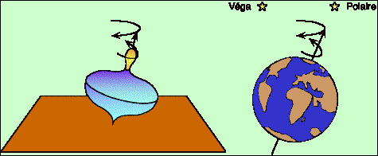

Tournant chaque année de 0,01416 j (20 min 23,5 s), l’équinoxe fait donc un tour complet en 365,25636&#8239;/&#8239;0,01416 ≈ 25 795 ans, *i.e.* à peu près 26&#8239;000 ans (période de la précession). La période de la précession étant très longue, on a l’impression de revoir exactement les mêmes étoiles au même moment de l’année&#8239;; en fait, il y a un décalage progressif, qui n’est sensible que sur de très longues périodes.

<a href="https://astronomia.fr/1ere_partie/calendrier/leverHeliaque.php"><em>Lever héliaque</em></a>. C’est un phénomène dont l’étymologie provient du nom grec du Soleil, *Hélios*. Au cours de l’année, le Soleil parcourt tout le Zodiaque, et reste à peu près un mois dans chaque constellation. Lorsqu’il est dans le Lion par exemple, cette constellation est invisible, et en particulier l’étoile Régulus qui en fait partie. Lorsque le Soleil sort du Lion, Régulus va se dégager de plus en plus de la clarté solaire, jusqu’à redevenir visible dans l’aube. On appelle lever héliaque de Régulus le premier jour où elle peut être observée à nouveau.

Bien que l’observation d’un lever héliaque soit délicate, et parfois entachée d’erreur, c’est une méthode assez fine de détermination de l’année, par ailleurs très floue. Il faut noter toutefois que le lever héliaque d’une étoile se reproduit lorsque le Soleil reprend la même position par rapport aux étoiles, et qu’il mesure donc l’année sidérale et non l’année tropique. Mais la précision de sa détermination étant de l’ordre d’un jour, la différence de 20 minutes entre les deux types d’années n’est pas gênante.

<Encadre type="plus" titre="Lune et Soleil : des contraintes contradictoires">
Un calendrier purement lunaire présente une année de l’ordre de 29,53059 × 12 = 354,36708 jours, qui se décale très vite par rapport aux saisons (définies par l’année tropique de 365,2422 jours, qui a donc 11 jours de plus). Par contre, la Lune est toujours nouvelle au début du mois, et pleine le 15, ce qui est en accord avec la définition du mois.

Inversement, un calendrier posant par principe que l’année est solaire, et qu’elle est toujours constituée du même nombre de mois (12 mois, fin de l’année correspondant avec la fin d’un mois) implique que le mois ne correspond plus à la lunaison (puisque 12 lunaisons ne comptent que 354 jours), et par conséquent la Lune peut être pleine à n’importe quelle date.

Une solution acceptant l’indépendance des deux phénomènes, avec de vrais mois lunaires et une année solaire, verrait la fin de l’année tomber à date variable, car janvier par exemple reviendrait tous les 354,36708 jours (et pas forcément en fin de jour). Dans ces conditions, si on fêtait une nouvelle année le 31 décembre à minuit, la suivante serait le 11 janvier à 8 heures 48… Aimeriez-vous réveillonner le 11 janvier à 8 h 48 du matin&#8239;?

Il faut bien comprendre que les contraintes à prendre en compte sont autant de nature humaine (fin de l’année = fin de mois = fin de jour, régularité des semaines, retour des anniversaires dans les mêmes circonstances…) que de nature astronomique (périodes moyennes, variabilité…).
</Encadre>

### La semaine, les noms des jours

L’origine lointaine de la semaine, provenant des phases de la Lune, se retrouve dans les textes babyloniens, avec les 7 jours différents, mais sans la continuité à laquelle nous sommes habitués. En fin de mois, on revenait au premier jour de la semaine pour inaugurer le mois suivant (comme si tous les premiers du mois chez nous étaient des lundis). Les Hébreux, héritant de cette tradition, ont fondé la semaine que nous connaissons, avec sa continuité. D’autres civilisations ont utilisé un groupement des jours différent&#8239;: 4 jours en Afrique occidentale, 5 dans le centre de l’Asie, 6 en Assyrie, 10 en Égypte. Une coïncidence a voulu qu’à l’époque sept astres mobiles aient été connus (visibles à l’œil nu). Le chiffre 7 a donc pris une signification importante, et les 7 jours de la semaine ont été associés à ces astres comme on peut le voir sur le schéma ci-après.

Cette association montre aussi l’intérêt que les Anciens portaient aux figures géométriques régulières (ici, un heptagone étoilé&#8239;!). Les astres dont les noms figurent sur ce schéma sont les *planètes* que connaissaient les Anciens.

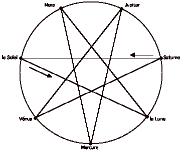

<Encadre type="plus" titre="Attention">
Le Soleil et la Lune ne sont pas des planètes dans la terminologie moderne&#8239;; le mot planète vient du grec πλανήτος (*planêtos*), qui signifie *errant*. Dans ce sens étymologique, le Soleil et la Lune en font partie. Les planètes sont supposées tourner autour de la Terre, et l’ordre obtenu en suivant les branches de l’heptagone étoilé est celui de leurs distances supposées à la Terre. Il n’a bien sûr aucune justification astronomique, le centre réel du système étant le Soleil.
</Encadre>

À partir de Saturne, en suivant la flèche, on obtient successivement&#8239;: le Soleil, la Lune, Mars, Mercure, Jupiter et Vénus. La correspondance entre les *planètes* ou dieux et les noms des jours est donnée par le tableau ci-dessous&#8239;:

<table>
<thead>
<tr><th colspan="2">dieu ou <em>planète</em></th><th colspan="6">nom du jour</th></tr>
<tr><th>latin</th><th>scandinave</th><th>latin</th><th>français</th><th>anglais</th><th>allemand</th><th>provençal</th><th>italien</th></tr>
</thead>
<tbody>
<tr><td>Soleil</td><td>Soleil</td><td>Solis dies</td><td>dimanche</td><td>sunday</td><td>sonntag</td><td>dimenche</td><td>domenica</td></tr>
<tr><td>Lune</td><td>Lune</td><td>Lunae dies</td><td>lundi</td><td>monday</td><td>montag</td><td>dilun</td><td>lunedi</td></tr>
<tr><td>Mars</td><td>Tyr</td><td>Martis dies</td><td>mardi</td><td>tuesday</td><td>dienstag</td><td>dimar</td><td>martedi</td></tr>
<tr><td>Mercure</td><td>Odin</td><td>Mercurii dies</td><td>mercredi</td><td>wednesday</td><td>mittwoch</td><td>dimecre</td><td>mercoledi</td></tr>
<tr><td>Jupiter</td><td>Thor</td><td>Jovis dies</td><td>jeudi</td><td>thursday</td><td>donnerstag</td><td>dijou</td><td>giovedi</td></tr>
<tr><td>Vénus</td><td>Frigg</td><td>Veneris dies</td><td>vendredi</td><td>friday</td><td>freitag</td><td>divendre</td><td>venerdi</td></tr>
<tr><td>Saturne</td><td>Saterne</td><td>Saturni dies</td><td>samedi</td><td>saturday</td><td>samstag</td><td>disate</td><td>sabato</td></tr>
</tbody>
</table>

On remarquera que les noms des jours (latin *dies*&#8239;: jour, provenant d’une racine indo-européenne *diew*&#8239;: lumière) dérivent du nom du dieu latin ou scandinave correspondant, ou de la *planète*. On notera cependant&#8239;:

- dimanche vient de *Dies Dominica* = jour du Seigneur, ce qui est évident en italien&#8239;; ces mots ne dérivent pas du nom du Soleil. C’est le cas pourtant en anglais et en allemand.
- *mittwoch* signifie littéralement milieu de semaine&#8239;; *donnerstag* signifie jour de Thor&#8239;;
- en provençal, *di* (*dies*) est placé en tête (di-lun = jour *de la* Lune) alors que *di* en français, *tag* en allemand et *day* en anglais sont placés après (sauf pour dimanche en français).

<Encadre type="hist" titre="En bulgare">
Les noms des jours sont formés de manière différente&#8239;: dimanche se nomme *Nédélia*, c’est le nom d’une sainte orthodoxe&#8239;; lundi se dit *après dimanche* (*Ponédelnik*)&#8239;; mardi, jeudi et vendredi se nomment d’après leur rang à partir du dimanche&#8239;; mercredi se dit *milieu* (comme en allemand)&#8239;; enfin, samedi dérive directement de Sabbat.
</Encadre>

## La préhistoire et les monuments mégalithiques
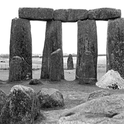

La préhistoire nous a laissé quelques monuments qui attestent déjà du soucis de comprendre le mouvement des astres.

Le plus célèbre d’entre eux est celui de Stonehenge (ci-contre), dont l’orientation permet, depuis le centre, de voir le Soleil se lever dans la plus grande porte au solstice d’été.

Une pierre de la Vallée des Merveilles ne laisse pénétrer le Soleil levant qu’aux équinoxes.

On trouve de tels alignements en Amérique centrale dans les grandes pyramides à degrés.

Des représentations picturales des astres principaux se trouvent dans le monde entier&#8239;; on peut penser que les intempéries ont détruit d’innombrables autres oeuvres, moins bien placées.

## L’histoire

Les plus anciens textes connus concernent l’observation du ciel et ont 6 000 ans. Ils proviennent de Mésopotamie. Ils sont à la base des calendriers égyptien, babylonien, hébreu ancien, donc indirectement du nôtre. D’autres calendriers anciens proviennent de Chine et d’Amérique latine.

Les renseignements à propos de ces calendriers sont parfois imprécis, et même faux ou contradictoires. Les notes qui suivent donnent des indications sur les plus importants, et nous développerons tout particulièrement les calendriers julien et grégorien, puisque ce dernier est en usage presque universel maintenant.

L’ordre de présentation choisi n’est pas l’ordre historique, ce qui serait difficile puisque plusieurs calendriers ont existé simultanément. Nous grouperons plutôt les grandes familles de calendriers, montrant ainsi les apports des uns aux autres et leur évolution. Pour les plus anciens, l’absence de traces écrites ne permet pas de préciser les influences&#8239;; ceci introduit une part d’arbitraire dans l’ordre de présentation.

### Calendrier chaldéen ou babylonien

Les plus anciennes tablettes d’argile datent de 3800 ans avant J.C., sous le règne de Sargon l’Ancien, et montrent que l’astronomie était déjà développée depuis longtemps.

Elles nous indiquent les plus anciennes observations astronomiques connues. La civilisation des Chaldéens ou Babyloniens remonte au moins à 4000 ans avant J.C. La précision de leur savoir a servi de base à la science grecque. Ils connaissaient le mouvement des planètes, les éclipses, la précession des équinoxes&#8239;; ils ont divisé le cercle en 360° et le degré en 60 minutes. Ils utilisaient le *gnomon*&#8239;; (bâton planté verticalement dans le sol, dont on mesure l’ombre&#8239;; il permet de définir les solstices) et le cadran solaire. Ils ont jeté les bases des premiers calendriers.

<Encadre type="plus">
Les peuples anciens ont naturellement compté sur leurs doigts, ce qui a donné la base de numération 10&#8239;; mais 12 a aussi été utilisé car il possède 4 diviseurs propres, contre deux seulement pour 10. Dans le commerce, on utilise encore de nos jours la douzaine. De ces deux bases, on a dérivé la base 60, qui possède les diviseurs de 10 et ceux de 12.
</Encadre>

Les Babyloniens ont défini le *zodiaque*&#8239;: c’est la bande de ciel dans laquelle se meuvent les planètes. Pour indiquer où se trouve une planète à un instant donné, ils ont divisé le zodiaque en douze parties, et les ont nommées&#8239;; étant un peuple pastoral, ils ont choisi des noms évoquant leur travail agricole&#8239;: la zone où se trouvait le Soleil au moment de la naissance des agneaux a pris le nom de *Bélier*&#8239;; celle où ils utilisaient les boeufs pour labourer s’est nommée *Taureau*&#8239;; celle dans laquelle le Soleil levant cesse de progresser vers le nord de jour en jour, pour redescencre vers le sud a pris le nom de l’écrevisse (*Cancer* = Crabe) qui marche à l’envers&#8239;; les *lions* qui s’approchaient des villes à une certaine époque ont donné leur nom à une zone&#8239;; la saison des pluies a donné le *Verseau*&#8239;; la *Balance* correspond à la période où nuit et jour sont égaux&#8239;; le *Sagittaire* indique la chasse aux bêtes sauvages… Ces noms d’animaux ont donné le nom de la bande&#8239;: *zodiaque* vient du grec *zôô* vivre, *zoidon* figure d’animal, et *zoidiakos* qui concerne les constellations d’animaux

Ceci a été défini 4 300 ans avant J.C.&#8239;; le Soleil était alors dans le Taureau au moment de l’équinoxe de printemps. Mais depuis, les choses ont changé&#8239;: avec la lente dérive de la précession des équinoxes, le Soleil est maintenant dans les Poissons au moment de l’équinoxe, et sera bientôt dans le Verseau (l’équinoxe faisant un tour complet en 26.000 ans, il parcourt 59° en 4.300 ans&#8239;; ce qui représente presque deux constellations, puisque chacune occupe 30° sur le ciel). Alors, les noms, ou signes, ne correspondent plus avec les constellations qui accueillent le Soleil.

Le calendrier babylonien est empirique, fondé sur l’observation au jour le jour, sans prévision possible&#8239;; il était suffisant pour la société pastorale qui l’utilisait. La Lune a imposé une unité de mesure en rapport avec son évolution&#8239;: le mois. Les mois se succèdent avec des durées de 29 et 30 jours. Les Babyloniens ont essayé d’accorder leur calendrier sur les saisons, en utilisant une période de 12 mois, l’année. Les éléments essentiels étaient déjà en place. Ils découlent de manière évidente des phénomènes naturels les plus perceptibles.

Cette année dure 29 × 6 + 30 × 6 = 354 jours, d’où un déficit de 11 jours par rapport à l’année solaire (définissant les saisons). Au bout de 3 ans, il manque 33 jours, à peu près un mois. Par décret royal, l’un des mois de l’année est redoublé pour combler ce déficit. En moyenne, le calendrier babylonien comptait donc deux années de 12 mois, suivies d’une de 13. L’adjonction étant empirique, et pas toujours correctement effectuée, la chronologie babylonienne est inutilisable. L’année de 13 mois porte le nom d’*année embolismique* (du grec το εμβολισμα = pièce rajustée à un vêtement).

Le calendrier babylonien est donc un calendrier lunaire, avec ajustement très approximatif sur le Soleil&#8239;; de ce fait, on peut le dire luni-solaire. A cause de l’empirisme des ajouts, il est impossible de donner une valeur moyenne de l’année, et on a constaté des années communes de 353, 354 et 355 jours, et des années embolismiques de 383, 384 et 385 jours (nous retrouverons ces valeurs dans le calendrier israélite, mais avec une plus grande régularité&#8239;; cette similitude n’est cependant qu’apparente, car les causes sont toutes différentes).

Pour détecter la dérive, les Babyloniens utilisaient le lever héliaque d’une étoile brillante. Le mois embolismique sera utilisé par de nombreux peuples&#8239;; et l’ajout d’un jour bissextil procède de la même méthode, en donnant plus de souplesse à l’ajustement (les à-coups étant moins importants).

Le début du mois est déterminé également par l’observation&#8239;: le grand prêtre déclare le mois commencé dès qu’il a pu observer le croissant de la Lune après le coucher du Soleil. Le mois et le jour commencent donc au coucher du Soleil. Si le ciel était nuageux le jour où la Lune aurait dû se montrer, il attendait le lendemain&#8239;; si le temps était encore défavorable, il déclarait malgré tout le mois commencé, de sorte que l’erreur n’excédait pas 1 jour. L’année commençait au printemps avec le mois de Nisanu.

Les mois ont, semble-t-il, été découpés en 6 périodes de 5 jours, avec des sacrifices à la fin de chaque période. Ceci serait en relation avec l’usage du système sexagésimal (à base 60, comme nos heures de 60 minutes, et nos minutes de 60 secondes) connu depuis la plus haute antiquité à Babylone (*Bab Iloû*&#8239;: porte de Dieu).

Mais les mois ont été découpés d’autre part en semaines de sept jours, les deux derniers jours des mois de 30 jours ne portant pas de noms, et la semaine reprenant au début le mois suivant. Il n’y avait donc pas la continuité de la semaine que nous connaissons, qui se reproduit indéfiniment sans relation avec les mois et les années.

Chaque jour était dédié à l’une des planètes (au sens *astre errant*, incluant Lune et Soleil). Le dernier jour était consacré à Ea (Saturne) qui était censé apporter la paresse&#8239;; il est à l’origine du Sabbah, et de notre dimanche de repos&#8239;! L’Eglise dit que ce sont les apôtres qui ont transféré le jour de repos du Sabbah (samedi) au dimanche. Grâce aux tablettes d’argile, les noms babyloniens et assyriens des mois nous sont connus&#8239;:

<table>
<thead>
<tr><th>n°</th><th>nom babylonien</th><th>nom assyrien</th><th>n°</th><th>nom babylonien</th><th>nom assyrien</th></tr>
</thead>
<tbody>
<tr><td>1</td><td>Nisanu</td><td>Nisanu</td><td>7</td><td>Tashritu</td><td>Tasritu</td></tr>
<tr><td>2</td><td>Aïru</td><td>Aïru</td><td>8</td><td>Arajshamma</td><td>Arah-Samna</td></tr>
<tr><td>3</td><td>Sivanu</td><td>Sivanu</td><td>9</td><td>Kisilivu</td><td>Kisilev</td></tr>
<tr><td>4</td><td>Douzu</td><td>Douzu</td><td>10</td><td>Thebitu</td><td>Tebetu</td></tr>
<tr><td>5</td><td>Abu</td><td>Abu</td><td>11</td><td>Shabatu</td><td>Sebatu</td></tr>
<tr><td>6</td><td>Eliulu</td><td>Ululu</td><td>12</td><td>Addaru</td><td>Adaru</td></tr>
</tbody>
</table>

Une tablette d’argile datant de 2 000 ans avant J.C. témoigne d’un de ces ajouts, effectué par le roi Hammourabi. Une étude statistique des mois ajoutés montre que les Babyloniens utilisaient une période de 19 ans dès l’an 200 de Nabonassar, *i.e.* vers 550 avant J.C., comprenant 7 années embolismiques aux rangs 3, 6, 8, 11, 14, 17 et 19. Curieusement, l’année 17 du cycle est allongée par un redoublement du mois Ululu, alors que les autres le sont par un mois Adaru II.

### Calendrier égyptien

Son origine remonte à 10 000 ans&#8239;! C’est le premier calendrier qui ait délaissé le rythme lunaire, pour se baser exclusivement sur le Soleil. Pour le peuple cultivateur égyptien, le retour de la crue fertilisante du Nil était bien plus important que les phases de la lune. Ce calendrier comprend néanmoins 12 mois de 30 jours divisés en 3 décades (12 × 30 = 360 est l’origine de la division du cercle en 360 °). L’année est trop courte, et se décale très vite sur les saisons (1 mois en 6 ans).

Vers 4.230 avant J.C. lui succède le *calendrier* *vague*. Aux 12 mois de 30 jours précédents s’ajoutent 5 jours épagomènes, hors mois, pour totaliser 365 jours. Il a été utilisé pendant plus de 4.000 ans. Encore trop court de presque un quart de jour, ce calendrier n’est pas ancré sur les saisons. Au Ve millénaire, à Memphis, le *lever héliaque* de Sirius coïncidait avec la crue du Nil. Le début de l’année, le 1er Thot, fut fixé à ce jour-là. Mais l’année étant trop courte, le lever héliaque de Sirius se fit le 2, puis le 3 Thot… Les Egyptiens constatèrent rapidement que la dérive était d’un jour en 4 ans. Ceci donnait une année de 365,25 jours, valeur connue 4.000 ans avant notre ère. Le décalage n’a pas arrêté les Egyptiens qui ont conservé leur calendrier. Au bout de 1.461 années vagues, l’accord se refit. On appelle cette durée *période Sothiaque* (*Sothys* est le nom égyptien de Sirius).

<table>
<thead>
<tr><th>nom de la saison</th><th>caractéristique</th><th colspan="4">noms des mois</th></tr>
</thead>
<tbody>
<tr><td>Akhet</td><td>inondation</td><td>Thot</td><td>Phaophi</td><td>Athyr</td><td>Choiak</td></tr>
<tr><td>Peret</td><td>végétation</td><td>Tybi</td><td>Mechir</td><td>Phamenoth</td><td>Pharmuti</td></tr>
<tr><td>Shemon</td><td>récoltes</td><td>Pachon</td><td>Payni</td><td>Epiphi</td><td>Mesori</td></tr>
</tbody>
</table>

La durée de l’année est fonction de l’observation de son début et de sa fin (début de la suivante). Si le lever héliaque de Sirius est connu à un jour près, l’erreur sur l’année est de deux jours. Mais sur les 4.000 ans d’usage du calendrier vague, l’erreur reste la même, et doit être divisée par 4.000. Les Egyptiens auraient pu connaître, au terme de l’emploi du calendrier vague, la valeur de l’année à 2 / 4.000e de jour près, *i.e.* à 2 / 4.000me de 24 × 60 × 60 s = 43,2 s. Il faut bien remarquer que cette valeur ne dépend d’aucun appareil de mesure du temps&#8239;!

L’année vague, sans aucun ajout empirique de jours ou de mois, est un excellent calendrier pour l’astronome, car toutes les années ont 365 jours. Pour calculer une durée, il suffit de multiplier le nombre d’années écoulées par 365. Ce n’est pas vrai avec les autres calendriers.

Le roi Ptolémée III Evergète (Evergète signifie&#8239;: *le bienfaiteur*) a essayé d’améliorer le calendrier par le décret de Canope en 238 avant J.C. en ajoutant un jour épagomène tous les 4 ans. Ce calendrier préfigure le calendrier julien, pour lequel il a certainement été pris pour modèle. Mais le peuple ne l’a jamais utilisé.

Les Egyptiens ont divisé l’année en périodes de 10 jours, et ont associé à chaque décade une étoile dont le lever héliaque marquait le début. Ces étoiles étaient nommées *décans* (à cause des dix jours). Elles avaient un autre rôle&#8239;: elles définissaient une division de la nuit. Le décan D1 qui marquait une décade se levait chaque jour un peu plus tôt&#8239;; puis un nouveau décan D2 se levait à son tour, et marquait la décade suivante. Alors, le lever de D1 indiquait le début de la dernière heure de la nuit, qui s’achevait au lever de D2. Au cours d’une nuit d’été, 10 décans se levaient successivement, et divisaient la nuit en 10 heures&#8239;; auxquelles s’ajoutaient une heure de crépuscule et une d’aube, ce qui faisait 12. C’est là l’origine de nos journées de 24 heures.

### Calendrier hébreu ancien

Les Hébreux ont emprunté leur calendrier aux Babyloniens&#8239;; il est donc essentiellement lunaire avec ajustement solaire. Les noms des mois sont semblables dès la sortie d’Egypte en 1645 avant J.C. au mois de Nisan (≅ avril). Moïse impose une année religieuse qui commence en ce mois. Le calendrier est défini par le code d’Hammourabi. Comparer les noms des mois Hébreux ci-dessous avec ceux des mois Babyloniens&#8239;:

<table>
<thead>
<tr><th>n°</th><th>nom babylonien</th><th>nom hébreu</th><th>n°</th><th>nom babylonien</th><th>nom hébreu</th></tr>
</thead>
<tbody>
<tr><td>1</td><td>Nisanu</td><td>Nisan</td><td>7</td><td>Tashritu</td><td>Tishri</td></tr>
<tr><td>2</td><td>Aïru</td><td>Iyar</td><td>8</td><td>Arajshamma</td><td>Marchesvan</td></tr>
<tr><td>3</td><td>Sivanu</td><td>Sivan</td><td>9</td><td>Kisilivu</td><td>Kislev</td></tr>
<tr><td>4</td><td>Douzu</td><td>Tamouz</td><td>10</td><td>Thebitu</td><td>Tebet</td></tr>
<tr><td>5</td><td>Abu</td><td>Ab</td><td>11</td><td>Shabatu</td><td>Sebat</td></tr>
<tr><td>6</td><td>Eliulu</td><td>Elul</td><td>12</td><td>Addaru</td><td>Adar</td></tr>
</tbody>
</table>

Les Hébreux attachaient une grande importance à la célébration des anniversaires dans les conditions qui entouraient l’événement. Ceci nécessite le rattachement au Soleil, qui se fait par ajout de mois entiers. Le 13e mois est aussi en usage chez les Macédoniens sous Alexandre.

La fête de Pâques (Pessah, signifiant *passage*) se célébrait le 15 Nisan, la Lune étant pleine (dans un calendrier lunaire, la Lune est toujours pleine le 15). Le 16 avait lieu une offrande d’orge précoce. Ces circonstances doivent donc se répéter aux anniversaires, chaque année. Lorsque les orges précoces ne mûrissaient pas à temps, le grand prêtre ordonnait le redoublement du mois Adar (≅ mars). Le calendrier hébreu est donc copié sur le calendrier babylonien, avec les mêmes défauts d’irrégularité et de non prévisibilité.

Afin qu’il n’y ait jamais deux jours de fêtes consécutifs, l’année ne pouvait commencer ni un mercredi, ni un vendredi ni un dimanche. Si le premier jour de l’année tombait sur l’un de ces jours, on le reculait d’un jour, augmentant l’année finissante d’un jour et diminuant d’autant l’année commençante. Ceci donne 6 sortes d’années&#8239;:

<table>
<tbody>
<tr><td rowspan="3">communes de 12 mois</td><td>régulière</td><td>de 354 jours</td></tr>
<tr><td>abondante</td><td>de 355 jours</td></tr>
<tr><td>défective</td><td>de 353 jours</td></tr>
<tr><td rowspan="3">embolismiques de 13 mois</td><td>régulière</td><td>de 384 jours</td></tr>
<tr><td>abondante</td><td>de 385 jours</td></tr>
<tr><td>défective</td><td>de 383 jours</td></tr>
</tbody>
</table>

### Calendrier israélite moderne

C’est l’évolution du calendrier hébreu. Les Juifs ont adapté le cycle de Méton dès qu’ils l’ont connu, c’est-à-dire au IVe siècle de notre ère. Les années de 13 mois prennent place aux rangs 3, 6, 8, 11, 14 et 19 du cycle. Il date du quatrième siècle de notre ère.

A l’heure actuelle, le calendrier israélite est toujours basé sur le même principe, mais en utilisant les phases calculées de la Lune et non plus observées. Les phases sont calculées par les tables astronomiques en usage à l’heure actuelle. On notera de ce fait une grande différence avec le calendrier grégorien, qui utilise un comput conventionel. Les années sont comptées à partir de la création du monde qui, dans la tradition juive, est datée de l’an 3761 avant notre ère.

### Calendrier musulman

Avant l’Islam, les arabes définissaient une année de 12 mois, portant pour noms&#8239;:

<table>
<tbody>
<tr><td>Mutamer</td><td>Nadjir</td><td>Jawan</td><td>Sawan</td><td>Hinum</td><td>Ronna</td></tr>
<tr><td>Asam</td><td>Adel</td><td>Natik</td><td>Waghel</td><td>Hewah</td><td>Barak</td></tr>
</tbody>
</table>

Les noms ont été changés sous le règne de Kêlab, trisaïeul de Mahomet, en 412 de notre ère. Ce calendrier dérivait sur les saisons, et à l’apparition de l’Islam, le pèlerinage à La Mecque, censé se faire en automne, se mit à dériver. On décida donc d’ajouter un mois pour rattrapper&#8239;; cet ajout n’étant pas suffisant, Mahomet fit son pèlerinage, 3 mois avant sa mort, en avril&#8239;; il interdit à l’avenir l’ajout du treizième mois, probablement pour mettre fin aux ajustements trop imprécis. Le calendrier est donc redevenu purement lunaire.

Les mois ont changé de noms&#8239;:

<table>
<tbody>
<tr><td>Mouharram</td><td>30</td><td>Safar</td><td>29</td><td>Rabi’-oul-Aououal</td><td>30</td><td>Rabi’-out-Tani</td><td>29</td></tr>
<tr><td>Djoumada-l-Oula</td><td>30</td><td>Djoumada-t-Tania</td><td>29</td><td>Radjab</td><td>30</td><td>Cha’ban</td><td>29</td></tr>
<tr><td>Ramadan</td><td>30</td><td>Chaououal</td><td>29</td><td>Dou-l-Qa’da</td><td>30</td><td>Dou-l-Hidjja</td><td>29 ou 30</td></tr>
</tbody>
</table>

La durée de l’année musulmane est 6 × 30 + 6 × 29 = 354 jours (le dernier mois étant de 29 jours)&#8239;; 12 lunaisons moyennes comptent 12 × 29,530588 = 354,367056 jours. La différence avec l’année musulmane est 0,367056 jours *i.e.* 8 h 48 min 34 s par an. Au bout de 30 ans la différence atteint 0,367056 × 30 = 11,01168 jours. Le calendrier prévoit donc d’ajouter 11 jours dans un cycle de 30 années musulmanes. La différence est ainsi réduite à 11,01168 - 11 = 0,01168 jours *i.e.* 16 min 49 s. Au bout de 100 années musulmanes (un peu moins de 97 de nos années), elle correspond à 0,01168 × 100 = 1,168 jour. Depuis la création de leur ère, les musulmans ont donc été obligés de rattraper par un autre mécanisme les divergences observées entre leur calendrier et la Lune réelle.

Les années de 354 jours sont appelées *années communes*, les années de 355 jours sont dites *années abondantes*. Dans le cycle de 30 ans, il y a 11 années abondantes. Par conséquent la durée moyenne de l’année musulmane est&#8239;:

354 × 19 + 355 × 11 = 10.631 j&#8239;;

10.631 / 30 = 354,366 j

Ces 30 années lunaires comptant exactement 30 × 12 mois, la durée moyenne de la lunaison est&#8239;:

10.631 / (30 × 12) = 29,530556 j

Il est bien évident que l’année de 354,366 jours se promène dans l’année solaire à grande vitesse. C’est ainsi que le mois de Ramadan, qui est celui du jeûne musulman, se déplace d’à peu près 11 jours chaque année solaire (donc par rapport au calendrier grégorien), ce qui fait en gros un tour complet en 30 ans. Notons que les musulmans ont basé leurs mois sur l’apparition du mince croissant dans le crépuscule. Celui-ci n’étant pas visible avant une trentaine d’heures après la conjonction, les mois musulmans sont décalés par rapport aux lunaisons.

Les musulmans utilisent bien sûr la semaine, et les noms des jours sont&#8239;:

<table>
<tbody>
<tr><td>dimanche</td><td>lundi</td><td>mardi</td><td>mercredi</td><td>jeudi</td><td>vendredi</td><td>samedi</td></tr>
<tr><td>Youm el Ahad</td><td>Youm el Thani</td><td>Youm el Thaleth</td><td>Youm el Arbaa</td><td>Youm el Thamis</td><td>Youm el Djouma</td><td>Youm el Effabt</td></tr>
</tbody>
</table>

L’ère musulmane est l’*Hégire*, dont l’origine est la fuite de Mahommet, qui est parti de la Mecque vers Médine où il est arrivé le vendredi 16 juillet 622 julien. Pour cela, Youm el Djouma est le jour de la grande prière.

### Calendrier chinois
La définition d’un calendrier a été ordonnée par le roi Yao il y a plus de 4.000 ans. Ce calendrier lunaire divise l’année en 12 mois alternativement de 29 et 30 jours. Pour rester en accord avec les saisons, les chinois ajoutaient un mois de temps en temps. Ils ont connu la valeur de 365,25 jours pour l’année depuis la dynastie Shang au moins, ce qui reporte à 1600 ans avant J.C.

Grâce à leurs calculs, ils ont découvert le cycle de Méton avant l’heure, cycle qu’ils nommaient *Tchang*. Dans la période de 19 ans, ils intercalaient le treizième mois dans les années 3, 6, 9, 11, 14, 17 et 19. Le premier mois de l’année est celui qui voit l’entrée du soleil dans les Poissons. Depuis l’an 104 avant J.C., le début de l’année tombe entre le 21 janvier et le 20 février.

Les prévisions étant difficiles, il revenait au souverain, après consultation des astronomes, de fixer la longueur du mois et le moment d’intercalation d’un mois supplémentaire. Ceci ne donne pas une chronologie précise. Mais les chinois ont utilisé à côté de ce calendrier un cycle de 60, qui ignore l’astronomie, et donc n’est pas sujet aux difficultés induites par les astres. Cette chronologie-là est particulièrement fiable, et s’étend sur plus de 3 millénaires.

Les chinois ont défini les dix *troncs célestes*, nommés&#8239;: *Jia*, *Yi*, *Bing* , etc.&#8239;; et les douze *rameaux terrestres*, nommés&#8239;: *Zi*, *Chou*, *Yin*, etc. Des animaux sont associés aux rameaux terrestres depuis le sixième siècle. A chaque saut du cycle, on passe d’un tronc au suivant, et d’un rameau au suivant. On revient dans l’état initial après 60 combinaisons. Partant de *Jia-Zi,* la moitié des combinaisons possibles seulement est utilisée. Le tableau suivant donne le cycle&#8239;:

<table>
<thead>
<tr><th colspan="2" rowspan="2"></th><th colspan="12">rameaux terrestres</th></tr>
<tr><th>Zi rat</th><th>Chou bœuf</th><th>Yin tigre</th><th>Mao lièvre</th><th>Chen dragon</th><th>Si serpent</th><th>Wu cheval</th><th>Wei chèvre</th><th>Shen singe</th><th>You coq</th><th>Xu chien</th><th>Hai cochon</th></tr>
</thead>
<tbody>
<tr><th rowspan="10"><em>troncs célestes</em></th><th>Jia</th><td>1</td><td></td><td>51</td><td></td><td>41</td><td></td><td>31</td><td></td><td>21</td><td></td><td>11</td><td></td></tr>
<tr><th>Yi</th><td></td><td>2</td><td></td><td>52</td><td></td><td>42</td><td></td><td>32</td><td></td><td>22</td><td></td><td>12</td></tr>
<tr><th>Bing</th><td>13</td><td></td><td>3</td><td></td><td>53</td><td></td><td>43</td><td></td><td>33</td><td></td><td>23</td><td></td></tr>
<tr><th>Ding</th><td></td><td>14</td><td></td><td>4</td><td></td><td>54</td><td></td><td>44</td><td></td><td>34</td><td></td><td>24</td></tr>
<tr><th>Wu</th><td>25</td><td></td><td>15</td><td></td><td>5</td><td></td><td>55</td><td></td><td>45</td><td></td><td>35</td><td></td></tr>
<tr><th>Ji</th><td></td><td>26</td><td></td><td>16</td><td></td><td>6</td><td></td><td>56</td><td></td><td>46</td><td></td><td>36</td></tr>
<tr><th>Geng</th><td>37</td><td></td><td>27</td><td></td><td>17</td><td></td><td>7</td><td></td><td>57</td><td></td><td>47</td><td></td></tr>
<tr><th>Xin</th><td></td><td>38</td><td></td><td>28</td><td></td><td>18</td><td></td><td>8</td><td></td><td>58</td><td></td><td>48</td></tr>
<tr><th>Ren</th><td>49</td><td></td><td>39</td><td></td><td>29</td><td></td><td>19</td><td></td><td>9</td><td></td><td>59</td><td></td></tr>
<tr><th>Gui</th><td></td><td>50</td><td></td><td>40</td><td></td><td>30</td><td></td><td>20</td><td></td><td>10</td><td></td><td>60</td></tr>
</tbody>
</table>

C’est grâce à ce calendrier que les astronomes ont pu dater précisément l’explosion de la supernova qui a donné naissance à la nébuleuse du Crabe en 1054.

<Encadre type="plus">
Ce mécanisme de numérotation est extraordinaire&#8239;! Partez de 1, et suivez les nombres croissants. Arrivé à 10, vous devez passer à la case en bas et à droite… qui n’existe pas. Mais puisqu’on ne peut pas descendre, on repart en haut. De là, on reprend la progression le long de la diagonale, jusqu’à retrouver une limite. Si on déborde en bas, on reprend en haut dans la même colonne (et ensuite on décale à droite)&#8239;; si on déborde à droite, on reprend à gauche dans la même ligne (et ensuite on descend).  Ceci revient à identifier les bords haut et bas, et à identifier les bords droit et gauche. Ce qui est vraiment remarquable, c’est que l’on obtient par cette identification un *tore*. Vous pouvez le réaliser en partie en collant les deux bords opposés d’une bande de papier. Vous obtenez un tube. Pour coller les deux autres bords, vous vous heurtez à la rigidité du papier. Mais si c’était du caoutchouc, vous y parviendriez.  Ce procédé est utilisé aujourd’hui en [cosmologie](https://astronomia.fr/6eme_partie/cosmologie.php), lorsqu’on se préoccupe non seulement de la géométrie, mais également de la topologie de l’espace-temps&#8239;!
</Encadre>

### Calendrier maya

Les Mayas utilisaient une numération vigésimale (à base 20). Les nombres sont représentés par des têtes de divinités vues de profil (glyphes), associés à des chiffres. Cette pratique s’est étendue à leur calendrier. C’est le seul peuple de l’Amérique précolombienne qui nous ait laissé un système complet d’écriture. Le jour est appelé *kin* (Soleil en Maya), et à chacun sont associés un nom et un glyphe&#8239;:

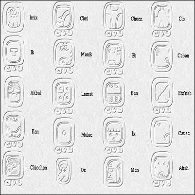

Il existe deux autres unités de rang supérieur, que nous pourrions par analogie appeler mois et année&#8239;: un *uinal* comprend vingt jours, et un *tun (pierre)*, qui devrait comprendre naturellement 20 uinal (dans leur système à base 20), est ramené à 18 pour correspondre à peu près à l’année solaire (ceci totalise 360 jours au lieu de 365,24). Les mois portent aussi des noms et ont des glyphes associés.

Ci-contre, les glyphes et les noms des mois.

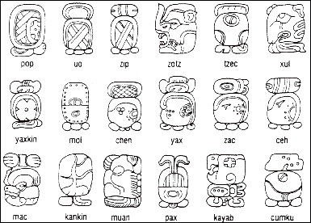

Pour les durées plus longues, les Mayas utilisent des groupes de 20 tun = *katun* (7.200 jours), et des groupes de 20 katun = *baktun* (144.000 jours). Une date est le compte de jours écoulés (écrit dans la numération vigésimale) depuis l’origine du calendrier Maya, 3113 avant notre ère. Cette date très ancienne est certainement antérieure à la civilisation Maya, et semble avoir été choisie pour des raisons obscures, sans doute religieuses. Le nombre de baktun, de katun, de tun, de uinal et de kin détermine une date.

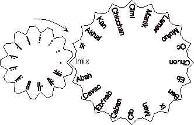

Un système parallèle existe, qui indique le rang du jour dans un cycle de 260 jours. Il constitue *l’almanach rituel* des Mayas. Nommé *tzolkin* (cercle sacré), il indique également l’âge de la Lune, l’équivalence avec l’année solaire, et le nom de la divinité patronne du jour. Les Mayas connaissent la valeur de l’année solaire de 365,25 jours, mais ne l’utilisaient pas dans leur calendrier. Cependant, ils établissaient des corrections qui attestent de leurs connaissances astronomiques.

Schéma montrant l’association entre les noms des jours (dans un cycle de 20), et leur rang dans un cycle de 13. Au bout de 260 jours, on revient à la situation initiale.

La représentation des nombres figurée sur la roue de gauche est la suivante&#8239;:

L’étude des mouvements de la Lune et de Vénus est très poussée, et a atteint des valeurs tout à fait correctes. Vénus était la plus importante de toutes les planètes, et était appelée *Quetzalcoatl Ku Kulcan*, serpent oiseau. Les Mayas avaient obtenu la valeur de 584 jours pour la révolution synodique de Vénus. Cette durée avait une grande importance religieuse. Le jour du lever héliaque était particulièrement risqué, et les rites qui l’accompagnaient très importants.

Pour obtenir ce résultat, les Mayas ne disposaient pourtant d’aucun instrument de mesure digne de ce nom, ils utilisaient l’architecture (soigneusement calculée) pour établir des alignements. C’est pourquoi leurs monuments ont des orientations précises, de même que certains détails architecturaux tels que des fenêtres placées pour viser une étoile particulière.

On a déterminé de telles orientations pour les pyramides d’Egypte. De là à penser que le volume de la grande pyramide divisé par la racine cubique de l’âge du dernier pharaon est exactement le nombre Pi…

### Calendrier aztèque

Les aztèques ont hérité des Olmèques et des Mayas l’usage de la divination mêlée à l’astronomie. Ils rédigeaient des *tonalamatl* (= livre du destin), dans lesquels ils associaient aux jours les dieux auxquels ils étaient consacrés. Ils y faisaient figurer pour chaque jour le dieu de la lumière et le dieu de l’obscurité, et l’oiseau de ces divinités. Ce sont des calendriers rituels et divinatoires, divisés en 20 sections de 13 jours. Ils dérivent directement des tzolkins mayas.

L’année solaire était constituée de 18 mois de 20 jours, et de 5 jours considérés comme maléfiques, les *nemontemi*. On distingue donc 3 années, de longueurs différentes&#8239;: une année divinatoire (de 260 jours), une année solaire (de 365 jours) et une année vénusienne de 584 jours (répétant les mêmes positions de la planète par rapport au soleil).

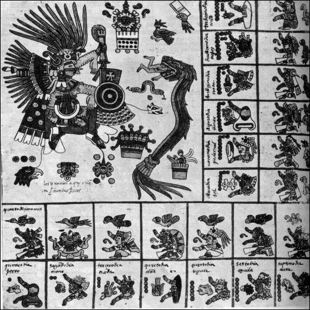

*Encyclopédia Universalis, article"Calendrier" page 792*

Page du Codex Borbonicus représentant l’une des 20 sections de 13 jours d’un tonalamatl. Remarquer les divinités et les oiseaux associés. (Bibl. Assemblée Nationale)

### Calendrier persan

Les Perses ont adopté un calendrier solaire, ce qui est beaucoup plus facile à faire qu’un calendrier lunaire, du fait de la grande régularité du mouvement apparent du Soleil, si l’on parvient à mesurer la durée de l’année tropique. Ils ont trouvé une solution très astucieuse pour obtenir un calage à long terme sur les saisons, ce qui fait qu’ils connaissaient précisément, au moins implicitement, cette durée.

Leur principe de base est le même que le nôtre&#8239;: des années communes de 365 jours, et des années longues de 366. Ils ajoutaient un jour à une année sur quatre. Mais ils faisaient cela sept fois de suite, donc pendant 28 ans&#8239;; ensuite, ils rompaient la série en ne mettant qu’un seul jour de plus dans les 5 années qui suivaient. Ceci nous donne une durée du cycle de&#8239;: 7 × (3 × 365 + 366) + 4 × 365 + 366 = 12.053 jours répartis en 28 + 5 = 33 ans.

La durée moyenne de l’année est donc de 12.053 / 33 = 365,24242424 jours

Le nombre de jours ajoutés en 33 ans est de 8&#8239;; donc la durée moyenne de l’année s’écrit aussi 365 + 8 / 33 = 365,24242424 j. Nous verrons plus loin un calcul très simple permettant d’obtenir cette fraction. Cette valeur est vraiment très proche de l’année tropique réelle, et nous verrons que l’approximation obtenue est légèrement **meilleure** que celle de notre calendrier grégorien&#8239;!

Les Perses auraient pu ajouter les huits jours supplémentaires en une seule fois, au terme de la période de 33 ans. Ceci aurait été une procédure extrêmement simple, avec le seul inconvénient de permettre un décalage croissant avec les saisons en cours de période.

### Calendrier grec

Il y eut plusieurs calendriers grecs anciens, toutes les villes n’étant pas en accord sur ce sujet. Mais les différences étant minimes, nous nous intéresserons plus particulièrement à celui d’Athènes.

Le calendrier grec n’est pas directement à la base de notre calendrier actuel. Son intérêt principal tient à la participation de grands astronomes connus pour d’autres travaux&#8239;: Eudoxe, Callipe, Hipparque, Ptolémée, Méton… Il montre aussi que des affinements successifs sur une durée importante ont permis d’obtenir des valeurs de l’année et surtout de la lunaison qui sont vraiment très proches des valeurs établies à l’heure actuelle. On remarquera ainsi que le calendrier a bien rendu à l’astronomie l’aide qu’elle lui a apportée.

Le calendrier grec fut d’abord purement lunaire, avec des mois de 30 jours, puis avec des mois alternés de 29 et 30 jours (bien que la durée des mois soit trop longue par rapport à la lunaison). Ceci donnait une année de 6 × 30 + 6 × 29 = 354 jours. L’ajustement aux saisons est resté très mauvais pendant longtemps.

Au 8e siècle avant J.C., Hésiode a composé un calendrier de la vie courante, destiné aux agriculteurs, indiquant le repère des étoiles par rapport aux cultures. Des prévisions météo s’y ajoutent, puis des indications sur les jours fastes et néfastes. Ce sont les *parapegmes*, ancêtres des almanachs (παραπηγμα&#8239;: tables astronomiques, pour consigner la division du temps).

Les Grecs ont longtemps ajusté leur calendrier par rapport à l’année par adjonction empirique de mois. Ensuite, ils ont systématisé la correction en ajoutant un mois plein (30 jours) tous les deux ans. L’usage du mois embolismique a été adopté définitivement en 430 avant J.C. à Athènes.

Ceci donne une année trop longue. Par la suite, ils n’ont plus ajouté qu’un mois tous les 3 ans ce qui produit une année trop courte… Enfin, ils ont découvert *l’octaétéride*, comprenant 8 années, la 3me, la 5e et la 8e ayant 13 mois. Les mois sont alternativement *pleins* (30 jours) et *caves* (29 jours) sauf les 3 mois complémentaires qui étaient pleins.

La durée de l’octaétéride est donc&#8239;: 5 × (6 × 30 + 6 × 29) + 3 × (6 × 30 + 6 × 29 + 30) = 2.922 j sur 8 ans, ce qui fait 2.922 / 8 = 365,25 jours. Cette durée semble connue depuis -775. C’est exactement la même que celle du calendrier julien.

D’autre part, l’octaétéride utilise une valeur de la lunaison trop courte. En effet, le nombre total de mois dans l’octaétéride est&#8239;: 8 × 12 + 3 = 99. Il leur correspond 2 922 jours, donc la durée moyenne d’un mois est de 2 922 / 99 = 29,51515. L’erreur par rapport à la lunaison moyenne est&#8239;:

29,53059 - 29,51515 = 0,0154385 j ( *i.e.* 22 min 14 s).

Sur une octaétéride complète, l’erreur s’élève à 0,0154385 × 99 = 1,5284115&#8239;; et sur 10 octaétérides (80 ans), elle atteint 15 jours, ce qui fait que la Lune est pleine quand le calendrier la voudrait nouvelle&#8239;! L’octaétéride semble connue dès le VIIIe siècle avant J.C. en Grèce.

La solution fut une période de 19 ans nommée *cycle* *de Méton* (Méton, astronome grec qui vivait à Athènes vers 430 avant J.C.) qui indique que 19 ans = 235 lunaisons (voir la [seconde partie](#secondePartie) de ce texte pour le calcul du cycle). Après 19 ans, les phases reviennent aux mêmes dates des mêmes mois. Cette découverte fut publiée en 433 avant J.C. Le cycle de Méton organise comme suit les 235 mois parmi les 19 années&#8239;:

<table>
<tbody>
<tr><td>5</td><td>années de</td><td>355</td><td>jours, qui totalisent</td><td>1.775 j</td></tr>
<tr><td>7</td><td></td><td>354</td><td></td><td>2.478 j</td></tr>
<tr><td>6</td><td></td><td>384</td><td></td><td>2.304 j</td></tr>
<tr><td>1</td><td></td><td>383</td><td></td><td>383 j</td></tr>
<tr><td></td><td></td><td></td><td>total</td><td>6.940 j</td></tr>
</tbody>
</table>

L’année moyenne correspondante fait 6.940 / 19 = 365,78 j&#8239;; la lunaison 6.940 / 235 = 29,5319 j.  Ces valeurs sont toutes deux trop longues. Elles sont moins bonnes que celles fournies par l’octaétéride, mais elles s’accordent mieux entre elles. Le décalage se fait maintenant par rapport au Soleil, mais il est plus difficile à détecter.

Les Athéniens, émerveillés, ont fait graver en chiffres d’or les nombres du cycle de Méton sur les colonnes du temple de Minerve. C’est pourquoi le rang d’une année dans le cycle de Méton porte le nom de *Nombre d’or* (les Babyloniens connaissaient probablement le cycle de Méton au VIIIe siècle avant notre ère).

La connaissance de ce cycle en 433 avant J.C. est incertaine. Il est par contre sûr qu’il était utilisé en 342 avant J.C..

A cette époque, Callipe propose une amélioration en groupant 4 cycles en une seule période de 76 ans, mais en supprimant 1 jour&#8239;; donc la *période de Callipe* comprend 4 × 19 = 76 années. Elle compte d’autre part 6.940 × 4 - 1 jours = 27 759 jours. L’année de Callipe moyenne vaut&#8239;: 27.759/76 = 365,25 j (comme l’année julienne).

De même, la période de Callipe comprend 235 × 4 = 940 lunaisons. D’où la lunaison moyenne de 27.759/940 = 29,53085 j. L’erreur sur la lunaison est&#8239;: 29,53085 - 29,53059 = 0,00026 j (22 s)&#8239;!

En 130 avant notre ère, Hipparque fut le premier à découvrir que l’année est plus courte que 365,25 jours. Sur 4 cycles de Callipe, il retrancha encore un jour&#8239;; ceci donne les chiffres suivants&#8239;:

4 × 76 = 304 ans 4 × 27.759 - 1 = 111.035 j pour la période

donc 111.035 / 304 = 365,2467 jours (365 jours 5 h 55 min), ce qui fait 6 min d’erreur sur l’année.

Le nombre de lunaisons est 4 × 940 = 3.760&#8239;;

La lunaison moyenne 111.035 / 3.760 = 29,5305851 j (29 jours 12 h 44 min 2 s)

ce qui correspond à moins d’une seconde d’erreur&#8239;!! Ceci vers 130 avant J.C….

<Encadre type="plus">
L’élément correcteur est de durée constante (1 jour). Pour effectuer des corrections plus fines, il faut diminuer son importance relative. Donc, pour augmenter la précision, on doit s’adresser à des périodes de plus en plus longues.

On peut remarquer aussi que la précision sur la lunaison est bien meilleure que sur l’année&#8239;; c’est parce que la lunaison est beaucoup plus facile à observer que les saisons, et que sa période est plus courte. La lune changeant rapidement d’aspect, il est facile de déterminer ses phases à moins d’un jour près.

Les Grecs n’ont cependant pas suivi ces résultats, et leur calendrier est resté approximatif et basé sur l’octaétéride. Ils n’utilisaient pas la semaine, mais la décade.
</Encadre>

### Calendrier romain

A la fondation de Rome (753 avant J.C.), les Romains ont utilisé l’année primitive dite de Romulus (premier roi de Rome). Elle comprenait 10 mois totalisant 304 jours (4 mois de 31 jours et 6 mois de 30). Ils la tenaient d’un ancien peuple, les Albains. Ce calendrier est curieux, avec des mois ne correspondant pas à la lunaison (et donc une dérive de la lune), et une année ne correspondant pas plus au soleil&#8239;! on pourrait presque dire que ce calendrier n’est ni solaire, ni lunaire… Les années sont numérotées à partir de la fondation de Rome, à partir de 1 (les Romains ne connaissaient pas le chiffre zéro).

<table>
<tbody>
<tr><td>Martius</td><td>Aprilis</td><td>Maïus</td><td>Junius</td><td>Quintilis</td></tr>
<tr><td>31 j</td><td>30 j</td><td>31 j</td><td>30 j</td><td>31 j</td></tr>
<tr><td>Sextilis</td><td>September</td><td>October</td><td>November</td><td>December</td></tr>
<tr><td>30 j</td><td>30 j</td><td>31 j</td><td>30 j</td><td>30 j</td></tr>
</tbody>
</table>

L’origine éthymologique des 4 premiers mois est la mythologie&#8239;: Martius est le nom du dieu de la guerre&#8239;; Aprilis vient de Aperta, autre nom d’Apollon&#8239;; Maïus vient de Maïa, déesse mère de Mercure&#8239;; Junius vient de même de Junon, femme de Jupiter. Pour les autres, le nom est tout simplement leur numéro dans l’année&#8239;: Quintilis = cinquième, Sextilis = sixième… On voit sur le tableau que l’année commençait le 1e mars.

Cette année étant beaucoup trop courte par rapport à l’année tropique, on ajoutait le nombre de jours suffisant pour rattraper l’erreur après le mois de December. Ce rattrapage était empirique, les jours ajoutés ne portaient pas de nom.

Sous Numa Pompilius (second roi de Rome, 715-673 av. J.C.) on systématisa le rattrapage en ajoutant deux mois, ce qui porta l’année à 355 jours (4 mois de 31 jours, 7 de 29 et 1 de 28). Ces mois ont pris les noms de Januarius (29 jours) et Februarius (28 jours), consacrés à Janus, roi du Latium et dieu de la paix, et à Febbruo, dieu des morts. Februarius fut placé après December, et Januarius après Februarius.

Vers l’an 400 de Rome (vers 350 avant J.C.) on déplaça Februarius entre Januarius et Martius. L’année est essentiellement lunaire, avec une durée de 355 jours. Bien que la longueur des mois ne cadre pas avec la lunaison, les 12 mois totalisent à peu près 12 lunaisons (355 jours contre 354,6). Pour les besoins de l’agriculture, il fallait cependant assurer un calage à peu près correct sur l’année des saisons, aussi il fut décidé d’ajouter un mois, nommé *Mercedonius*, de 22 ou 23 jours, et qui, curieusement, était placé au milieu de Februarius&#8239;!

Les nombres impairs étaient censés plaire aux dieux. Les Romains ont donc déplacé des jours de manière à n’avoir que des mois de longueur impaire, sauf Februarius qui a la double infortune d’être le plus court et d’avoir un nombre pair de jours. La constitution d’une année commune, sans mois intercalaire, était donc&#8239;:

<table>
<tbody>
<tr><td>Martius</td><td>Aprilis</td><td>Maïus</td><td>Junius</td><td>Quintilis</td><td>Sextilis</td></tr>
<tr><td>31 j</td><td>29</td><td>31 j</td><td>29 j</td><td>31 j</td><td>29 j</td></tr>
<tr><td>September</td><td>October</td><td>November</td><td>December</td><td>Januarius</td><td>Februarius</td></tr>
<tr><td>29 j</td><td>31 j</td><td>29 j</td><td>29 j</td><td>29 j</td><td>28 j</td></tr>
</tbody>
</table>

Les jours portaient des noms&#8239;:

> *Calendes* (nouvelle lune)  *Nones* (premier quartier&#8239;; neuvièmes, nb de jours entre Nones et Ides)  *Ides* (pleine lune&#8239;; du verbe *Iduare*&#8239;: diviser)

Calendes, en latin *Calendæ*, de *Calendus* = devant être appelé. Chaque 1e du mois, on convoquait solennellement le peuple de Rome pour lui faire connaître les jours fériés. Les Calendes étaient dédiés à la déesse Junon, qui a pris de ce fait le surnom de *Calendaris*.

La pleine lune devait tomber le 14 ou le 15. Mais les nombres pairs étant considérés comme néfastes, on préférait la faire tomber artificiellement le 13 dans le premier cas.

Pour désigner les autres jours, les Romains comptaient à l’envers&#8239;! Ainsi&#8239;:

> Le 2 était le IVe avant les Nones.  Le 3 était le IIIe avant les Nones  Le 4 était la veille des Nones

Le 3 est nommé 3e avant les Nones, car le jour des Nones lui-même est compté. Il en est de même avec les Ides et les Calendes. Nous verrons plus loin que cette numérotation a donné son nom au jour bissextil.

A l’époque républicaine, les Calendes sont consacrées à Junon et Janus, les Ides à Jupiter.

<Encadre type="plus">
Dans le calendrier Grec, il n’y a jamais eu de Calendes…

On disait d’un mauvais payeur à Rome, *"ad calendas græcas solvere !"*

Littéralement "renvoyer ses créanciers aux Calendes grecques".
</Encadre>

Incapables de recaler correctement leur calendrier sur les saisons, les Romains donnèrent au collège des Pontifes le droit de choisir la durée du mois intercalaire. Les Pontifes ont alors allongé ou raccourci l’année en cours pour favoriser les consuls en exercice ou leurs successeurs. Cette corruption appela la réforme du calendrier.

### Création du calendrier julien
Jules César est né à Rome en juillet 101 avant J.C. De caractère ambitieux, la guerre des Gaules, qui a duré 9 ans, a été pour lui un moyen de prendre le pouvoir&#8239;: il s’est constitué une armée solide et dévouée qui lui a, par la suite, permis de lutter contre ses adversaires en Italie même, et de prendre le pouvoir.

Bien qu’il n’ait pas fondé l’empire, son nom est resté comme symbole du pouvoir&#8239;; il a donné le mot allemand *Kaiser* (empereur) et le mot slave *Tsar* (qui signifie roi en Russe, Bulgare…).

Soupçonné de vouloir prendre le titre de roi, il a été assassiné aux Ides de mars 44 par une conjuration attachée à la République, menée par Brutus. Brutus était le fils de sa maîtresse Servilia, et César le considérait comme son propre fils. C’est pourquoi on lui prête cette exclamation&#8239;: *Tu quoque, mi fili&#8239;!* toi aussi, mon fils&#8239;!

Caius Octavius, petit-neveu de César, est né à Rome en 63 avant J.C. Dans son testament, César l’a adopté et lui a donné son nom. Il a pris plus tard le nom d’Auguste (*Augustus*) sous lequel il est connu. C’est lui qui a réellement fondé l’empire romain, qui devait durer 5 siècles. Il est mort le 14 août 14 après J.C.

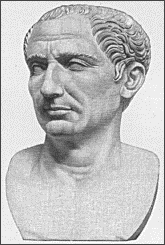

Pour mettre fin aux désordres du calendrier, Jules César, en l’an 708 de Rome (46 avant J.C.) impose une réforme qui apparaît à la fois audacieuse, car il a fixé les années sans l’intervention des pontifes, mais timide en ce qui concerne la structure des mois, qui ont conservé leurs irrégularités.

Pour calculer le calendrier, il fit venir d’Alexandrie l’astronome Egyptien Sosigène. Ils choisirent une durée de l’année moyenne de 365,25 jours, bien qu’un siècle plus tôt Hipparque savait déjà que cette valeur était trop forte. On a donc un cycle comprenant 3 années de 365 jours, suivies d’une année de 366.

Le jour ajouté doubla le 24 février (puisque c’est là qu’on insérait traditionellement Mercedonius). Le 24 février s’appelait 6e avant les Calendes de mars, *i.e.* *Sextius Ante Calendas Martias*. Donc en le redoublant, on obtint le ***Bis Sextius*** *Ante Calendas Martias*, d’où le nom de *bissextil*.

L’année 708 de Rome étant en grave désaccord avec les saisons, César l’allongea à 455 jours (une année anormale servira de nouveau quelques siècles plus tard pour réformer le calendrier julien et passer au grégorien). On la nomme *Année de confusion*. De plus, César a ramené le début de l’année au 1e janvier. *L’ère Julienne* (à ne pas confondre avec la période julienne, que nous verrons plus loin) débute le 1e janvier de l’an 45 avant notre ère. Mercédonius disparaît, et ses jours sont répartis aux mois de 29 jours. C’est ainsi que les mois, d’origine lunaire, ont perdu leur correspondance de durée approximative avec la lunaison. Cette structure de l’année est parvenue jusqu’à nous&#8239;; seul le début de l’année a connu au Moyen Age de nombreuses vicissitudes, au hasard des années et des pays. Les noms des mois de l’année julienne à l’origine étaient&#8239;:

<table>
<tbody>
<tr><td>Januarius</td><td>Februarius</td><td>Martius</td><td>Aprilis</td><td>Maïus</td><td>Junius</td></tr>
<tr><td>31 j</td><td>28 (29) j</td><td>31 j</td><td>30 j</td><td>31 j</td><td>30 j</td></tr>
<tr><td>Quintilis</td><td>Sextilis</td><td>September</td><td>October</td><td>November</td><td>December</td></tr>
<tr><td>31 j</td><td>31 j</td><td>30 j</td><td>31 j</td><td>30 j</td><td>31 j</td></tr>
</tbody>
</table>

Les noms *Quintilis* (cinquième), *Sextilis* (sixième), *September* (septième), *October* (huitième), *November* (neuvième) et *December* (dixième) ne correspondent donc plus à leurs numéros. Ils subsistent néanmoins.

Aux Calendes de janvier, les Romains fêtaient la nouvelle année&#8239;; ils veillaient à ne pas prononcer de paroles de mauvais augure, se rendaient des visites, et échangeaient de menus cadeaux, nommés *strena*. C’est l’origine de nos étrennes.

La réforme de Jules César a été mal comprise, et mal appliquée pendant quelques années&#8239;: les pontifes intercalèrent une année bissextile tous les trois ans. Il s’ensuivit un décalage auquel l’empereur Auguste remédia en décrétant qu’il n’y aurait pas d’années bissextiles pendant 12 ans.

En 44 avant J.C., Marc-Antoine donna au mois Quintilis, pendant lequel Jules César était né, son nom *Julius*, qui est devenu juillet. De même, en 8 avant J.C., le Sénat donna à Sextilis le nom de l’empereur Auguste&#8239;: *Augustus*, qui est devenu août. *Julius* et *Augustus* n’ayant pas le même nombre de jours, ce qui ne plaçait pas les deux monarques sur pied d’égalité, quelques transferts subsidiaires ont amené l’année à ce que nous connaissons actuellement. La structure de l’année n’a pas changé depuis&#8239;; seule la répartition des jours bissextils sera légèrement modifiée plus tard. On peut donc dire que notre calendrier a plus de 2.000 ans.

La numérotation des jours par les Calendes a subsisté jusqu’au XVIe siècle. Ce sont les peuples Barbares qui ont institué la numérotation à l’aide des chiffres arabes.

L’année 0 n’existe pas. L’invention du zéro est d’ailleurs tardive, car c’est un concept abstrait&#8239;; elle est due aux hindous au Ve siècle de notre ère. Le zéro est dérivé de la marque du vide, qui était nommée *sunya* et figurée par un petit cercle. Il est devenu *sifr* en arabe, puis *zephirum* en latin, qui donna *zephiro* et donc zéro. On note que le nom arabe du zéro, *sifr*, a donné le nom générique de tous les chiffres.

Le premier siècle a donc commencé avec l’an 1, et pour compter 100 ans, il s’est achevé **à la fin** de l’année 100. Le deuxième siècle a commencé au premier janvier 101. Par conséquent, le XXIe siècle commença le premier janvier 2001, et l’an 2000 est la dernière année du XXe siècle&#8239;!

Arthur C. Clarke, auteur d’un livre, suivi par Stanley Kubrik qui en a tiré un film, ne s’y sont pas trompés&#8239;: le titre est bien ***2001**, l’Odyssée de l’espace*. Ils ont placé l’action dans un futur proche, mais qui marquait une véritable rupture&#8239;: le début d’un millénaire, un vaste avenir devant soi…

## Le calendrier julien

### Date de Noël

Les fêtes célébrées actuellement dans la partie du monde de tradition chrétienne ont diverses origines, et leurs dates en découlent. Les deux principales fêtes sont Noël et Pâques, dont nous allons voir l’origine.

Très anciennement, dès que les hommes en ont été conscients, ils ont célébré le retour du soleil, au moment où les jours commençaient à rallonger, c’est-à-dire au solstice d’hiver&#8239;; les Romains célébraient à cette date *Dies Solis Invicti* (le jour du soleil invaincu). Au début de la chrétienté, le soucis d’éradiquer ces anciennes fêtes a conduit à les remplacer par d’autres, d’inspiration religieuse. Ce serait pourquoi *Noël* du latin *Natalis*) a été fixé au 25 décembre, qui est très proche du solstice. L’Eglise d’Orient a célébré la Nativité le 6 janvier jusqu’au 6e siècle. Un décret apostolique de l’an 376 a fixé la date du 25 décembre. En Espagne, le 6 janvier est toujours une grande fête.

### Date de Pâques
La Pâque est une fête juive à l’origine (voir le calendrier hébreu). Elle est célébrée le 14e jour du mois de Nisan (début du printemps). Le calendrier israélite étant lunaire, la lune était toujours pleine à cette date, et son éclairage facilitait les déplacements. Le Christ célébrait la Pâque, et il est mort à l’heure où les prêtres égorgeaient les agneaux au temple. Mais la tradition chrétienne à Rome voulait qu’on célèbre la fête de Pâques (avec un s) un dimanche, car la résurection avait eu lieu ce jour-là. Après de très longues discussions, Pâques a été défini par le concile de Nicée en 325 de notre ère comme&#8239;:

Le premier dimanche qui suit (strictement) la première pleine lune de Printemps.

A l’époque, la valeur connue de l’année est de 365,25 jours, et l’équinoxe tombait le 21 mars. Les membres du concile ont cru que cette date était définitive, et l’ont utilisée pour déterminer la date de Pâques. La règle ci-dessus devient donc&#8239;: *le premier dimanche qui suit (strictement) la première pleine lune après le 21 mars*. Un procédé de calcul, nommé Comput (du latin *computare* = calculer), permet d’obtenir la date de Pâques à partir de cette formule.

<Encadre type="plus">
Pâques est le dimanche qui suit le quatorzième jour de la Lune qui atteint cet âge au 21 mars ou immédiatement après
</Encadre>

### Ère chrétienne
En 532 julien, le moine Denys le Petit (*Dionysus Exiguus*) calcula que le Christ avait dû naître en 754 de Rome. Il en profita pour proposer cette année pour début d’une nouvelle ère. Cette proposition ne s’est imposée qu’au VIIIe siècle sous Charlemagne dans le royaume des Francs.

Il résulte de cette modification que le calendrier julien était en vigueur avant même l’année choisie pour origine. Il existe donc des années avant J.C. Mais on n’a jamais défini d’année 0. Ainsi, l’année qui précède immédiatement l’année 1 après J.C. est l’année 1 avant J.C. Une autre façon de désigner les années antérieures à notre ère est la notation relative (avec des nombres négatifs). La correspondance est&#8239;:

<table>
<tbody>
<tr><td>…</td><td>-2</td><td>-1</td><td><strong>0</strong></td><td><strong>1</strong></td><td>2</td><td>3</td><td>4</td><td>…</td></tr>
<tr><td>…</td><td>3 av. J.C.</td><td>2 av. J.C.</td><td><strong>1 av. J.C.</strong></td><td><strong>1 ap. J.C.</strong></td><td>2 ap. J.C.</td><td>3 ap. J.C.</td><td>4 ap. J.C.</td><td>…</td></tr>
</tbody>
</table>

L’année 4 après J.C. est bissextile (son millésime est divisible par 4). Comptant 4 années vers le passé, on s’aperçoit que l’an 1 av. J.C. doit donc l’être aussi. Mais son millésime 1 n’est pas divisible par 4. Par contre, dans la notation relative, les années bissextiles sont bien les années 0, -4, -8 etc. dont les millésimes sont divisibles par 4.

Il est facile de calculer une durée dans la notation relative, par soustraction des millésimes, beaucoup moins dans l’autre. Toutefois, les historiens utilisent la première.

### Jésus-Christ est né avant J.-C.&#8239;!
Le début de notre ère ayant été fixé par Denys le Petit au 1e janvier qui suit la naissance du Christ, celui-ci serait donc né le 25 décembre de l’an 1 avant J.C….ce qui est déjà bien étrange&#8239;! Mais il y a pire.

Il n’est pas possible de déterminer historiquement la date de naissance du Christ, les registres ayant été perdus. On peut la déterminer approximativement en recoupant avec d’autres événements. Rome a ordonné un recensement sous le règne d’Hérode le Grand, pour lequel Marie et Joseph se sont rendus à Bethléem, où Jésus est né. Or, Hérode est mort en l’an 4 avant J.C. (année 750 de Rome). Les Evangiles nous donnent aussi de nombreuses indications, qui mettent en évidence les années 747, 748 et 749 de Rome (donc 7, 6 ou 5 avant J.C.). Le début de l’ère chrétienne, qui était censé correspondre avec l’année de la naissance du Christ, est donc erroné. Et le Christ est né aux alentours de 5 av. J.C.&#8239;!

### Autres éléments

L’*indiction romaine* (voir le calendrier des postes) était une période de 15 ans intermédiaire entre le mois et l’année, un peu comme le lustre (5 ans). Elle servait pour les impôts&#8239;! passons… L’indiction donnée par le calendrier est le rang de l’année dans un cycle de 15 ans.

Le *cycle dominical*, ou *cycle solaire*, est le produit de deux cycles&#8239;: la période de 7 correspondant aux jours de la semaine, et une période de 4 correspondant aux années communes et bissextiles. Au bout de 7 × 4 = 28 ans, les jours reviennent aux mêmes dates du mois.

Le troisième élément, le *nombre d’or* (voir le paragraphe relatif au calendrier grec) est utilisé pour le calcul de la date de Pâques, puisqu’il permet d’obtenir l’âge de la lune. La lunaison vraie s’écarte beaucoup de la lunaison moyenne. Ces variations rendent très difficile la prévision des phases, qui seule permet d’établir à l’avance un calendrier. Le calendrier julien et son successeur grégorien sont les seuls ayant des caractères lunaires à utiliser une méthode prédictive. A l’époque de Jules César, il n’était pas question d’établir une théorie de la lune. Le cycle de Méton a fourni une méthode alternative, basée sur la répétition. Par l’observation soignée des phases au cours d’un cycle, il est possible d’établir un tableau de prévision des phases des cycles suivants, avec une erreur de moins d’un jour sur une période de 320 ans. Le tableau ci-dessous donne donc toutes les nouvelles lunes d’un cycle de Méton en fonction du nombre d’or&#8239;:

<table>
<thead>
<tr><th>Nb d’Or</th><th>janv</th><th>fév</th><th>mars</th><th>avril</th><th>mai</th><th>juin</th><th>juil</th><th>août</th><th>sept</th><th>oct</th><th>nov</th><th>déc</th></tr>
</thead>
<tbody>
<tr><td>1</td><td>23</td><td><strong>21</strong></td><td>23</td><td><strong>21</strong></td><td>21</td><td><strong>19</strong></td><td>19</td><td><strong>17</strong></td><td>16</td><td><strong>15</strong></td><td>14</td><td><strong>13</strong></td></tr>
<tr><td>2</td><td>12</td><td><strong>10</strong></td><td>12</td><td><strong>10</strong></td><td>10</td><td><strong>8</strong></td><td>8</td><td><strong>6</strong></td><td>5</td><td><strong>4</strong></td><td>3</td><td><strong>2</strong></td></tr>
<tr><td>3</td><td><strong>1</strong>, 31</td><td>-</td><td><strong>1</strong>, 31</td><td>29</td><td>29</td><td><strong>27</strong></td><td>27</td><td><strong>25</strong></td><td>24</td><td><strong>23</strong></td><td>22</td><td><strong>21</strong></td></tr>
<tr><td>4</td><td>20</td><td><strong>18</strong></td><td>20</td><td><strong>18</strong></td><td>18</td><td><strong>16</strong></td><td>16</td><td><strong>14</strong></td><td>13</td><td><strong>12</strong></td><td>11</td><td><strong>10</strong></td></tr>
<tr><td>5</td><td>9</td><td><strong>7</strong></td><td>9</td><td>7</td><td>7</td><td><strong>5</strong></td><td>5</td><td><strong>3</strong></td><td><strong>2</strong></td><td>2, <strong>31</strong></td><td>30</td><td><strong>29</strong></td></tr>
<tr><td>6</td><td>28</td><td><strong>26 (27)</strong></td><td>28</td><td><strong>26</strong></td><td>26</td><td><strong>24</strong></td><td>24</td><td><strong>22</strong></td><td>21</td><td><strong>20</strong></td><td>19</td><td><strong>18</strong></td></tr>
<tr><td>7</td><td>17</td><td><strong>15</strong></td><td>17</td><td><strong>15</strong></td><td>15</td><td><strong>13</strong></td><td>13</td><td><strong>11</strong></td><td>10</td><td><strong>9</strong></td><td>8</td><td><strong>7</strong></td></tr>
<tr><td>8</td><td>6</td><td><strong>4</strong></td><td><strong>6</strong></td><td>5</td><td>4</td><td>3</td><td><strong>2</strong></td><td>1, <strong>30</strong></td><td>29</td><td><strong>28</strong></td><td>27</td><td><strong>26</strong></td></tr>
<tr><td>9</td><td>25</td><td><strong>23</strong></td><td>25</td><td><strong>23</strong></td><td>23</td><td><strong>21</strong></td><td>21</td><td><strong>19</strong></td><td>18</td><td><strong>17</strong></td><td>16</td><td><strong>15</strong></td></tr>
<tr><td>10</td><td>14</td><td><strong>12</strong></td><td>14</td><td><strong>12</strong></td><td>12</td><td><strong>10</strong></td><td>10</td><td><strong>8</strong></td><td>7</td><td><strong>6</strong></td><td>5</td><td><strong>4</strong></td></tr>
<tr><td>11</td><td><strong>3</strong></td><td>2</td><td><strong>3</strong></td><td>2</td><td><strong>1, 31</strong></td><td><strong>29</strong></td><td>29</td><td><strong>27</strong></td><td>26</td><td><strong>25</strong></td><td>24</td><td><strong>23</strong></td></tr>
<tr><td>12</td><td>22</td><td><strong>20</strong></td><td>22</td><td><strong>20</strong></td><td>20</td><td><strong>18</strong></td><td>18</td><td><strong>16</strong></td><td>15</td><td><strong>14</strong></td><td>13</td><td><strong>12</strong></td></tr>
<tr><td>13</td><td>11</td><td><strong>9</strong></td><td>11</td><td><strong>9</strong></td><td>9</td><td>7</td><td>7</td><td><strong>5</strong></td><td>4</td><td><strong>3</strong></td><td>2</td><td><strong>1, 31</strong></td></tr>
<tr><td>14</td><td>30</td><td><strong>28 (29)</strong></td><td>30</td><td><strong>28</strong></td><td>28</td><td><strong>26</strong></td><td>26</td><td><strong>24</strong></td><td>23</td><td><strong>22</strong></td><td>21</td><td><strong>20</strong></td></tr>
<tr><td>15</td><td>19</td><td><strong>17</strong></td><td>19</td><td><strong>17</strong></td><td>17</td><td><strong>15</strong></td><td>15</td><td><strong>13</strong></td><td>12</td><td><strong>11</strong></td><td>10</td><td><strong>9</strong></td></tr>
<tr><td>16</td><td>8</td><td><strong>6</strong></td><td>8</td><td><strong>6</strong></td><td>6</td><td>4</td><td>4</td><td><strong>2</strong></td><td><strong>1</strong></td><td>1, <strong>30</strong></td><td>29</td><td><strong>28</strong></td></tr>
<tr><td>17</td><td>27</td><td><strong>25 (26)</strong></td><td>27</td><td><strong>25</strong></td><td>25</td><td><strong>23</strong></td><td>23</td><td><strong>21</strong></td><td>20</td><td><strong>19</strong></td><td>18</td><td><strong>17</strong></td></tr>
<tr><td>18</td><td>16</td><td><strong>14</strong></td><td>16</td><td><strong>14</strong></td><td>14</td><td><strong>12</strong></td><td>12</td><td><strong>10</strong></td><td>9</td><td><strong>8</strong></td><td>7</td><td><strong>6</strong></td></tr>
<tr><td>19</td><td>5</td><td><strong>3</strong></td><td><strong>5</strong></td><td>4</td><td><strong>3</strong></td><td>2</td><td>1, 30</td><td><strong>28</strong></td><td>27</td><td><strong>26</strong></td><td>25</td><td><strong>24</strong></td></tr>
<tr><th>Nb d’Or</th><th>janv</th><th>fév</th><th>mars</th><th>avril</th><th>mai</th><th>juin</th><th>juil</th><th>août</th><th>sept</th><th>oct</th><th>nov</th><th>déc</th></tr>
</tbody>
</table>

Les lunaisons de 29 et 30 jours alternent presque toujours. Les nombres en rouge correspondent au début des lunaisons de 30 jours. Les parenthèses en février concernent les années bissextiles.

### Les fêtes mobiles
Fêtes liées à Pâques&#8239;:

<table>
<tbody>
<tr><td><em>Septuagésime</em></td><td></td><td>neuvième dimanche avant Pâques</td></tr>
<tr><td><em>Quinquagésime</em></td><td></td><td>(dimanche de Carnaval) 7 semaines avant Pâques</td></tr>
<tr><td><em>Mercredi des Cendres</em></td><td></td><td>début du carême 3 jours après Le Carême compte 40 jours, dimanches exclus</td></tr>
<tr><td><em>Pentecôte</em></td><td></td><td>(signifie Cinquantième) 7 semaines après Pâques</td></tr>
<tr><td><em>Ascension</em></td><td></td><td>le jeudi 10 jours avant la Pentecôte</td></tr>
<tr><td><em>Trinité</em></td><td></td><td>dimanche après Pentecôte</td></tr>
<tr><td><em>Fête-Dieu</em></td><td></td><td>dimanche après la Trinité</td></tr>
<tr><td><em>Epiphanie</em></td><td></td><td>elle était célébrée le 6 janvier (fête provenant de l’Eglise d’Orient)&#8239;;  elle a maintenant été fixée au premier dimanche de janvier.</td></tr>
</tbody>
</table>

> L’Avent est le début de l’année liturgique&#8239;: le premier dimanche de l’Avent est le plus proche du 30 novembre&#8239;; c’est donc une fête légèrement mobile.

### Calendrier grégorien

Nous avons vu que la durée de l’année choisie par César était trop longue&#8239;: 365,25 jours au lieu de 365,2422 jours. Ceci fait une différence de 11 minutes par an. Bien que faible, cette erreur va s’accumuler, et en 129 ans atteindre un jour. Ainsi, à long terme, le calendrier dérive encore par rapport aux saisons. Une nouvelle réforme va s’imposer.

Cette nouvelle réforme du calendrier ne s’est pas faite en un jour, et n’est pas l’œuvre d’une seule personne. Dès le milieu du XIIIe siècle, Jhon de Holywood, moine écossais, a proposé de modifier l’ajout des jours bissextils juliens. Puis des astronomes espagnols, sur ordre d’Alphonse X de Castille, ont déterminé la valeur de l’année tropique&#8239;: 365 j 5 h 49 min 12 s (seulement 26 secondes de trop). Au XIVe siècle, le pape Clément IV fit faire une étude sur ce sujet, mais mourut avant de prendre une décision. Puis le cardinal Pierre d’Ailly saisit le concile de Constance en 1417 sur ce problème, sans résultat. Le cardinal Nicolas de Cusa fit une proposition au concile de Bâle en 1439, sans succès encore. A la fin du XVe siècle, le pape Sixte IV fit venir Regiomontanus (Jean Muller de Koenigsberg) pour travailler sur la question, mais le malheureux est mort avant d’avoir donné ses résultats… Le concile de Latran en 1514, celui de Trente en 1563 ont remis la question sur le tapis. Pie V ne put venir à bout de la réforme. Enfin, ce fut Grégoire XIII qui, en 1582, parvint au but. On a donc donné son nom au nouveau calendrier. On peut cependant trouver dans les livres une autre appellation&#8239;: la réforme grégorienne étant en fait une retouche du calendrier Julien, celui-ci a souvent été nommé *vieux style*, et le grégorien *nouveau style*.

Dès le début de son règne, Grégoire XIII a nommé une commission, composée de savants, dont Clavius et Aloïsio Lilio (auteur d’un projet qui servit de base de discussion). Pour remettre le calendrier en accord avec les saisons, il fallait supprimer des jours&#8239;; mais comment&#8239;? Au temps de Jésus, l’équinoxe tombait le 25 mars&#8239;; mais il tombait déjà le 21 lors de l’important concile de Nicée. Laquelle des deux dates choisir&#8239;? Le nombre de jours à retrancher n’était pas le même…

On peut signaler que la proposition de Clavius n’a pas fait l’unanimité&#8239;! En particulier François Viète, inventeur de l’algèbre, l’a pris à parti sur les principes de la réforme, employant des arguments pas toujours très judicieux. Viète a publié en 1600 un calendrier modifié, afin de corriger les erreurs qu’il imputait à Clavius&#8239;: *Relatio Kalendarii vere gregoriani*.

Une fois la décision de retrancher 10 jours prise, à quel moment le faire&#8239;? En une seule fois (comme César en a rajouté pour *l’année de confusion*), ou bien en supprimant le caractère bissextil des années à venir, jusqu’à ce que l’accord se refasse (méthode analogue à celle employée par Auguste)&#8239;? Le pape a choisi le 21 mars pour date de l’équinoxe, et décidé de retrancher les 10 jours de recalage en une seule fois. Il en a averti les rois, les églises… Après leur consentement, il publia la bulle *Inter Gravissima* le 24 février 1582, qui instaura sa réforme. Ainsi, en Italie le lendemain du 4 octobre 1582 a été le 15 octobre 1582. En France, l’application a un peu tardé, et c’est seulement en décembre que la suppression a été faite&#8239;: le lendemain du 9 décembre 1582 a été le 20 décembre (sous le règne d’Henri III).

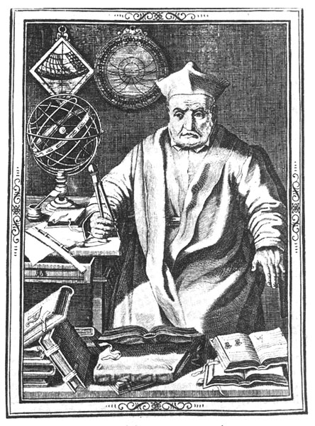

L’ajustement étant refait, il fallait éviter qu’un nouveau décalage se produise&#8239;; grâce à la bonne valeur connue à l’époque pour l’année tropique, Clavius a montré qu’il fallait supprimer 1 jour bissextil tous les 400 ans&#8239;; ceci est très simple, et nous le verrons dans la seconde partie. Grégoire XIII a décidé, par soucis de simplicité, de supprimer le caractère bissextil des années séculaires (dont le millésime se termine par deux 0) si leur millésime n’est pas divisible par 400.

<Encadre type="retenir" titre="Les deux règles grégoriennes">
- Règle 1&#8239;: **les années séculaires ne sont bissextiles que si leur millésime est divisible par 400**&#8239;;
- Règle 2&#8239;: **les années non séculaires sont bissextiles si leur millésime est divisible par 4**.
</Encadre>

Donc, 1600 et 2000 restent bissextiles, alors que 1700, 1800 et 1900 ne le sont plus.

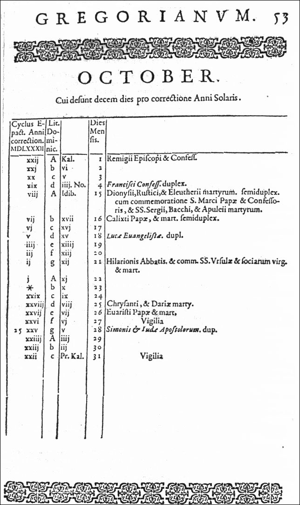

*page montrant le premier calendrier grégorien, pour le mois d’octobre 1592&#8239;;  provenance inconnue…*

*Cui defunt decem dies pro correctione Anni Solaris*&#8239;: suppression de 10 jours pour corriger l’année solaire

La suppression de 10 jours est un rattrapage de même nature que l’ajout des jours bissextils ou des mois embolismiques. Simplement, il est plus brutal que ce à quoi nous sommes habitués. Rapellez-vous qu’Auguste a choisi une solution plus douce pour résoudre exactement le même problème, en supprimant l’ajout des jours bissextils pendant 12 ans.

La réforme, n’a pas été adoptée dans tous les pays en même temps. Par exemple&#8239;:

<table>
<tbody>
<tr><td>1582</td><td>Italie, Espagne, Portugal, France (sous Henri III, 9 - 20 décembre), Pays-Bas catholiques</td></tr>
<tr><td>1584</td><td>Autriche, Allemagne catholique, Suisse catholique</td></tr>
<tr><td>1586</td><td>Pologne</td></tr>
<tr><td>1587</td><td>Hongrie</td></tr>
<tr><td>1610</td><td>Prusse</td></tr>
<tr><td>1700</td><td>Allemagne protestante, Pays-Bas protestants, Danemark, Norvège</td></tr>
<tr><td>1752</td><td>Royaume-Uni, Suède</td></tr>
<tr><td>1753</td><td>Suisse protestante</td></tr>
<tr><td>1873</td><td>Japon</td></tr>
<tr><td>1911</td><td>Chine</td></tr>
<tr><td>1917</td><td>Bulgarie</td></tr>
<tr><td>1919</td><td>Roumanie, Yougoslavie</td></tr>
<tr><td>1923</td><td>URSS, Grèce</td></tr>
<tr><td>1926</td><td>Turquie</td></tr>
</tbody>
</table>

Tous ces pays utilisaient antérieurement le calendrier julien, à l’exception de la Chine et du Japon qui avaient un calendrier national, et de la Turquie qui se servait du calendrier musulman.

L’examen de ces dates justifie une remarque de Kepler&#8239;: *"Les protestants aiment mieux être en désaccord avec le soleil que d’accord avec le Pape"*&#8239;! Lorsqu’enfin ils se rallièrent au nouveau calendrier, ils modifièrent le calcul de la date de Pâques, modification connue sous le nom de *correction de Weigel*. Cette correction fut abandonnée en 1778 par Frédéric le Grand.

L’application de la réforme provoqua des troubles à Riga, à Londres… Le peuple n’admettait pas qu’on touche à son calendrier. Bien que le calendrier grégorien ait encore des défauts, une nouvelle réforme serait difficile à faire admettre&#8239;!

Certaines dates historiques, concernant des pays non encore ralliés au calendrier grégorien, sont écrites dans les deux calendriers. Ainsi, on note 10/23 janvier 1920 (10 janvier 1920 julien = 23 janvier 1920 grégorien). Il faut noter qu’au Moyen Age on écrivait en latin&#8239;; et les noms romains des jours (Calendes, Ides, Nones) ont perduré jusqu’au XVIe siècle dans des actes publics.

Enfin, le calcul de la date de Pâques a été modifié pour tenir compte de ces changements&#8239;:

- à chaque année séculaire non bissextile, on retranche un jour à l’Epacte. Cette règle se nomme *Métemptose*.
- pour corriger l’erreur du cycle de Méton, on ajoute une unité à l’Epacte tous les 300 ans quand une année séculaire arrive. Cette règle se nomme *Proemptose*. La première fut opérée en 1800.
- la Proemptose de l’an 4200 est retardée à l’an 4300 et il en est de même tous les 2.500 ans.

Deux remarques importantes&#8239;:

- le caractère religieux du calendrier lui vient des fêtes&#8239;; à part elles, il suit le plus précisément possible le cours des saisons, et c’est ce qui le rend acceptable par tout le monde&#8239;;
- il est le mélange de nombreuses cultures et traditions&#8239;: les Hébreux, les Romains, les Barbares (Thor…) ont participé à sa définition&#8239;; ce trait participe à son acceptation, et rendra très difficile son abandon.

Vous trouverez en seconde partie de cet opuscule des formules expliquées permettant de faire tous les calculs sur ce calendrier.

Le calendrier julien est parfois appellé "ancien style", par opposition au grégorien, qui est dit "nouveau style".

### Calendrier républicain

La République a été proclamée le 22 septembre 1792, par hasard le jour de l’équinoxe d’automne. Ce hasard a amené les révolutionnaires à prendre ce jour pour début de l’ère républicaine (premier Vendémiaire an I). Le calendrier républicain a été créé le 6 octobre 1793. Les noms des mois ont été proposés par Fabre d’Eglantine&#8239;; ils sont magnifiques par leurs consonances, et sont en rapport avec la saison&#8239;:

<table>
<thead>
<tr><th>mois</th><th>Etymologie des noms des mois</th><th>débute le</th><th>termine le</th></tr>
</thead>
<tbody>
<tr><td>Vendémiaire</td><td>Vendemia (Latin) = vendange</td><td>22 septembre</td><td>21 octobre</td></tr>
<tr><td>Brumaire</td><td>brume (Français)</td><td>22 octobre</td><td>20 novembre</td></tr>
<tr><td>Frimaire</td><td>frimas (Français)</td><td>21 novembre</td><td>19 décembre</td></tr>
<tr><td>Nivôse</td><td>nivis (Latin) = neige</td><td>21 décembre</td><td>19 janvier</td></tr>
<tr><td>Pluviôse</td><td>pluviosus (Latin) = pluvieux</td><td>20 janvier</td><td>18 février</td></tr>
<tr><td>Ventôse</td><td>ventosus (Latin) = venteux</td><td>19 février</td><td>20 mars</td></tr>
<tr><td>Germinal</td><td>germination (Français)</td><td>21 mars</td><td>19 avril</td></tr>
<tr><td>Floréal</td><td>floraison (Français)</td><td>20 avril</td><td>19 mai</td></tr>
<tr><td>Prairial</td><td>prairie (Français)</td><td>20 mai</td><td>18 juin</td></tr>
<tr><td>Messidor</td><td>messis (Latin) = moisson</td><td>19 juin</td><td>18 juillet</td></tr>
<tr><td>Thermidor</td><td>thermos(Grec) = chaud</td><td>19 juillet</td><td>17 août</td></tr>
<tr><td>Fructidor</td><td>fructus(Latin) = fruit</td><td>18 août</td><td>16 septembre</td></tr>
</tbody>
</table>

Les 12 mois comportent 30 jours (12 × 30 = 360). Les années normales comprennent 5 jours de plus, placés après Fructidor, et appelés *Sans-culottides*. Une année sur quatre est dite *sextile*&#8239;; elle comprend un jour de plus nommé *jour de la Révolution*. Ceci fait une année moyenne de 365,25 jours, comme l’année julienne. La période de quatre années est appelée *Franciade*, et se termine par le jour de la Révolution.

L’année commence le 1e Vendémiaire, pour la raison suivante&#8239;: la royauté a été abolie par la Convention Nationale le 21 septembre 1792, et le décret est paru le 22. Or ce jour-là était l’équinoxe d’automne, où jour et nuit sont égaux, où la Terre entière (pôles compris) est éclairée par le Soleil. Le symbolisme avec l’égalité proclamée entre les citoyens était frappant, et a conduit les révolutionnaires à choisir cette date pour début de l’année et de leur ère. On pourrait y voir *a posteriori* une ombre au tableau&#8239;: à l’équinoxe d’automne, la déclinaison du Soleil est décroissante…

La Révolution a donné des noms pour remplacer (et chasser) les noms des jours provenant de l’astrologie ancienne, et ceux des saints. Ainsi, la semaine est supprimée, et remplacée par la décade&#8239;; chaque jour de la décade sera doté d’un nom, selon un système très pratique. Le nom du jour est dérivé de son numéro dans la décade&#8239;:

<table>
<tbody>
<tr><td>1 primidi</td><td>2 duodi</td><td>3 tridi</td><td>4 quartidi</td><td>5 quintidi</td></tr>
<tr><td>6 sextidi</td><td>7 septidi</td><td>8 octidi</td><td>9 nonidi</td><td>10 décadi</td></tr>
</tbody>
</table>

Il était très simple de savoir quel jour on était (contrairement à notre calendrier grégorien)&#8239;: si on est un quartidi, c’est le 4, le 14 ou le 24. Comme on sait toujours si on est au début, au milieu ou à la fin du mois, l’ambiguïté est levée.

L’erreur systématique du calendrier julien se retrouve ici&#8239;; de plus, les calculs du calendrier républicain sont approximatifs, car le début de l’année était fixé par l’observation de l’équinoxe d’automne&#8239;! Il renouait donc avec l’empirisme des anciens… Si on ajoute à cela que les noms des mois sont relatifs au climat de Paris, que les termes de Franciade, Sans-culottide… sont liés à un événement français, on voit que ce calendrier, contrairement au système métrique, n’avait aucun caractère d’universalité. Il n’est pas étonnant qu’il ait été rapidement abandonné.

### Calendrier universel

Les réformes du calendrier ont souvent rencontré une forte opposition, due à la force des habitudes. Certaines ont été abandonnées, par exemple celle de Ptolémé III Evergète qui a réformé le calendrier vague, mais n’a pas été suivi par le peuple. De même, le calendrier Républicain n’a duré que 12 ans. Tout ceci montre quelles précautions il faut prendre lorsqu’on envisage de réformer le calendrier, même si cette transformation paraît nécessaire. Toute tentative dans ce sens doit prendre en compte les habitudes, et surtout ne pas rompre avec la chronologie. Les anniversaires font partie de la civilisation.

Nous avons vu que notre calendrier grégorien est un excellent calendrier solaire, et l’erreur qui subsiste sur la durée de l’année est plus faible que la variabilité de cette année&#8239;; nulle réforme ne s’impose sur ce plan. Les critiques qu’on pourrait lui faire portent sur la répartition des jours en mois, dont nous avons vu l’origine historique. Une plus grande régularité apporterait quelques améliorations, mais le prix à payer serait l’abandon d’une tradition. Dans ces conditions, il apparaît extrêmement difficile de fixer le calendrier.

On peut toutefois envisager des modifications par l’adoption de jours blancs, placés hors semaine. Le principe est de fixer les dates (le 28 mars serait toujours un jeudi…). L’année devrait pour cela être un multiple de la semaine. Or 7 × 52 = 364. Il manque donc un jour au moins.

Si on conserve l’essentiel du calendrier grégorien, qui a fait ses preuves avec plus de 400 ans d’existence, et qui est d’usage à peu près universel, on voit que le 1e janvier se décale d’un jour chaque année (car 365 jours = 52 semaines de 7 jours plus 1 jour&#8239;; le décalage est de 2 jours pour les années bissextiles). Si on désire que toutes les années commencent par le même jour (lundi par exemple) il est alors nécessaire d’envisager que le dernier jour des années communes ou le dernier jour et le bissextil des années bissextiles soient des jours blancs, hors semaine, *i.e.* sans nom.

Grégorien + dates fixes ⇒ brisure de la continuité de la semaine

Cette brisure étant admise, on peut considérer plusieurs arrangements des jours et des mois dans l’année&#8239;:

- simple suppression du nom du 31 décembre (jeudi, mardi…)
- année de 12 mois, mais avec des trimestres identiques de 91 jours respectivement de 31, 30 et 30 jours, plus le jour blanc&#8239;; le bissextil est blanc aussi. C’est le calendrier universel (Armelin et Mamin, 1887&#8239;; soutenu par Camille Flammarion).
- année de 13 mois égaux de 28 jours = 4 semaines&#8239;; 13 × 28 = 364 jours plus 1 jour blanc. C’est le calendrier fixe, dit *positiviste*, basé sur les propriétés subjectives des nombres, proposé par Auguste Comte en 1849. Cette solution est inacceptable, car des superstitions sont attachées au nombre 13, qui d’autre part est premier.li&gt;

<table>
<thead>
<tr><th colspan="21">calendrier universel</th></tr>
</thead>
<tbody>
<tr><td colspan="7">janvier avril juillet octobre</td><td colspan="7">février mai août novembre</td><td colspan="7">mars juin septembre décembre</td></tr>
<tr><td>D</td><td>L</td><td>M</td><td>M</td><td>J</td><td>V</td><td>S</td><td>D</td><td>L</td><td>M</td><td>M</td><td>J</td><td>V</td><td>S</td><td>D</td><td>L</td><td>M</td><td>M</td><td>J</td><td>V</td><td>S</td></tr>
<tr><td>1</td><td>2</td><td>3</td><td>4</td><td>5</td><td>6</td><td>7</td><td>.</td><td>.</td><td>.</td><td>1</td><td>2</td><td>3</td><td>4</td><td>.</td><td>.</td><td>.</td><td>.</td><td>.</td><td>1</td><td>2</td></tr>
<tr><td>8</td><td>9</td><td>10</td><td>11</td><td>12</td><td>13</td><td>14</td><td>5</td><td>6</td><td>7</td><td>8</td><td>9</td><td>10</td><td>11</td><td>3</td><td>4</td><td>5</td><td>6</td><td>7</td><td>8</td><td>9</td></tr>
<tr><td>15</td><td>16</td><td>17</td><td>18</td><td>19</td><td>20</td><td>21</td><td>12</td><td>13</td><td>14</td><td>15</td><td>16</td><td>17</td><td>18</td><td>10</td><td>11</td><td>12</td><td>13</td><td>14</td><td>15</td><td>16</td></tr>
<tr><td>22</td><td>23</td><td>24</td><td>25</td><td>26</td><td>27</td><td>28</td><td>19</td><td>20</td><td>21</td><td>22</td><td>23</td><td>24</td><td>25</td><td>17</td><td>18</td><td>19</td><td>20</td><td>21</td><td>22</td><td>23</td></tr>
<tr><td>29</td><td>30</td><td>31</td><td>.</td><td>.</td><td>.</td><td>.</td><td>26</td><td>27</td><td>28</td><td>29</td><td>30</td><td>.</td><td>.</td><td>24</td><td>25</td><td>26</td><td>27</td><td>28</td><td>29</td><td>30</td></tr>
</tbody>
</table>

31 décembre et 31 juin&#8239;: jours blancs&#8239;; si l’année est bissextile, Pâques le 8 avril

Il existe une autre solution, sans jours blancs&#8239;:

- 400 années tropiques = 400 × 365,2422 = 146.096,97 jours
- 400 années grégoriennes = 146.097 jours (voir [le Calendrier Grégorien](#Calengrégo)).

Il se trouve que 146.097 jours = 7 × 20.871 jours = 20.871 semaines. Donc il est possible de créer une période de 400 ans au cours de laquelle un minimum de calendriers distincts est nécessaire.

20.871 n’est pas divisible par 4, ce qui impose d’avoir des siècles de longueurs différentes&#8239;: 3 siècles de 5.218 semaines, et un de 5.217. La répartition des semaines dans les années du siècle se fait en utilisant des années ayant un nombre entier de semaines&#8239;: les années communes avec 52 semaines = 52 × 7 = 364 jours, suivies d’années longues ayant une semaine de plus (le caractère bissextil passe du jour à la semaine&#8239;; rapellez-vous que dans les temps anciens, on ajoutait des mois entiers). Une année plus longue d’une semaine tous les 5 ans convient, car 4 × 364 + (364 + 7) = 1.827 jours et 1.827 / 5 = 365,4.

Un calendrier de ce type est plus uniforme que le grégorien, mais marque des ruptures plus importantes. Est-il vraiment souhaitable d’atteindre une plus grande uniformité&#8239;? La diversité de notre calendrier n’a-t-elle pas un certain charme&#8239;? …

### Période julienne

Une solution très simple pour établir une chronologie consiste à numéroter les jours à partir d’une origine conventionnelle. Si cette méthode n’a été adoptée par aucune civilisation, c’est qu’elle amène l’emploi de grands nombre malcommodes à utiliser. Cependant, les astronomes sont habitués à ce genre d’exercice, et se servent d’une numérotation dont l’origine est le

1e janvier 4 713 avant J.C. à midi.

En plaçant le début du jour à midi, les astronomes occidentaux s’assuraient que toute une nuit d’observation s’étendait sur une même date. Cette numérotation présente par ailleurs un grand intérêt en histoire, pour établir la concordance entre les différents calendriers.

La *période julienne*, ou *période de Scaliger* a été imaginée par Joseph Scaliger en 1583, dans son ouvrage *Opus Novum de Emmendatione Temporum* (étude nouvelle de la correction du temps). C’est une suite de 7.980 ans, obtenue en multipliant le cycle dominical (28 jours) par le cycle de Méton (19 ans) et par l’indiction romaine (15 ans)&#8239;: 28 × 19 × 15 = 7.980. En divisant le rang d’une année dans la période de Scaliger par 15, 19 et 28, les restes donnent l’indiction romaine, le nombre d’or et le cycle solaire.

Son origine, qui semble tout à fait arbitraire, est choisie parce que ce jour-là les trois nombres en question valaient 1 (lundi 1e janvier d’une année bissextile). Chaque année, l’annuaire du Bureau des Longitudes publie des tables de correspondance permettant un calcul facile de la période julienne pour une date donnée.

Le calcul des durées est le point fort de cette période&#8239;: le nombre de jours séparant deux dates est obtenu par soustraction des valeurs correspondantes de la période julienne.

Le cycle actuel de Scaliger s’achèvera le 31 décembre 3 267 julien, ou le 22 janvier 3 268 grégorien.

## Le calcul du calendrier

Dans cette partie consacrée aux calculs du calendrier, nous utiliserons uniquement la division entière (appelée *division euclidienne*) pour représenter tous les calculs. Chaque formule sera amenée de manière logique, à partir des règles du calendrier ou des phénomènes astronomiques. Si l’aspect des formules peut paraître rébarbatif de prime abord, leur calcul est extrêmement simple.

L’utilisation de ces formules permettra de résoudre tous les problèmes liés au calendrier grégorien, en particulier quelques exercices amusants placés à la fin de la section. Le plus courant de ces problèmes consiste à retrouver, quelques années après, quel jour de la semaine correspond à une date donnée, de naissance par exemple.

### Calcul de la règle solaire grégorienne

Sur 400 ans, le calendrier grégorien compte 97 années bissextiles. L’année moyenne vaut donc

$$
\overline{A} = 365 + \frac{97}{400} = 365{,}2425 \ \text{jours}
$$

soit environ 26 secondes de plus que l’année tropique&#8239;: le décalage atteint un jour en un peu plus de 3 000 ans. Sur 400 ans, le calendrier compte {fr(400 * 365 + 97, 0)} jours, soit exactement {fr((400 * 365 + 97) / 7, 0)} semaines&#8239;: **le calendrier grégorien se reproduit à l’identique, jours de la semaine compris, tous les 400 ans.**

### Cycle de Méton

L’astronome grec Méton d’Athènes remarque en 432 avant J.-C. que 19 années tropiques et 235 lunaisons durent presque le même temps&#8239;:

<table>
<thead><tr><th>Durée</th><th class="num">Valeur</th></tr></thead>
<tbody>
<tr><td>19 années tropiques (19 × 365,2422 j)</td><td class="num">{fr2(19 * 365.2422)} jours</td></tr>
<tr><td>235 lunaisons (235 × 29,530589 j)</td><td class="num">{fr2(235 * 29.530589)} jours</td></tr>
</tbody>
</table>

L’écart n’est que d’environ deux heures. Après 19 ans, les phases de la Lune reviennent donc aux mêmes dates de l’année solaire. Ce cycle est à l’origine du nombre d’or, vu plus bas.

### Quelques solutions vers un calendrier solaire parfait
Pour l’année solaire, on peut calculer directement, de manière très simple, diverses solutions possibles. Il suffit de mettre la durée de l’année tropique 365,2422 jours, sous la forme 365 + a / b avec a et b entiers bien sûr. Ainsi, nous saurons immédiatement qu’il faut ajouter *a* jours dans une période de *b* années. En effet, s’il faut par exemple rajouter la fraction 7/29 de jours par an, sur une période de 29 années, il faudra rajouter 7 jours.

La recherche empirique de ces nombres peut être fastidieuse et aléatoire, mais il existe une façon très simple de les trouver&#8239;:

**1-** a = 365,2422&#8239;; si on néglige la partie décimale, on obtient **a ≅ 365.** Elle correspond à une année fixe de 365 jours, meilleure approximation entière utilisée dans de nombreux calendriers primitifs. L’erreur par rapport à l’année tropique est de 0,2422 jour *i.e.* **5 h 48 min**.

**2-** Le calendrier julien utilise une année de 365 j 1/4. C’est une valeur approchée&#8239;; il faudrait à la place de 4 un nombre un peu plus grand, que nous appellerons p. Cherchons sa valeur&#8239;:

$$
a = 365{,}2422 = 365 + \frac{1}{p}
$$

d’où&#8239;:

$$
\frac{1}{p} = 365{,}2422 - 365 = 0{,}2422
$$

et&#8239;:

$$
p = \frac{1}{0{,}2422} = 4{,}12882
$$

La valeur exacte est donc

$$
a = 365{,}2422 = 365 + \frac{1}{4{,}12882}
$$

Ceci signifie qu’il faudrait ajouter 1 jour tous les 4,12882 ans&#8239;; ce n’est pas très pratique&#8239;!

En négligeant 0,12882 on retrouve l’approximation julienne 365 + 1 / 4. On ajoute 1 jour dans chaque période de 4 ans, ce qui donne une année moyenne de 365,25 j. L’erreur par rapport à l’année tropique est de 365,25 - 365,2422 = 0,0078 jour *i.e.* **11 min**.

**3-** Refaisons le même travail sur le nombre obtenu 4,12882&#8239;:

$$
4{,}12882 = 4 + \frac{1}{p_1}
$$

d’où

$$
\frac{1}{p_1} = 4{,}12882 - 4 = 0{,}12882
$$

et

$$
p_1 = \frac{1}{0{,}12882} = 7{,}76282
$$

donc

$$
4{,}12882 = 4 + \frac{1}{7{,}76282}
$$

Reportons cette valeur dans l’expression trouvée plus haut&#8239;:

$$
a = 365{,}2422 = 365 + \frac{1}{4{,}12882} = 365 + \cfrac{1}{4 + \cfrac{1}{7{,}76282}}
$$

En négligeant 0,76282 on obtient une approximation&#8239;:

$$
a \approx 365 + \cfrac{1}{4 + \cfrac{1}{7}} = 365 + \frac{7}{29}
$$

En calculant la fraction, on obtient 365,24138 jours. L’erreur par rapport à l’année tropique est de 365,24138 - 365,2422 = -0,00082 jour *i.e.* **1 min 11 s**.

C’est une approximation dans laquelle on aurait une année commune de 365 jours, avec adjonction de 7 jours supplémentaires en 29 ans.

**4-** Pour faire toujours mieux , on utilise encore le même procédé avec le nombre 7,76282&#8239;:

$$
7{,}76282 = 7 + \frac{1}{p_2}
$$

d’où

$$
p_2 = \frac{1}{7{,}76282 - 7} = 1{,}3109
$$

a = 365,2422 = **365** + 1/(**4** +1 / (**7** + 1 / **1**,3109))

$$
a = 365{,}2422 = 365 + \cfrac{1}{4 + \cfrac{1}{7 + \cfrac{1}{1{,}3109}}}
$$

si on néglige la partie décimale, on obtient

$$
a \approx 365 + \cfrac{1}{4 + \cfrac{1}{7 + \cfrac{1}{1}}} = 365 + \cfrac{1}{4 + \cfrac{1}{8}} = 365 + \frac{8}{33}
$$

L’année moyenne vaut 365,2424. L’erreur par rapport à l’année tropique est de 365,2424 - 365,2422 = 0,0002 jour *i.e.* **17 s**.

On reconnait là la solution utilisée par le calendrier Persan. L’histoire ne nous dit pas s’ils ont utilisé cette méthode pour l’obtenir. La méthode utilisée est connue sous le nom de *fractions continues*.

Le tableau suivant donne les résultats de ce calcul poussé à 11 itérations, sous forme synthétique&#8239;:

- Les coefficients sont ceux de la fraction obtenue, par exemple 4 et 7 à la troisième ligne (1 / ( 4 + 1 / 7))) = 7 / 29&#8239;;
- p donne le nombre de jours à ajouter, au cours d’une période de q année&#8239;;
- p / q représente l’excès à 365 jours, et doit être aussi proche que possible de 0,2422&#8239;;
- enfin, la colonne validité indique le nombre d’années au bout duquel la dérive atteint 1 jour. La valeur donnée dépend fortement de la valeur de l’année tropique. Pour les grandes valeurs, il ne faut y voir qu’un ordre de grandeur.

<table>
<thead>
<tr><th>coefficients</th><th>p</th><th>p/q</th><th>validité (années)</th><th>calendrier</th></tr>
</thead>
<tbody>
<tr><td>(365&#8239;;)</td><td>0 / 1</td><td>0,000000000000</td><td>4</td><td>vague</td></tr>
<tr><td>(365&#8239;; 4)</td><td>1 / 4</td><td>0,250000000000</td><td>128</td><td>julien</td></tr>
<tr><td>(365&#8239;; 4, 7)</td><td>7 / 29</td><td>0,241379310345</td><td>1 218</td><td>-</td></tr>
<tr><td>(365&#8239;; 4, 7, 1)</td><td>8 / 33</td><td>0,242424242424</td><td>4 459</td><td>persan</td></tr>
<tr><td>(365&#8239;; 4, 7, 1, 3)</td><td>31 / 128</td><td>0,242187500000</td><td>80 000</td><td>-</td></tr>
<tr><td>(365&#8239;; 4, 7, 1, 3, 4)</td><td>132 / 545</td><td>0,24220183486239</td><td>545 000</td><td>-</td></tr>
<tr><td>(365&#8239;; 4, 7, 1, 3, 4, 1)</td><td>163 / 673</td><td>0,24219910846954</td><td>1 122 000</td><td>-</td></tr>
<tr><td>(365&#8239;; 4, 7, 1, 3, 4, 1, 1)</td><td>295 / 1 218</td><td>0,24220032840722</td><td>3 045 000</td><td>-</td></tr>
<tr><td>(365&#8239;; 4, 7, 1, 3, 4, 1, 1, 1)</td><td>458 / 1 891</td><td>0,24219989423585</td><td>9 455 000</td><td>-</td></tr>
<tr><td>(365&#8239;; 4, 7, 1, 3, 4, 1, 1, 1, 1)</td><td>753 / 3 109</td><td>0,24220006432937</td><td>15 545 000</td><td>-</td></tr>
<tr><td>(365&#8239;; 4, 7, 1, 3, 4, 1, 1, 1, 1, 1)</td><td>1 211 / 5 000</td><td>0,2422</td><td>∞</td><td>-</td></tr>
</tbody>
</table>

Cette méthode permet, connaissant la valeur de l’année tropique, de trouver une approximation aussi précise qu’on le souhaite de sa valeur. Mais attention, plus on pousse les calculs, plus les résultats dépendent des décimales les moins significatives. Ce qui signifie que si on change les dernières décimales, les fractions obtenues à partir d’un certain rang changent. Par contre, les premières fractions sont communes, car déterminées par les premières décimales.

Dans ce tableau, on remarque tout d’abord que les calendriers vague, julien et persan sont représentés. Ils sont parmi les solutions les plus simples obtenues ci-dessus.

On remarque aussi que le calendrier grégorien manque à l’appel. Pourquoi&#8239;? La réponse est bien simple&#8239;: le calendrier grégorien compte 97 années bissextiles en 400 ans, donc la durée moyenne de l’année est&#8239;: (400×365 + 97) / 400 = 365,2425 jours, et non 365,2422 qui est notre hypothèse. On obtiendrait le calendrier grégorien en prenant pour base du calcul la valeur 365,2425. Elle vient d’ailleurs après 1/4 et 8/33, qui sont obtenues aussi. En effet, dans la décompostion en fraction continue, les premières décimales du nombre à décomposer donnent les premières fractions solutions. Si deux valeurs ne diffèrent que par la quatrième décimale, les premières solutions sont identiques.

Enfin, la dernière ligne donne une solution exacte&#8239;! Qui plus est, cette solution est assez simple… Elle consiste à répartir 1 211 jours bissextils dans toute période de 5 000 ans. La question est de savoir comment. Ce problème est identique à celui de Jules César, qui devait ajouter un jour bissextil tous les 4 ans. Identique, mais moins évident à résoudre. Si on veut répartir les 1 211 jours bissextils dans les 5 000 ans, il faut en mettre un tous les 5 000 / 1 211 = 4,1288 ans. Soit tous les 4 ans et 47 jours. Pas très pratique…

Mais on pourrait reprendre l’idée de Grégoire XIII. C’est-à-dire ajouter un jour tous les 4 ans, ce qui est trop, et en supprimer quelques uns. Si on ajoute un jour tous les 4 ans, on en ajoute 5 000 / 4 = 1 250. Or il faut en ajouter seulement 1 211, c’est-à dire 1 250 - 1 211 = 39 de moins. Le problème est donc maintenant de supprimer 39 jours dans les 5 000 ans. Pour les répartir, il faut en supprimer un tous les 5 000 / 39 = 128 ans. 128 étant divisible par 4, il suffit donc de rendre commune une année qui serait normalement bissextile. La règle serait alors simple&#8239;:

<Encadre type="plus">
les années dont le millésime est divisible par 4 sont bissextiles, sauf si leur millésime est divisible par 128.
</Encadre>

Ce n’est pas vraiment plus compliqué que les deux règles grégoriennes&#8239;!

Strictement, la première année qui perd son caractère bissextil est l’année 128. De ce fait, il en manque une à la fin du cycle (on n’en supprime que 38 au lieu des 39 nécessaires). Il faudrait donc rajouter une règle spéciale pour supprimer le caractère bissextil de l’an 5 000, et alors l’idéal serait atteint. Mais si on n’utilise pas cette dernière règle, la durée de l’année est de (5 000×365 + 1 250 - 38) / 5 000 = 365,2424 jours, qui reste une excellente approximation. La simple règle énnoncée ci-dessus ferait donc un calendrier tout à fait présentable&#8239;! Mais le clendrier persan donne exactement la même précision, pour une période bien plus courte.

Vous pourrez d’ailleurs constater que cette même règle s’appliquerait pour la fraction 132/545.

Mais ceci était un exercice d’école, il n’y aurait aucun intérêt à changer de calendrier (et d’habitudes) pour un gain minime. Le calendrier grégorien supprime 3 jours bissextils en 400 ans par rapport au julien qui donne le caractère bissextil à toutes les années dont le millésime est divisible par 4. Ce qui revient à supprimer une année bissextile tous les 400 / 3 = 133 ans (au lieu d’une tous les 128 ans comme vu ci-dessus).

Il ne faut pas aller trop loin dans la précision&#8239;: tous ces calculs sont basés sur la valeur de l’année tropique, qu’on connaît avec une certaine erreur de mesure. Il est inutile que le calendrier soit plus précis que cette mesure. Même en supposant qu’on soit capable de faire une mesure parfaite, elle serait valable à un instant donné&#8239;; les paramètres de l’orbite terrestre varient dans le temps, ce qui fait que la durée de l’année tropique n’est pas non plus constante. Il serait donc illusoire de rechercher une précision beaucoup plus grande que celle fournie par le calendrier grégorien.

### Calcul du jour julien, à partir d’une date julienne

Les astronomes comptent les jours sans se soucier des mois ni des années&#8239;: le **jour julien** (JJ) est le nombre de jours écoulés depuis le 1er janvier de l’an 4713 avant J.-C. à midi, dans le calendrier julien. Pour une date J/M/A, on ramène janvier et février aux mois 13 et 14 de l’année précédente (si M vaut 1 ou 2, on remplace A par A − 1 et M par M + 12), puis&#8239;:

$$
JJ = E\bigl(365{,}25\,(A + 4716)\bigr) + E\bigl(30{,}6001\,(M + 1)\bigr) + J + B - 1524{,}5
$$

où E désigne la partie entière. Dans le calendrier julien, B = 0.

<Encadre type="def" titre="Convention">
Les années avant J.-C. se comptent à l’astronomique&#8239;: l’année 1 avant J.-C. est l’année 0, 2 avant J.-C. est l’année −1, etc. Le jour julien commence à midi&#8239;: une date à 0 h se termine donc par « ,5 ».
</Encadre>

### Calcul du jour julien, à partir d’une date grégorienne

Dans le calendrier grégorien, on ajoute la correction B = 2 − E(A / 100) + E(E(A / 100) / 4), qui compense les jours supprimés en 1582. Pour le 1er janvier 2000 à 0 h, on trouve JJ = {fr(jourJulien(2000, 1, 1), 1)}.

Essayez avec vos propres dates&#8239;:

<ConvertisseurJulien />

### Jour julien modifié

Le jour julien est un grand nombre (2,4 millions aujourd’hui) qui commence à midi. Pour le simplifier, on utilise souvent le **jour julien modifié**&#8239;:

$$
JJM = JJ - 2\,400\,000{,}5
$$

Il commence à minuit et reste petit&#8239;: le 1er janvier 2000 à 0 h, JJM = {fr(jourJulienModifie(jourJulien(2000, 1, 1)), 0)}.

### Durée

La différence de deux jours julien donne directement le nombre de jours entre deux dates, quel que soit le nombre de mois ou d’années bissextiles intermédiaires. Entre le 14 juillet 1789 et le 14 juillet 2026, il s’est écoulé {fr(jourJulien(2026, 7, 14) - jourJulien(1789, 7, 14), 0)} jours. Le dernier outil du convertisseur ci-dessus fait ce calcul pour deux dates grégoriennes.

### Retrouvons le jour de la semaine

Les jours de la semaine tournent sans interruption depuis des siècles. Le jour julien permet de le retrouver&#8239;: on calcule le reste de la division de E(JJ + 1,5) par 7, et on lit le résultat dans ce tableau.

| Reste | 0 | 1 | 2 | 3 | 4 | 5 | 6 |
|---|---|---|---|---|---|---|---|
| Jour | dimanche | lundi | mardi | mercredi | jeudi | vendredi | samedi |

Pour le 14 juillet 1789, JJ = {fr(jourJulien(1789, 7, 14), 1)} et le jour obtenu est un **{JOURS[jourSemaine(jourJulien(1789, 7, 14))]}**.

### Comput ecclésiastique

Le comput est l’ensemble des règles qui fixent la date de Pâques. Depuis le concile de Nicée (325), Pâques est le **dimanche qui suit la première pleine lune de printemps**, l’équinoxe de printemps étant conventionnellement fixé au 21 mars. Cette pleine lune n’est pas celle du ciel&#8239;: c’est une pleine lune « ecclésiastique », calculée avec des cycles réguliers (le cycle de Méton) pour que la date puisse être établie des années à l’avance. Les sections suivantes détaillent les éléments de ce calcul.

### Caractère bissextil

Une année julienne est bissextile quand son millésime est divisible par 4. Une année grégorienne l’est dans les conditions de l’encadré donné plus haut. Quelques exemples grégoriens&#8239;:

<table>
<thead><tr><th>Année</th>{[1900, 2000, 2024, 2026, 2100].map((an) => <th>{an}</th>)}</tr></thead>
<tbody><tr><td>Bissextile&#8239;?</td>{[1900, 2000, 2024, 2026, 2100].map((an) => <td>{estBissextile(an) ? 'oui' : 'non'}</td>)}</tr></tbody>
</table>

### Cycle solaire

Dans le calendrier julien, les jours de la semaine reviennent aux mêmes dates tous les 28 ans (la bissextile revient tous les 4 ans et la semaine compte 7 jours, d’où 4 × 7 = 28). Le **cycle solaire** est le rang de l’année dans ce cycle&#8239;:

$$
CS = (A + 8) \bmod 28 \quad (\text{si le reste est nul, } CS = 28)
$$

Pour 2026, CS = {cycleSolaire(2026)}.

### Indiction romaine

L’indiction est un cycle de 15 ans, hérité des périodes de recensement fiscal de l’Empire romain&#8239;:

$$
IR = (A + 3) \bmod 15 \quad (\text{si le reste est nul, } IR = 15)
$$

Pour 2026, IR = {indictionRomaine(2026)}.

### Nombre d’or

C’est le rang de l’année dans le cycle de Méton, de 19 ans&#8239;:

$$
NO = (A \bmod 19) + 1
$$

Pour 2026, NO = {nombreOr(2026)}. Deux années de même nombre d’or ont, à peu près, les mêmes phases de la Lune aux mêmes dates.

### Lettre dominicale

On numérote les jours de l’année de 1 à 7 en recommençant, et on leur donne les lettres A à G&#8239;: A pour le 1er janvier, B pour le 2, et ainsi de suite. La **lettre dominicale** est la lettre des dimanches de l’année, et elle suffit à retrouver tous les jours de la semaine. Une année bissextile a deux lettres&#8239;: la première jusqu’en février, la seconde ensuite, car le 29 février décale les lettres d’un cran.

Exemples&#8239;: {lettresDominicales(2025).join(' ')} en 2025, {lettresDominicales(2026).join(' ')} en 2026, {lettresDominicales(2024).join(' ')} en 2024 (année bissextile).

### Détermination du jour de la semaine
Connaissant la lettre dominicale, qui correspond au premier dimanche de l’année, il est facile de déterminer le jour de la semaine correspondant à n’importe quelle date. Il suffit d’ajouter le nombre de jours écoulés depuis le premier janvier jusqu’à la date recherchée, et de lui retrancher toutes les semaines entières possibles (autrement dit, de prendre le reste de la division par 7 de ce nombre). Nous avons déjà vu pour le calcul du jour julien, l’expression du nombre de jours écoulés dans une années à une date donnée&#8239;; on l’ajoute donc à L&#8239;:

> S = L + VM&#91;m&#93; + biss(a,m) + j - 1

et on prend le reste&#8239;:

s = &#91; L + VM&#91;m&#93; + biss(a, m) + j - 1&#93;7

**Exemple**&#8239;: recherchons quel jour était le 21 juillet 1969&#8239;:

L = &#91; 1969 + &#123;1969 / 4&#125; - &#123;1969, 100&#125; + &#123;1969, 400&#125; &#93;7 = &#91; 1969 + 492 - 19 + 4 &#93;7 = &#91; 2446 &#93;7 = 0

s = &#91; 0 + 181 + 0 + 21 - 1&#93;7 = &#91; 201&#93;7 = 5 c’est donc un vendredi.

### Calendrier lunaire
Nous avons vu comment était définie la date de Pâques, qui constitue l’essentiel du calendrier lunaire grégorien. Il reste maintenant à établir les formules permettant de la calculer pour une année quelconque.

La lunaison moyenne est de 29,53059 jours. Dans une année, il y a 12 lunaisons moyennes pleines&#8239;:

29,53059 ×12 = 354,36708 jours

365,2422 - 354,36708 =10,87512&#8239;; il reste 11 jours. L’âge de la lune augmente donc grossièrement de 11 jours d’une année à l’autre.

On appelle *Epacte* l’âge de la lune au 1e janvier (*i.e.* le nombre de jours écoulés depuis la dernière Nouvelle lune).

L’épacte se calcule à l’aide de ce décalage de 11 jours d’une année à l’autre. Mais il faut aussi tenir compte du cycle de Méton. Au bout de 19 ans, les phases de la lune reviennent aux mêmes dates, donc l’épacte doit revenir aussi. Au lieu de relier l’épacte au millésime, on la relie au nombre d’or. Nous allons d’abord faire le calcul dans le calendrier julien.

Le nombre entier de jours le plus proche de la lunaison moyenne est de 30 jours, donc l’épacte prendra 30 valeurs, de 0 à 29. Le nombre d’or croît d’une unité chaque année, jusqu’à retomber à 1. L’épacte croît de 11 chaque année, elle est donc de la forme&#8239;:

> e = &#91; 11 n + b &#93;30

b est une constante d’ajustement à déterminer. On choisit pour cela une année dont on connaît l’épacte (prise dans un annuaire par exemple)&#8239;:

pour 1924, e = 3 donc b = -3 e = &#91; 11 n - 3 &#93;30 épacte julienne

Les valeurs obtenues en calculant cette formule sont&#8239;:

<table>
<tbody>
<tr><td>Nombre d’or</td><td>1</td><td>2</td><td>3</td><td>4</td><td>5</td><td>6</td><td>7</td><td>8</td><td>9</td><td>10</td><td>11</td><td>12</td><td>13</td><td>14</td><td>15</td><td>16</td><td>17</td><td>18</td><td>19</td></tr>
<tr><td>Epacte</td><td>8</td><td>19</td><td>&#42;</td><td>11</td><td>22</td><td>3</td><td>14</td><td>25</td><td>6</td><td>17</td><td>28</td><td>9</td><td>20</td><td>1</td><td>12</td><td>23</td><td>4</td><td>15</td><td>26</td></tr>
</tbody>
</table>

L’épacte 0 est notée &#42; par convention. Ce tableau, et la formule qui permet de l’établir, sont valables pour le calendrier julien, avant la réforme.

### Calcul de l’épacte grégorienne

L’**épacte** est l’âge de la Lune ecclésiastique au 1er janvier. Pour une année A, on calcule d’abord un paramètre h à l’aide de la division euclidienne&#8239;:

$$
\begin{aligned}
a &= A \bmod 19, \quad b = E\!\left(\frac{A}{100}\right), \quad d = E\!\left(\frac{b}{4}\right) \\
f &= E\!\left(\frac{b+8}{25}\right), \quad g = E\!\left(\frac{b-f+1}{3}\right) \\
h &= (19a + b - d - g + 15) \bmod 30
\end{aligned}
$$

puis l’épacte vaut (23 − h) mod 30. Pour 2026, l’épacte est {epacte(2026)}. Une épacte nulle se note aussi « * », comme en 2025.

### Calcul de la pleine lune pascale

La pleine lune pascale tombe h jours après le 21 mars, avec deux exceptions qui évitent de dépasser le 18 avril&#8239;: si h = 29, on prend h = 28&#8239;; si h = 28 et a est supérieur à 10, on prend h = 27. En 2026, h = 12&#8239;: la pleine lune pascale est le {formaterDate(pleineLunePascale(2026))}.

### Calcul de la date de Pâques

Pâques est le dimanche qui suit la pleine lune pascale&#8239;: si elle tombe un dimanche, on attend le dimanche suivant.

<table>
<thead><tr><th>Année</th><th>Pleine lune pascale</th><th>Pâques</th></tr></thead>
<tbody>
{[2024, 2025, 2026, 2027].map((an) => <tr><td>{an}</td><td>{formaterDate(pleineLunePascale(an))}</td><td>{formaterDate(paques(an))}</td></tr>)}
</tbody>
</table>

Pâques tombe toujours entre le 22 mars (en 1818, puis en 2285) et le 25 avril (en 1943, puis en 2038). Les autres fêtes mobiles s’en déduisent&#8239;: le mercredi des Cendres 46 jours avant, l’Ascension 39 jours après et la Pentecôte 49 jours après. En 2026, ce sont le {formaterDate(fetesMobiles(2026).cendres)}, le {formaterDate(fetesMobiles(2026).ascension)} et le {formaterDate(fetesMobiles(2026).pentecote)}.

## Application

### Construction d’un almanach

L’almanach ci-dessous applique tout ce qui précède à l’année de votre choix, de 1583 à 2500&#8239;: calendrier des douze mois, éléments du comput (lettre dominicale, nombre d’or, cycle solaire, indiction, épacte) et fêtes mobiles.

<Almanach />

### Conclusion
Pratiquement tous les calendriers anciens sont exclusivement lunaires, parce que les phénomènes lunaires sont plus faciles à observer. Pour ajuster le retour des saisons (nécessaire pour les fêtes du solstice, l’agriculture …), on remarque qu’un groupe de 12 lunaisons les ramène grossièrement. Mais la dérive est trop importante pour être tolérée. Alors on ajoute un 13e mois lorsque c’est nécessaire.

Cette première correction introduit dans la représentation du phénomène continu de la révolution des astres, une discontinuité qui sera le principe de tous les calendriers plus évolués. La question sera seulement de savoir quand l’introduire, et de quelle durée. Cette première approche peut être rapide, les erreurs qu’elle corrige étant très importantes (11 jours par an). Ensuite, les modalités d’ajout d’un mois supplémentaire sont difficiles, à cause de la grande variabilité de la Lune.

On constate donc une longue période de tâtonnements, qui dans les bons cas (si la civilisation qui a créé le calendrier n’est pas éteinte, ou si les principes religieux ou les habitudes prises ne l’empêchent pas) aboutit à la connaissance de cycles, ou groupes d’années qui ramènent à peu près les mêmes conditions. Dès lors, le tableau des phénomènes observés pendant l’un des cycles permet de prévoir les suivants. Mais bien sûr, cette répétition n’est qu’approchée, et elle marque à peu près le terme de l’évolution des calendriers luni-solaires. La connaissance de ces cycles qui s’étalent sur de longues périodes (quelques dizaines d’années) permet d’obtenir de très bonnes valeurs pour les durées de l’année et de la lunaison.

A partir de là, il devient possible d’établir un calendrier purement solaire, débarrassé des difficultés inhérentes à l’accord avec la Lune, et dont la précision peut être très grande. Les exceptions à ce schéma sont&#8239;:

- le calendrier vague, qui est exclusivement solaire dès le début, mais s’appuie sur l’année sidérale et non sur l’année tropique&#8239;;
- le calendrier musulman qui reste exclusivement lunaire.

### Synthèse

<table>
<thead>
<tr><th>calendrier</th><th>origine</th><th>type</th><th>année1 moy.</th><th>ajout4</th><th>subdiv.</th></tr>
</thead>
<tbody>
<tr><td>Babylonien</td><td>4 000 av. J.C.</td><td>lunaire</td><td></td><td>1 m / ≈ 3 a</td><td>semaine</td></tr>
<tr><td>Egyptien</td><td>10 000 av. J.C</td><td>solaire</td><td>360 j</td><td>aucun</td><td>décade</td></tr>
<tr><td>Vague</td><td>4 236 av. J.C.</td><td>solaire</td><td>365 j</td><td>aucun</td><td>décade</td></tr>
<tr><td>Hébreu</td><td>1 645 av. J.C.</td><td>lunaire</td><td></td><td>1 m / ≈ 3 a</td><td>semaine</td></tr>
<tr><td>Israélite</td><td></td><td>lunaire</td><td></td><td>1 m / ≈ 3 a</td><td>semaine</td></tr>
<tr><td>Musulman</td><td>16 / 7 / 622 jul.</td><td>lunaire</td><td>354,366</td><td>11 j / 30 a</td><td>semaine</td></tr>
<tr><td>Chinois</td><td>4 000 av. J.C.</td><td>lunaire</td><td>365,05</td><td>7 m / 19 a</td><td>cycle 60 j</td></tr>
<tr><td>Maya</td><td></td><td>aucun3</td><td>360</td><td>aucun</td><td>260 j</td></tr>
<tr><td>Maya rituel</td><td></td><td>vigésimal</td><td>260 j</td><td>aucun</td><td></td></tr>
<tr><td>Persan</td><td></td><td>solaire</td><td><strong>365,2424 j</strong></td><td>8 j / 33 a</td><td></td></tr>
<tr><td>Grec</td><td></td><td>lunaire puis mixte</td><td>365,25</td><td>3 m /8 a</td><td>décade</td></tr>
<tr><td>Romain</td><td>753 av. J.C.</td><td>lunaire</td><td>304 puis 355</td><td>1 m /&#8239;?</td><td>décade</td></tr>
<tr><td>Julien</td><td>46 av. J.C.</td><td>mixte2</td><td>365,25</td><td>1 j / 4 a</td><td>semaine</td></tr>
<tr><td>Grégorien</td><td>1 582</td><td>mixte2</td><td>365,2425</td><td>97 j / 400 a</td><td>semaine</td></tr>
<tr><td>Républicain</td><td>22 / 9 / 1792</td><td>solaire</td><td>365,25</td><td>1 j /4 a</td><td>décade</td></tr>
</tbody>
</table>

1. Pour les calendriers empiriques, il n’est pas possible de définir une durée moyenne de l’année.
2. Les calendriers julien et grégorien sont solaires, avec des fêtes lunaires.
3. Le calendrier Maya comporte 18 mois de 20 jours&#8239;; il est basé sur la numération vigésimale, et non sur l’astronomie.
4. Ajout de rattrapage, en nombre de jours par an&#8239;: m pour mois, j pour jour. Le symbole ≈ signifie que le calendrier est empirique, et que le nombre d’années qui suit est approximatif. Pour le calendrier romain, les ajouts ont été trop variables pour donner une période.

Les chinois ont découvert de leur côté le cycle de Méton.

Ce texte n’est pas exhaustif, et laisse de côté quelques calendriers intéressants. Le but était de faire une étude assez représentative de la diversité dans ce domaine. Pour quelques compléments, voir le site de [l’IMCCE](http://www.imcce.fr/langues/fr/grandpublic/temps/calendriers.php).

### Exercices
Les formules données plus haut décrivent les liens qui existent entre les différents éléments du calendrier grégorien. Grâce à elles on peut maintenant résoudre tous les problèmes concernant le calendrier&#8239;:

- trouver quel jour de la semaine vous êtes né&#8239;;
- déterminer quel jour tombe Noël en l’an 2 000&#8239;;
- trouver quels sont les vendredi 13 de 1999&#8239;;
- trouver la date de Pâques pour une année quelconque&#8239;;
- déterminer les années de naissance de l’arrière grand-père, du grand-père, du père et du fils (qui est un de mes amis…) sachant qu’ils sont nés tous les 4 un dimanche 29 février&#8239;;
- Shakespeare et Cervantes sont tous deux morts le 23 avril 1616. Lequel est mort avant l’autre&#8239;?
- un dicton nous dit que les jours s’allongent&#8239;: "pour Ste Luce, du saut d’une puce&#8239;; pour St Antoine du repas d’un moine"&#8239;; l’ennui, c’est que Ste Luce est le 13 décembre, avant le solstice d’hiver qui tombe vers le 23 (donc quand les jours diminuent encore)… où est l’erreur&#8239;?
- construire le calendrier de l’année 2000 en utilisant la méthode donnée plus haut, et comparer le résultat avec celui proposé&#8239;;
- etc.

### Quelques réponses
Shakespeare est mort le 23 avril 1616 en Angleterre, où la réforme grégorienne n’a été appliquée qu’à partir de 1752. Il s’agit donc du 23 avril Julien.

Cervantes est mort le 23 avril 1616 en Espagne, où la réforme a été appliquée dès 1582. Donc il s’agit ici du 23 avril grégorien.

Et puisqu’on a supprimé 10 jours au calendrier julien pour obtenir le grégorien, le 15 octobre 1582 grégorien avance de 10 jours sur le même 15 octobre julien. Il en sera de même jusqu’à ce qu’une année séculaire non bissextile dans le calendrier grégorien accroisse l’écart. Mais l’année 1600 est bissextile dans les deux calendriers&#8239;; l’écart en 1616 est resté de 10 jours. Donc, Cervantès est mort 10 jours avant Shakespeare&#8239;!

Le dicton relatif à Ste Luce est ancien, il date d’avant la réforme grégorienne. A ce moment-là, le solstice d’hiver tombait 13 jours plus tôt, le 12 décembre. Pour Ste Luce, les jours rallongeaient donc de quelques secondes…

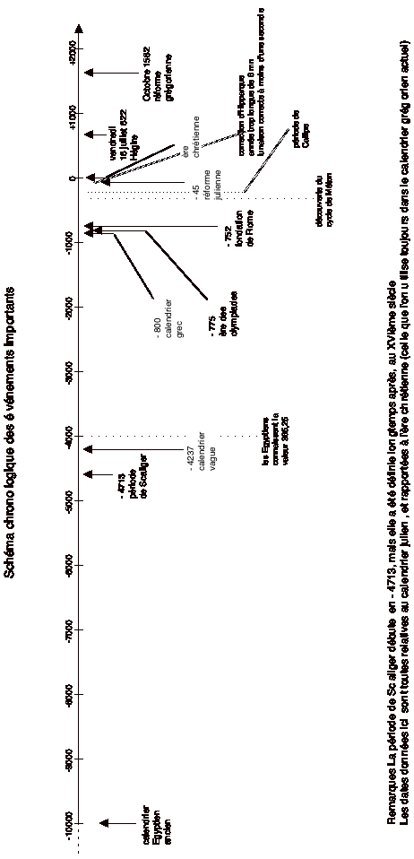

### Bibliographie

<table>
<tbody>
<tr><td>Chauve-Bertrand</td><td><em>La question du Calendrier</em></td><td>La renaissance du livre</td><td>Paris 1920</td></tr>
<tr><td>Paul Couderc</td><td><em>Le Calendrier</em></td><td>Que Sais-je&#8239;?</td><td>1946</td></tr>
<tr><td>Lucien Tartois</td><td>article <em>Le Calendrier</em></td><td>Encyclopédie la Pléïade</td><td>Paris 1962</td></tr>
<tr><td></td><td>article <em>Le Calendrier</em></td><td>Encyclopedia Universalis</td><td></td></tr>
<tr><td></td><td>article <em>Connaissances scientifiques</em></td><td>Quid&#8239;?</td><td></td></tr>
<tr><td>Caratini Roger</td><td><em>L’astronomie</em></td><td>Bordas</td><td></td></tr>
<tr><td></td><td>article <em>Le Calendrier</em></td><td>Encyclopédie atlas du ciel</td><td>édition Atlas</td></tr>
<tr><td>André Danjon</td><td><em>Astronomie Générale,</em> p127 et 128</td><td>Albert Blanchard</td><td>1980</td></tr>
<tr><td>Oudin J.M.</td><td><em>Les secrets des calendriers à la portée de tous</em></td><td>imp. St Luc</td><td>Tournai 1939</td></tr>
<tr><td>Lévy J.</td><td><em>La date de Pâques</em></td><td>annuaire du bureau des longitudes</td><td>1975</td></tr>
<tr><td></td><td><em>Données sur les calendriers</em></td><td>annuaire du Bureau des Longitudes</td><td>année en cours</td></tr>
<tr><td>Bigourdan G.</td><td></td><td>annuaire du Bureau des Longitudes</td><td>1917</td></tr>
<tr><td>Jean Lefort</td><td><em>La saga des calendriers</em></td><td>bibliothèque Pour la Science</td><td>1998</td></tr>
<tr><td>Jean-Pierre Verdet</td><td><em>Une histoire de l’astronomie</em></td><td>collection Point, ed. Seuil</td><td></td></tr>
<tr><td>Agnès Acker</td><td><em>Astronomie, introduction</em></td><td>Masson</td><td>1992</td></tr>
<tr><td></td><td><em>La semaine a-t-elle une origine astronomique&#8239;?</em></td><td>Ciel et Espace</td><td>janv-fév 1987</td></tr>
<tr><td>Emile Biémont</td><td><em>Rythmes du temps</em></td><td>De Boeck</td><td></td></tr>
</tbody>
</table>

### Index
- **A**&#8239;: [almanach](#almanach) · année ([abondante](#Calhébanc) (hébreu ancien) ; commune&#8239;: [babylonienne](#communeBab), [hébreu ancienne](#Calhébanc), [musulmane](#Calenmusul), [persanne](#Calenpersa), [romaine](#Calenromai) ; [embolismique](#Calhébanc) (hébreu ancien) ; [sidérale](#annees) ; [tropique](#annees))
- **B**&#8239;: [baktun](#Calenmaya) · [bissextil](#bissextil)
- **C**&#8239;: calendrier ([aztèque](#Calenaztèq) ; [des postes](#almanach) ; [égyptien](#Calenégypt) ; [grégorien](#Calengrégo) ; [hébreu ancien](#Calhébanc) ; [julien](#calenjulie) ; [persan](#Calenpersa) ; [romain](#Calenromai) ; [universel](#Calenunive) ; [chaldéen ou babylonien](#Calchabab) ; [chinois](#Calenchino) ; [grec](#Calengrec) ; [israélite moderne](#Calisrmod) ; [maya](#Calenmaya) ; [musulman](#Calenmusul) ; [républicain](#Calenrépub) ; [vague](#Calenégypt)) · cycle ([dominical](#Autreéléme) ; [de Méton](#Meton) ; [solaire](#Autreéléme))
- **D**&#8239;: [décans](#decans)
- **E**&#8239;: [Epacte](#epacte) · [Equinoxe](#Quelqdéfin) · [ère](#ere)
- **H**&#8239;: [Hégire](#Hegire)
- **I**&#8239;: [indiction romaine](#Autreéléme)
- **J**&#8239;: [jour de la Révolution](#jourRevol)
- **K**&#8239;: [katun](#katun) · [kin](#Calenmaya)
- **L**&#8239;: [Lever héliaque](#heliaque) · [lunaison](#annees) · [lunaison moyenne](#annees) · [luni-solaires](#luniSolaire)
- **M**&#8239;: [Mayas](#Calenmaya) · [mixtes](#luniSolaire) · [mois](#Défincalen)
- **N**&#8239;: [nemontemi](#Calenaztèq) · [Noël](#DateNoël) · [Nombre d’or](#Autreéléme) · [nouveau style](#style)
- **O**&#8239;: [octaétéride](#Meton)
- **P**&#8239;: [parapegmes](#parapegme) · période ([julienne](#PérioJulie) ; [de Callipe](#callipe) ; [de Scaliger](#PérioJulie) ; [sothiaque](#Calenégypt)) · [planètes](#semnomjou) · [précession des équinoxes](#annees)
- **R**&#8239;: [révolution synodique](#annees)
- **S**&#8239;: [Sans-culottides](#jourRevol) · [semaine](#semnomjou) · [solstice](#Quelqdéfin) · [Sothys](#Calenégypt)
- **T**&#8239;: [tonalamatl](#Calenaztèq) · [tun](#Calenmaya) · [tzolkin](#katun)
- **U**&#8239;: [uinal](#Calenmaya)
- **V**&#8239;: [Vénus](#katun) · [vieux style](#style)
- **Z**&#8239;: [zodiaque](#heliaque)

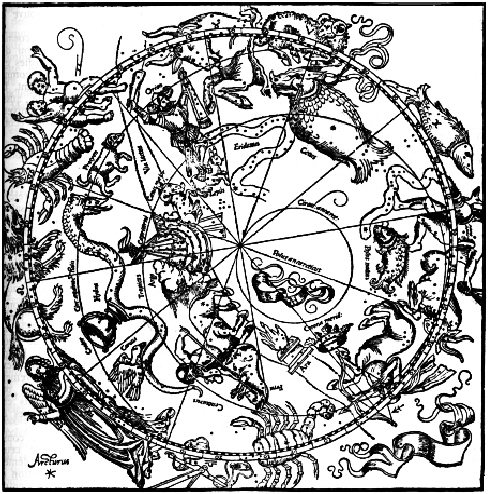

Planche représentant les constellations australes, extraite de l’édition de 1554 de l’Almageste de Claude Ptolémée. Cet ouvrage a été imprimé pour la première fois en 1538.

Ce texte a fait l’objet d’une publication dans la revue de l’Association Marseillaise d’Astronomie (AMAs), sous l’ISSN 1287 - 8278
