import Encadre from '../../../components/chapitre/Encadre.astro';
import SimulateurAristarque from '../../../components/distances/SimulateurAristarque.astro';
import SimulateurParallaxe from '../../../components/distances/SimulateurParallaxe.astro';
import OutilCepheide from '../../../components/distances/OutilCepheide.astro';
import SimulateurDistancesCosmo from '../../../components/distances/SimulateurDistancesCosmo.astro';
import TableauDistances from '../../../components/distances/TableauDistances.astro';

## Méthodes antiques

### Diamètre et distance de la Lune

Aristarque de Samos a imaginé une méthode pour mesurer le diamètre et la distance de la Lune&#8239;; Avec une assez bonne approximation, on peut considérer que les premier et dernier quartiers sont alignés. Il s’ensuit que le Soleil est beaucoup plus éloigné que la Lune. On peut donc supposer que l’ombre de la Terre est un cylindre (en réalité c’est un cône, mais son angle au sommet est très faible, et cette approximation est acceptable). En observant la Lune au cours d’une éclipse totale, Aristarque vit qu’elle restait dans l’ombre du Soleil pendant presque deux heures. Or en une heure, elle se déplace sur le ciel de son propre diamètre.

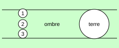

En position 1, la Lune est juste totalement éclipsée. Au bout d’une heure, elle se trouve en 2, ayant avancé de son propre diamètre. Au bout de 2 heures, elle se trouve en 3, toujours totalement dans l’ombre. Elle en sort alors. Ainsi&#8239;: **la Lune est trois fois plus petite que la terre**.

Si L est le diamètre de la Lune, et T celui de la terre&#8239;: L = 0,3 T.

On voit la Lune sous un angle de 32′ à peu près&#8239;; on a donc&#8239;: tg 32′ = L / d = 0,3 T / d = 0,0093

d’où d = 0,3 T / 0,0093 = 32 T = 64 R

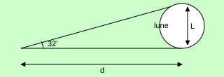

La valeur correcte est de 60 R. Aristarque avait donc trouvé une excellente approximation. Remarquons que cette mesure est **relative**&#8239;! Elle exprime la distance de la Lune par rapport au rayon de la Terre. C’est très souvent, en Astronomie, qu’on rencontrera ce genre de problème. Il est plus facile d’obtenir des rapports que des valeurs absolues.

Le [diamètre de la Terre](https://astronomia.fr/2eme_partie/planetes/3Terre/Terre.php#mesureTerre) ayant été mesuré, la Lune et son orbite sont maintenant connues.

### Distance Terre-Soleil

La distance du Soleil a été mesurée par Aristarque de Samos, qui a défini une méthode dérivée de l’observation de la Lune.

Le *Premier Quartier PQ* se produit lorsqu’on voit exactement la moitié de la Lune éclairée. Ce qui prouve que l’angle Terre-Lune-Soleil est droit, et ceci ne dépend pas de la distance du Soleil (c’est vrai sur les deux dessins ci-dessous).

Si le Soleil était à l’infini, le Premier Quartier serait exactement à mi-chemin entre la Nouvelle Lune et la Pleine Lune (le point H du simulateur ci-dessous).

Ce n’est pas le cas, le Soleil est à distance finie. Par conséquent, le Premier Quartier est plus proche de la Nouvelle Lune que de la Pleine Lune (l’arc d’orbite à parcourir est plus court). Si on suppose que l’orbite de la Lune est un cercle, parcouru à vitesse constante, l’intervalle de temps entre la Nouvelle Lune et le Premier Quartier est plus court que l’intervalle entre le Premier Quartier et la Pleine Lune. Aristarque a mesuré le temps écoulé entre la Nouvelle Lune et le Premier Quartier, puis entre le Premier Quartier et la Pleine Lune. Il a trouvé une différence de 6 heures&#8239;; il en a déduit un angle de 3°.

<SimulateurAristarque />

En résolvant le triangle, il trouve que le Soleil est 20 fois plus loin que la Lune.

<Encadre type="plus">
Les angles LTH et LST sont égaux (leurs côtés sont respectivement perpendiculaires&#8239;: LT ⊥ LS&#8239;; HT ⊥ ST)

L’angle LTH étant mesuré, LST lui est donc égal. Son sinus donne&#8239;:

$$
\sin \widehat{LST} = \frac{LT}{ST} \quad\Rightarrow\quad ST = \frac{LT}{\sin \widehat{LST}}
$$

Calculant sinus LST, la distance Terre-Soleil ST est obtenue en fonction de la distance LT.
</Encadre>

La difficulté de cette méthode tient dans l’observation de l’instant précis du Premier Quartier. Observant évidemment à l’œil nu, Aristarque s’est trompé assez largement sur le décalage&#8239;; la vraie valeur est de seulement 35 minutes. Il s’ensuit que le Soleil est, non pas 20 fois, mais 387 fois plus éloigné que la Lune.

Nous retiendrons l’astuce de ces premiers astronomes qui ont su trouver des résultats pertinents sans l’appareillage complexe dont nous disposons maintenant. L’important était surtout que le Soleil se trouve beaucoup plus loin de nous que la Lune. Et comme il a le même diamètre apparent, c’est qu’il est aussi beaucoup plus gros.

D’autre part, on savait déjà, par des méthodes géométriques simples, que la Lune est à 60 rayons terrestres de nous (60 × 6.379 = 382.740 km au lieu de 384.000 km de valeur moyenne, ce qui est une excellente précision). Donc le Soleil se trouvait à des millions de km de la Terre, ce qui est déjà assez loin pour permettre certaines approximations.

### Distance Vénus-Soleil

Si on considère que la Terre tourne autour du Soleil, ce qu’avait envisagé Aristarque de Samos au IIIe siècle avant JC, on peut définir simplement les distances **relatives** des planètes au Soleil. Prenons le cas de Vénus.

En tournant autour du Soleil, elle se voit parfois le matin, parfois le soir. Entre les deux, elle se rapproche du Soleil, passe devant ou derrière, puis s’en éloigne à nouveau. Au moment où elle occupe une position extrême (**plus grande élongation**, son plus grand éloignement angulaire au Soleil), on peut mesurer l’angle qui la sépare du Soleil. A partir de cet angle, il est très facile de calculer la distance de Vénus au Soleil, en prenant celle de la Terre pour unité&#8239;:

Il est facile de mesurer l’angle α. On remarque qu’au moment de la plus grande élongation (α maximum), la droite joignant la Terre à Vénus est tangente à l’orbite de Vénus.

Par conséquent, elle est perpendiculaire au rayon joignant Vénus au Soleil. Le triangle TVS étant donc rectangle en V, le sinus de l’angle α est&#8239;: sin α = SV / ST.

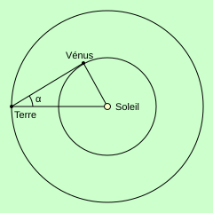

Copernic remarqua que cet angle maximum était de 46°. Par suite&#8239;: SV = sin α ST = sin 46° ST = 0,7 ST.

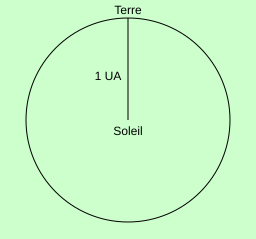

SV = 0,7 ST. En choisissant ST, la distance de la Terre au Soleil, comme unité (appelée *Unité Astronomique* et notée UA), on obtient la distance de Vénus au Soleil dans cette nouvelle unité&#8239;: **Vénus est à 0,7 UA du Soleil**. C’est cette méthode relative qui a déterminé le choix de la distance Terre-Soleil pour unité astronomique.

On peut vérifier avec les données modernes que 150 × 0,7 = 105 millions de km, ce qui est un excellent ordre de grandeur pour la distance de Vénus au Soleil.

L’unité astronomique vaut 149.597.870 km.

<Encadre type="plus">
**Exercice**&#8239;: trouver une méthode **très** simple, ne nécessitant aucun instrument particulier, pour mesurer l’angle entre le Soleil et Vénus (en effectuant cette mesure plusieurs fois, de jour en jour, on obtiendra le maximum nécessaire pour la méthode citée plus haut). (Surtout ne regardez *pas* la [solution](https://astronomia.fr/1ere_partie/solution.php)&#8239;!)
</Encadre>

Il est beaucoup plus difficile de mesurer une distance en kilomètres. La première évaluation de ce genre a été faite par Giovanni Domenico Cassini (dit Jean-Dominque Cassini), en mesurant la parallaxe de Mars entre la France et la Guyane. Cette parallaxe est l’angle α ci-dessous. Connaissant la distance entre ces deux points F et G sur Terre, il en déduisit la distance dans la même unité entre les deux planètes.

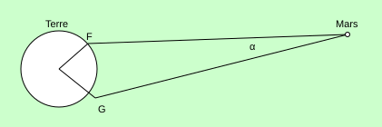

Une méthode semblable, mais bien plus précise (méthode des passages), est décrite dans le [chapitre](https://astronomia.fr/2eme_partie/planetes/2Venus/Venus.php#passage) consacré à Vénus.

## Parallaxe

La méthode des parallaxes est excellente, mais elle est très délicate à mettre en œuvre. Il a fallu attendre des moyens d’observation évolués pour pouvoir l’utiliser, mais alors elle a révolutionné notre connaissance de notre entourage stellaire.

Pour comprendre son principe, faisons une petite expérience. Tendons le bras en avant, index levé. On voit le doigt se profiler devant le mur d’en face. Si on ferme l’œil droit, on va voir le doigt devant l’image du téléphone. Sans bouger, fermons maintenant l’œil gauche. Le doigt ne se projette plus devant le téléphone, mais devant le flocon de neige. On va profiter de cela pour mesurer la distance du doigt&#8239;:

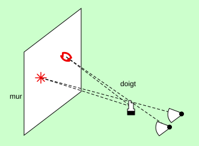

La distance entre les deux yeux produit un effet de perspective, que l’on nomme *parallaxe*. Cet effet est d’autant plus marqué que l’objet observé est plus proche, c’est-à-dire que sa distance est plus petite devant l’écart entre les yeux. On peut le mesurer par l’angle que font les rayons lumineux sur le dessin.

Historiquement, c’est Thalès qui a le premier décrit la méthode&#8239;; il l’a utilisée pour mesurer de loin la hauteur d’une pyramide.

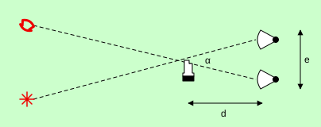

Dans le triangle formé par les yeux et le doigt, on connait la distance e entre les yeux, et on mesure l’angle α. On en déduit la distance d. C’est ce que notre cerveau fait en permanence (vous voyez bien que vous savez calculer un *sinus*&#8239;!). Si on ferme un œil, on perd la notion de profondeur.

L’idée des astronomes a été d’augmenter l’écart entre les yeux&#8239;! Pour simuler cela, ils ont pris deux photos du ciel à 6 mois d’intervalle. Sur ces photos, il y a des étoiles très lointaines, qui jouent le rôle du mur, et des étoiles proches qui jouent le rôle du doigt. La distance entre les deux yeux (les deux photos) est la dimension de l’orbite de la Terre&#8239;! 300 millions de kilomètres. Avec cela, on peut espérer mesurer la distance des étoiles les plus proches.

<SimulateurParallaxe />

On connait la base du triangle&#8239;; c’est le diamètre de l’orbite terrestre. On mesure l’angle α&#8239;; il ne reste plus qu’à résoudre le triangle, pour calculer l’un des côtés. **La connaissance de l’angle α est donc équivalente à celle de la distance**.

<Encadre type="plus">
La relation utilisée est&#8239;: A / sin a = B / sin b = C / sin c où A, B et C sont les côtés, a, b, c les angles respectivement opposés aux côtés.
</Encadre>

On nomme **parallaxe** l’angle sous lequel on voit le **rayon** de l’orbite terrestre (et non pas son diamètre comme sur le schéma ci-dessus&#8239;; par l’observation, on mesure l’angle α, et on le divise par deux pour obtenir la parallaxe de l’étoile). On utilise le rayon de l’orbite terrestre, **parce que c’est l’unité astronomique**.

### Parsec

Cette méthode a donné une nouvelle unité de distance&#8239;: le **parsec** est la distance correspondant à une **par**allaxe d’une **sec**onde.

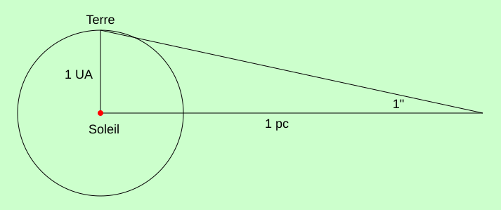

C’est donc&#8239;:

<Encadre type="def" titre="Parsec">
1 parsec = distance à laquelle on voit l’Unité Astronomique sous un angle d’une seconde.
</Encadre>

Abbréviation&#8239;: **pc**

**Remarque 1**&#8239;: le parsec est défini à partir de l’unité astronomique, donc les distances entre les étoiles peuvent être mesurées dans la même unité que les distances dans le système solaire (homogénéité du système d’unités astronomiques). Ce n’est pas le cas avec l’année-lumière, dont la définition ne fait intervenir que les propriétés de la lumière. On peut toutefois établir des formules de transformation des unités, qui permettront de passer de l’une à l’autre&#8239;:

<Encadre type="plus">
1 pc = 3,26 années-lumière = à peu près 3 1013 km
</Encadre>

Cette méthode des parallaxes a permi de mesurer depuis le sol les distances stellaires avec une précision de 10 à 20 % jusqu’à une distance de 30 pc.

Pour sa cohérence avec l’unité astronomique, le parsec présente un grand intérêt, et les astronomes ont tendance à l’utiliser à la place de l’année-lumière.

**Remarque 2**&#8239;: l’année-lumière a un grand intérêt pédagogique. Si on veut avoir une idée des distances dans l’Univers, il suffit de dire que la Terre est à 8 minutes-lumière du Soleil, alors que l’étoile la plus proche est à 4,2 années-lumière. On peut dire que l’écart entre 8 minutes et 4,2 années saute aux yeux&#8239;! C’est beaucoup plus parlant que de comparer en km (que signifient 150.000.000 et 40.000 milliards de kilomètres&#8239;?).

### Mesures des parallaxes depuis le sol

Les étoiles sont si loin, que leurs parallaxes sont très faibles, et bien difficiles à mesurer. Impossible à l’œil nu en tous cas, et cette impossibilité à suscité des oppositions au système héliocentrique de Copernic&#8239;: puisqu’on ne voit pas de déplacement annuel des étoiles, c’est que la Terre est fixe&#8239;!

Il a fallu attendre donc d’avoir de bons instruments pour mettre la parallaxe des étoiles les plus proches en évidence. C’est Bessel qui a publié la première mesure en 1838, de la parallaxe de l’étoile 61 Cygni (0,29″, 11,36 AL, soit 3,48 pc&#8239;; 61 Cyg est aussi la première étoile dont on ait mesuré le mouvement propre). Cette mesure fut une justification supplémentaire de l’héliocentrisme.

La petitesse de la parallaxe de toutes les étoiles (sauf les toutes proches), rend très difficile sa mesure, et les instruments au sol, avec la turbulence atmosphérique, sont bien limités. Pour progresser, il faut se débarrasser de l’atmosphère, donc observer depuis l’espace. Avant cela, on disposait seulement des positions de 300 étoiles avec une précision de 10 %.

Même depuis l’espace, seules les étoiles les plus proches seront mesurables. On imagine déjà que pour les plus lointaines, il faudra trouver des méthodes indirectes. La parallaxe est une mesure **équivalente** aux mesures que l’on fait sur Terre, par comparaison avec un étalon. De ce fait, elle sera la base de toute détermination de distance dans l’Univers, d’où son importance.

### Hipparcos

Le satellite Hipparcos (**Hi**gh **P**recision **PAR**allax **CO**llecting **S**atellite) de l’Agence Spatiale Européenne (**ESA**), lancé par Ariane IV le 8 août 1989 depuis la base de Kourou, observant hors de l’atmosphère, a augmenté 50 fois la précision des mesures, sur un nombre d’étoiles multiplié par 80&#8239;! Ses résultats ont amené les astronomes à revoir tout le système de mesures de l’Univers.

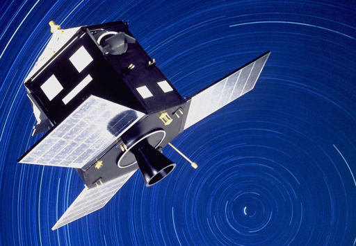

*le télescope Hipparcos image ESA*

Il était équipé d’un petit télescope de Schmidt de 29 cm de diamètre, lui permettant d’atteindre la magnitude 12,4. Il observait simultanément deux régions écartées de 58° l’une de l’autre. Il était en rotation lente (un tour en 2 h 8 minutes), provoquant un balayage systématique du ciel. C’est ce balayage qui permettait de mesurer les positions.

Il a observé 120.000 étoiles à moins de 500 AL de la Terre, avec une précision de l’ordre du millième de seconde d’arc. Il a produit trois catalogues&#8239;:

- la *catalogue Hipparcos*, contenant 120.000 étoiles mesurées à 1 mas&#8239;;
- le *catalogue Tycho*, contenant plus d’un million d’étoiles à une précision de 20 à 30 mas&#8239;;
- le *catalogue Tycho2*, qui est une extension du précédent, contenant 2.500.000 étoiles, avec une précision un peu améliorée. Il couvre 99 % de toutes les étoiles de magnitude inférieure à 11.

Le résultat le plus spectaculaire d’Hipparcos a été la modification de toutes les distances dans l’Univers. La révision des erreurs antérieures sur la distance des étoiles, base de toutes les distances dans l’Univers, ont entraîné une augmentation de la taille estimée de l’Univers. Correlativement, l’âge de l’Univers a été révisé à la baisse.

### Gaia

L’Agence Spatiale Européenne a construit un successeur d’Hipparcos, nommé Gaia. Gaia fait partie du programme scientifique de l’ESA *Horizon 2000*, comprenant Rosetta, Herschel, Planck, Lisa, BepiColombo et Gaia. Il a été lancé le 19 décembre 2013 depuis la base européenne de Kourou, par une fusée Soyouz Fregat. Gaia est arrivé à son poste, autour du point de Lagrange L2, le 8 janvier 2014.

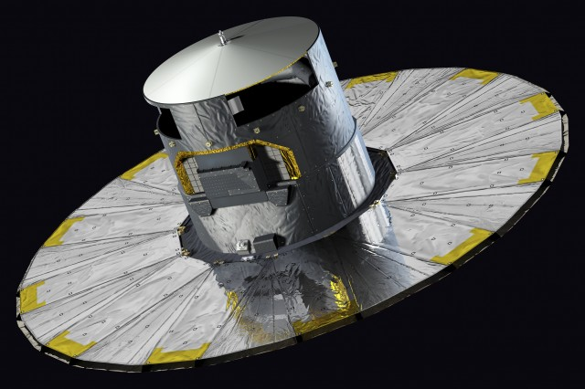

*le télescope Gaia image ESA*

Cet instrument est exceptionnel. Il a été entièrement réalisé en carbure de silicium SiC (monture, support, miroir… afin de garantir la meilleure stabilité thermique pour la fiabilité des mesures. Il comporte deux télescopes séparés d’un angle de 106,5°. Les faisceaux qui en émergent sont combinés. Cette méthode est plus efficace que celle utilisée sur Hipparcos (optique de combinaison à la sortie plus petite et plus légère, angle mécaniquement constant).

Gaia est 50 fois plus précis qu’Hipparcos, et mesurera plus d’un milliard d’étoiles jusqu’à la magnitude 20 (position, photométrie, spectre). Ce nombre représente quelque chose comme 1 % des étoiles de la Voie Lactée. La durée de la mission est de 5 ans.

A cette magnitude limite, il déterminera les positions du milliard d’étoiles à la précision de 300 µas (micro arc-seconde). C’est 10.000 fois plus d’étoiles qu’Hipparcos, à une précision plus de 3 fois meilleure. Notez bien que, passant de la magnitude 12 à la magnitude 20, on observe des étoiles considérablement plus éloignées&#8239;: une étoile de M = 5 (assez semblable au Soleil), à 250 pc apparaît à la magnitude m = 12&#8239;; on la voit à m = 20 si elle est à 10.000 pc, soit 40 fois plus loin&#8239;! Jusqu’à cette distance (30.000 AL), la précision sur la distance sera meilleure que 20 %.

Pour les étoiles proches, Gaia obtiendra une précision bien meilleure&#8239;: jusqu’à la magnitude 12, c’est à mieux que 7 µas que l’on obtiendra les mesures. Ceci représente une pièce d’un euro sur la Lune. A cette précision, il faut tenir compte des effet de lentille gravitationnelle produits par le Soleil bien sûr, mais aussi par les planètes, et même certains satellites&#8239;! La précision sera meilleure pour les étoiles rouges (type spectral M), que pour les bleues.

La précision de position atteinte pourrait permettre la découverte de 10 à 20.000 exoplanètes, par la mesure des changements provoqués par leur circulation orbitale. Ce n’est plus seulement la vitesse (radiale), mais aussi le mouvement propre (tangentiel) de l’étoile qui trahit la planète&#8239;! Un changement radical dans la façon de considérer les exoplanètes.

Gaia apportera aussi de nombreux renseignements sur les propriétés physiques des étoiles&#8239;: luminosité, température, composition chimique… Mais aussi un catalogue des astéroïdes, des naines brunes, des quasars (500.000). Enfin, toute explosion de la précision en science a apporté son lot de découvertes inattendues. Gageons que ce sera le cas aussi pour Gaia.

Gaia embarque aussi un détecteur de photométrie, et un spectromètre (vitesse radiale). Ces trois instruments sont alignés dans le plan focal, de sorte qu’un astre passe successivement sur les trois. Ainsi, on peut dire qu’ils travaillent en parallèle. La photométrie en plusieurs couleurs donnera une indication sur le décalage spectral des objets mesurés.

Le premier but de Gaia est la constitution d’un catalogue d’étoiles en trois dimensions, avec les vitesses. Mais grâce au spectromètre, des données physiques sur les étoiles seront aussi mesurées. Le résultat sera une connaissance extrêmement approfondie de toutes les étoiles dans un volume important autour du Soleil. Sachant que des propriétés de celles-ci on extrapole les propriétés de l’Univers, on mesure l’importance de cette mission.

Le satellite étant destiné à balayer tout le ciel plusieurs fois, il est évident que tous les objets assez brillants seront observés. Ceci inclus des astéroïdes, des comètes, et d’autres objets beaucoup plus lointains. Ces observations seront des retombées du programme principal.

## Méthodes actives

### Laser

Une première méthode utilise le laser, et sert pour mesurer la distance Terre-Lune (télémétrie laser-Lune). Des lasers de puissance tirent des éclairs vers les réflecteurs laser qui ont été déposés à la surface de la Lune par les missions *Apollo* ainsi que les rovers soviétiques *Lunokhod*. Ces réflecteurs sont des *coins optiques*, c’est-à-dire des coins de cube, aluminiés à l’intérieur, qui renvoient tout rayon lumineux qui les frappe, quelle que soit l’incidence, vers l’émetteur (l’usinage de ces coins est très précis, les angles font 90° à mieux qu’une seconde près). La précision des mesures est de l’ordre du centimètre. L’observatoire de la Côte d’Azur abrite l’un des lasers-Lune&#8239;:

<Encadre type="plus">
Station de télémétrie laser MéO (Métrologie Optique, ancienne LLR pour Lunar Laser Ranging), télescope de 1,54 m de diamètre, laser YAG (Yttrium, Aluminium, Grenat) émettant 10 tirs par seconde, retour 1 photon tous les 100 tirs, précision d’horloge de 7 ps (7 pico secondes, 7 10-12 s), précision de mesure 15 à 30 ps qui donne un résultat à quelques millimètres près.
</Encadre>

Le résultat le plus spectaculaire de ces expériences est la mesure précise de l’éloignement annuel de la Lune, dû aux marées, et qui se monte à 3,8 cm / an.

Il n’est pas possible d’utiliser le laser sur des cibles planétaires (le nombre de photons retournés serait bien trop faible, surtout en l’absence de réflecteurs).

### Radar

Pour les planètes donc, on utilise un radar. Ou tout au moins quelque chose qui fonctionne sur ce principe. L’idée est la même que pour le laser&#8239;: il s’agit d’éclairer la surface d’une planète, et de capter l’éclair en retour. Au lieu d’être dans le domaine visble, la *lumière* utilisée ici est de longueur d’onde bien plus grande, ce sont des micro-ondes. L’ennui ici est qu’on ne dispose pas de réflecteurs à la surface, et donc le rendement est mauvais. Très peu de puissance radio nous revient, ce qui limite l’emploi de la méthode.

Les paraboles des radars n’ont pas la surface suffisante pour envoyer un faisceau jusqu’à une planète, même proche. On utilise donc un radiotélescope, dont le miroir est très grand. Un émetteur est placé au foyer du miroir, à côté du récepteur. L’instrument est utilisé successivement en émission puis en récpetion (c’est le principe qui est appliqué pour les radars routiers…). Le plus grand ayant été utilisé est celui d’Arecibo.

La radioastronomie est passive, en ce sens qu’elle détecte des ondes émises par les astres, alors que la méthode décrite ici est active, elle envoie un faisceau vers la planète dont on veut connaître la distance. La précision est meilleure que le kilomètre.

Appliquée à Vénus, cette méthode donne une excellente valeur de la distance et permet, en retour, de fixer l’Unité Astronomique&#8239;: sa valeur est de 149.597.870 km. Les difficultés ont amené des résultats fantaisistes au début, mais à partir de 1961, des données correctes ont été obtenues.

Mars a été observée depuis Arecibo, et des détails de surface ont été mis en évidence. Sur Mercure, plus lointaine, la distance est le résultat à attendre.

La méthode a été appliquée pour cartographier des astéroïdes passant près de la Terre. Par exemple 216 Kleopatra, qui a la forme d’un gros nonos&#8239;!

Le radar a été utilisé aussi, toujours pour mesurer des distances, mais dans des circonstances très différentes. Embarqué à bord d’une satellite placé en orbite autour de Vénus, le faisceau est assez étroit grâce à la proximité, pour ne sonder qu’une petite partie du terrain placé en-dessous. Si on connait très bien l’orbite du satellite, la mesure de la distance sol-satellite point par point permet de reconstituer toute l’altimétrie de la planète. C’est ainsi que Vénus, toujours cachée sous d’épais nuages et impossible à photographier, a pu être cartographiée. Cette cartographie précise a mis en évidence les volcans, et toutes les formations géologiques, certaines n’existant que sur Vénus.

Pareillement, la sonde Cassini a cartographié la surface de Titan, également couverte de nuages. Elle a mis en évidence, outre les altitudes, des différences de réflexivité du sol, qui ont permi de détecter des lacs d’hydrocarbure à la surface. Mis en rapport avec les photos prises sous les nuages par le module européen Huygens, c’est toute la connaissance de Titan qui en a été bouleversée.

Dans ces expériences de cartographie, ce sont toujours les distances qui sont mesurées (essentiellement), mais dans un but dérivé. On s’éloigne un peu de la mesure pure des distances.

## Méthodes passives

La méthode des parallaxes est excellente, et fournit une grande précision, à condition de pouvoir mesurer l’angle sous lequel on voit une étoile par rapport aux étoiles du fond. Mais cette précision ne peut être atteinte que dans le voisinage immédiat du Soleil.

Il existe de nombreuses méthodes, basées sur des phénomènes différents&#8239;; nous allons en survoler quelques unes. Mais auparavant, voyons une analogie plus parlante.

### Analogie des mesures dans une ville

Imaginons qu’on veuille réaliser le plan d’une ville, en restant sur le toit d’un immeuble. On ne pourrait pas mesurer directement la distance des autres immeubles, et de plus, certains bâtiments en cacheraient d’autres.

La distance des immeubles très proches peut être mesurée directement par trigonométrie (voir plus loin)&#8239;: en se déplaçant sur le toit, on les voit se détacher devant des points différents repérés sur les collines au loin. La mesure de ce déplacement permet de calculer très simplement la distance. Mais plus les immeubles sont lointains, plus faible est leur déplacement apparent devant le paysage. Lorsque ce déplacement devient trop faible, sa mesure n’est plus possible, et donc la distance ne peut plus être calculée.

Mais avec un peu d’astuce, on peut s’en sortir tout de même&#8239;! L’idée de base est que les immeubles sont plus ou moins semblables, qu’ils soient proches ou lointains. On peut vérifier cette idée sur les plus proches, dont a on mesuré les distances. Une fois la méthode éprouvée sur ceux-là, on l’extrapolera vers les immeubles plus lointains.

Considérons par exemple la luminosité des fenêtres (la nuit). On peut calculer la luminosité moyenne des fenêtres sur l’ensemble des immeubles proches. On vérifie en même temps que les fenêtres beaucoup plus ou beaucoup moins lumineuses que la moyenne sont très rares. Cette moyenne est donc significative. Puisqu’on connaît la distances des immeubles sur lesquels on a fait cette analyse, on en déduit la luminosité moyenne des fenêtres en fonction de la distance.

Observons maintenant les fenêtres d’un immeuble plus lointain, trop lointain pour que sa distance puisse être mesurée par trigonométrie. La luminosité apparente des fenêtres introduite dans la relation précédente donnera la distance.

Nous faisons en permanence cette gymnastique mentale sans en prendre conscience. La précision est moins bonne, mais l’ordre de grandeur représente une très bonne approximation.

Si la ville est très grande, on ne pourra pas mesurer la luminosité des fenêtres pour les immeubles les plus lointains. Il faudra se contenter de critères concernant non plus un détail de l’immeuble, mais l’immeuble dans son ensemble. Il est évident qu’il existe des immeubles de tailles très différentes. Mais si on regarde les plus hauts parmi ceux dont on a déterminé la distance, on s’aperçoit qu’ils sont à peu près de la même hauteur (correspondant peu que peu à ce qu’on sait faire, techniquement ou financièrement). Alors, pour les faubourgs lointains, on pourra évaluer la distance à laquelle se trouve un quartier dans son ensemble, à la condition qu’il s’y trouve quelques grands immeubles, dont on mesurera la luminosité globale. Mais on ne pourra pas préciser la distance d’un immeuble en particulier.

Enfin, si la ville est vraiment très grande, on pourra établir des statistiques sur les quartiers eux-mêmes, et s’en servir pour déterminer la distance des plus lointains.

C’est un ensemble de méthodes de ce genre qu’on utilise en astronomie, étant donné que la Terre, sur son orbite, représente le toit de l’immeuble auquel nous sommes attachés. Depuis notre observatoire, qui se déplace de 300 millions de kilomètres au cours de l’année, nous voyons les étoiles proches se déplacer légèrement par rapport au plus lointaines, et ceci permet de mesurer leurs distances par trigonométrie. Ensuite, ayant analysé les propriétés physiques des étoiles proches, de distance connue, on peut extrapoler ces mêmes propriétés vers les plus lointaines, et en déduire une distance approximative. Bien évidemment, ces méthodes sont de moins en moins précises à mesure qu’on s’éloigne, puisque les erreurs de chacunes des méthodes utilisées pour y parvenir s’accumulent.

### Adaptation à la Séquence Principale

Cette méthode s’applique à un amas d’étoiles, et est basée sur le diagramme HR. Ce dernier est construit en plaçant les points figuratifs d’un groupe d’étoiles sur un graphique dont l’axe des abscisses porte la température effective, et l’axe des ordonnées la magnitude absolue.

Que se passerait-il si, au lieu de la magnitude absolue (en général inconnue), on mettait la magnitude visuelle&#8239;? La magnitude visuelle dépend de la distance, la magnitude absolue en est débarrassée. Si on considère deux étoiles de même température effective, et situées à des distances différentes, elles seront placées sur une même verticale, puisque la température effective en abscisse est la même, mais à des hauteurs différentes, puisque leur éclat sera diminué différemment selon leur distance.

Si on fait la même chose pour toutes les étoiles d’un amas, dont les dimensions sont petites devant la distance, on peut considérer que toutes ses étoiles sont affaiblies de la même façon par l’éloignement, qui est à peu près le même pour toutes. Donc, leurs magnitudes visuelles seront égales à leurs magnitudes absolues plus une constante, la même pour toutes. Par conséquent, le diagramme HR élaboré avec les magnitudes apparentes sera une ligne parallèle à la Séquence Principale, décalée vers le haut ou le bas de cette constante. Puisqu’on connait très bien le diagramme HR construit avec les magnitudes absolues, il suffira de décaler la ligne représentative des magnitudes visuelles pour l’amener en superposition avec la Séquence Principale. La valeur du décalage représente le module de distance, et permet de calculer la distance.

### Les Céphéides

La méthode que nous allons considérer date du début du XXe siècle, et repose sur les propriétés d’étoiles semblables.

Comme nous venons de le voir, la méthode géométrique, appliquée du sol ou de l’espace, permet de mesurer les distances des étoiles proches. Connaissant ces distances, on connait l’éclat des étoiles concernées, et on peut étudier leur comportement. Certaines de ces étoiles, comme δ Cephée, présentent des variations de luminosité&#8239;; on les appelle [*étoiles variables*](https://astronomia.fr/3eme_partie/variables.php). Mais les Céphéides varient périodiquement, **de manière très précise**. Et une astronome, Miss Henrietta Leavitt, a montré au début du XXe siècle, que leur période était liée à leur luminosité (ou magnitude absolue). Par conséquent, pour les Céphéides proches, dont la distance est connue par la méthode géométrique, la magnitude absolue est connue aussi&#8239;; on mesure la période, on en déduit la relation.

Cette relation étant maintenant connue, on peut l’appliquer à d’autres Céphéides plus lointaines, dont on ignore la distance. On mesure leur magnitude apparente et leur période. De la période on déduit la magnitude absolue en utilisant la relation&#8239;; on dispose maintenant de la magnitude visuelle et de la magnitude absolue. Il est aisé d’en déduire la distance.

En détails, on mesure m la magnitude visuelle totale, B et V les magnitudes visuelles restreintes à la partie Bleue et Visible- ou jaune - du spectre, obtenues derrière des [filtres](https://astronomia.fr/seminaires/annee1112/diagrammeHR.php#photometrie). La période s’obtient en traçant la courbe de lumière (m par rapport au temps), sur une durée de l’ordre du mois. La période est le temps qui s’écoule entre deux maxima successifs de la courbe de lumière. Si on mesure sur plusieurs mois, on améliore la précision sur la période.

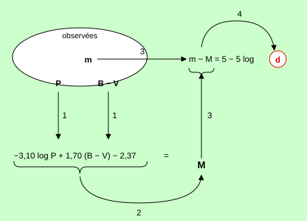

La période P et B - V (observés) permettent de calculer la magnitude absolue, grâce à la relation ci-dessus (flèches 1 et 2)&#8239;; et la relation entre la magnitude visuelle, la magnitude absolue et la distance permet donc de déduire la distance (flèches 3 et 4). Faites le calcul vous-même&#8239;:

<OutilCepheide />

La chance veut que les Céphéides soient des étoiles très brillantes, que l’on voit de loin. Elles permettent donc de mesurer les distances des amas d’étoiles et des galaxies qui les contiennent. On dit que ce sont des indicateurs de distance secondaires.

C’est sur l’étude des Céphéides que repose tout le système de mesure des distances dans l’Univers.

La distance d (en parsecs), tirée de la relation $m - M = 5 \log d - 5$, s’exprime par&#8239;:

$$
d = 10^{\,(m - M + 5)/5}
$$

A partir d’une certaine distance, il n’est plus possible de voir des Céphéides. Pour mesurer les distances, on utilise alors des objets plus lumineux, visibles de plus loin. Ces objets sont en particulier les noyaux de galaxies. Bien évidement, la précision des ces mesures, très indirectes, est plus faible.

Toute la connaissance de l’Univers est donc basée sur les mesures géométriques pour les objets proches, puis sur les Céphéides plus loin, puis sur la luminosité globale de très gros objets plus loin encore. Plus on s’éloigne, plus la précision des mesures diminue.

### Mira Ceti

Les étoiles de type Mira sont aussi très brillantes, et obéissent à une relation semblable à celle des Céphéides. Elles sont aussi utilisées pour déterminer les distances.

### Loi de Tully-Fisher

En 1977, Tully et Fisher ont découvert une relation empirique entre la vitesse de rotation d’une spirale et sa luminosité. Nommée *loi de Tully-Fisher*, cette relation s’exprime par&#8239;:

$$
L \propto V^4
$$

La vitesse V est la vitesse de rotation du disque galactique, L est la luminosité de la galaxie. L’étude de quelques galaxies assez proches pour que la distance puisse être déterminée par les Céphéides, permet de calibrer la relation, c’est-à-dire de déterminer la constante de proportionalité.

Il est facile de la déterminer par l’observation, tout au moins pour les galaxies dont on est capable de prendre un spectre relativement détaillé. Considérons une raie spectrale, Hα par exemple. On la verra en absorption provenant des différentes parties de la galaxie. La contribution du bulbe donne une raie spectrale dont le décalage vers le rouge est dû à la distance à laquelle se trouve la galaxie (expansion de l’Univers). Décalons l’ensemble du spectre de cette quantité, pour le voir comme si la galaxie était au repos par rapport à nous. Les parties externes du disque, dans leur rotation s’approchent et s’éloignent de nous. Le bord qui s’approche produit un décalge vers le bleu, le bord qui s’éloigne un décalge vers le rouge. L’ensemble de la galaxie présente donc une raie spectrale non pas verticale dans le spectre, mais inclinée. L’angle dont lequel elle s’incline permet de déterminer la vitesse de rotation apparente (en projection sur le ciel, selon l’inclinaison de la galaxie par rapport à nous).

L’aspect de la galaxie donne par ailleurs une approximation de l’angle sous lequel elle se présente à nous. La connaissance de cet angle permet de déterminer la vitesse de rotation réelle de la galaxie.

Nous avons vu comment, par l’observation, déterminer la vitesse de rotation d’une spirale. Il ne reste maintenant qu’à appliquer la relation de Tully-Fischer pour en obtenir la luminosité, c’est-à-dire la magnitude absolue M.

Enfin, la mesure de la magnitude apparente m permet, toujours avec la même relation, de déterminer la distance.

### Loi de Faber-Jackson

C’est l’équivalent de la loi de Tully-Fischer pour les galaxies elliptiques. Elle joue donc le même rôle.

Les galaxies elliptiques étant maintenues par la pression, et non par la rotation, la loi de Tully-Fischer ne s’applique évidemment pas. Mais au lieu de la vitesse de rotation, on peut utiliser la dispersion de vitesses, qui caractérise la pression dans le cœur de la galaxie. C’est ce qu’ont fait Sandra Moore Faber et Robert Earl Jackson, et ils ont obtenu la relation empirique&#8239;:

$$
L \propto \sigma^4
$$

Cette relation a été ensuite analysée et critiquée par D. Gudehus, qui a proposé une relation plus complexe, ayant davantage de paramètres.

## Méthodes basées sur l’expansion de l’univers

### Loi de Hubble

Cette loi, dite *de Hubble*, a été découverte en réalité par Alexandre Friedman et Georges Lemaître, à partir de la Relativité Générale, et s’exprime par&#8239;:

$$
V = H\,d
$$

où V est la vitesse apparente d’éloignement de la galaxie, et d sa distance. H est la constante de Hubble, qui n’est en fait que la valeur actuelle d’une variable. Elle représente le taux d’expansion de l’Univers, et varie donc avec la répartition de la masse en son sein.

A petite distance (si l’on peut dire), cette loi donne une distance qui a un sens, V étant mesurée par le décalage spectral. Mais si d est grande, elle devrait tenir compte de la variation de la "constante" H avec le temps (et l’éloignement).

La valeur de H est très difficile à établir correctement, et n’est pas encore universellement acceptée. On donne aujourd’hui&#8239;: H0 = 72 km s−1 Mpc−1

La vitesse étant croissante avec l’éloignement, on peut chercher à quelle distance elle atteint la vitesse de la lumière&#8239;:

V = 300.000 km s-1 = 72 km s-1 Mpc-1 d ⇒ d = 300.000 km s-1 / 72 km s-1 Mpc-1

d = 4.166 Mpc, ou 13,5 milliards d’années-lumière. On trouve donc que la vitesse définie de cette manière tend vers la vitesse de la lumière lorsqu’on s’approche du Big Bang. En réalité, le calcul esrt plus complexe, puisque H varie avec le temps. Ici, nous n’avons calculé qu’une approximation avec H constant.

### Supernovæ de type Ia

Les SN Ia servent aussi d’indicateurs de distance.

### Distance comobile

Au-delà des méthodes précédentes, on ne connait plus d’objets assez lumineux et présentant des propriétés stables pour définir une méthode de même type que les précédentes.

La solution vient de l’expansion de l’Univers, et de la relation entre distance et décalage vers le rouge. Malheureusement, cette relation est fort complexe, et dépend de multiples paramètres que l’on ne maîtrise pas. Pour essayer de s’y retrouver quelque peu, commençons par une analogie qui explique l’expansion de l’Univers.

Prenons une bande de caoutchouc élastique, et traçons-y en noir les graduations d’un mètre en ruban et les chiffres correspondant. Cette idée saugrenue devient intéressante par analogie avec l’espace-temmps. Ajoutons en rouge deux points, disons espacés de 50 cm. Ils représenteront deux galaxies. Si on tire sur l’élastique, elle s’allonge régulièrement, et la distance entre les graduations augmente. Là où il y avait un centimètre, il y en aura deux. Mais cette opération ne change pas les nombres inscrits&#8239;! La distance entre les deux points indique toujours 50 cm, même s’ils sont maintenant espacés réellement de 1 m.

C’est exactement ce que font les astronomes. L’expansion de l’Univers change sans cesse les distances réelles entre deux galaxies typiques. Si on imagine que des graduations sont indiquées dans l’espace-temps, elles s’écarteront de même avec l’expansion, mais indiqueront toujours la même chose. Pour cette raison, on dit qu’on utilise un *référentiel comobile*, en ce sens qu’il bouge, par l’expansion, avec les objets qu’il permet de repérer. Dans le référentiel comobile, la distance (*distance comobile* dc) entre deux galaxies reste constante au cours du temps. Mais la *distance physique* dφ varie comme on le comprend. La distance physique dφ est parfois appelée *distance propre*.

Pour faire cela, on a inventé le *facteur d’échelle* a(t). Dans l’exemple ci-dessus, on a imaginé que les distances doublent dans un certain temps t (le temps de tirer sur l’élastique). Le facteur d’échelle a(t) correspondant sera 2. La distance des galaxies (toujours dans notre exemple) est toujours de 50 cm. Donc&#8239;: dφ = 1 m = a(t) dc = 2 × 50 cm

De manière générale, nous aurons&#8239;:

$$
d_\varphi = a(t)\, d_c
$$

On peut comprendre l’avantage de cette notion. Le facteur d’échelle, entre deux dates, nous indique de combien l’Univers a grossi dans cet intervalle. Si on a cette information, alors on peut savoir quelle est la distance entre les deux galaxies (connaissant leur distance comobile).

Le facteur d’échelle dépend du temps, et aujourd’hui, il vaut 1, afin que la distance propre (distance physique), soit celle que l’on mesure maintenant. On a donc a(1) = 1. On peut déterminer la dépendance entre z et a(t)&#8239;:

z = (λ0 - λe) / λe et λe = a(t) λ0 (la longueur d’onde est une longueur particulière, et évolue comme telle)

D’où l’on tire&#8239;:

$$
1 + z = \frac{1}{a(t)}
$$

Le facteur d’échelle représentant l’expansion, il est évident qu’il dépend du modèle d’Univers choisi. Si l’Univers était vide de matière, l’expansion ne serait pas freinée, et se poursuivrait sans limite. Si l’Univers étit à forte densité, l’expansion serait fortement ralentie. Le facteur d’échelle devrait évidemment suivre ces comportements.

En regroupant les deux formules, on obtient la distance physique en fonction du décalage spectral&#8239;:

$$
d_\varphi = \frac{d_c}{1 + z}
$$

Nous allons maintenant voir comment on peut mesurer les distances dans l’Univers.

### Distance de luminosité

Une façon de déterminer les distances, largement utilisée dans l’espace proche, utilise cette propriété&#8239;: plus un astre de luminosité donnée est loin, plus il apparaît faible. Sa lumière se répand dans l’espace, selon une sphère de rayon dφ (on est à la distance physique dφ). L’éclat apparent diminue donc comme 1 / dφ2.

En fonction du facteur d’échelle, dφ = a(t) × d0, où d0 est la distance comobile.

Lorsque la distance est grande, les effets de l’expansion se font sentir. La lumière émise nous arrive décalée vers le rouge. Un photon voit donc sa longueur d’onde augmenter, tout simplement selon le décalage spectral&#8239;: Δλ / λ0 = z ⇒ (λ - λ0) / λ0 = z

d’où λ = λ0 (1 + z).

Les longueurs d’onde sont multipliées par le facteur 1 + z. Puisque l’énergie des photons est inversement proportionnelle à la longueur d’onde, l’énergie de chaque photon est divisée par 1 + z. Nous voyons donc des photons qui portent moins d’énergie, comme si la source était plus loin&#8239;! Si nous appliquons la méthode habituelle pour déterminer la distance, nous obtiendrons une distance nommée *distance de luminosité*, qui est plus grande que la distance réelle (physique) dans le facteur 1 + z. Donc&#8239;:

$$
d_{lum} = d_\varphi\,(1 + z)
$$

Si un objet est proche, son décalage spectral z est très petit, et peut être négligé devant 1 (z ≪ 1). On retrouve alors dlum = dφ, ce qui justifie l’usage de cette méthode à petite distance (petit z).

Si on mesure dlum et z, on peut en déduire dφ, ce qui est satisfaisant pour l’esprit&#8239;: on peut imaginer où se trouve l’objet qu’on est en train de regarder, quelque part dans un espace-temps figuré. Mais quelle est la signification de cette distance "réelle", étant donné que nous ne pouvons pas voir l’objet à cette position&#8239;?

Dans ce qui précède, nous avons supposé que l’Univers est plat (sa géométrie est euclidienne). S’il n’en était pas le cas, l’influence de la géométrie modifierait encore ce résultat&#8239;: une géométrie hyperbolique éloignerait encore les objets, la distance-lumioère serait encore plus grande. Par contre, une géométrie sphérique les rapprocherait, annulant au moins partiellement l’effet du décalage spectral. Ceci nous indique que cette notion de distance dépend de la géométrie de l’Univers, que nous ne connaissons pas vraiment. Actuellement, il semble bien que l’Univers soit plat, donc à géométrie euclidienne.

### Distance angulaire

La taille des galaxies spirales est relativement peu dispersée autour d’une moyenne. Notre Voie Lactée, Andromède, sont assez représentatives de ces objets. Alors, si on mesure l’angle sous lequel on voit une spirale, on peut en déduire sa distance, en supposant qu’elle ait la taille moyenne. Ceci donne une approximation valable.

Là encore, pour les objets proches, on obtient une distance qui est en parfait accord avec les autres mesures (distance de lumière par exemple, ou Céphéides). Mais lorsque z croît, les choses se gâtent encore, et la divergence se manifeste.

Reprenons l’élastique-mètre variable. Etendue, elle représente l’Univers aujourd’hui. Si on la raccourci, on remonte le temps vers le Big Bang. Que fait-on quand on mesure la distance angulaire&#8239;? On consdère la dimension **physique** de l’objet observé. Par exemple, on considère une spirale de 100.000 AL de diamètre. Ces 100.00 AL restent constants lorsqu’on remonte le temps, alors que les mesures dans l’Univers raccourcissent. On peut, pour illustrer ce phénomène, découper une spirale en papier, et la poser sur l’élastique. En raccourcissant l’élastique, la spirale paraît de plus en plus grosse par comparaison. Elle grossit donc comme l’Univers diminue. Or, en remontant le temps, l’Univers diminue comme 1 + z. Donc, la dimension des objets semble grossir comme 1 + z, c’est-à-dire que&#8239;:

$$
d_{diam} = \frac{d_\varphi}{1 + z}
$$

<Encadre type="plus" titre="Démonstration de cette loi">
Métrique FLRW, au moment te où la lumière a été émise&#8239;: ds2 = -c2 dt2 + a2(te) &#91;dr2/(1- kr2) + r2 (dθ2 + sin2 θ dφ2)&#93;

ds est la taille de la galaxie, r0 sa distance. On considère dθ l’angle sous lequel on voit la galaxie. dφ = 0, dr = 0 et dt = 0. Il reste donc&#8239;:

ds2 = a2(te) r02 dθ2, d’où ds = a(te) r0 dθ, et dθ = ds / a(te) r0.

Par l’expansion, a(te) = a0 / (1 + z). Donc&#8239;: dθ = ds (1 + z) / (a0 r0)

Par définition, la distance angulaire est ddiam = ds / dθ, donc ddiam = a0 r0 / (1 + z)

Puisque a0 r0 = dφ, on retrouve ddiam = dφ / (1 + z)
</Encadre>

Cette propriété contre-intuitive a un avantage important&#8239;: les galaxies les plus lointaines nous donnent toujours une image exploitable. Si leur comportement correspondait à notre intuition, ces galaxies ne nous apparaîtraient que comme des points lumineux, sans aucune structure apparente. C’est donc bien ce qui nous permettra de comprendre l’évolution des galaxies depuis leur naissance&#8239;!

Si on remonte le temps, z → ∞ et donc ddiam → 0. Plus un objet (une galaxie) est loin, plus sa distance de diamètre angulaire diminue&#8239;: il semble d’autant plus près&#8239;! Mais attention, sa distance de lumière augmente, car il paraît bien plus faible.

Calculons le rapport entre la distance de lumière et la distance de diamètre angulaire&#8239;:

<table>
<tbody>
<tr><td></td><td>dlum = dφ (1 + z)</td><td>→</td><td>dφ = dlum / (1 + z)</td></tr>
<tr><td>et</td><td>ddiam = dφ / (1 + z)</td><td>→</td><td>dφ = ddiam (1 + z)</td></tr>
</tbody>
</table>

En égalant les deux valeurs de dφ il vient&#8239;:  dlum / (1 + z) = ddiam (1 + z), soit&#8239;:

$$
d_{lum} = d_{diam}\,(1 + z)^2
$$

### Validité de ces distances

Que signifient toutes ces distances&#8239;? Pas grand chose, puisqu’elles ne donnent pas les mêmes valeurs. Mais chacune a son propre domaine d’utilisation, selon les mesures qu’on est capable de faire.

Elles dépendent de la géométrie de l’Univers, qui n’est pas complètement assurée. Aussi, les cosmologistes préfèrent utiliser z, qui est une mesure directe, et qui a un sens quel que soit le modèle utilisé. L’emploi de z permet de s’abstraire de ce modèle, et de renvoyer à plus tard le choix, si on est capable de le faire.

Evidemment, ils se forgent dans la tête une représentation qui leur permet de se comprendre lorsqu’ils parlent de z, et c’est ce que nous devons faire aussi. L’espace-temps est bien un tout, et séparer l’espace du temps n’a pas de sens. Mais **deux objets au même z sont observés dans une même phase de leur histoire, et c’est ça qui compte et permet de les comparer**.

<Encadre type="plus">
Le décalage spectral z est un *indicateur de distance*, s’il n’est pas une distance au sens habituel du terme.
</Encadre>

Cependant, pour obtenir cette représentation mentale, il faut d’abord s’appuyer sur une notion tangible. Aussi, il faut avoir une idée (non précise), des distances correspondant à z. Non pour savoir où se trouve un objet en milliards de parsecs, mais pour comprendre comment évolue z, car son comportement est fortement non linéaire. z = 1 est déjà une très grande distance, et un retour énorme vers le passé. Ensuite, les valeurs de z augmentent bien plus vite que les distances (dans l’espace et dans le temps). 380.000 ans après le Big Bang correspond à z = 1.100 à la recombinaison. 380.000 ans plus tôt, c’est le Big Bang, z est infini&#8239;! Voici un tableau qui donne une idée de ces ordres de grandeur, calculé pour les paramètres mesurés par le satellite Planck (H0 = 67,7 km s−1 Mpc−1, Ωm = 0,31, ΩΛ = 0,69)&#8239;:

<TableauDistances />

Le simulateur ci-dessous trace ces distances pour tous les z, et permet de changer de modèle d’Univers. On y voit que la distance de diamètre angulaire passe par un maximum vers z ≈ 1,6, puis diminue&#8239;: au-delà, les objets plus lointains paraissent plus grands.

<SimulateurDistancesCosmo />
