import Encadre from '../../../components/chapitre/Encadre.astro';
import SimulateurCanon from '../../../components/mecanique/SimulateurCanon.astro';
import SimulateurJardinier from '../../../components/mecanique/SimulateurJardinier.astro';
import SimulateurKepler from '../../../components/mecanique/SimulateurKepler.astro';

Ce chapitre présente un ensemble de notions essentielles pour comprendre les bases de l’astronomie.

## Qu’est-ce que l’Astronomie&#8239;?

### L’Astronomie est une science

Les sciences proposent une démarche particulière pour énoncer des lois. Cette démarche consiste à définir un protocole d’expérience (les règles du jeu), à réaliser des expériences suivant ce protocole, puis à en analyser les résultats (les réponses de la Nature).

Donnons un exemple&#8239;: attachons une bille de plomb à un fil, et suspendons le fil au plafond. On peut faire balancer la bille au bout de son fil (**en l’écartant peu** de la verticale). Elle met un certain temps pour faire un aller-retour. Si nous allongeons le fil, ce temps s’allonge également. Nous définissons un protocole d’expérience en décidant&#8239;:

- de faire des mesures avec des longueurs de fil de 0,50 mètre, 1 mètre, 1,5 mètre…
- pour chaque longueur, on notera le temps mis par la bille pour faire un aller-retour. Pour que le résultat soit plus précis, on détermine le temps mis pour faire 10 balancements, et on le divise par 10&#8239;;
- on refait l’expérience de nombreuses fois, et on observe la moyenne des résultats. Si l’expérience est bien faite, la dispersion des résultats doit être faible (avec la même longueur de fil, on doit retrouver toujours à peu près la même valeur)

On note, dans un tableau, les temps mesurés au cours de ces expériences en regard des longueurs de fil.

Après cette analyse, on tente de formuler des lois. Dans l’exemple donné, on remarquera qu’on obtient toujours le même nombre (à peu près 4,025) si on divise le carré du temps par la longueur du fil. On va considérer cette relation comme une loi potentielle (T2 / L = 4,025), qu’il convient de valider. On refait des expériences, en variant la longueur du fil, et chacune **doit vérifier** la loi. Même et surtout avec des longeurs de fil non utilisées dans les expériences, car une loi doit être générale&#8239;!

L’essentiel est que **ces expériences doivent être reproductibles**, par d’autres personnes, en d’autres lieux. Si les lois obtenues sont contredites par une seule autre expérience (validée évidemment), elles sont abandonnées. Cette méthode permet d’avancer vers une connaissance de plus en plus fine et de plus en plus correcte de la nature. Dans notre exemple, il convient de refaire les mesures avec des fils de toutes longueurs, et en tout lieu&#8239;: on confirmera la relation, si on s’en tient à des mesures simples, disons au dixième de seconde près. Si on augmente la précision des mesures, on s’apercevra que la loi reste vraie dans son principe, mais que la valeur obtenue peut varier d’un lieu à l’autre&#8239;: ce n’est pas partout exactement 4,025. Il conviendrait donc de raffiner la loi, de la préciser pour qu’elle tienne compte d’un facteur secondaire qu’on avait ignoré jusque là, et incorporé dans cette fausse constante. Les scientifiques ont le courage d’énoncer et de publier des lois précises, vérifiables (et surtout réfutables…) par tout le monde. D’ailleurs, pour être un grand scientifique, une bonne voie consiste à réfuter une théorie antérieure, et à proposer la sienne, qui va plus loin dans son adéquation avec la Nature.

Nous verrons plus loin l’explication du mouvement des planètes, mais historiquement, les choses se sont passées ainsi&#8239;:

- d’abord, constatation que les planètes tournent autour du soleil, sans savoir pourquoi (Copernic, mais d’autres dans l’Antiquité)&#8239;;
- mesures précises des positions d’une planète (Mars, par Tycho Brahé)&#8239;;
- établissement des lois de Kepler (à partir de ces positions), formules mathématiques permettant de faire des calculs, pour bien représenter les mouvements, sans les expliquer&#8239;;
- de ces lois découle une première explication formulée par Newton, avec la notion de force, mystérieuse action à distance instantanée (Gravitation Universelle)&#8239;;
- enfin, la théorie géométrique d’Einstein considère la gravitation comme une déformation de l’espace-temps.

La théorie d’Einstein raffine la théorie de Newton, la précise et lui donne une base plus claire. Elle élimine la génante action à distance instantanée, et la remplace par une propagation des déformations de l’espace-temps à la vitesse de la lumière. Elle explique davantage de phénomènes que la loi de Newton.

L’Histoire en est là, peut-être (probablement) n’est-elle pas finie…

Notre propos sera donc d’expliquer les observations astronomiques, avec les méthodes scientifiques disponibles aujourd’hui. Nous proposerons quelques expériences simples pour aider la compréhension.

### Science et croyance

Pour terminer cette approche de la méthode scientifique, rappelons qu’il ne faut pas confondre Astronomie et astrologie. L’astrologie **n’est pas** une science, même si elle s’affuble parfois de ses oripeaux. Elle ne fait aucune expérience, elle ne se base que sur une connaissance encyclopédique, empirique, venue de la nuit des temps, sans en maîtriser l’origine.

**Rien n’est reproductible**. L’astrologie ne fait pas d’expériences encadrées par un solide protocole permettant à d’autres de la vérifier. Mars est associée au sang, à la guerre, à cause de sa couleur rouge… due à des oxydes de fer&#8239;! L’analogie de couleur a donné toute une interprétation, qui n’a plus aucun sens depuis qu’une sonde a analysé le sol de la planète. **L’astrologie est basée sur l’ignorance**.

Les énoncés des astrologues sont toujours vagues. Ils font intervenir des paramètres divers, **selon les circonstances**. Leurs prédictions sont assez floues pour masquer leurs erreurs, leur permettant de les interpréter *a posteriori* de la manière la plus favorable. C’est ce qui fait le succès de l’astrologie.

L’astrologie s’adresse à des personnes crédules&#8239;: c’est parfois un réconfort d’avoir une explication, si foireuse soit-elle. Elle joue donc un rôle un peu semblable à celui des religions, en donnant un sens à nos interrogations profondes et nos angoisses sur l’avenir.

Une expérience a été faite dans une université américaine&#8239;: une lettre nominative a été adressée à une centaine d’étudiants, en leur demandant si le portrait qu’elle dressait, établi d’après leur date de naissance, leur était ressemblant. 90 % d’entre eux ont répondu oui… alors que le portrait était le même pour tous&#8239;!

Plus grave, l’astrologie ignore les réalités astronomiques sur lesquelles elle prétend se baser, et nous verrons plus loin que même les signes du zodiaque ne correspondent plus maintenant à leur constellation&#8239;!

C’est le contraire de la Science, dont les règles rigoureuses sont nécessairement sans ambiguité&#8239;: elles expliquent correctement les phénomènes de la Nature, ou pas.

La notion de science que nous avons maintenant s’est forgée lentement au cours des siècles. Tout ce qui touche au ciel (auquel on n’a pas accès) a toujours eu une connotation magique, religieuse. Kepler, l’un des premiers qui ait appliqué des méthodes scientifiques, qui nous a donné les lois régissant le mouvement des planètes, n’a pas échappé à cette tendance, et il a gagné sa vie en… rédigeant des horoscopes&#8239;! Mais à côté de cette activité lucrative, il a fait une immense œuvre scientifique&#8239;: avant lui, la seule explication possible du ciel était religieuse, tirée de la Bible qu’il fallait lire littéralement (création du ciel et de la Terre, de la Lune et des étoiles, puis de l’Homme, en 7 jours&#8239;; âge de la Terre, 6.000 ans, déduit des générations de personnages bibliques…).

Claude Ptolémée, dans l’Antiquité, a défini un système du monde, constitué de cercles (seule courbe *parfaite*) parcourus par les planètes d’un mouvement uniforme (*mouvement parfait*). Comme les vrais mouvements ne sont pas uniformes, il a dû compliquer son système en excentrant le Soleil, et en plaçant le centre d’un cercle sur un autre cercle… Pour lui, Soleil, Lune, planètes, étoiles, tournaient autour de la Terre&#8239;! En accord avec les apparences immédiates… Cette analyse ne permettait pas de prédire correctement les positions des planètes. Le système géocentrique (la Terre au centre) de Ptolémée, qui n’explique rien, mais se contente de décrire les apparences, était acceptable pour les religieux, et a été le seul enseigné pendant tout le Moyen Âge. Dommage, car Aristarque de Samos avait déjà compris que la Terre tourne autour du Soleil en 280 avant JC…

Kepler a montré qu’une étude raisonnée pouvait être plus fructueuse, puisqu’elle lui a permis de découvrir les lois du mouvement. Mais il a dû faire preuve pour cela d’une grande indépendance d’esprit. On sait ce qu’il pouvait en coûter, en pensant au procès de Galilée, et à la fin tragique de Giordano Bruno.

Maintenant, admettons que&#8239;:

**la Science n’est pas la Vérité**&#8239;! mais **la recherche de la vérité**.

Ce n’est pas du tout la même chose… Ce que nous croyons aujourd’hui en matière scientifique n’attend qu’une réfutation future… Mais la réfutation d’une loi porte en germe l’ouverture vers d’autres lois, voire vers d’autres branches de la science. C’est ce qui est arrivé au début du XXe siècle. A la fin du siècle précédent, la Physique était achevée&#8239;! Tout était connu et compris… (annonce de Lord Kelvin en 1900), sauf trois petits détails insignifiants&#8239;:

- l’avance du périhélie de Mercure,
- le rayonnement du corps noir,
- et l’effet photoélectrique.

Un astrologue aurait invoqué des influences mauvaises, les scientifiques en ont tiré la Mécanique Quantique, la Relativité Restreinte et la Relativité Générale. Une vision complètement nouvelle du Monde, un bouleversement si riche qu’il permet en particulier d’envisager une compréhension globale de l’Univers&#8239;! Des applications qui permettent de fabriquer des lasers (optique quantique), des téléviseurs (relativité restreinte dans les écrans vidéo), des GPS (relativité générale)… Sans ces trois petits détails et leurs conséquences, notre vie quotidienne ne serait pas ce qu’elle est. Mais pour en arriver là, il a fallu se remettre totalement en question. Ce qui est le propre des scientifiques, ou plus précisément de la méthode, du système scientifique.

Les scientifiques ne sont pas parfaits, ils commettent sans cesse des erreurs, mais **la méthode scientifique porte en elle les moyens de corriger ses erreurs**.

Laissons donc les aspects religieux ou ésotériques pour essayer de comprendre la réalité de l’Univers qui nous entoure&#8239;: elle est bien plus belle&#8239;! Tout le monde a entendu parler de planètes, de satellites, de nébuleuses, de galaxies, de quasars, de trous noirs… Ces mots sont apportés par certains journalistes qui font œuvre louable en parlant de science de temps en temps, mais attention aux erreurs parfois (souvent&#8239;? ! ) commises. Le but de ces notes sera d’expliquer progressivement toutes ces notions mais… commençons par ce qui nous entoure&#8239;!

## Regarder le ciel

### L’instrument d’observation&#8239;: l’œil

L’œil est le premier instrument d’observation, et le seul pour la plupart des gens&#8239;! Le seul en tous cas pendant des millénaires… Il faut apprendre à s’en servir.

Tout d’abord, savoir qu’il n’est pas parfait, même quand on est tout jeune…

Pensez à une voiture qui vient vers vous la nuit, dans une vaste plaine (pas forcément morne…)&#8239;: de très loin, vous voyez la tache de ses phares… LA tache&#8239;? Elle a pourtant DEUX phares&#8239;! Mais maintenant qu’elle s’approche en effet, vous en voyez deux. Vous ne vous êtes jamais posé de question à ce sujet&#8239;? C’est tellement naturel, qu’on n’y prête aucune attention. Pourtant, une question se pose à la moindre réflexion&#8239;: pourquoi distingue-t-on les deux phares lorsque la voiture est à 4 km, et non à 0,4 km ou à 40 km&#8239;? Ce n’est pas hasard, il y a une explication.

### Constitution de l’œil

L’œil comprend une lentille convergente, le cristallin, et une surface sensible, la rétine, sur laquelle se forment les images (il a la même structure qu’un appareil photo, à moins que ce soit l’inverse).

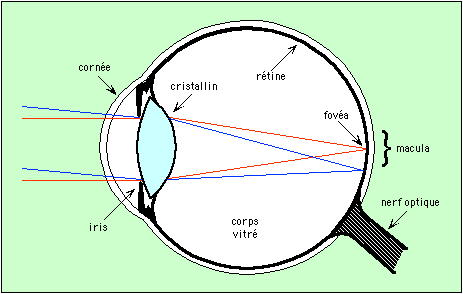

La rétine est constituée de minuscules cellules juxtaposées, sensibles à la lumière. Chacune indique au cerveau si elle reçoit de la lumière, et en quelle proportion. Le schéma montre que les images de deux étoiles, une bleue et une rouge, vont se former sur la rétine.

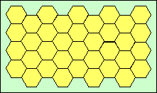

Schéma de la rétine, montrant les cellules sensibles juxtaposées.

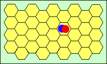

Deux images sur la même cellule&#8239;; on voit un seul point.

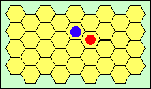

Deux cellules éclairées. Images bien visibles **séparément**.

L’œil peut donc distinguer séparément deux objets à condition que leurs images se forment sur deux cellules différentes. Sinon, la seule cellule touchée indiquera au cerveau qu’il voit un seul objet. La taille des cellules de la rétine fait que l’œil peut distinguer deux objets à condition qu’ils soient séparés par un angle d’au moins 1′ (lire&#8239;: *une minute*). Lorsque la voiture est trop loin (plus de 4 km), l’angle sous lequel on voit ses phares est inférieur à 1′, et donc les images des deux phares tombent sur la même cellule de la rétine&#8239;; nous ne voyons qu’une seule tache lumineuse.

Observons maintenant la voiture au loin avec des jumelles. Nous allons bien distinguer les deux phares. On dit qu’un instrument d’optique a un *[pouvoir séparateur](../instruments/)*, c’est-à-dire qu’il est capable de séparer les images de deux objets distincts. Les jumelles ont donc un pouvoir séparateur meilleur que l’œil. Un grand télescope a un pouvoir séparateur encore meilleur que des jumelles. En d’autres termes, cela signifie qu’il nous permettra de voir de plus petits détails. Dans le ciel, il y a de nombreuses étoiles doubles, et il faut parfois de puissants instruments pour les distinguer.

 Le pouvoir séparateur de l’œil nu est donc d’une minute d’arc (notée 1′), mais ceci est un peu obscur, et demande une explication.

- le cercle est divisé en 360°, (lire&#8239;: 360 degrés d’arc, ou simplement 360 degrés)&#8239;; chaque degré est divisé en 60′ (lire&#8239;: 60 minutes d’arc, ou simplement 60 minutes) et chaque minute est encore divisée en 60" (lire&#8239;: 60 secondes d’arc, ou simplement 60 secondes). Dans le cercle Il y a donc 360°, ou bien 360 × 60 = 21.600′, ou bien 360 × 60 × 60 = 1.296.000″.  Pour visualiser, voici un cercle avec trois rayons. L’angle entre les rayons rouge et vert vaut 60°, et celui entre les rayons vert et bleu vaut 10°. Cet angle valeur nous paraît petit.

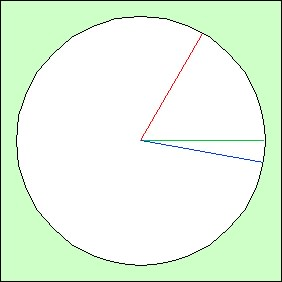

- la pleine lune a un diamètre apparent de 30′ (soit un demi-degré)&#8239;; donc à l’œil nu, on peut y voir des détails trente fois plus petits qu’elle-même&#8239;;
- 1′ correspond à l’angle sous lequel on voit une pièce de 1 euro (23 mm) à 80 mètres…
- l’angle formé par les deux lignes ci-dessous fait à peu près 20′&#8239;:

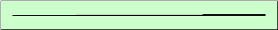

**Expérience**&#8239;: Réalisez le schéma ci-dessous sur du papier fort, et percez les deux trous représentés sur le dessin. Ils doivent être séparés de 3 mm (entre les centres des trous).

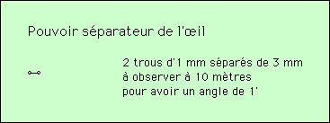

Placez une ampoule derrière, et observez à 10 mètres… Vous aurez la même sensation qu’en regardant deux étoiles séparées d’une minute d’arc.

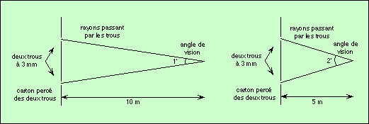

Attention, sur ce schéma les échelles verticale et horizontale sont très différentes… Si vous ne distinguez qu’un seul trou, c’est que vous êtes au-dessous du pouvoir séparateur de votre œil. En vous rapprochant (partie droite du schéma ci-dessus), vous augmenterez l’angle entre les trous et vous arriverez à les distinguer.

Voici l’angle sous lequel on voit les deux trous, selon la distance à laquelle on se trouve&#8239;:

<table>
<tbody>
<tr><td>distance</td><td>20 m</td><td>15 m</td><td>10 m</td><td>7 m</td><td>5 m</td><td>3 m</td><td>2 m</td><td>1 m</td></tr>
<tr><td>angle</td><td>30″</td><td>40″</td><td>1′</td><td>1′ 30″</td><td>2′</td><td>3′ 30″</td><td>5′ 10″</td><td>10′ 20″</td></tr>
</tbody>
</table>

Le but d’un instrument astronomique est **d’augmenter l’angle** sous lequel on voit un objet, pour le faire passer au-dessus du pouvoir séparateur de l’œil. Ce qui nous donne l’impression de nous en rapprocher&#8239;! Il vous suffit de regarder le schéma précédent, pour constater qu’à 5 mètres, on voit les deux trous sous un angle de 2 minutes, double de l’angle sous lequel on les voit à 10 mètres. Il paraissent deux fois plus proches… et le sont effectivement.

### Vision nocturne

La rétine est constituée de deux sortes de cellules sensibles différentes, les **cônes** et les **bâtonnets**. Les cônes voient la couleur, mais sont relativement peu sensibles, et servent en vision diurne, lorsqu’on dispose de beaucoup de lumière. Les bâtonnets ne voient qu’en noir et blanc, mais sont très sensibles à la moindre lumière, et donc utilisés la nuit. Cônes et bâtonnets sont disposées différemment dans la rétine&#8239;:

- La plus grande partie de la rétine ne contient que des bâtonnets, au nombre de 120 millions&#8239;;
- Le fond, où se forme l’image d’un objet qu’on regarde en face, contient essentiellement 6 millions de cônes. On le nomme **macula**, car il forme une tache plus sombre que le reste de la rétine&#8239;;
- Au centre de la macula se trouve la *fovéa*, ne contenant que des cônes aveugles la nuit, mais dont l’acuité visuelle est maximale en pleine lumière.

Ainsi, dans des conditions de faible éclairement, ce seront les bâtonnets qui nous permettent de voir, mais en noir et blanc. C’est pourquoi&#8239;:

*La nuit, tous les chats sont gris*&#8239;!

Ces rapides explications vous permettront de comprendre un phénomène bien connu des astronomes&#8239;: lorsque vous regardez un objet vraiment faible, il ne faut pas chercher à le regarder bien en face, en centrant son image sur la *fovea*, au centre de la rétine. Il vaut mieux regarder un peu à côté, comme pour l’ignorer… Ce seront alors les bâtonnets sensibles qui agiront, et vous aurez la surprise de bien le distinguer… sans couleurs évidement.

Résumons&#8239;:

<table>
<tbody>
<tr><td>bâtonnets&#8239;:</td><td>faible acuité</td><td>grande sensibilité</td><td>présents partout</td><td>noir et blanc</td><td>vision nocturne</td><td>vision <em>scotopique</em></td></tr>
<tr><td><strong>cônes&#8239;:</strong></td><td>haute acuité</td><td>faible sensibilité</td><td>au centre de la rétine</td><td>couleur</td><td>vision diurne</td><td>vision <em>photopique</em></td></tr>
</tbody>
</table>

*Scotopique* est synonyme de nocturne, et *photopique* est synonyme de diurne. Ce sont les termes savants… pour mémoire.

## Lieux d’observation

Pour installer un observatoire, il faut mettre tous considérer, et d’abord la latitude du lieu. Pour le comprendre, placez-vous au centre d’une pièce. Penchez la tête en arrière pour voir le plafond juste au-dessus de vous. Maintenant, tournez sur vous-même&#8239;: vous voyez toujours la même chose (le plafond et le haut des murs), seule l’orientation change.

Mettez maintenant la tête à l’horizontale&#8239;: vous voyez une partie du plafond, le mur qui vous fait face, et une partie du plancher. Tournez&#8239;; vous voyez à mesure les autres parties du plafond, les autres murs, et les autres parties du plancher&#8239;!

Donc, si votre regard se porte **perpendiculairement à l’axe de rotation** (deuxième cas), vous découvrirez en tournant la totalité de ce qui vous entoure, alors que le regard vers le plafond, vous ne verrez jamais la plancher. Pour un observatoire&#8239;:

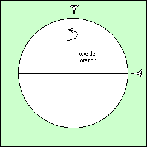

Au pôle (Nord), le regard dirigé vers le ciel est dans l’axe de rotation, on voit la moitié (Nord) de la sphère céleste, qui tourne par rapport au sol. L’autre moitié (Sud) est inaccessible au-dessous de l’horizon&#8239;!  A l’équateur, le regard tourné vers le ciel est perpendiculaire à l’axe de rotation. Chaque nuit on ne voit qu’une moitié du ciel, mais le déplacement annuel de la Terre autour du Soleil nous présente successivement toutes les parties de la sphère céleste.  Lorsque les transports étaient lents et hasardeux, on construisait les observatoires là où on était, et s’accomodait des conditions locales. Avec les progrès techniques, il est devenu intéressant de les construire près de l’équateur.  A l’équateur même, les étoiles proches des pôles ne seraient jamais observables correctement, toujours noyées dans les brumes de l’horizon. Les grands observatoires ont donc été construits aux latitudes moyennes, dans les deux hémisphères.

Aujourd’hui, les choses changent encore. En Antarctique, on dispose d’une nuit de cinq mois, pendant laquelle des observations pourront se poursuivre très longtemps, sans interruption par le Soleil. Et pendant l’été austral, c’est le Soleil lui-même qui peut être observé 24 heures sur 24. Bien que les conditions climatiques y soient sévères, des projets sont en cours de réalisation.

### Pollution lumineuse

La proximité des grandes villes interdit l’observation astronomique, par la quantité de lumière que les divers éclairages jettent dans le ciel. Depuis l’espace, de nombreuses photographies de la Terre ont été faites de nuit&#8239;; il est impressionnant de voir les taches lumineuses associées aux grandes villes et aux agglomérations. La région de Londres est particulièrement brillante. Seuls certains déserts, comme le Sahara, sont pour le moment épargnés. Il est bien évident que les grands télescopes, qui chassent la moindre goutte de lumière tombant des étoiles, ne peuvent supporter un tel voisinage.

<Encadre type="plus">

Signalons une initiative très intéressante&#8239;: *l’Association Nationale pour la Protection du Ciel et de l’Environnement Nocturnes* (ANPCEN), travaille pour la protection du ciel, au bénéfice des astronomes, mais aussi des animaux qui disparaissent en masse à cause des éclairages. Cette association propose aux communes d’améliorer leur éclairage, à effet de diminuer fortement la consommation électrique, ainsi que la pression humaine sur l’environnement pour la production d’énergie.

Le 26 avril 2008, Le Rove, près de Marseille, a signé la charte du ciel nocturne proposée par cette association, à la suite de Rocbaron, dans le Var (18 août 2007). En 2024, ce sont 722 communes qui ont reçu un label de qualité du ciel.
</Encadre>

### Turbulence atmosphérique

Il reste encore une difficulté, et non des moindres. Elle est induite par l’atmosphère. C’est la [turbulence](../instruments/#Seeing) qui affecte les images. On peut s’en faire une idée en observant une route surchauffée en été. On voit l’air chaud qui tremble au-dessus, et qui déforme les objets situés plus loin. Ce phénomène se produit également dans les couches de l’atmosphère au-dessus de nos têtes, et fait trembler les images. C’est lui qui produit le scintillement des étoiles. Il limite le pouvoir séparateur d’un instrument à 0,5" au mieux. Cette limite est le [seeing](../instruments/#seeing).

Pour diminuer l’importance de la turbulence, la solution la plus simple consiste à diminuer l’épaisseur de l’atmosphère, ce qui se réalise très facilement en installant les télescopes à haute altitude.

Un autre avantage de l’altitude se trouve dans la grande sécheresse de l’air. La vapeur d’eau présente dans les basses couches de l’atmosphère gêne les observations en filtrant certaines radiations, et par son dépôt sur les instruments sous forme de rosée. Enfin, en se condensant, elle produit les nuages. A haute altitude, on se trouve souvent au-dessus des nuages.

### Lieux favorables

Pour trouver un site favorable à l’observation, il faut découvrir un endroit où&#8239;:

1. le temps est toujours beau (absence de nuages),
2. la vapeur d’eau est presque absente de l’atmosphère (observations en IR),
3. l’atmosphère est la plus légère possible (il n’en reste plus que la moitié au-dessus de 4.000 m),
4. le ciel est accessible dans sa plus grande partie (proche de l’équateur),
5. la présence humaine (lumières) est quasiment nulle,
6. la turbulence est minimale.

Le beau temps (1) et l’absence de vapeur d’eau (2) indiquent les déserts (qui satisfont 5). D’ailleurs, les déserts se trouvent dans la zone équatoriale (4 en plus). Plus on s’élève en altitude, plus la couche d’atmosphère au-dessus de la tête diminue (3). Enfin, la proximité de la mer assure une stabilité des températures, et par conséquent des différences faibles entre jour et nuit. Ceci est favorable pour diminuer la turbulence (6). Au bout du compte, les déserts proches de la mer et à haute altitude sont les régions les plus indiquées pour installer les observatoires modernes.

Les meilleurs sites se trouveront donc en altitude, proches de la mer (ou en plein milieu, sur une île…), loin des villes et dans une zone au climat désertique.

Il y a des lieux sur Terre qui conjuguent ces trois conditions&#8239;:

- les grands volcans, dans les îles Hawaii (Mauna Kea, 4.200 m…)&#8239;;
- les Canaries (Roque de los Muchachos, 2.600 m)&#8239;;
- le désert d’Atacama, dans la Cordillère des Andes, au Chili (La Silla 2.400 m, Cerro Tololo 2.400 m, Cerro Paranal 2.635 m…).

Dans ces zones, l’air est très sec, la turbulence atmosphérique très faible, et les nuages rares. Aucune grande ville ne se trouve à proximité. Presque tous les grands télescopes modernes sont installés en ces lieux. Au Cerro Paranal, on atteint les 360 nuits de beau temps par an&#8239;!!

Les sites d’Amérique du sud sont toutefois sujets à de fréquents séismes, car situés sur une plaque tectonique (Nazca) en mouvement. Les coupoles du VLT ont été construites aux normes antisismiques…

Pour être complet, il faut toutefois signaler un nouveau lieu prometteur&#8239;: c’est l’Antarctique&#8239;! La nuit y dure 6 mois, autorisant des observations de très longue durée… Le froid glacial qui y règne pendant la nuit (c’est-à-dire pendant l’hiver), supprime toute vapeur d’eau dans l’atmosphère. L’altitude y est élevée&#8239;: 3.000 mètres au Dôme C. Toutes ces caractéristiques sont parfaites pour l’astronomie, à la condition de protéger du froid le matériel… et les astronomes. Une étude précise faite par Eric Fossa (Observatoire de Nice) indique qu’au niveau du sol (pardon, de la glace), la turbulence est très élevée, rendant toute observation illusoire (vents catabatiques). Mais à une vingtaine de mètres au-dessus du sol, l’air est d’une stabilité impressionante, meilleure que dans tous les autres sites mondiaux. Malgré les difficultés très grande d’installation d’un observatoire sur pilotis dans un tel lieu, Eric Fossa pense bien parvenir à réaliser son rêve d’observatoire vraiment austral&#8239;!

Maintenant, nous savons l’essentiel sur la constitution de notre œil, et nous savons où mettre nos télescopes. Il est temps de s’intéresser aux messages que les astres nous envoient, tout d’abord la lumière visible.

### La lumière

La lumière est restée le seul moyen de connaissance de l’Univers, jusqu’au XXe siècle. Ses propriétés ont été exploitées à fond par les astronomes pour en tirer la position, la couleur, la température, la composition chimique, le magnétisme, la vitesse… des étoiles et des objets plus curieux qu’ils ont découverts par la suite.

Plus généralement, [la lumière](../lumiere/) n’est qu’un rayonnement électromagnétique parmi tant d’autres, et nos moyens modernes d’observation nous permettent de les utiliser tous. Chaque gamme donne des renseignements particuliers, et l’ensemble nous permet d’atteindre une grande richesse d’information sur les objets qui nous entourent. Les rayons électromagnétiques sont assez complexes pour porter un grand nombre d’informations, de natures et de sources diverses.

Depuis les années 1920, la théorie de la Relativité d’Einstein permet de comprendre l’état actuel et l’évolution de l’Univers dans son ensemble. Cette théorie a été fondée sur l’invariance de la vitesse de la lumière, qui est très proche de 300.000 kilomètres par seconde.

A cette vitesse, la lumière met 1,3 secondes pour aller de la Terre à la Lune, 8 minutes pour aller du Soleil à la Terre, entre 4 et 7 heures (selon sa position sur l’orbite) pour aller du Soleil à Pluton…

Mais elle met 4,2 années pour nous parvenir de l’étoile la plus proche. Ceci a une conséquence très importante&#8239;: nous voyons l’étoile la plus proche non telle qu’elle est actuellement, mais telle qu’elle était il y a 4,2 années&#8239;!

Et plus on voit loin, plus les objets qu’on observe sont vieux. Les objets les plus lointains qu’on puisse voir actuellement sont situés à près d’une dizaine de milliards d’années-lumière, autant dire qu’on les voit maintenant tels qu’ils étaient il y a une dizaine de milliards d’années. Beaucoup de ces objets ont sans doute disparu, en tout cas ils ont considérablement évolué depuis, mais nous ne pouvons pas le savoir.

Toutefois, en observant des objets à des distances différentes, donc à des âges différents, on peut arriver à reconstituer leur évolution. Supposez que vous ignoriez tout des arbres, et qu’on vous emmène dans une forêt. Il vous serait assez facile de reconnaître des sapins (par exemple), même s’ils sont tous d’âges différents. Vous auriez vite compris comment ils poussent.

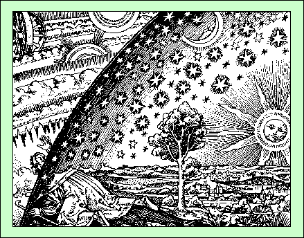

*Le système de l’Univers, dessin du Moyen-Age*

A l’heure actuelle, nous disposons d’instruments capables de capter tous les rayonnements électromagnétiques, depuis les ondes radio jusqu’aux rayons gamma. Il se trouve que les astres émettent toutes ces sortes d’ondes, chacun ayant une gamme de fréquences déterminée par sa nature physique, et par l’énergie disponible. Beaucoup de ces rayonnements ne parviennent pas au sol, car ils sont arrêtés par l’atmosphère. Il faut donc construire des observatoires orbitaux capables de travailler dans ces domaines d’ondes. Toute une nouvelle branche de l’astronomie s’est constituée depuis l’avènement des fusées et des satellites.

### Terre, Lune et Soleil

Quand on regarde le ciel, on peut y voir deux objets montrant une surface sensible&#8239;: la Lune et le Soleil (il en existe trois autres, la galaxie d’Andromède dans l’hémisphère nord, et les deux galaxies satellites de la nôtre, le Grand et le Petit Nuage de Magellan, dans l’hémisphère sud).

Tout le reste se présente comme de simples points lumineux plus ou moins brillants.

Ces points lumineux conservent toujours les mêmes positions relatives. Ils forment sur le ciel des dessins plus ou moins évidents, qu’on a nommés *constellations*. L’ensemble constitue la *sphère des fixes* des Anciens.

Mais 5 points lumineux se particularisent&#8239;: ils se déplacent par rapport à la sphère des fixes. Pour cela, les Grecs les ont nommés *planètes*, mot qui signifie *astre errant*. Remarquez que d’après cette éthymologie, le Soleil et la Lune sont aussi des planètes&#8239;; mais cette appellation, basée sur le seul mouvement et faisant fi des profondes différences physiques, n’est plus de mise en astronomie moderne.

Dans cette belle ordonnance du ciel, il arrive parfois qu’un intrus apparaisse&#8239;: les *comètes* ne pouvaient donc qu’être maléfiques, annonciatrices de guerres ou de calamités (mais des guerres, il y en a malheureusement toujours une pour associer à une comète, et si jamais il n’y en avait pas, une simple sécheresse, une gelée tardive au printemps… permettait de justifier ce caractère maléfique des comètes).

Il reste enfin un phénomène rare, celui des *novæ* (pluriel et abbréviation de *stella nova* = étoile nouvelle). Ce sont des étoiles qui explosent, et deviennent subitement beaucoup plus lumineuses, permettant de les voir à l’œil nu alors qu’elles étaient trop faibles avant. Les chinois les appelaient joliment *étoiles invitées*.

Voilà donc le ciel des Anciens (il y a sans doute encore beaucoup d’Anciens à l’heure actuelle, qui n’ont jamais cherché à en savoir davantage… et qui en restent aux apparences).

Jusqu’au Moyen Age, la Terre était souvent vue plate, n’ayant rien de commun avec la Lune ou le Soleil. Aujourd’hui, nous disposons d’innombrables observations depuis l’espace qui montrent à l’évidence que c’est une sphère (certains grands esprits de l’Antiquité le savaient déjà, voir la [fiche historique](https://astronomia.fr/7eme_partie/fiches/fic_histoire.php#grandsAstro)).

La Terre est une planète. Une planète est un corps qui ne produit pas de lumière, par opposition aux étoiles. La Terre tourne autour du Soleil, qui est une étoile.

La Lune est un satellite de la Terre (elle tourne autour de la Terre). Un satellite (naturel) est un corps semblable à une planète, mais qui tourne autour d’une planète.

La Lune nous paraît grosse car elle est relativement proche. Pour l’instant, nous ne nous occuperons que de la Terre et du Soleil.

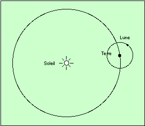

## Les lois du mouvement

### Expérience

Faites rouler une boule de pétanque sur un sol de gravier&#8239;: elle n’ira pas loin. Faites-le sur de la terre battue&#8239;: avec le même élan, la boule ira plus loin. Si vous la lancez sur un sol cimenté, elle ira encore plus loin. Poursuivez ce raisonnement&#8239;: si le sol était de marbre bien lisse, elle irait encore plus loin. Ce qui l’empêche de continuer son mouvement provient des aspérités du sol, qui lui prennent de l’énergie. Si vous imaginez la boule lancée sur un sol *parfaitement* lisse, sans la moindre aspérité, elle pourrait continuer à rouler indéfiniment. On dit qu’elle suit une **trajectoire inertielle**.

Ce raisonnement a été fait par Galilée, qui a compris qu’une boule lancée n’a pas de raison *propre* de s’arrêter. Elle ne ralenti que parce que son mouvement est contrarié par le sol sur lequel elle roule, c’est-à-dire par une cause extérieure.

Ceci constitue la **loi de l’inertie énoncée par Galilée en 1642**. C’est la toute première loi de la physique expérimentale&#8239;!

Nous n’avons pas envisagé le frottement de la boule sur l’air, car il est plus faible que les frottements sur le sol&#8239;; mais il agit dans le même sens. La véritable expérience de l’inertie doit se faire hors de l’atmosphère, et en gravité nulle. Mais la théorie de la Relativité Générale permet de la vérifier en orbite terrestre, car elle généralise l’inertie et les satellites parcourent des trajectoires inertielles dans la gravité terrestre. Ainsi, la Relativité Générale s’appuie sur la loi découverte par Galilée, qui est&#8239;:

<Encadre type="plus">
**Un corps, non soumis à des forces extérieures, continue indéfiniment son mouvement uniforme en ligne droite**
</Encadre>

Vous pourrez trouver des détails dans le chapitre [Relativité Galiléenne](https://astronomia.fr/6eme_partie/RelativiteGalileenne.php).

Pour visualiser le mouvement des planètes, nous nous appuierons sur une analogie justifiée parce que la loi de la gravité newtonienne est semblabloe à celle du magnétisme. Plaçons un aimant sur une table bien lisse et horizontale. Plaçons ensuite une bille d’acier (provenant d’un roulement à billes) à quelque distance, et lâchons-la sans la lancer. La bille se met en mouvement en direction de l’aimant, elle va de plus en plus vite et fini par se coller à l’aimant. **L’aimant exerce donc une attraction sur la bille**.

Laissant l’aimant sur la table, lançons la bille. Pour respecter le principe d’inertie, elle devrait aller tout droit. Pour répondre à l’attraction de l’aimant, elle devrait aller vers lui. **Elle va concilier les deux en suivant une trajectoire courbée**, que l’on observe facilement.

Les planètes sont soumises à des lois semblables&#8239;:

- le Soleil exerce sur elles une *attraction gravitationnelle*, qui ressemble à l’attraction de l’aimant sur la bille&#8239;;
- lancée sur son orbite, la planète devrait aller tout droit pour satisfaire au principe d’inertie. Mais attirée par le soleil, sa course est infléchie, et elle tourne autour.

### Mouvement d’un satellite

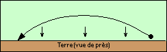

A toute petite échelle, on voit la Terre plate. Si on lance un caillou, il retombe un peu plus loin en décrivant une belle courbe (une parabole).

A échelle régionale, si on lance une petite fusée, disons avec une vitesse de 5.000 km/h, elle va suivre une même trajectoire, mais plus grande.

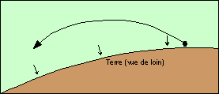

La Terre étant courbée, elle retombera beaucoup plus loin. Remarquez les flèches, qui indiquent la direction de la pesanteur&#8239;: dans le premier schéma, elles semblaient parallèles. Ici, elles ne le sont manifestement plus.

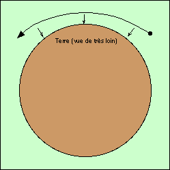

Enfin, si nous lançons maintenant une fusée à plus de 28.000 km/h, elle va aller tellement loin, qu’elle va passer de l’autre côté de la Terre. Et là, elle va encore tomber sur la Terre, mais celle-ci étant toute ronde se dérobe sans cesse&#8239;! Ainsi, la fusée n’arrivera plus à retomber sur la Terre, elle va devoir tourner autour… Les flèches indiquant la direction de la pesanteur sont dirigées vers le centre de la Terre.

Un satellite est donc un objet en chute libre, dont le corps attracteur se dérobe sans cesse par sa forme ronde.

Entre la première expérience et la dernière, la forme de la courbe change un peu&#8239;: d’une parabole, elle passe à une ellipse. Ce changement est dû à la direction de la pesanteur&#8239;: lorsqu’on peut considérer la pesanteur toujours dans la même direction (premier schéma), le mouvement est une parabole&#8239;; lorsque la direction de la pesanteur varie le long de la trajectoire, toujours dirigée vers le centre de la Terre, c’est une ellipse. Mais ce sont deux courbes très proches, on les appelle généralement des coniques. Ce nom générique vient de leur découverte&#8239;: ellipse, parabole et hyperbole sont les courbes que l’on obtient en coupant un cône par un plan. Le cercle n’est qu’un cas particulier d’ellipse, où l’excentricité est nulle (le plan de coupe est perpendiculaire à l’axe du cône).

#### Explication du mouvement parabolique

Le mouvement parabolique est la composition de deux mouvements. Supposons qu’un objet soit lancé dans l’espace, loin de toute masse (en l’absence de toute force)&#8239;: son mouvement, d’après Galilée, serait rectiligne uniforme. Il se déplacerait donc indéfiniment en ligne droite à vitesse constante. Supposons maintenant que ce même corps soit laché sans vitesse initiale au-dessus d’un corps massif. Il tomberait en chute libre avec un mouvement accéléré.

Maintenant, si un corps est lancé avec une vitesse initiale au-dessus d’un corps massif très grand (pour que le champ de gravité puisse être considéré comme constant le long de la trajectoire), il va en ligne droite selon le principe d’inertie, mais en même temps il tombe selon la loi de la gravitation. Il combine donc les deux mouvements, et se déplace d’un mouvement parabolique accéléré.

L’animation ci-dessous le représente&#8239;:

<SimulateurCanon />

L’animation ci-dessus montre le mouvement d’un corps lancé horizontalement avec une vitesse donnée. Les deux premiers curseurs permettent de fixer la vitesse du mobile (proportionnelle à la puissance du canon), et l’accélération de la pesanteur (gravité à la surface de l’astre considéré). Au lancement de l’animation, ces deux paramètres ont des valeurs moyennes.

Si vous annulez la gravité, le corps se déplace en apesanteur (le sol de l’astre a disparu). Il n’est donc soumis à aucune force, et se déplace en ligne droite à vitesse constante (mouvement inertiel).

Si vous annulez la vitesse du mobile, le corps n’est soumis qu’à la gravité, et tombe verticalement. Son mouvement est accéléré&#8239;: à chaque seconde, il parcours une distance plus grande qu’à la précédente. En 2 secondes, il parcours une distance 4 fois plus grande qu’en une. La distance totale parcourue varie comme le carré du temps de parcours.

Pour bien visualiser la différence entre le mouvement inertiel horizontal, et le mouvement accéléré vertical, des marques sont inscrites sur les axes. Leur écart est proportionnel à la distance parcourue pendant l’unité de temps correspondante. Sur l’axe horizontal, elles sont donc régulièrement espacées, conformément au mouvement uniforme (le mobile parcours la même distance à chaque seconde). Verticalement par contre, l’écart croît vers le bas, montrant l’accélération du mouvement.

La distance entre ces marques varie naturellement avec la valeur de la vitesse, et avec celle de la gravité.

L’important est de constater que le mouvement parabolique réel est la résultante des deux précédents. C’est ce que montrent les axes qui progressent depuis la bouche du canon&#8239;: l’horizontal mesure le déplacement uniforme du mobile en l’absence de gravité, le vertical montre son mouvement en l’absence de vitesse initiale.

### La Gravitation Universelle

C’est l’attraction gravitationnelle qui agit sur nous et nous plaque au sol. Autrefois, on ne se posait pas de questions&#8239;: on imaginait la Terre plate, et il était évident qu’il y avait le **haut** et le **bas**. Lorsqu’on a pensé que la Terre pourrait être ronde, on ne comprenait pas comment les Chinois pouvaient marcher la tête en bas&#8239;!

L’explication est que la Terre attire tout à elle par la gravité. Qu’on soit en France ou aux antipodes, on est attiré vers le **centre** de la Terre, et le bas est toujours du côté de ce centre, donc du sol. Par analogie, la bille d’acier se dirige vers l’aimant, quel que soit le côté où on la lâche.

On dit que la gravité est universelle, parce que c’est une propriété de la matière&#8239;: tout objet matériel attire tous les autres. La pomme de Newton attire la Terre proportionnellement à sa masse qui est très faible. La Terre attire la pomme proportionnellement à sa masse qui est très grande. Le résultat est que la pomme tombe vers la Terre beaucoup plus que ce que la Terre tombe vers la pomme&#8239;!

Une autre analogie aide à comprendre&#8239;: si on se trouve dans une petite barque, et que l’on pousse le quai à l’aide d’un aviron, la petite barque va s’éloigner du quai qui ne bouge pas (presque). Si au lieu de pousser le quai, on pousse une grosse barque, on verra la grosse barque se déplacer un peu&#8239;!

Reprenons la bille. Lâchons-la sans vitesse à diverses distances de l’aimant. Elle est attirée plus ou moins fortement&#8239;: de plus près, la force est plus importante.

Si nous la faisons passer près de l’aimant, elle subira une grande force, et tombera dessus. Pour éviter cela, il faut la lancer plus vite, l’inertie sera alors suffisante pour lui éviter de tomber.

Il en va de même de l’attraction gravitationnelle&#8239;: le Soleil attire les planètes vers lui, d’autant plus fortement qu’elles sont plus proches. Par conséquent, pour ne pas tomber sur le Soleil, une planète proche doit tourner plus vite qu’une planète lointaine. Cette plus grande vitesse lui confère une inertie suffisante pour ne pas tomber. On peut vérifier cela sur le tableau suivant, qui donne la liste des 9 planètes principales avec leurs caractéristiques orbitales&#8239;:

<table>
<thead>
<tr><th rowspan="2">planète</th><th colspan="2">distance</th><th rowspan="2">vitesse km/s</th><th rowspan="2">année</th><th rowspan="2">inclinaison équateur</th><th rowspan="2">inclinaison orbite</th><th rowspan="2">excentricité</th></tr>
<tr><th>millions de km</th><th>UA</th></tr>
</thead>
<tbody>
<tr><td>Mercure</td><td>58</td><td>0,39</td><td>48</td><td>88 j</td><td>7°</td><td>7°</td><td>0,21</td></tr>
<tr><td>Vénus</td><td>108</td><td>0,72</td><td>35</td><td>224 j</td><td>3° 4′</td><td>3° 23′</td><td>0,01</td></tr>
<tr><td>Terre</td><td>150</td><td>1</td><td>30</td><td>365 j</td><td>23° 26′</td><td>0°</td><td>0,02</td></tr>
<tr><td>Mars</td><td>228</td><td>1,52</td><td>24</td><td>1 an 321 j</td><td>23° 59′</td><td>1° 51′</td><td>0,09</td></tr>
<tr><td>Jupiter</td><td>778</td><td>5,19</td><td>13</td><td>11 ans 314 j</td><td>3° 5′</td><td>1° 18′</td><td>0,05</td></tr>
<tr><td>Saturne</td><td>1.430</td><td>9,53</td><td>9,6</td><td>29 ans 167 j</td><td>26° 44′</td><td>2° 29′</td><td>0,06</td></tr>
<tr><td>Uranus</td><td>2.876</td><td>19,2</td><td>6,8</td><td>84 ans 7 j</td><td>97° 55′</td><td>0° 46′</td><td>0,05</td></tr>
<tr><td>Neptune</td><td>4.506</td><td>30</td><td>5,4</td><td>164 ans 280 j</td><td>28° 48′</td><td>1° 46′</td><td>0,01</td></tr>
<tr><td>Pluton</td><td>5.914</td><td>39,4</td><td>4,7</td><td>248 ans 157 j</td><td>122°</td><td>17° 12′</td><td>0,25</td></tr>
</tbody>
</table>

**tableau I**

Dans ce tableau, UA signifie Unité Astronomique. Nous l’expliquerons plus loin, mais disons simplement que c’est la distance de la Terre au Soleil. Dans cette unité, on voit très facilement que Neptune est 77 fois plus loin du Soleil que nous (30 UA / 0,39 UA = 76,9).

Pour la durée de l’année, il faut remarquer que deux phénomènes vont dans le même sens&#8239;:

- plus on est loin du Soleil, plus la distance à parcourir pour faire un tour est grande. C’est comme pour un coureur de fond qui a davantage de chemin à faire quand il est à l’extérieur que quand il est à la corde. A vitesse égale, on mettrait donc plus de temps&#8239;;
- mais d’autre part, plus on est loin moins on va vite&#8239;! Neptune se déplace presque 9 fois plus lentement que Mercure.

Pour parcourir un chemin 77 fois plus grand à une vitesse 9 fois plus faible, il faudra 9 × 77 = 693 fois plus de temps. Soit 693 × 88 jours = 60 984 jours ≈ 167 ans. Cet ordre de grandeur est bien proche de la valeur correcte de 164 ans 280 j que l’on voit sur le tableau.

Le dieu Mercure est toujours représenté avec de petites ailes aux pieds. Il est donc bien choisi pour représenter la championne des planètes&#8239;!

Quand à Pluton, son nom est placé en italique, parce que l’Union Astronomique Internationale a décidé de la déclasser&#8239;! Pluton n’est plus considéré comme une planète, mais simplement une planète naine parmi de nombreuses conseurs. On verra ceci en temps utile.

### Orbites des planètes

Kepler a montré que les orbites des planètes sont en général des *ellipses*, et le Soleil est toujours placé à l’un des foyers de l’ellipse. L’*excentricité* indique le taux d’aplatissement de l’ellipse. Une excentricité nulle indique un cercle, une excentricité égale à 1 indique une autre conique, qui n’est plus une ellipse, et qui ne se referme pas sur elle-même&#8239;: c’est une *parabole*. L’excentricité **e** d’une ellipse est donc telle que 0 ≤ **e** &lt; 1.

On remarque que dans le tableau, toutes les excentricités sont comprises entre 0,01 et 0,25. Toutes les planètes ont donc bien des orbites elliptiques, et la plupart sont proches d’un cercle.

### Tracer une ellipse

Une ellipse est une courbe fermée ovale. Ce dernier qualificatif, signifiant en forme d’œuf, est assez vague et même inadapté. Pour bien voir ce qu’est une ellipse, le mieux est d’en tracer quelques unes. Et pour cela, nous utiliserons la méthode du jardinier&#8239;: on plante dans le sol deux piquets, auxquels on attache les extrémités d’une ficelle. À l’aide d’un troisième piquer, on garde la ficelle tendue en tournant, pour tracer une courbe sur le sol.

En chaque point de cette courbe, la ficelle étant tendue, sa longueur est la somme des distances du piquet marqueur aux deux fixes. Ce qui est la définition même d’une ellipse.

L’animation ci-dessous montre ce principe tel qu’on pourrait le réaliser avec deux épingles et un crayon, sur une feuille de papier.

<SimulateurJardinier />

Cette animation montre la méthode élémentaire pour tracer une ellipse, qui est utilisée par les jardiniers pour dessiner leurs massifs de fleurs, et découle directement de la définition de l’ellipse&#8239;:

<Encadre type="plus">
l’ellipse est l’ensemble des points dont **la somme des distances à deux points fixes** est constante.
</Encadre>

Ces deux points fixes sont nommés *foyers* de l’ellipse.

Sur une planchette, fixez une feuille de papier&#8239;; plantez deux épingles&#8239;; attachez-leur une ficelle lâche&#8239;; en tendant la ficelle avec le crayon, vous pouvez tracer une ellipse. Les épingles en sont les foyers.

La distance entre les deux foyers est la distance focale. On a coutume d’utiliser la *demi distance focale* (qui est donc la distance d’un foyer au centre de l’ellipse), et *on la note c*. La droite qui passe par les deux foyers est le *grand axe* de l’ellipse, parfois nommé *ligne des absides*&#8239;; il coupe l’ellipse en ses deux *sommets*. La droite perpendiculaire au grand axe, et qui passe par le centre, est le *petit axe*. On note *a* le *demi-grand axe*&#8239;; c’est la distance du centre à un sommet. On note *b* le *demi petit axe*. On appelle excentricité de l’ellipse le rapport de la demi distance focale c au demi grand axe a&#8239;: e = c / a

L’excentricité de l’ellipse mesure son aplatissement. Notez que c est strictement plus petit que a, donc **e &lt; 1**.

Si vous rapprochez les deux épingles, jusqu’à les confondre, vous verrez que l’ellipse s’arrondit. S’il n’y a qu’une seule épingle (ou deux épingles confondues), la distance d’un point de l’ellipse à chacune (à la seule…) est constante&#8239;! Donc l’ellipse est un cercle. Dans ce cas, c mesurant la distance des deux foyers est nul. Donc l’excentricité aussi&#8239;: un cercle est une ellipse particulière d’excentricité nulle.

**Courbes de la même famille**

Il existe deux courbes proches de l’ellipse&#8239;: la parabole et l’hyperbole.

<Encadre type="plus">
La parabole est l’ensemble des points équidistants d’un point (le foyer) et d’une droite (la directrice)
</Encadre>

On peut définir l’excentricité d’une parabole, comme pour une ellipse. Elle est égale à 1&#8239;: **e = 1**.

Il existe enfin une troisième sorte de courbe, nommée hyperbole&#8239;:

<Encadre type="plus">
L’hyperbole est l’ensemble des points dont **la différence des distances à deux points fixes** (les foyers) est constante
</Encadre>

L’excentricité existe, et comme par hasard, elle est plus grande que 1&#8239;: **e &gt; 1**.

La ressemblance de ces trois types de courbes provient d’une propriété géométrique commune&#8239;: ce sont les courbes produites lorsqu’on coupe un cône par un plan. Selon l’inclinaison du plan par rapport à l’axe du cône, on obtient un cercle (plan perpendiculaire à l’axe du cône&#8239;; le cercle est une ellipse d’excentricité nulle), une ellipse vraie (inclinaison &gt; 0 et inférieure à l’ouverture du cône), une parabole (inclinaison égale à l’ouverture du cône), ou une hyperbole (inclinaison supérieure). Les plans de coupure ne passent pas, en général, par le sommet du cône (la courbe se réduirait à un point).

Pour ce fait, ces courbes se nomment de manière générique *coniques*.

### Visualisation des orbites

On peut donner une représentation de ces orbites&#8239;: e = 0,01 indique une ellipse très proche d’un cercle&#8239;; e = 0,25 est une forte excentricité pour une planète, indiquant une distance très variable de la planète au Soleil. Mercure et Pluton se particularisent sous cet aspect. Le schéma ci-dessous montre deux ellipses, dont les excentricités sont 0,02 à gauche (la Terre), et 0,25 à droite (Pluton). Elles sont dessinées de la même taille, bien que l’orbite de Pluton soit 40 fois plus grande, car il s’agit de comparer les formes. On y voit la position qu’occupe le soleil par rapport à l’aplatissement. Celui-ci n’est pas très sensible, même dans l’orbite de droite, mais on voit très bien que le soleil est décalé (vérifiez sur l’animation ci-dessus). Il s’ensuit que la distance de la planète au soleil est fortement variable à droite.

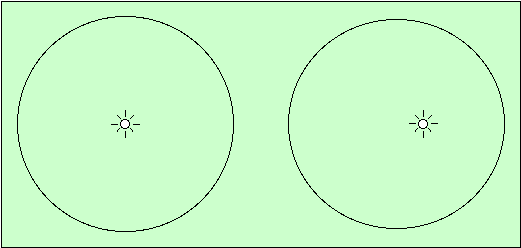

Si la trajectoire d’une planète est une ellipse marquée (forte excentricité), elle se rapproche et s’éloigne du Soleil au cours du temps. Lorsqu’elle est plus proche, elle subit une gravité plus forte, elle doit aller plus vite pour ne pas tomber&#8239;; et lorsqu’elle est plus loin, elle ralentit. La vitesse d’une planète sur son orbite est donc constamment variable (dans le tableau précédent, les vitesses indiquées pour les planètes sont les vitesses moyennes&#8239;; dans le schéma ci-après, l’excentricité est très exagérée pour mieux illustrer le propos).

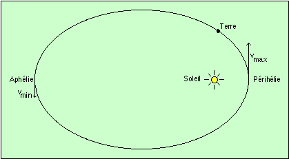

Le schéma montre la Terre sur son orbite autour du Soleil, dont l’excentricité est très fortement exagérée. Le point où elle se trouve au plus près est le *périhélie*, le point le plus lointain est *l’aphélie*.

C’est Kepler qui a montré que les planètes se déplacent sur des orbites elliptiques, et qui a découvert les lois du mouvement. Il a analysé les positions de la planète Mars relevées pendant de nombreuses années par Tycho-Brahé. Cette découverte est empirique&#8239;: d’après les données de Tycho, il a réussi à tracer l’orbite de Mars, et constaté que c’est une ellipse et non un cercle, dont il a déterminé l’excentricité et le demi grand axe. Son travail n’expliquait pas pourquoi la planète suit cette trajectoire. Il avait cependant compris que le Soleil était le moteur de ce mouvement. C’est Newton, un peu plus tard, qui déduira la loi de la gravitation universelle, à partir des lois de Kepler. Vous pouvez découvrir l’histoire de ces découvertes dans un [séminaires de 2012](https://astronomia.fr/seminaires/annee1112/gravitationUniverselle.php).

Réciproquement, la loi de la gravitation universelle étant connue, il est aisé de l’utiliser pour retrouver par le calcul les lois de Kepler. La loi de Newton explique d’une certaine manière, par une mystérieuse force attractive qui agit instantanément à grande distance, les lois de Kepler.

Cette explication sera jugée insatisfaisante au début du XXe siècle, et Einstein donnera une nouvelle théorie, la Relativité Générale, qui supprime la notion newtonienne de force, et la remplace par une explication géométrique du mouvement.

## Les lois de Kepler

On appelle *rayon vecteur* la ligne imaginaire qui relie, à tout instant, la planète au Soleil.

<Encadre type="plus">
1. les planètes se déplacent sur des orbites planes elliptiques, dont le Soleil occupe l’un des foyers.
2. le rayon vecteur, reliant la planète au Soleil, balaye des aires égales en des temps égaux (loi des aires).
3. le rapport des cubes des demi grands axes aux carrés des périodes est constant&#8239;: a3 / T2 = constante (loi harmonique).
</Encadre>

La *loi des aires* précise ce que l’on a constaté&#8239;: en 24 heures, la planète doit se déplacer beaucoup plus au périhélie qu’à l’aphélie pour balayer une même aire.

Physique&#8239;: **la loi des aires traduit la conservation de l’énergie**.

Conservation de l’énergie

L’énergie totale de la planète est constante le long de l’orbite.

- lorsque la planète passe au périhélie&#8239;:
    - elle possède une grande vitesse, donc une grande *énergie cinétique* (½ m v2)
    - si elle tombait sur l’étoile en chute libre, elle produirait une énergie cinétique. Cette énergie cinétique, *qui n’est pas dégagée mais qui pourrait l’être*, est nommée *énergie potentielle*, et la planète la possède. Puisqu’elle est proche de l’étoile, l’énergie potentielle est faible.
- lorsque la planète passe à l’aphélie&#8239;:
    - sa vitesse est minimale, et donc aussi son énergie cinétique.
    - sa distance à l’étoile maximale, et aussi son énergie potentielle.

La mécanique nous apprend que la perte de l’une compense exactement le gain de l’autre, et par conséquent leur somme, l’énergie totale, est constante. Cette énergie totale est proportionnelle à la surface des aires balayées en des temps égaux.

<SimulateurKepler />

Le bouton Lecture lance l’animation ou la met en pause. L’animation montre une étoile (en rouge) autour de laquelle tourne une planète sur une orbite képlérienne (sans perturbations). Initialement, l’excentricité est nulle, l’orbite est circulaire.

Sous le dessin on trouve l’excentricité de l’orbite, et les valeurs instantanées de la distance de la planète à l’étoile, et de sa vitesse orbitale.

Éléments de contrôle&#8239;: un curseur pour modifier l’excentricité de l’orbite (entre 0 et 0,95), un autre pour la vitesse d’animation, puis deux cases à cocher activant ou inhibant respectivement le dessin de l’orbite complète, et les aires balayées. Si on coche les deux, on voit les aires balayées tout au long de l’orbite.

Le point de l’orbite le plus proche de l’étoile est le *périhélie* (à droite sur l’animation), le plus loin est *l’aphélie* (à gauche). Les distances des sommets de l’ellipse au foyer où se trouve le Soleil, sont&#8239;:

q = a (1 - e) Q = a (1 + e)

q est la *distance périhélique*, et Q la *distance aphélique*. La variation totale de distance planète-étoile est donc δ = Q - q = a (1 + e) - a (1 - e) = 2 a e. La variation relative est donc de 2 e. Si δ = 0,1 par exemple, la variation totale de distance est de 10 %.

L’animation montre un système générique&#8239;: on peut interpréter l’objet central comme une étoile, ou bien le soleil, ou bien une planète&#8239;; l’objet en orbite est alors respectivement une exoplanète, une planète, ou un satellite. La masse centrale n’étant pas précisée, la distance est normalisée de telle sorte qu’elle vaut 1 au périhélie. Si vous connaissez la distance exacte au périhélie, il vous suffit de multiplier toutes les valeurs affichées par celle-ci pour avoir toutes les distances exactes. Si vous lisez par exemple 'distance&#8239;: 9', cela signifie que la planète est, à ce moment-là, 9 fois plus éloignée de son étoile qu’au périhélie. Vous verrez ainsi qu’une comète d’excentricité 0,95 est presque 10 fois plus éloignée à l’aphélie qu’au périhélie (c’est-à-dire qu’elle y reçoit presque 100 fois moins d’énergie de l’étoile).

Pour la même raison, la vitesse est normalisée à 1 à l’aphélie&#8239;; si sa valeur est 4 en un point, elle y va 4 fois plus vite qu’à l’aphélie.

On peut remarquer que le rapport entre les deux vitesses extrêmes est l’inverse du rapport entre les deux distances extrêmes&#8239;; ceci découle de la conservation de l’énergie.

Avec une excentricité nulle, vous constatez que l’orbite est un cercle, et que l’étoile est au centre. Si vous donnez une excentricité inférieure à 0,2, vous ne distinguerez guère l’ellipse d’un cercle. Par contre vous remarquerez aisément que l’étoile n’est plus au centre de l’ellipse&#8239;: les foyers s’en écartent rapidement lorsque l’excentricité augmente. Notez de plus qu’une excentricité de 0,2 est forte dans notre système solaire&#8239;: elle n’est que de 0,0068 pour Vénus, moins de 0,017 pour la Terre. Les deux planètes ayant les orbites les plus excentriques sont Mercure avec 0,21 et Mars avec 0,09. Cette dernière valeur paraît encore faible sur l’animation, mais elle a suffi à Kepler pour découvrir les trois lois du mouvement (si l’excentricité était faible, les mesures de Tycho n’auraient pas permi de distinguer entre ellipse et cercle).

Pour la Terre&#8239;: a = 150 millions de km&#8239;; e = 0,017

q = 150 ( 1 - 0,017) = 150 x 0,983 = 147,45 millions de km

Q = 150 ( 1 + 0,017) = 150 x 1,017 = 152,55 millions de km.

La différence est tout de même de 5,1 millions de km. Mais rappellez-vous que cette distance variable au Soleil n’explique absolument pas les saisons terrestres, qui sont dues essentiellement à l’inclinaison de l’axe de rotation de la Terre.

Fixez l’excentricité à 0,25 (Pluton). Pour cette valeur, considérée comme extrêmement forte, l’ellipse ressemble encore vraiment à un cercle. Mais le soleil est fortement excentré, et la distance Pluton-soleil varie de 2 a e = 2 x 5,9 x 0,25 = 2,95 millirds de km... Au périhélie, Pluton possède une atmosphère ténue d’azote, et celle-ci gèle sur le sol en allant vers l’aphélie&#8239;! Les saisons sur Pluton sont dues à la varaition de distance au soleil.

**Loi des aires&#8239;:** cliquez sur la case 'Aires'. Le rayon vecteur (ligne imaginaire reliant la planète à l’étoile) est tracé pendant un intervalle de temps, non dans l’intervalle suivant, etc. Tous ces intervalles de temps sont égaux. Près du périhélie l’aire a une grande base (arc de l’ellipse) et une faible hauteur (distance à l’étoile). À l’opposé, c’est l’inverse, la base est étroite et la hauteur importante. On visualise ainsi que ces aires, balayées par le rayon-vecteur en des temps égaux, sont égales. La loi des aires est donc matérialisée.

Dans la troisième loi (loi harmonique), a est le demi grand axe de l’orbite, et T la période de révolution (la durée de l’année). La loi indique donc que pour toutes les planètes, le cube du demi grand axe divisé par le carré de la période, donne la même valeur&#8239;! Ce qui s’écrit&#8239;: aT3 / TT2 = aP3 / TP2 en prenant la Terre (indice T) et une planète quelconque (indice P).

Cette loi est extrêmement utile, car il est facile de mesurer la période de révolution d’une planète quelconque. Connaissant cette période, la loi donne le demi grand axe de la planète par simple comparaison avec la Terre (voir [calcul de la distance](#Calcudista) un peu plus bas).

Dans cette loi harmonique, on peut choisir les unités de telle sorte qu’elle apparaisse plus simple. Prenons pour cela **l’unité astronomique pour unité de longueur, et l’année pour unité de temps** (année terrestre). Le demi grand-axe de la Terre aT = 1 UA, et la période de révolution de la Terre TT = 1 an. Ainsi, aT3 / TT2 = 1 / 1 = 1. Par conséquent, aP3 / TP2 = 1. Dans ces unités-là, la loi se réduit à (en supprimant l’indice puisqu’il n’y a plus qu’une planète)&#8239;:

<Encadre type="plus">
a3 = T2
</Encadre>

### Terminologie

Le plan de l’orbite terrestre est appelé *écliptique*, car c’est là que se produisent les éclipses (le Soleil est forcément toujours dans l’écliptique, et les éclipses font intervenir le Soleil).

Pour des raisons historiques, lorsqu’un astre tourne autour d’un autre plus massif, le point où les deux astres sont les plus proches, et le point où ils sont les plus éloignés, portent des noms différents selon l’astre central&#8239;:

<table>
<thead>
<tr><th>astre central</th><th>plus proche</th><th>plus lointain</th></tr>
</thead>
<tbody>
<tr><td>le Soleil (Hélios)</td><td><em>périhélie</em></td><td><em>aphélie</em></td></tr>
<tr><td>la Terre (Gée)</td><td><em>périgée</em></td><td><em>apogée</em></td></tr>
<tr><td>la Lune (Sélénée)</td><td><em>périsélénée</em></td><td><em>aposélénée</em></td></tr>
<tr><td>un astre générique (aster)</td><td><em>périastre</em></td><td><em>apoastre</em></td></tr>
</tbody>
</table>

Périhélie vient du grec *péri* = proche, et *Hélios* = Soleil. Aphélie vient de *apo* = loin, et *Hélios*.  Apogée et périgée viennent des mêmes préfixes, et du suffixe *Gé* qui désigne la Terre. Périsélénée et aposélénée dérivent pareillement de *Séléné* = la Lune. Enfin périastre et apoastre se comprennent simplement.

### Calcul de la vitesse

Si on considère que les planètes ont des orbites circulaires (ce qui est vrai en première approximation, au moins pour se faire une idée des vitesses), alors on constate que la vitesse orbitale moyenne diminue comme l’inverse de la racine carrée de la distance au Soleil&#8239;:

<Encadre type="plus">
v ∝ 1 / √a
</Encadre>

On peut le vérifier sur le tableau des planètes, et trouver la démonstration dans le séminaire sur la [mécanique céleste](../mecanique/#vitesse).

Considérons la Terre et Jupiter par exemple. Faisons le rapport vJ / vT = (1 / √aJ) / (1 / √aT) = √aT / √aJ

La vitesse de Jupiter est donc vJ = vT × (√aT / √aJ).

En donnant les demi grands axes en unités astronomiques&#8239;: aT = 1&#8239;; aJ = 5,2&#8239;; et sachant que la vitesse de la Terre sur son orbite est de 30 km/s.&#8239;:

vJ = 30 km/s × (√1 / √5,2) = 30 km/s × √(0,192) = 30 km/s × 0,439 = 13,17 km/s

**Remarque**&#8239;: la 3e loi de Kepler est une approximation, parfaitement valable si on néglige les masses des planètes devant celle du Soleil. Ceci est justifié, puisque ce rapport est inférieur au millième. La théorie de Newton en donne une expression très légèrement différente, plus exacte. Pour en savoir plus, voir&#8239;: [mécanique céleste](../mecanique/).

### Calcul de la distance

En utilisant la 3e loi de Kepler sous sa forme simplifiée a3 = T2, on peut calculer la distance de Jupiter au Soleil d’après la durée de l’année jovienne. Celle-ci est assez facile à déterminer, le calcul est fait à partir de la [révolution synodique de Jupiter](https://astronomia.fr/2eme_partie/systSol.php#Révolsynod), et donne T = 11 ans et 314 jours.

Les 314 jours font 314 / 365,25 = 0,859 ans, donc la période jovienne est T = 11,859 ans. Alors&#8239;:

a3 = 11,8592 = 140,64 UA3 ⇒ a = **5,2 UA** en extrayant la racine cubique.

## La mesure du temps

La mesure du temps est un problème difficile à résoudre lorsqu’on ne dispose pas de moyens techniques importants. Nous en avons pourtant une notion intuitive plus ou moins bonne. Mais on sait bien que le temps ne passe pas aussi vite lorsqu’on attend que lorsqu’on s’amuse&#8239;! Il s’agit là bien sûr du *temps subjectif*. Scientifiquement, on veut mesurer un *temps objectif*, mais il n’est pas facile à définir.

Pour mesurer le temps, il faut des repères. Ceux-ci seront soit naturels, soit artificiels. Dans les deux cas, ils sont basés sur des phénomènes périodiques, ou tout au moins réguliers.

Le premier instrument de mesure du temps est la *clepshydre*, ou horloge à eau (du grec *cleptein*, dérober, et *hydros*, eau). L’écoulement de l’eau, relativement régulier, indiquait l’heure. Sur le même principe, l’eau a été remplacée par du sable dans les sabliers. Plus tard, beaucoup plus tard, on a remplacé un écoulement régulier par un phénomène périodique&#8239;: le mouvement d’un pendule. Mais un pendule laissé à lui-même s’amorti très vite, à cause des frottements. Pour assurer un garde-temps efficace, il faut lui restituer l’énergie perdue, et ceci se fait grâce au mécanisme d’échappement, dont la première ébauche semble dater de 725. Ces horloges mécaniques, d’une précision de plus en plus grande, ont permi de mesurer les mouvements des astres.

L’horlogerie a eu une importance capitale, car seule la conservation du temps peut permettre, sur un navire en pleine mer, de déterminer la longitude. La création d’horloges de marine précises a sans douté marqué l’apogée de ces mécanismes. Aujourd’hui, les oscillateurs mécaniques sont remplacés par des oscilateurs électriques (quartz piezzo-électrique) ou même atomiques (horloges atomiques).

Pendant très longtemps, le mouvement des astres a été considéré comme parfaitement régulier, et la rotation de la Terre a été prise comme étalon de temps. On en a tiré le *temps solaire moyen*, qui nous sert tous les jours. Les horloges mécaniques étaient périodiquement recalées sur le temps astronomique.

La notion de jour elle-même, bien qu’évidente pour nous, pose un problème majeur&#8239;: l’alternance jour-nuit est un cycle, et un cycle n’a pas de début&#8239;! Quand commence une journée&#8239;? Diverses réponses ont été données, celle que nous employons maintenant fait commencer le jour à minuit, d’autres le faisaient commencer au lever du Soleil, ou au coucher, ou à midi…

Voici pour le début, mais qu’en est-il de la durée&#8239;? Ceci aussi semble naturel, le jour dure 24 heures bien régulières… Mais si vous plantez un bâton vertical dans le sol, et si vous notez à quelle heure de votre montre l’ombre est la plus courte, vous aurez des surprises&#8239;: ce n’est jamais à la même heure de la montre, et c’est rarement à midi&#8239;! L’heure que marque un cadran solaire (le *gnomon*, son ancêtre, est un simple bâton planté dans le sol), donne le *midi vrai* du lieu où l’on se trouve. Les rapides voyages en avion nous ont bien habitués au décalage horaire, qui n’est rien d’autre que la constatation du fait qu’il n’est pas midi partout au même moment&#8239;!

### Jour sidéral

Le *jour sidéral* est l’intervalle de temps qui s’écoule **entre deux passages d’une même étoile au méridien**. Les étoiles étant à des distances extrêmement grandes, il délimite un tour complet de la Terre sur elle-même.

### Jour solaire

Le jour sidéral n’intéresse par grand-monde, à part les astronomes. C’est le jour solaire qui règle notre vie. Le *jour solaire vrai* est l’intervalle de temps entre deux midis vrais successifs. Puisqu’il est sans cesse variable, il ne serait pas possible de régler une montre sur ce feu follet. Alors, on définit le *jour solaire moyen*, comme étant la durée moyenne du jour solaire vrai sur une longue période, sur l’année.

Quelle est la différence entre le jour sidéral et le jour solaire moyen&#8239;? Supposons que l’orbite de la Terre soit parfaitement circulaire (elle n’en est pas loin)&#8239;:

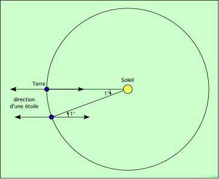

Dans la première position dessinée, le Soleil, la Terre et une étoile (supposée très loin à gauche) sont alignés. Après un tour exactement sur elle-même, la Terre se retrouve tournée vers la même étoile, mais le Soleil n’est pas au rendez-vous, parce que la Terre s’est déplacée sur son orbite, en lui tournant autour. Pour retrouver le Soleil en face, il lui faut faire encore une petite fraction de tour. L’angle correspondant est égal celui que font ses deux positions successives par rapport au Soleil. Or il est très facile à évaluer&#8239;: La Terre fait un tour en 365 jours, et ce tour compte 360°. Par conséquent, la Terre tourne autour du Soleil d’à peu près 1° par jour. Dans la seconde position, il lui manque donc 1° pour retrouver le Soleil, pour qu’il soit midi en ce lieu.

Un degré correspond à un 360e de tour, donc à un 360e du temps qu’il représente, c’est-à-dire de 24 heures de temps moyen. Ces 24 heures totalisent 24 × 60 × 60 = 86.400 secondes&#8239;; donc la Terre tourne d’un degré en 86.400 / 360 = 240 secondes = 4 minutes, qui correspondent à la différence approximative entre le jour solaire moyen et le jour sidéral. Si on fait un calcul plus correct avec 365 jours, on trouve 3 mn 56 s. Il est facile de voir que c’est le jour solaire moyen qui est le plus long puisque la Terre doit tourner d’un degré de plus pour le compléter, donc&#8239;:

<Encadre type="plus">
jour solaire moyen = jour sidéral + 3 mn 56 s
</Encadre>

Une conséquence curieuse est qu’une année solaire moyenne (pratiquement celle de nos calendriers), contient 366 jours sidéraux&#8239;!

**Exercice&#8239;:** calculez votre prochain anniversaire sidéral&#8239;!

L’orbite de la Terre n’étant pas vraiment un cercle, le jour solaire vrai est légèrement variable. La différence entre le jour solaire moyen et le jour solaire vrai se nomme *équation du temps*. C’est une courbe en forme de *huit* à branches inégales, qui est souvent dessinée sur les cadrans solaires.

Basé sur la loi de Newton, le *temps des éphémérides* est un temps plus théorique, qui est censé être parfaitement régulier. C’est celui des équations.

### L’année sidérale

Comme pour repérer le jour, on repère l’année par rapport aux étoiles, c’est l’année sidérale qui vaut 365,25636042 jours solaires moyens. Cette valeur correspond aussi à l’intervalle de temps entre deux passages de la Terre au périhélie.

Mais il y a un problème, c’est que les saisons sont déterminées par le mouvement apparent du Soleil par rapport à l’équateur. Ce dernier tourne lentement, entraînant l’équinoxe de printemps dans une ronde au ralenti&#8239;: **le printemps va la rencontre du Soleil**. L’année des saisons se nomme *année tropique*, elle vaut 365,2422 jours solaires moyens. Elle est donc plus courte que l’année sidérale 365,25636042 - 365,2422 = 0,01416 jour, ou 20 minutes 23 s.

<Encadre type="plus">
année tropique = année sidérale - 20 mn 23 s
</Encadre>

Le mouvement du printemps à la rencontre du Soleil se traduit par le signe - dans cette formule. C’est la *précession des équinoxes*.

À raison d’un déplacement de 0,01416 jour par an, il faudra 365 / 0,01416 ans pour faire un tour complet, c’est-à-dire **25.000 ans** à peu près. C’est la période de la précession. Elle correspond à une avance de 360° / 25.000 = 360 x 60 x 60 / 25.000 = 50" d’arc par an. C’est la valeur de la précession annuelle.

Nous n’entrerons pas ici dans les détails de la mesure du temps. Mais il en est un aspect qui intéresse tout le monde, par son côté pratique de tous les jours, c’est celui qui concerne la mesure des périodes relativement longues, de l’heure à l’année ou au siècle. Ces durées sont un peu plus faciles à apréhender que les plus courtes, et ont été étudiées et maîtrisées avant. Elles donnent lieu à l’établissement d’un [calendrier](../calendrier/), qui fait l’objet d’une étude à part.

*Année anomalistique*&#8239;: intervalle de temps qui s’écoule entre deux passages successifs de la Terre à son périhélie.

*Année tropique*&#8239;: intervalle de temps qui s’écoule entre deux passages successifs de la Terre au point vernal, ou équinoxe de printemps.

## Le Soleil

Bien qu’il nous apparaisse infiniment plus brillant, le Soleil est une étoile. La seule différence est qu’il se trouve très près de nous (à l’échelle astronomique) alors que les étoiles sont beaucoup plus loin. Pour donner un ordre de grandeur, les étoiles les plus proches sont 300.000 fois plus loin que le Soleil&#8239;! Pour imaginer la différence, considérez une ampoule située à 1 mètre de vous, et une autre de même puissance à 300 km…

La nature du Soleil est restée longtemps incomprise, il fallut attendre le début du XXe siècle pour la comprendre.

### La couronne solaire

Au cours d’une éclipse totale de Soleil, on peut d’abord voir le disque noir de la Lune grignoter le Soleil. On peut suivre sa progression sur le sol, sous un arbre. En effet, il y a de petits interstices entre les feuilles qui laissent filtrer un peu de soleil. Par ces petits trous, on obtient une image projetée du Soleil sur le sol. A mesure que la Lune le masque, on voit les petites taches rondes sous les arbres se transformer en croissants&#8239;! Un petit trou par où passe la lumière s’appelle un *[sténopée](https://astronomia.fr/2eme_partie/soleil.php#stenopee)*. Il est à la base de la chambre noire.

Petit à petit, la Lune recouvre le Soleil de plus en plus, pour finalement le cacher complètement. A ce moment-là on découvre un spectacle magnifique, et insoupçonné&#8239;: la *couronne*. Le Soleil est constitué de plusieurs parties, la plus évidente étant la *photosphère*, le disque visible. Mais au-delà de la photosphère, le Soleil possède ce qu’il est convenu d’appeler une atmosphère. Celle-ci est encore divisée en plusieurs couches&#8239;: la plus basse est nommée *chromosphère*, car elle est de couleur rose. Ce n’est qu’une mince pellicule, qui n’est pas facile à distinguer. Mais la couche au-dessus, la couronne, s’étend très loin du Soleil, et ne possède pas la forme sphérique. Elle est irrégulière, avec des jets plus ou moins importants selon la date à laquelle se produit l’éclipse. Il faut savoir en effet que le Soleil possède un cycle d’activité de 11 ans, et que l’extension de la couronne en dépend.

La brillance de la couronne n’est que le millionième de celle de la photosphère, autant dire que la moindre parcelle de photosphère encore visible suffit à la masquer. Elle n’est visible que pendant les éclipses totales de Soleil. Quelques instants avant la totalité, le Soleil est presque tout caché, mais on peut en voir encore de minuscules fragments dans les creux du relief lunaire&#8239;! Ces parcelles visibles sont nommées *grains de Baily*. Le moindre d’entre eux suffit à masquer la couronne.

Pendant les éclipses totales, on peut parfois voir d’immenses jets évoquant des flammes, s’élever dans la couronne&#8239;: ce sont les *protubérances*, gaz très chauds montant dans l’atmosphère du Soleil, guidés par un champ magnétique. Elles durent de quelques dizaines de minutes à quelques heures ou quelques jours. Elles apparaissent au bord du Soleil, où elles se détachent sur le fond de la couronne. Les protubérances qui se forment sur le disque du Soleil sont visibles d’une autre manière.

Les éclipses totales étant très rares en un lieu donné, les astronomes se sont longtemps demandé comment faire pour l’observer en dehors de ces instants privilégiés. La réponse a été apportée par Bernard Lyot, qui a réussi à résoudre tous les problèmes d’optique posés. L’instrument s’appelle le *coronographe*. Grâce à lui, on peut faire des observations de la couronne à tout moment, et l’étude du Soleil a beaucoup avancé.

Cette étude est très importante, car le Soleil est la seule étoile que nous ayons vraiment sous la main&#8239;! Toutes les autres sont trop lointaines pour être observées en détail, tout ce que l’on savait d’elles il y a peu de temps encore provenait d’une analyse globale de la lumière qu’elles émettent. On commence seulement maintenant à disposer d’instruments qui donnent quelques détails de la surface des étoiles les plus proches.

L’application des théories physiques à l’étude du Soleil a permi de construire ce que l’on appelle le modèle standard, qui décrit la composition du Soleil, depuis le centre jusqu’aux plus hautes couches de l’atmosphère, comment se produit l’énergie que le Soleil rayonne, comment elle est propagée depuis le cœur jusqu’à l’espace, etc.

Bien sûr, toutes les étoiles ne sont pas semblables au Soleil, il en est même de très différentes. Mais il est très important de vérifier que toutes les prévisions du modèle standard sont réalisées. Toutes&#8239;? Non&#8239;! Là aussi une irréductible observation sème la perturbation, alors que tout le reste semble si bien représenter le fonctionnement de notre étoile. Mais ce mal qui répand la terreur, le *neutrino* puisqu’il faut l’appeler par son nom, était susceptible de remettre en cause soit le modèle standard du Soleil, soit carrément la théorie des particules élémentaires. Mais ceci est une autre histoire… le problème ayant été résolu au bénéfice du modèle du Soleil&#8239;!

### Les comètes

Les comètes sont des objets éphémères, qui apparaissent un beau jour sans signes précurseurs, évoluent, puis disparaissent. Imprévisibles, elles ont cristallisé toutes les peurs et les superstitions des hommes depuis qu’ils existent. Leur [explication correcte](https://astronomia.fr/2eme_partie/petitsCorps/cometes.php) est très récente. Leur observation détaillée encore plus&#8239;: minuscules objets de quelques kilomètres de diamètre, situés à des distances de centaines de millions de kilomètres, elles n’apparaissent que comme de minuscules points faiblement lumineux dans les meilleurs télescopes. Seules les sondes spécialement conçues, envoyées dans leur voisinage (*Giotto*, *Vega*, *Stardust*…) ou même destinées à se poser à leur surface (*Rosetta*), sont susceptibles de nous donner des renseignements précis. Cependant, elle perdent des gaz sur leur trajectoire, et ceux-ci, éclairés par le Soleil, dessinent les magnifiques queues cométaires que tout le monde connait.

## La mesure des distances

Pour couper une robe, une couturière utilise un *mètre en ruban*. Mais cette unité n’a plus de sens pour mesurer la distance de Marseille à Grenoble. On utilise alors une unité plus appropriée, le kilomètre. Cet exemple pratique nous montre que pour un même type de mesure, on peut choisir des unités différentes selon l’échelle à laquelle on se place. Il en est de même dans les mesures astronomiques.

Au Moyen-Age, il était difficile d’imaginer ce qu’il y avait au-delà d’une trentaine de kilomètres (sauf pour les pèlerins ou les compagnons). Maintenant, tout le monde (&#8239;?!) a une idée précise de ce qu’est la Terre. La Terre est une petite planète qui tourne autour d’une étoile très quelconque, le Soleil. Entre le Soleil et ses planètes, on peut mesurer les distances en kilomètres. La Terre n’est qu’à 150.000.000 de kilomètres du Soleil, mais Pluton est à 5.900.000.000 de km. Il n’est pas très pratique d’écrire des nombres pareils, et ce qu’on voudrait surtout retenir, c’est que **Pluton est beaucoup plus loin que la Terre**&#8239;!

Les astronomes ont défini diverses unités de distance, chacune adaptée à un domaine particulier. Ces distances sont *l’unité astronomique*, *l’année-lumière*, *le parsec*.

Ce n’est pas seulement la difficulté d’écriture des nombres qui a incité les astronomes à définir une unité de distance nouvelle&#8239;; c’est bien plus la très grande difficulté de mesurer les distances dans le système solaire directement dans une unité terrestre. Il a fallu attendre des mesures de parallaxe précises, récentes, pour établir le lien entre les distances terrestres et les distances astronomiques. Voyez le principe de la mesure de la [distance de Vénus](../distances/#distVenus) expliqué dans un autre chapitre. Le résultat est une mesure de la distance Vénus-Soleil, **en fonction** de la distance Terre-Soleil. Donc, si on prend cette dernière comme unité nommée *Unité Astronomique* (UA), la distance Terre-Soleil = 1 UA. Alors la distance Vénus-Soleil est de 0,7 UA&#8239;; pour Jupiter, nous avons déjà trouvé une distance de 5,2 UA. Pluton est donc à 5.900.000.000 / 150.000.000 = 39 UA. Le Soleil y est 39 fois plus loin que d’ici, il ne doit pas y faire très chaud…

On a ensuite mesuré la distance de l’étoile la plus proche de nous&#8239;: 39.700.000.000.000 km. Traduisant ce nombre en UA, on obtient 39.700.000.000.000 / 150.000.000 = 265.000 UA. C’est encore un nombre bien grand, si on pense que toutes les étoiles sont plus loin que ça, et même beaucoup plus loin.

Mais ce nombre nous apprend déjà que l’étoile la plus proche est tout de même 265.000 fois plus loin de nous que le Soleil&#8239;!

D’où la définition d’une nouvelle unité plus grande,*l’année-lumière*&#8239;: c’est la distance parcourue par la lumière en une année. Pour avoir une idée de ce que cela représente en unités habituelles, convertissons 1 AL en km&#8239;: la lumière se déplace à 300.000 km/s&#8239;; 1 AL = 60 × 60 × 24 × 365 × 300.000 km = 9.460.800.000.000 km ~ 10.000.000.000.000 km = 1013 km = 10.000 milliards de kilomètres… La valeur précise de l’année-lumière est 0,946073047 1013 km, et celle de l’unité astronomique est 149.597.870 km.

Calculer la distance de l’étoile la plus proche de nous en AL&#8239;: 39.700.000.000.000 / 9.460.800.000.000 = 4,2 AL.

Pour donner une autre idée des distances, calculons la distance-lumière de Pluton au Soleil&#8239;: le temps mis par la lumière pour parcourir les 5.900.000.000 km entre le Soleil et Pluton est&#8239;: 5.900.000.000 km / 300.000 km s-1 = 19.666 secondes = 327 minutes ~ 6 heures. Donc Pluton est à 6 heures-lumière du Soleil, ou bien encore 1/4 de jour, donc 1/4/365 d’année *i.e.* 0,000 685 AL. C’est moins d’un millième d’année-lumière.

Ces distances difficiles à exprimer montrent l’immensité du vide dans le Système Solaire. Entre la Terre et Mars, lorsqu’elles sont au plus près, il y a 53 millions de kilomètres. Ce ne sont que des poussières dans le vide…

Représentons le Soleil de 1,4 million de kilomètres de diamètre par une tête d’épingle en verre d’un millimètre de diamètre. A la même échelle, le diamètre de l’orbite de Jupiter est de 5,20 mètres. Si cette tête d’épingle est au milieu d’une pièce de 10,40 mètres de côté (y compris la hauteur du plafond), Jupiter est un grain de sable sur le mur&#8239;!

## La mesure des températures

La température d’un objet massif, tels que ceux qui nous entourent, est une notion *a priori* subjective. On a d’abord remarqué que certains matériaux présentaient des variations de volume en fonction de la température&#8239;: un métal se dilate à la chaleur, et se contracte au froid. Ceci ne constitue pas encore une mesure, car il faut pour cela disposer d’un repère fixe.

La température a été objectivée en 1742 par Anders Celsius, astronome suédois, professeur à l’université d’Uppsala. Il a remarqué qu’un mélange d’eau froide et de glace conservait la même température, même si on l’exposait à un froid plus intense, ou à la chaleur. On peut le constater justement en y plongeant un morceau de métal, dont les variations de longueur dénoteront d’éventuelles variations de température. Tant qu’il reste à la fois de l’eau et de la glace, la température du mélange ne varie pas. On a donc un point fixe.

Pour établir une échelle, il faut de plus un coefficient multiplicateur, la distance entre deux barreaux successifs. Pour cela, un second point fixe est souhaitable. Il a été trouvé par le mélange d’eau et de vapeur, qui conserve lui aussi la même température tant qu’il reste à la fois de l’eau et de la vapeur. Entre ces deux points fixes, Celsius a établit 100 graduations, utilisant donc une division centésimale. La graduation se nomme donc *degré Celsius*, en référence à son créateur, ou *degré centigrade* en référence au nombre de divisions.

L’explication de ces deux phénomènes a été trouvée&#8239;: pour transformer de l’eau en glace, il faut lui retirer de la chaleur&#8239;; pour transformer de la glace en eau, il faut lui en fournir la même quantité (pour la même masse). Donc, s’il y a à la fois de l’eau et de la glace, lorsqu’on fourni de la chaleur, de la glace l’absorbe pour se transformer en eau, et lorsqu’on retire de la chaleur, de l’eau l’absorbe pour se transformer en glace. Donc, les variations de température sont absorbées par ces transformations.

Dans le cas de l’eau et de la vapeur, il en est de même. Les variations de température sont gommées.

A l’origine, la température de la glace fondante a été notée 100° et celle de l’eau bouillante 0°. Une permutation de ces deux valeurs a amené l’échelle à celle que nous utilisons tous les jours.

Mais les physiciens ont rencontré un problème. Comme on lave plus blanc que blanc, on peut faire plus froid que froid&#8239;: il existe des températures négatives. L’échelle Celsius n’a pas de bornes, ni dans les valeurs positives, ni dans les valeurs négatives. Or cette méthode de mesure a été construite en l’absence d’explication de la chaleur. Qu’est ce qui différencie un objet chaud d’un objet froid&#8239;?

Il a fallu comprendre que la matière est faite d’atomes, que l’on peut voir ici comme de petites billes, pour trouver l’explication&#8239;: la chaleur mesure l’agitation des atomes&#8239;! Une particule animée d’une vitesse possède une énergie cinétique. C’est le cas de tous les objets macroscopiques (essayez donc de vous laisser tomber une boîte de petits poi(d)s sur le pied…). Les molécules de l’air (formées de plusieurs atomes) sont animées d’une grande vitesse. Lorsqu’elles viennent heurter notre peau (à 20° C, la vitesse d’une molécule d’oxygène O2 est de 340 m/s = 1.220 km/h, la molécule d’azote N2 est légèrement moins lourde, donc légèrement plus rapide), elles nous communiquent leur énergie cinétique. Chacune en apporte très peu, mais elles sont si nombreuses… Alors, l’impression de chaleur que nous ressentons n’est que l’apport d’énergie produit par des milliards de molécules qui viennent nous percuter. Donc, plus les particules vont vite, plus l’objet qu’elles composent est chaud. *A contrario*, lorsqu’il fait froid, les molécules de l’air ont moins d’énergie que celles de la peau. Le transfert d’énergie se fait donc dans l’autre sens, c’est ce qui nous donne cette sensation de froid.

Mais qu’arrive-t-il si les molécules qui composent un objet sont immobiles&#8239;? Elle ne nous communiquerons plus d’énergie du tout. Il sera donc difficile de faire plus froid&#8239;! C’est là la notion de zéro absolu&#8239;: il existe une température minimale&#8239;! Alors qu’il n’existe pas de température maximale, si ce n’est celle qu’aurait un corps dont les atomes s’agiteraient à la vitesse de la lumière&#8239;!!

Des expériences ont montré que cette température est de l’ordre de -273,15° C. On en déduit l’échelle absolue, ou échelle Kelvin (nommée ainsi parce qu’elle a été définie par Lord Kelvin)&#8239;: le zéro est la température minimum possible, donc approximativement -273,15° C, et les graduations sont les mêmes que dans l’échelle Celsius. Donc le zéro Celsius correspond à 273,15 Kelvins. La conversion est facile&#8239;:

<Encadre type="plus">
TK = TC + 273,15
</Encadre>

Une température estivale de 26,85° C correspond à 300 Kelvins. La température de la photosphère solaire, qui est de 5.775 Kelvins, vaut donc 5.500° C.

La notion de température que nous avons est basée sur notre immersion dans un environnement de densité élevée. De l’air chaud nous chauffe. Mais que se passe-t-il si on chauffe à 1.000 Kelvins de l’hydrogène à une densité de quelques atomes au cm3&#8239;? Que ressentirait-on si on pouvait exposer sa main à un tel gaz&#8239;? Bien que chaque atome percuterait notre peau à très grande vitesse, et y déposerait une énergie importante (à l’échelle de l’atome), ceci ne représenterait pratiquement rien pour nous, et serait strictement insensible (bien que ça pourrait faire des dégats au niveau microscopique).

La chaleur qu’un corps nous communique est due à un grand nombre de chocs à chaque seconde, dans un milieu dense. Dans un milieu très raréfié, même si la température est très élevée, l’apport d’énergie reste très faible sinon négligeable.

## Les objets astronomiques

Pour les étoiles, c’est très simple. Elles se forment à partir du milieu interstellaire, qui a été créé juste après le Big Bang. Sa composition comprend à peu près 75 % d’hydrogène et 25 % d’hélium. Ces valeurs sont arrondies, car on ne les connait qu’à quelque chose près, et le milieu interstellaire contient des traces d’éléments légers, essentiellement du lithium, peut-être un peu de bérylium et de bore. Rien d’autre, à l’origine. Plus tard, les étoiles massives ont synthétisé des éléments plus lourds, qui viennent contaminer le milieu pour moins de 2 %.

Les autres objets (planètes, comètes, astéroïdes…) sont formés d’éléments plus lourds. Les éléments les plus légers ont été éliminés par les conditions physiques (température notamment). Ils sont donc constitués essentiellement d’éléments plus lourds, oxygène, carbone, azote, calcium…. Or ces éléments ont tendance à se combiner, aux températures qui règnent loin des étoiles, pour former des molécules&#8239;; aussi, il n’est pas étonnant de trouver une large panoplie du parfait chimiste dans l’Univers.

Les planètes sont formées des composés chimiques les plus simples, *oxydes*, *carbonates*, *silicates*… On trouve également des métaux à l’état natif, c’est-à-dire non combiné. C’est le cas dans les météorites, car elles proviennent du cœur d’une planète détruite, et les conditions physico-chimiques qui régnaient là ne permettaient pas la constitution de molécules. Une petite remarque au sujet des éléments plus lourds que le fer&#8239;: il ne peuvent pas être synthétisés dans les étoiles, et trouvent leur origine dans des événements violents de l’Univers, comme les explosions d’étoiles.

Mais il y a aussi des matériaux volatils. L’eau est le premier exemple, et le plus répandu. Elle se présente sous trois formes selon la température et la pression&#8239;: l’eau liquide, la glace et la vapeur. Ce mot de glace a été créé pour la phase froide de l’eau. Mais maintenant, on l’applique à d’autres situations, plus précisément à d’autres éléments chimiques&#8239;: on connait bien la glace carbonique, qui a des usages industriels importants. C’est du gaz carbonique (CO2) liquéfié, puis gelé. Elle a un aspect blanc, et ressemble beaucoup à la glace d’eau. Mais on peut faire subir le même traitement à d’autres gaz, pas exemple l’azote. Dans des conditions encore plus sévères de température, l’azote se liquéfie et se gèle. On trouve donc de la glace carbonique sur Mars, de la glace d’azote sur Triton. On nomme donc *glace* tout gaz, ou tout élément volatil, gelé.

### Les étoiles

Les étoiles sont d’autres soleils. Elles se sont formées d’une manière semblable, sont constituées des mêmes matériaux, brillent pour la même raison. Elles nous apparaissent minuscules et pâles parce qu’elles sont beaucoup plus loin que le Soleil. Mais certaines sont beaucoup plus lumineuses et beaucoup plus chaudes.

Dans un instrument, même modeste, on peut en voir des milliers. Il est impossible de donner un nom à chacune. Pour s’y retrouver, les astronomes ont alors établi des catalogues d’étoiles, que nous verrons dans le chapitre qui leur est consacré.

### Les pulsars

Dans le domaine radio, on a observé des objets variables, mais dont la période est extrêmement courte&#8239;: quelques secondes, puis pour certains beaucoup moins… De tels signaux périodiques ont été attribués à une civilisation extraterrestre&#8239;! Jusqu’au jour où on a compris qu’il s’agissait d’une étoile dont la taille avait considérablement diminué, et qui tournait très, très vite sur elle-même. Comme ses signaux étaient pulsants, par association phonétique avec les quasars découverts avant, on a nommé ces objets *pulsars*.

On a depuis trouvé encore d’autres curiosités, nommées blazards, magnétars…

### La Voie Lactée, ses dimensions, son nombre d’étoiles

La [Voie Lactée](https://astronomia.fr/5eme_partie/voieLactee.php) est cette bande légèrement lumineuse qu’on peut voir l’été lorsqu’on a la chance de disposer d’un beau ciel, sans lumières parasites (loin de toute agglomération). La nature de cette bande laiteuse (d’où le nom et la légende) a été source de débat chez les astronomes&#8239;: soit il s’agissait de matière gazeuse, soit c’était un rassemblement de très nombreuses étoiles trop éloignées de nous pour être distinguées séparément. C’est cette seconde explication qui est la bonne, bien qu’il y ait également du gaz dans l’espace.

Notre Voie Lactée est donc formée de quelques 150 milliards d’étoiles, et contient aussi des nuages de gaz sombres ou lumineux, des rassemblements d’étoiles de forme quelconque et lâches ou bien nettement sphériques et compacts… Vue depuis la Terre sous la forme d’une bande lumineuse qui fait le tour du ciel, elle a la forme d’un disque aplati.

### Les galaxies

A l’œil nu, on peut distinguer trois objets qui ont un peu le même aspect&#8239;: la nébuleuse d’Andromède dans l’hémisphère nord, et les deux nuages de Magellan dans l’hémisphère sud. Ces deux derniers semblent être des lambeaux détachés de la Voie Lactée. En fait, ce sont d’autres Voies Lactées, nous dirons plus exactement d’autres galaxies. Il en est de même de la nébuleuse d’Andromède, qui est de même nature que la Voie Lactée, mais située beaucoup plus loin, à 2,5 millions d’années-lumière. Pour cette raison, on l’appelle maintenant la Grande Galaxie d’Andromède.

L’histoire des [galaxies](https://astronomia.fr/5eme_partie/galaxies.php) est récente. Les objets de Messier, petites taches floues dans le ciel, posaient un problème aux astronomes&#8239;: quelle est leur nature&#8239;? Avec les instruments du XIXe siècle, il était impossible de la découvrir. Etaient-ce des nuages de gaz flottant dans l’espace, ou bien de grands rassemblements d’étoiles, trop proches les unes des autres pour être distinguées depuis la Terre&#8239;? A cause de leur aspect, on les a toutes appelées nébuleuses. Certaines présentant une structure spiralée ont pris le nom de nébuleuses spirales.

L’Univers était constitué de la Terre, du Soleil et des planètes, disons du *système solaire* dans son ensemble, et d’étoiles. Au milieu (en apparence) des étoiles se trouvaient les nébuleuses. La question était de savoir si les nébuleuses étaient du gaz à la même distance que les étoiles, ou bien constituées d’étoiles, et alors beaucoup plus loin. En résumé, l’Univers était-il constitué d’un unique ensemble d’étoiles et de nébuleuses, ou bien de plusieurs ensembles d’étoiles, dont certains apparaissaient sous la forme de nébuleuses&#8239;?

Enfin, à la mise en service du téléscope Hooker de 2,50 m au Mont Wilson, on a pu résoudre la nébuleuse d’Andromède en étoiles, montrant donc que certaines nébuleuses étaient d’immenses groupes d’étoiles, situés très loin de nous. La Voie Lactée est notre formation d’étoiles, et les nébuleuses spirales sont des formations semblables. On a donné le nom de **galaxies** à ces formations. La Voie Lactée est souvent notée **Galaxie**, avec une majuscule. Cette découverte a multiplié par 1.000.000 la dimension de l’Univers, et notre façon de le concevoir.

On a depuis observé des milliards de galaxies. Chacune contient une centaine de milliards d’étoiles&#8239;!

### Les étoiles dans une galaxie

Lorsqu’on regarde une belle galaxie comme celle d’Andromède, on a l’impression de voir des étoiles qui se touchent. La réalité est bien différente. Cette illusion est due à l’éloignement et à la perspective. Considérons notre voisinage solaire&#8239;:

Le diamètre des étoiles est de l’ordre de 106 km (un million de km). Leur distance est de l’ordre de 5 1013 km (1 AL = 10.000 milliards de km). Leur distance est donc 5 1013 / 106 = 5 107 fois plus grande que leur diamètre.

Une tête d’épingle en verre a un diamètre de l’ordre du millimètre. 5 107 fois plus font 5 107 mm = 50 km. On peut donc représenter les étoiles dans une galaxie comme des têtes d’épingles situées à 50 kilomètres les unes des autres&#8239;!!! On comprend mieux que les collisions d’étoiles soient vraiment exceptionnelles, même dans le cas où deux galaxies se rencontrent.

L’impression que l’on a en regardant une galaxie est donc due à la profondeur&#8239;: sur la ligne de visée, il y a plusieurs étoiles en perspective, mais éloignées physiquement les unes des autres.

### Les amas de galaxies

Les galaxies se groupent à leur tour en [**amas**](https://astronomia.fr/5eme_partie/amasGalaxies.php) de galaxies, reliées par la gravité. Les amas en contiennent de quelques centaines à quelques milliers. Ils se regroupent en super amas. L’image que nous avons maintenant de la structure de l’Univers est celle d’une mousse de savon, dans laquelle les parois des bulles sont des amas de galaxies. Nous sommes loin de la Terre au centre de l’Univers&#8239;!

Ce que nous voyons d’un amas de galaxies représente seulement 1/400e de sa masse&#8239;! Où sont passés les 399/400e, nul ne le sait à l’heure actuelle… Et c’est un problème passionnant à résoudre&#8239;!

### Les quasars

Les observations radio ont montré l’existence de sources très intenses, mais dont on ne pouvait pas mesurer la position à cause du faible pouvoir séparateur des instruments. Lorsqu’on a réussi à déterminer précisément la position d’une de ces sources, on a été fort surpris de ne pas trouver d’étoile ou autre objet visible à son emplacement. On a fini par associer la radiosource à une toute petite étoile très faible. Par ses propriétés, cet objet n’était pas une étoile, bien qu’il en ait l’aspect. On l’a alors appelé *source radio quasi-stellaire*, en anglais *quasi-stellar radio source*, qui a été contracté en *quasar*.

Lorsqu’on a réussi à déterminer sa distance à la Terre, la surprise fut grande&#8239;: elle était très, très loin, et donc dépensait une énergie qu’on ne savait pas expliquer. Ce fut le début d’une longue histoire…

## La cosmologie

Après avoir étudié chaque astre séparément, puis par groupement, il sera temps de considérer l’Univers dans son ensemble. C’est le but de la [cosmologie](https://astronomia.fr/6eme_partie/cosmologie.php) (science du cosmos). Elle étudie l’espace (renommé espace-temps) et l’influence de ce qu’il contient (les galaxies étant considérées comme des particules d’épreuve…). De tous temps, l’Homme a cherché à comprendre ce qui l’entoure, depuis les modèles plutôt philosophiques des Anciens, jusqu’aux tentatives scientifiques de la fin du XIXe siècle. Mais il a fallu attendre la théorie de la Relativité Générale pour s’en faire une idée quelque peu acceptable… Cependant, nous ne sommes pas au bout de nos peines, et les interrogations à ce sujet se sont déplacées, mais existent toujours.

Les théories de l’Univers dans son ensemble rejoignent curieusement celles des particules élémentaires chères aux physiciens. Il semble bien difficile d’expliquer l’infiniment grand et l’infiniment petit séparément. Une solution acceptable doit forcément expliquer les deux du même coup&#8239;!

Pour cela, il faudra arriver à concilier les deux grandes théories du XXe siècle, la Relativité Générale et la Mécanique Quantique, la première expliquant l’infiniment grand, la seconde l’infiniment petit. L’ennui est que les deux théories s’ignorent, alors que l’Univers est fait de particules…
