import Encadre from '../../../components/chapitre/Encadre.astro';

## Observation visuelle

Nous ne considérerons ici que les instruments qui apportent un grossissement de l’image, excluant tous les instruments d’observation à l’œil nu utilisés de l’Antiquité jusqu’à Tycho Brahé. *Un petit coup de chapeau à tous ces chercheurs-philosophes qui voyaient le ciel comme nous, sans le moindre instrument, et qui ont été capables d’en extraire tant d’informations souvent pertinentes&#8239;!*

Les instruments d’optique jouent deux rôles très différents&#8239;:

<Encadre type="plus">
- ils collectent la lumière&#8239;;
- ils améliorent la finesse des images.
</Encadre>

Notre œil collecte la lumière par une pupille dont le diamètre, dans l’obscurité, est de l’ordre de 6 mm. Il nous permet de voir les astres brillants. Si on utilise un instrument 60 mm (une paire de jumelles), de diamètre 10 fois supérieur à notre pupille, il présente une surface 102 = 100 fois plus grande. Donc, il collecte 100 fois plus de lumière, en provenance du même astre. Ceci fait gagner 5 [magnitudes](https://astronomia.fr/3eme_partie/etoiles.php#magnitude)&#8239;! Dans un ciel noir et non pollué, on passe de la magnitude limite 6 à l’œil nu, à la magnitude 11. L’aspect du ciel en est totalement changé.

L’amélioration de la finesse des images permet de distinguer deux étoiles proches l’une de l’autre, qui sinon sont confondues. C’est la nature ondulatoire de la lumière qui est responsable de ce problème&#8239;: l’image d’une étoile ponctuelle n’est pas un point, mais une [*tache de diffraction*](../lumiere/#tacheDiff), ou *tache d’Airy*. Celle-ci est d’autant plus petite que le diamètre de l’instrument est plus grand. Deux étoiles proches dont les taches de diffractions se superposent si elles sont grosses (dans un instrument de petit diamètre), seront clairement séparées si les taches sont petites (dans un instrument de grand diamètre).

<Encadre type="plus">
Ainsi, utiliser un instrument de diamètre 10 fois (k fois) supérieur produit&#8239;:

- une image 100 fois (k2 fois) plus lumineuse,
- et des détails 10 fois (k fois) plus fins
</Encadre>

### Deux types d’instruments

<Encadre type="plus">
Il y a une différence importante entre la lunette et le télescope&#8239;; il est bon de la rappeler ici. La lunette se compose d’un tube qui porte à son extrémité supérieure une lentille convexe appelée objectif, et à son extrémité inférieure une seconde lentille nommée oculaire, à laquelle s’applique l’œil de l’observateur. Les rayons émanant de l’objet lumineux traversent la première lentille et vont, par réfraction, former une image renversée à son foyer. Cette image, on l’observe avec l’oculaire, qui la grossit exactement comme ferait une loupe. Le tube de la lunette est donc fermé à chaque extrémité par l’objectif et l’oculaire.  Au contraire, le tube du télescope est ouvert à son extrémité supérieure. Les rayons partis de l’objet observé y pénètrent librement et vont frapper un miroir métallique concave, c’est-à dire convergent. De là ces rayons réfléchis rencontrent un petit miroir qui les renvoie à l’oculaire, disposé de façon à grossir l’image produite.

De la Terre à la Lune, chapitre XXIV  Jules Verne
</Encadre>

Ce passage d’un roman de Jules Verne est toujours d’actualité, à l’exception de la matière du miroir, qui est maintenant en verre (ou en une substance de même nature que le verre). Il faut signaler que Jules Verne cite Léon Foucault dans le même chapitre.

<Encadre type="plus">

<table>
<tbody>
<tr><th>Lunettes</th><td>Elles sont constituées d’un objectif à lentilles, comme un objectif photographique, et d’un oculaire (les jumelles sont faites sur le même principe&#8239;: leur nom est l’abréviation de <em>lunettes jumelles</em>). La lumière des étoiles traverse l’objectif, puis l’oculaire. On les nomme aussi <em>instruments réfracteurs</em>, parce qu’ils construisent l’image par <strong>réfraction</strong> à la traversée du verre.</td></tr>
<tr><th>Télescopes</th><td>L’objectif est un miroir de forme sphérique ou parabolique, qui renvoie la lumière arrivant des étoiles, vers l’oculaire, qu’elle traverse. Il existe divers types de télescopes, qui diffèrent par des détails. L’oculaire devrait être placé à l’intérieur du tube, où la tête de l’observateur, dans un petit télescope, gênerait l’observation. C’est pourquoi on place un second miroir, plan, qui renvoie le faisceau vers le côté du tube pour l’observation&#8239;: c’est la formule de Newton. On nomme aussi les télescopes <em>instruments réflecteurs</em>.</td></tr>
</tbody>
</table>

</Encadre>

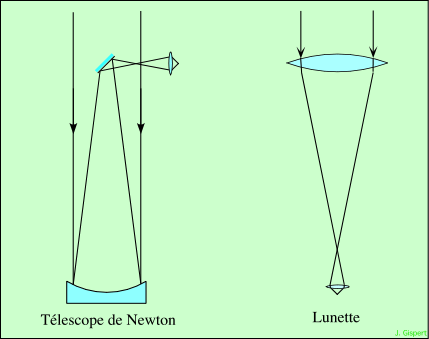

Remarquez sur ce schéma&#8239;:

- que la lumière ne traverse pas le verre du miroir dans le télescope, alors qu’elle traverse l’objectif de la lunette&#8239;;
- que les rayons lumineux se croisent avant de parvenir à l’oculaire.

En regardant un instrument astronomique, on voit du premier coup d’œil si c’est un télescope ou une lunette&#8239;: l’oculaire d’une lunette est situé au bout du tube, alors que celui du télescope est en haut sur le côté. Toutefois, il existe maintenant des télescopes (dits de *Cassegrain*) où l’oculaire est situé en bout, comme dans une lunette&#8239;; mais leur tube se distingue car il est beaucoup plus court.

La lunette est légèrement plus ancienne que le télescope&#8239;; elle a été inventée en Hollande vers 1609 (on ne connait pas avec certitude la date, ni l’inventeur, mais on l’attribue souvent à Hans Lippershey en 1608&#8239;; Jacob Metius et Zacharias Janssen ont aussi déposé des brevets dans le même sens). Très vite, elle a été connue dans le reste de l’Europe, et Galilée en a construit une à Florence (1609). Avec cet instrument, dont la qualité n’atteignait pas celle d’un jouet actuel, il a bouleversé la vision classique du monde&#8239;:

<Encadre type="plus">
La conception du monde, héritée des Grecs, et admise sans discussions au cours de tout le Moyen-Age, était basée sur deux dogmes&#8239;:

- la position centrale de la Terre, autour de laquelle tout devait tourner selon des mouvements circulaires uniformes (mouvements parfaits).
- la séparation de l’Univers en deux parties&#8239;:
    - le monde sub-lunaire dans lequel nous vivons, où tout est provisoire, tout évolue dans le temps, et qui est impur&#8239;;
    - le monde supra-lunaire, où tout est pur et parfait, et où donc les mouvements ne peuvent être que circulaires et uniformes.

Ce sont ces deux dogmes qui ont entraîné Ptolémée à construire un système du monde si compliqué…

Dès que Galilée a tourné sa lunette vers le ciel, il a fait deux découvertes fondamentales, qui ont suffi à balayer ces conceptions&#8239;:

- les objets supra-lunaires observés ne sont pas purs&#8239;:
    - la Lune elle-même est couverte de cratères&#8239;;
    - le Soleil montre des taches sombres.
- Les surfaces de ces astres ne sont donc pas lisses et parfaites.
- Jupiter est entourée de 4 satellites (il y en a beaucoup plus, mais Galilée ne pouvait en voir davantage&#8239;; on les appelle depuis *satellites galiléens*)&#8239;; ces corps tournent manifestement autour d’un corps qui n’est pas la Terre…  Saturne possède des anneaux.
</Encadre>

Galilée a eu les ennuis que l’on sait pour avoir osé dire ce qu’il voyait.

<Encadre type="plus">
La première lunette de Galilée était constituée d’un objectif constitué d’une lentille simple plan-convexe (face convexe à l’extérieur), de 5,6 cm de diamètre et de 1,7 m de focale.

L’oculaire était une lentille simple également, mais plan concave, la concavité tournée à l’intérieur. Le grossissement de cet instrument n’était que de 3 fois. Mais son pouvoir séparateur (finesse des images) devait être de l’ordre de 10 fois meilleur que celui de l’œil nu (sans trop tenir compte des aberrations présentées).
</Encadre>

Avant d’examiner les [lunettes et télescopes](#Deutypins), il convient de définir les différentes propriétés qui les caractérisent.

## Optique géométrique

Le but de ce paragraphe n’est pas de reprendre la théorie géométrique de la lumière, mais seulement de considérer les paramètres importants en astronomie.

### Foyer et stigmatisme

Il est facile de [tailler un miroir](../taille-miroir/) de télescope sphérique (*assez* facile). Si on considère une étoile (dont les rayons arrivent tous parallèles), située sur l’axe du miroir, il est aisé de voir qu’ils vont converger à une distance du miroir moitié de son rayon. Au point où un rayon lumineux frappe le miroir, la perpendiculaire au miroir passe par le centre. Donc, le rayon réfléchi est symétrique du rayon incident par rapport à cette perpendiculaire. Il coupe l’axe en un point situé *approximativement* à mi-distance du centre&#8239;:

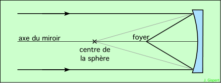

Mais cette forme ne donne pas toutes satisfactions. Les rayons marginaux, qui se réfléchissent sur le bord, se coupent un peu plus près du miroir que les rayons centraux. Il n’existe pas un foyer unique où tous les rayons se retrouveraient. Ce défaut est *l’aberration de sphéricité*.

<Encadre type="plus">
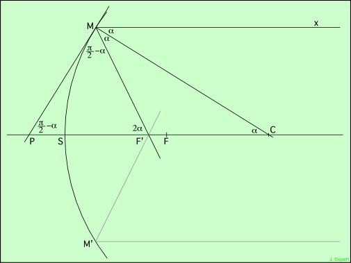

Le rayon xM, parallèle à l’axe du miroir, se réfléchit selon MF′. En effet, le rayon du cercle passant par M est MC. Il est perpendiculaire à la tangente au miroir en ce point (tangente MP). La loi de la réflexion dit que le rayon incident et le rayon réfléchi sont symétriques par rapport à la normale au miroir. Donc les deux angles en M sont égaux (α).

D’autre part, le rayon incident et l’axe du miroir sont parallèles. Donc les angles que fait MC avec eux sont égaux&#8239;: l’angle en C vaut aussi α. Par suite, le triangle MF′C est isocèle, et donc MF′ = F′C.

Le triangle CMP est rectangle en M. Son angle aigu en C vaut α, donc le troisième angle vaut π/2 - α (la somme des angles d’un triangle vaut 180° = π).

L’angle PMF′ = PMC - MCF′ = π / 2 - α.

Donc, le triangle PF′M est isocèle, puisqu’il a deux angles égaux. Par conséquent, les deux côtés adjacents à ces angles sont aussi égaux&#8239;: PF′ = MF′.

Rapprochons de l’égalité trouvée plus haut (MF′ = F′C), on obtient&#8239;: PF′ = F′C

Donc le point F′ est le milieu de PC. Prenez le rayon (en grisé sur le schéma) qui touche le miroir au symétrique M′. Les deux rayons se croiseront en F′, qui est donc leur foyer.

On peut faire le même raisonnement pour un rayon incident quelconque, en particulier pour le rayon passant par l’axe. Pour celui-ci, les points M et P sont confondus au point S. Le foyer de ces rayons est au milieu de SC (point F). Si M et M′ sont les bords du miroir, la distance F′F mesure l’aberration de sphéricité.

Si vous traciez de nombreux rayons parallèles à l’axe, à des distances diverses, vous verriez apparaître une courbe, enveloppe des rayons réfléchis. Cette courbe est la *caustique*. Puisque le miroir est dans l’espace et non dans le plan, il s’agit de la *surface caustique*.
</Encadre>

Pour corriger ce défaut, il faut reculer légèrement les bords du miroir par rapport à son centre, c’est-à-dire lui donner une forme parabolique. C’est un peu plus difficile à tailler, mais bien plus satisfaisant&#8239;: on obtient le stigmatisme parfait pour tous les *rayons parallèles à l’axe*.

<Encadre type="plus">
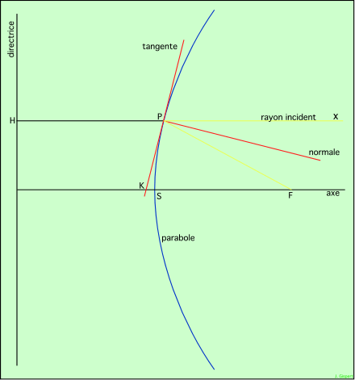

Il est un peu plus délicat de montrer que la parabole résoud le problème, car on doit s’appuyer sur un théorème.

Un rayon xP (jaune) parallèle à l’axe est perpendiculaire à la directrice de la parabole. Or dans une parabole, la tangente (rouge) en P est la bissectrice de l’angle HPF.

D’autre part, les angles HPF et FPx sont supplémentaires. Donc leurs bissectrices sont perpendiculaires. Par conséquent, la bissectrice de l’angle FPx est la perpendiculaire à la tangente, c’est à dire la normale.

Par conséquent, le rayon xP se réfléchit en PF, d’après la loi optique de la réflection, qui veut que le rayon émergeant (PF) est symétrique du rayon réfléchi par rapport à la normale . Ceci est indépendant du point P choisi, donc tous les rayons parallèles à l’axe convergent rigoureusement au foyer F.
</Encadre>

Mais pour les rayons inclinés par rapport à l’axe, le stigmatisme n’est pas rigoureux, mais seulement approché. Bien sûr, l’astigmatisme augmente avec l’inclinaison, et ceci limite le champ utilisable. On peut réduire l’astigmatisme en diminuant la courbure du miroir, c’est-à-dire en augmentant son rapport F/D. Ce qui permet d’augmenter le champ, au prix d’un encombrement accru. La définition d’un télescope est donc en particulier un compromis entre un grand champ et un tube court.

### Grandissement

Nous allons considérer un objet à distance finie de l’objectf. Pour expliquer le grandissement, nous allons considérer un objectif de lunette à lentille simple mince.

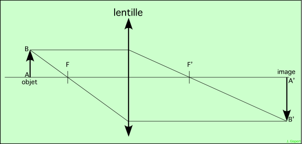

La lentille mince est symbolisée par la double flèche verticale, qui indique qu’elle est convergente (pointes des flèches tournées vers l’extérieur). F est le foyer objet, F′ est le foyer image. Considérons un objet linéaire AB, représenté par la flèche de gauche, et son image A′B′. L’objet étant placé, il est facile de construire son image.

Considérons le point B de l’objet. Il émet des rayons dans toutes les directions, et nous allons en considérer deux. Le premier sera parallèle à l’axe de la lentille. Par définition, il doit passer par le foyer image F′. L’image de B sera sur ce rayon.

Le second rayon considéré passera par le foyer objet. Symétrique du précédent, il ressortira de la lentille parallèle à son axe.

Les deux rayons se coupent en B′, c’est l’image du point B.

On pourrait montrer que l’image de A est dans le même plan, et se trouve sur l’axe (comme A). Donc, l’image de l’objet est le segment A′B′. On remarque que l’image est inversée par rapport à l’objet.

On constate que AB et A′B′ n’ont pas la même longueur. Par définition, le *grandissement* de la lentille est la rapport de la taille de l’image à la taille de l’objet&#8239;:

Γ = A′B′ / AB

C’est la notion courante, selon laquelle l’image donnée par une loupe est plus grande que l’objet regardé. Mais cette notion ne suffit pas. Si on éloigne l’objet, son image se rapproche du plan focal en F′. Mais si l’objet est rejetté à l’infini (cas des étoiles), la notion de grandissement n’a plus de sens, puisqu’il est impossible de mesurer l’objet. Seul, l’angle sous lequel on le voit garde un sens.

L’œil étant placé dans le plan image A′B′, l’image est vue sous un angle α.

Si on supprime la lentille, on voit l’objet directement sous un angle β. Par définition, le grossissement est le rapport de l’angle sous lequel on voit l’image dans l’instrument, à celui sous lequel on voit l’objet à l’œil nu.

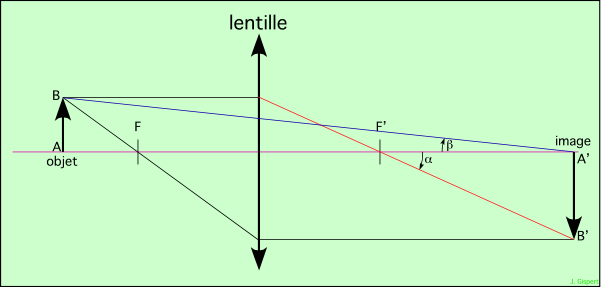

Sur le schéma, on constate bien que l’angle α est plus grand que l’angle β.

### Grossissement

Le grossissement ne doit pas être confondu avec le grandissement&#8239;; il est seul défini pour un objet situé à l’infini.

Mais le grossissement est un piège. C’est la caractéristique la plus connue du public en optique, mais aussi la plus ambigüe&#8239;!

Lorsque deux étoiles vues à l’œil nu sont trop proches l’une de l’autre, on ne les distingue pas (si l’angle sous lequel on les voit est inférieur à 1′&#8239;; voir [chapitre 1](../generalites/#oeil))&#8239;:

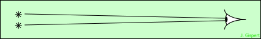

C’est parce que leurs images se forment sur la même cellule de la rétine. Pour arriver à les distinguer, il faut que l’angle qui les sépare soit plus grand. Un instrument d’optique peut augmenter l’angle sous lequel on les voit, et c’est pour cela qu’il donne l’impression de grossir l’image&#8239;:

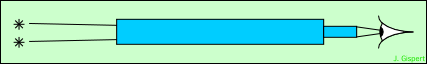

Le grossissement d’une lunette ou d’un télescope est obtenu par la **combinaison** de l’objectif, qui donne l’image, et de l’oculaire qui permet de l’observer. La valeur du grossissement s’obtient en divisant la focale F de l’objectif par celle f de l’oculaire&#8239;:

**G = F / f**

Pour un instrument donné, la focale F de l’objectif est fixée. Plus la focale de l’oculaire est courte, plus l’instrument grossit. On dispose en général d’un choix d’oculaires, permettant de modifier le grossissement en fonction de l’observation en cours. L’oculaire n’est donc qu’un accessoire de l’instrument (même si ses qualités optiques sont non négligeables).

Voici un tableau indiquant le grossissement obtenu selon l’instrument (objectif), et l’oculaire utilisé&#8239;:

<table>
<tbody>
<tr><th>F &#92; f</th><td>40</td><td>30</td><td>20</td><td>10</td><td>5</td><td>4</td></tr>
<tr><td>500</td><td>12</td><td>16</td><td>25</td><td>50</td><td>100</td><td>125</td></tr>
<tr><td>700</td><td>17</td><td>23</td><td>35</td><td>70</td><td>140</td><td>175</td></tr>
<tr><td>900</td><td>22</td><td>30</td><td>45</td><td>90</td><td>180</td><td>225</td></tr>
<tr><td>1000</td><td>25</td><td>33</td><td>50</td><td>100</td><td>200</td><td>250</td></tr>
<tr><td>1500</td><td>37</td><td>50</td><td>75</td><td>150</td><td>300</td><td>375</td></tr>
<tr><td>2000</td><td>50</td><td>66</td><td>100</td><td>200</td><td>400</td><td>500</td></tr>
</tbody>
</table>

Le grossissement n’est donc pas une caractéristique de l’instrument. Pire, on peut avoir un fort grossissement avec un miroir ou un objectif exécrable&#8239;! Annoncer un grossissement important n’est parfois qu’un argument commercial, pour vendeur peu scrupuleux… ou ignorant. Si vous voulez acheter un instrument d’amateur, considérez les qualités de l’objectif pour une lunette, ou du miroir pour un télescope. Le grossissement est secondaire, et vous verrez plus loin qu’il ne faut pas le pousser trop&#8239;!

### Grossissement équipupillaire

L’instrument, lunette ou télescope, laisse émerger un faisceau lumineux de l’oculaire. La lumière qui en sort est celle qui y est entrée, ceci semble évident&#8239;! Mais il faut préciser que cette lumière est passée par l’objectif, et qu’en fait, l’oculaire donne une image de l’objectif.

Tout d’abord, considérons que l’observateur recherche son confort visuel, et pour cela préfère voir une image à l’infini, ce qui lui évite d’accomoder. Les muscles de l’œil se reposent donc. Pour obtenir une image à l’infini d’un objet à l’infini (étoile), il faut que le foyer de l’oculaire coïncide avec celui de l’objectif. Ceci a deux conséquences&#8239;:

- l’image est inversée&#8239;;
- un faisceau entrant parallèle (une étoile) ressortira parallèle.

Ces deux propriétés se voient sur le schéma suivant&#8239;:

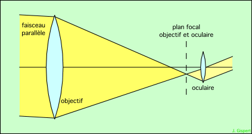

On voit sur ce dessin que le faisceau émergeant de l’instrument est un cylindre qui s’appuie sur le contour de l’objectif. Un problème se pose&#8239;: si le diamètre de ce cylindre est supérieur à la pupille de l’œil, une partie de la lumière sera perdue&#8239;:

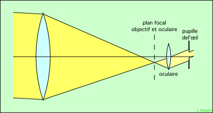

On ne voit pas toute la surface de l’objectif, donc pas la totalité de l’image produite. Si on augmente le grossissement, le faisceau émergeant sera plus incliné sur l’axe de l’instrument, et de ce fait sera plus étroit. Il pourra, pour une valeur minimum du grossissement, entrer en totalité dans l’œil&#8239;:

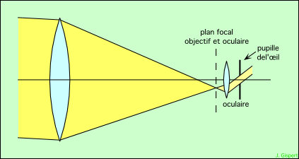

L’oculaire est de plus courte focale&#8239;; il intercepte le faisceau provenant de l’objectif plus près, à un endroit où il est plus étroit. Le faisceau de sortie est plus fin, et il passe par la pupille de l’œil. Le grossissement **minimum** qui permet cela est donné par une formule toute simple&#8239;:

<Encadre type="plus">
ge = D / 6
</Encadre>

où D est le diamètre de l’objectif exprimé **en millimètres**. On le nomme *grossissement équipupillaire*. Voici quelques valeurs obtenues par cette formule selon le diamètre de l’instrument&#8239;:

<table>
<thead>
<tr><th>diamètre</th><th>grossissement équipupillaire</th></tr>
</thead>
<tbody>
<tr><td>50 mm</td><td>8</td></tr>
<tr><td>100 mm</td><td>17</td></tr>
<tr><td>150 mm</td><td>25</td></tr>
<tr><td>200 mm</td><td>34</td></tr>
<tr><td>250 mm</td><td>42</td></tr>
<tr><td>300 mm</td><td>50</td></tr>
</tbody>
</table>

Ce grossissement, étant faible, est facile à atteindre et à dépasser.

### Grossissement résolvant

Le *grossissement résolvant* est le plus petit grossissement qui permet à l’œil de distinguer deux étoiles. C’est donc celui qui donne, de deux étoiles séparées par l’objectif, des images écartées d’un angle d’une minute d’arc à la sortie de l’oculaire. Il se calcule par&#8239;:

<Encadre type="plus">
gr = D / 2
</Encadre>

où D est exprimé en **millimètres**. On peut montrer que le grossissement résolvant est le triple du grossissement équipupillaire.

<Encadre type="plus">
gr = 3 ge
</Encadre>

On peut en déduire le tableau suivant, qui donne le grossissement résolvant&#8239;:

<table>
<thead>
<tr><th>diamètre</th><th>grossissement résolvant</th></tr>
</thead>
<tbody>
<tr><td>50 mm</td><td>25</td></tr>
<tr><td>100 mm</td><td>50</td></tr>
<tr><td>150 mm</td><td>75</td></tr>
<tr><td>200 mm</td><td>100</td></tr>
<tr><td>250 mm</td><td>125</td></tr>
<tr><td>300 mm</td><td>150</td></tr>
</tbody>
</table>

Si vous utilisez un instrument, vous verrez tous les détails qu’il est capable de donner à condition d’avoir un grossissement supérieur à cette valeur. Toutefois, ce calcul est basé sur les meilleures conditions possibles&#8239;; on ne doit pas le prendre au pied de la lettre (ni du chiffre…), et les conseils sont d’utiliser un grossissement du double, ce qui, au vu du tableau, est extrêmement simple&#8239;: le grossissement à choisir est égal au diamètre de l’objectif exprimé en millimètres.

On peut utiliser un grossissement supérieur, mais il ne faut pas trop le pousser, car l’image perdrait sa brillance et son contraste. En effet, plus on grossit, plus la tache de diffraction s’étale sur une grande surface. La même quantité d’énergie étant plus étalée, la tache de diffraction devient de plus en plus pâle. On considère qu’il ne faut pas dépasser 4 fois le grossissement résolvant.

Que signifie *grossir 100 fois un champ d’étoiles*&#8239;?

D’après ce que nous venons de voir, grossir une étoile ne change pas la taille de la tache de diffraction. Lorsqu’on observe un champ d’étoiles avec un grossissement de 100 par exemple, on multiplie par 100 l’angle sous lequel on le voit. Les images des étoiles ne seront pas plus grosses, mais 100 fois plus écartées les unes des autres. Aussi, on les distinguera bien mieux.

### Pouvoir séparateur théorique

Ce que nous venons d’expliquer concerne l’optique géométrique. Elle consiste à considérer un rayon lumineux comme une droite, et l’image d’une étoile comme un point. La réalité physique est un peu différente. L’optique géométrique est une approximation, qui permet de faire du très bon travail dans de nombreux cas, mais qui présente ses limites. La lumière est une onde, et en possède les propriétés. Aussi, l’image d’une étoile n’est pas un point sans dimensions.

Le rayon de la [tache de diffraction](../lumiere/#diffract) d’une étoile, observée par un instrument de diamètre D et à la longueur d’onde λ, vaut&#8239;:

r = 1,22 λ / D

λ et D étant exprimés dans la même unité.

**Remarque**&#8239;: la tache de diffraction est d’autant plus grande que λ (longueur d’onde) est plus grand. Pour un diamètre D donné, un télescope optique (λ de l’ordre du dix-millionième de mètre) donne une tache de diffraction un million de fois plus fine qu’un radiotélescope (longueur d’onde de l’ordre du mètre).

**Exemple**&#8239;: pour un télescope optique (λ = 0,55 µm = 0,55 10-6 m), avec un miroir de 25 cm de diamètre (D = 25 cm = 0,25 m)&#8239;: r = 1,22 × 0,55 10-6 / 0,25 = 2,684 10-6 rd = 0,55"

Pour un instrument de diamètre D donné, deux étoiles dont les taches de diffraction se chevauchent ne seront vues que comme une seule tache, indistinctement. On *sépare* deux étoiles (on distingue bien les deux taches) lorsque leur distance est au moins égale à 0,85 fois le rayon de la tache de diffraction. Cette valeur provient d’une étude de la répartition de la lumière pour deux étoiles de même éclat, ni trop faibles, ni trop brillantes. Si l’on veut tester les propriétés d’un instrument, il faut donc se placer dans ces conditions-là. Bien sûr, les conditions atmosphériques doivent être très bonnes…

On définit le *pouvoir séparateur théorique* d’un instrument grâce aux indications ci-dessus&#8239;:

p = 0,85 × r = 0,85 × 1,22 λ / D = 1,037 λ / D

p = 1,037 λ / D

Cette formule est générale (λ et D dans la même unité).

Pour les télescopes optiques, la longueur d’onde observée est de l’ordre de 0,55 µm. En remplaçant λ par cette valeur, on obtient&#8239;:

p = 1,037 × 0,55 10-6 / D = 0,570 10-6 / D

La longueur d’onde ayant été appliquée en mètres, le diamètre devra être donné aussi en mètres.

p est la tangente de l’angle sous lequel on voit les deux étoiles. Cet angle étant toujours très petit, on peut confondre la tangente avec l’angle exprimé en radians. **La formule donne donc l’angle en radians**. Pour l’obtenir en secondes d’arc, il faut multiplier par 180 × 60 × 60 = 648.000 et diviser par π&#8239;:

p = (0,570 10-6 / D) × 648.000 / π = 0,570 10-6 × 648.000 / (D × π) = 0,369 / (D × π) = 0,1176″ / D, D étant exprimé en mètres. Multiplions les deux membres par 100 pour exprimer D en centimètres&#8239;:

<Encadre type="plus">
p = 12″ / D
</Encadre>

où D est le diamètre de l’objectif en centimètres. Cette formule n’est évidemment valable que pour les télescopes optiques.

Par exemple, un télescope de 10 cm d’ouverture a un pouvoir séparateur de 1,2″&#8239;; un télescope d’un mètre atteint 0,12″, les 8,2 m du VLT atteignent 12 / 820 = 0,015″.

<table>
<thead>
<tr><th>Diamètre en mètres</th><th>pouvoir séparateur en arcsec ″</th></tr>
</thead>
<tbody>
<tr><td> calcul</td><td></td></tr>
</tbody>
</table>

Mais attention, le pouvoir séparateur théorique n’est pas atteint, pour les diamètres au-dessus de 30 cm, à cause de la turbulence de l’atmosphère ([seeing](#Seeing)). On peut l’atteindre effectivement soit au-dessus de l’atmosphère, grâce à un télescope spatial, soit grâce à l’[optique adaptative](#Trorévinf).

Reprenons la formule générale pour calculer le pouvoir séparateur d’un radiotélescope de 100 mètres de diamètre à la longueur d’onde de 21 cm de l’hydrogène neutre (exprimant λ et D en mètres)&#8239;:

p = 1,037 λ / D = 1,037 × 0,21 / 100 = 0,002178 radians

Traduisons en **minutes** d’arc&#8239;:

p = 0,002177 radians × 180 × 60 / π = 0,002177 × 10.800 / π = 7,48′

Le pouvoir séparateur est donc de 7,5 **minutes d’arc** seulement à 21 cm, pour un miroir de 100 mètres de diamètre, ce qui est 10 fois plus grand que tout ce qu’on a fait en optique&#8239;! Et pour un résultat beaucoup moins bon…

Par comparaison, un télescope optique de 100 m de diamètre observant à 0,55 µm, aurait un pouvoir séparateur de&#8239;:

p = 1,037 × 0,55 10-6 / 100 = 0,0057 10-6 radians

p = 0,0057 10-6 radians × 180 × 60 × 60 / π

p = 0,0057 10-6 radians × 648.000 / π = 1.176 10-6 ″ = 0,001176″

C’est-à-dire un millième de seconde d’arc&#8239;! 380.000 fois mieux que le radiotélescope… La variation du pouvoir séparateur avec la longueur d’onde creuse un abîme qui sépare la radioastronomie de l’optique. Et ce fut un moteur extraordinaire qui a poussé les radioastronomes à se surpasser, ce à quoi ils sont parvenus de la plus belle manière avec l’interférométrie. Nous le verrons plus loin.

### La turbulence atmosphérique, le seeing

La lumière qui nous arrive des étoiles traverse l’atmosphère de la Terre avant de parvenir sur le miroir. Or l’atmosphère n’est pas parfaite optiquement, loin s’en faut. Ses défauts limitent le pouvoir séparateur d’un télescope, quel que soit son diamètre, à celui d’un instrument d’amateur de 30 cm de diamètre&#8239;! Le pouvoir séparateur réel est de l’ordre de 1″ d’arc seulement (0,4″ dans des conditions exceptionnelles). Cette limite imposée par l’atmosphère se nomme le *seeing*. C’est le pouvoir séparateur *effectif* de l’ensemble instrument-atmosphère&#8239;; il dépend du lieu où l’instrument est installé.

Si on a construit des instruments de plus de 30 cm de diamètre (beaucoup plus) c’était donc uniquement pour voir des objets plus faibles. Le gaspillage colossal que représente cette limitation est insuportable pour un astronome normalement constitué… d’autant plus que les organismes financeurs demandent des résultats à la hauteur de leurs efforts&#8239;!

L’explication du problème est simple dans son principe&#8239;: la *tache de diffraction* est déplacée très rapidement par la turbulence des couches d’air que la lumière des étoiles traverse. La tache de diffraction concentre une grande partie de la lumière de l’étoile. Cependant, la diffraction au bord de l’objectif (lentille ou miroir), en disperse une petite partie, qui forme des *anneaux de diffraction* faiblement lumineux autour. Les schémas ci-dessous montrent cette tache avec ses anneaux de diffraction, tels qu’ils apparaissent successivement. Les images sont séparées d’un dixième de seconde (de temps). La turbulence déplace aléatoirement la tache de diffraction autour de sa position moyenne (images successives). La persistence rétinienne, ou la plaque photographique, accumule ces images pour donner une tache plus grosse, empâtée (figure du bas)&#8239;:

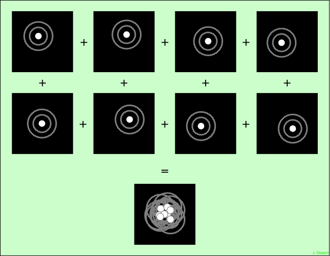

Ce phénomène est incontournable, il est produit par la nature ondulatoire de la lumière. Pour atteindre le pouvoir séparateur théorique des instruments, une solution évidente vient à l’esprit&#8239;: supprimer l’atmosphère&#8239;! Non pas en la pompant, selon la technique Shadock, mais en plaçant le télescope en orbite autour de la Terre. Cette solution est horriblement coûteuse à mettre en œuvre, mais elle est efficace. Elle a été utilisée pour le *H.S.T.* (Hubble Space Telescope), mais l’erreur incroyable faite sur sa construction a entraîné un surcoût encore plus important. Le télescope a été sauvé grâce à la navette spatiale, qui est maintenant au musée.

Nous verrons que les astronomes ont été assez ingénieux pour trouver une autre méthode, qui consiste à corriger les défauts de l’atmosphère. Ceci se fait très bien dans les grands observatoires, en gardant les pieds sur le plancher des vaches…

### Clarté d’un instrument

La notion de clarté est très simple&#8239;: il s’agit tout simplement de caractériser la quantité de lumière reçue avec l’instrument. Plutôt que de la déterminer à l’aide d’une quantité physique abstraite, on la caractérise par rapport à l’œil. Ainsi, la pupille bien dilatée présente un diamètre de l’ordre de 6 mm, qui sera pris comme référence. Alors, un instrument de diamètre D présentera une surface collectrice S = π D2 / 4. La *clarté* est le rapport de la surface de l’objectif, à la surface de la pupille&#8239;:

<Encadre type="plus">
C = S / s = D2 / d2
</Encadre>

où d est le diamètre de la pupille.

Cette valeur est théorique&#8239;; il faut considérer les pertes de lumière dans l’instrument par traversée de verre ou réflexion sur un miroir. Dans une lunette, la lumière traverse l’objectif, et une partie se réfléchit sur la face avant. Ajoutant à cela la perte dans l’oculaire, la clarté réelle d’une lunette est diminuée d’un facteur approximatif de 0,6. Pour un télescope, il y a une perte dans la réflexion, et la perte de l’oculaire. Le résultat est un peu meilleur que celui d’une lunette.

Puisque les pertes reviennent à multiplier la clarté théorique par un coefficient inférieur à 1, on nomme ce dernier *facteur de transmission*.

Lorsqu’on considère un astre étendu (la Lune, une comète, une planète), le raisonnement précédent ne peut s’appliquer. La théorie est plus complexe, du fait des paramètres à considérer. Le résultat s’exprime par&#8239;:

<Encadre type="plus">
Γ = (ge / g)2
</Encadre>

où g est le grossissement appliqué, et ge le grossissement équipupillaire. Le grossissement équipupillaire ne dépendant que du diamètre de l’objectif, est constant pour un instrument donné. Par contre, le grossissement appliqué dépend de l’oculaire utilisé. Ce grossissement étant toujours supérieur au grossissement équipupillaire, Γ est inférieur à 1, et d’autant plus petit que le grossissement est plus fort.

### Réalisation des lentilles et miroirs

La réalisation des surfaces optiques est délicate, et nécessite un long travail. Les premieres lentilles réalisées par les maîtres verriers italiens étaient très imparfaites, et la technique s’est améliorée. Mais les progrès décisifs ont été faits par Léon Foucault, qui a imaginé et mis au point un appareil permettant de voir les défauts, dont la taille est de l’ordre du cent-millième de millimètre&#8239;! [Un chapitre](../taille-miroir/) est consacré à la taille d’un miroir de télescope. Le principe pour fabriquer des lentilles est fondamentalement le même.

## Les lunettes

Tous les instruments du XVIIe siècle étaient de mauvaise qualité, à cause des défauts du verre, du polissage défectueux, et des aberrations que l’on ne savait pas corriger. L’aberration chromatique en particulier, a été le problème le plus important pour les premières lunettes.

On ne savait pas fabriquer de grands disques de verre de qualité suffisante pour construire des lunettes. C’est un verrier suisse, Pierre-Louis Guinand, qui a le premier réussi à couler des blocs de taille suffisante. Son procédé, consistant à brasser le verre en fusion et nommé *guinandage*, a été rapidement adopté dans de nombreux pays européens.

Dans un prisme, la lumière blanche traverse le verre. A la surface du verre, la lumière passe d’un milieu (l’air) à un autre milieu (le verre) dont les propriétés optiques sont différentes. L’indice de réfraction qui les caractérise est différent, ce qui signifie que la lumière ne s’y propage pas à la même vitesse (moins vite dans le verre que dans l’air). C’est cette réfraction qui va permettre de construire l’image.

Mais ce qui est important ici, c’est que l’indice de réfraction du verre n’est pas le même pour les différentes couleurs. Ce qui fait que la vitesse de la lumière dans le verre dépend de sa couleur, et la déviation en dépend aussi.

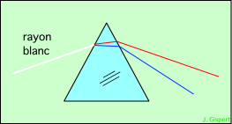

Une lentille simple se comporte localement comme un prisme. En regardant une partie de près, on voit que les rayons sont dispersés selon leur longueur d’onde. Il s’ensuit que l’image donnée par cette lentille ne sera pas bonne&#8239;:

les rayons bleus et rouges sont déviés différemment, le bleu plus que le rouge

les foyers bleu et rouge ne sont pas au même endroit

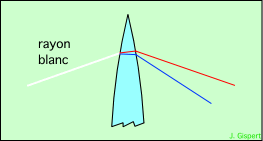

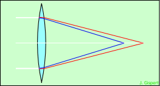

Si nous plaçons un écran pour intercepter les rayons, nous obtiendrons des images diverses selon la position de l’écran&#8239;:

l’écran est placé au **foyer rouge**

on voit une image rouge nette, entourée d’un anneau bleu

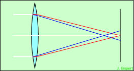

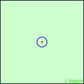

Si nous avançons l’écran nous obtiendrons une autre image&#8239;:

l’écran est placé au **foyer bleu**

l’image nette est bleue, entourée d’un anneau rouge

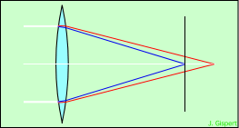

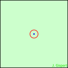

Il est impossible de faire une mise au point correcte à la fois sur toutes les longueurs d’onde. L’image dans l’oculaire (qui remplace l’écran) apparaît irisée. Outre le désagrément visuel, ce défaut interdit de distinguer des étoiles proches. Le pouvoir séparateur de l’instrument est diminué.

### "De grandes lunettes à faire peur aux gens"

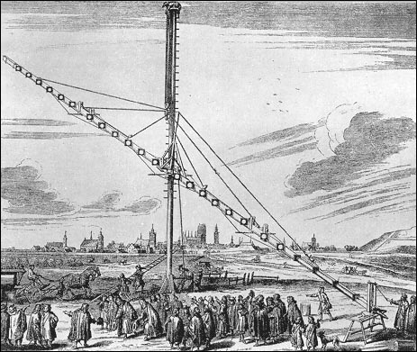

*lunette d’Hévélius, érigée à Dantzig en 1670*

Pour diminuer l’importance de l’aberration chromatique, on a construit des lunettes de plusieurs dizaines de mètres de longueur&#8239;! En effet, si on allonge la longueur focale, on diminue la courbure de la lentille, donc l’épaisseur du verre, et l’effet de prisme est atténué. Mais ce n’est qu’un palliatif, il subsiste toujours une aberration. Ci-dessus une lunette construite par Hévélius, de 12 cm de diamètre pour 46 mètres de long&#8239;!

### Doublets achromatiques

En 1729, Chester Moore Hall analyse le problème de l’aberration chromatique, et conçoit un doublet formé de deux verres de compositions nouvelles, le *flint* et le *crown*. Le flint est un verre lourd, très dispersif (il sépare fortement les rayons de couleurs différentes)&#8239;; le crown est au contraire un verre léger peu dispersif. En associant une lentille convergente de flint, et une lentille divergente de crown, il a réussi à obtenir une combinaison qui restait convergente, mais dont l’aberration chromatique était considérablement réduite&#8239;:

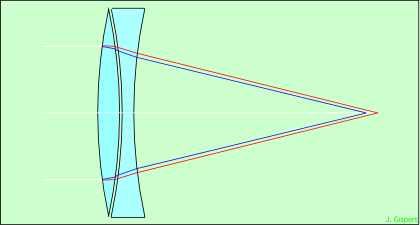

On appelle une telle association *doublet achromatique*. C’est l’opticien anglais J. Dollond qui dépose un brevet en 1758. Grâce à cette invention, la longueur des lunettes a pu diminuer, mais elle est tout de même restée importante, car l’aberration chromatique n’est pas totalement supprimée.

### La plus grande lunette

La plus grande lunette construite a été celle de l’Observatoire de Yerkes (USA), dont l’objectif atteint 1 mètre de diamètre (40 pouces), et la longueur 19 mètres&#8239;:

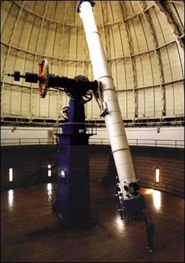

Il n’est pas possible de faire beaucoup mieux, pour deux types de raisons&#8239;:

- mécaniques&#8239;: le tube de la lunette Yerkes pèse déjà 75 tonnes. Pour un instrument plus grand, ce serait pire.
- optiques&#8239;: la lumière traverse l’objectif, qui ne peut donc être tenu que par les bords. Le poids du verre ne permettrait pas de faire beaucoup plus grand, sans déformations fatales des lentilles.

Notons pour mémoire qu’une lunette de 1,25 m de diamètre a été construite pour l’exposition universelle à Paris en 1900. Le tube (60 mètres) était fixe, en position horizontale, car il était bien trop lourd pour le déplacer. La lumière des astres était dirigée vers l’objectif par un sidérostat de 2 mètres de diamètre. Le tout, n’ayant aucun intérêt scientifique, a été démantelé à la fin de l’exposition… Il s’agissait juste de montrer qu’on pouvait faire plus que les autres, même (surtout&#8239;?) si ça ne servait à rien. On peut parier sans grands risques que Paris conservera ce record…

Les lunettes présentent deux principaux défauts&#8239;: l’aberration chromatique, nous l’avons vue, et l’absorption de la lumière. En traversant le verre, la lumière provenant des astres est en partie absorbée&#8239;; pour un petit diamètre, ce n’est pas gênant, car les lentilles restent minces. Mais dans un grand instrument, la perte serait trop importante, et les objets faibles (galaxies lointaines, nébuleuses…) ne seraient pas visibles. Mais en plus, un problème mécanique se pose&#8239;: les verres de l’objectif ne peuvent être tenus que par le bord, puisque la lumière les traverse. Au-delà d’un mètre, l’ojectif se casserait sous son propre poids.

L’objectif achromatique ne corrige vraiment que pour deux longueurs d’onde. On peut faire mieux en associant trois lentilles, ce qui donne un objectif *apochromatique* (1765). Enfin, car il serait difficile d’aller plus loin, on associe quatre lentilles pour obtenir l’objectif *superachromatique*, mais ceci grâce à des verres en fluorite (1960). Il ne faut pas oublier que cette multiplication des lentilles entraîne une multiplication évidente des dioptres air/verre et verre/air, ainsi qu’une plus grande épaisseur de verre, les deux entraînant une perte de lumière.

## Les télescopes

### L’invention des télescopes

Marin Mersenne a décrit l’utilisation d’un miroir comme objectif (un télescope) en 1636. James Gregory (mathématicien écossais) en a fait une théorie en 1663, et enfin Newton en a réalisé un en 1668 (publiée en 1670 à la Royal Society). Cassegrain a proposé une autre forme en 1672. Les trois sont différents, essentiellement par la forme des miroirs et leur disposition. Le principe est simple&#8239;: il consiste à remplacer les multiples lentilles de l’objectif par un miroir. L’avantage est double&#8239;: la lumière ne traverse plus de verre&#8239;; ils sont donc totalement exempts à la fois d’aberration chromatique, et d’absorption (il y a tout de même une très légère perte de lumière, car le pouvoir réfléchissant de la surface n’est pas parfait). Sur un plan pratique, le télescope a encore un avantage de plus&#8239;: la facilité de taille des miroirs. Considérez le doublet achromatique constituant l’objectif d’une lunette&#8239;; il est formé de deux lentilles collées, donc il comprend 4 faces sphériques à tailler (une amélioration ultérieure est l’objectif *apochromatique*, qui comprend trois lentilles, donc 6 faces sphériques). Le miroir d’un télescope n’en comprend qu’une seule. Cet argument est important. Toutefois, on a montré ([aberration de sphéricité](https://astronomia.fr/1ere_partie/Foyerstigm)) qu’une surface sphérique ne convient pas pour le miroir. Pour que tous les rayons convergent en un même point, la surface doit être parabolique, mais très proche d’une sphère. La modification est relativement facile à faire, mais la difficulté tient pour beaucoup dans la détermination de ce qu’il faut faire.

Il a donc été possible de construire des miroirs de télescope de diamètre bien plus grand que les objectifs de lunettes. Depuis le début du XXe siècle, les télescopes ont supplanté définitivement les lunettes (en particulier pour la photo).

### Constitution du miroir

Un miroir a deux fonctions&#8239;:

- donner une forme parfaite pour la qualité des images&#8239;;
- réfléchir la lumière.

Depuis l’antiquité, les dames ont utilisé des miroirs pour se coiffer, se maquiller… Ces miroirs que l’on peut voir dans certains musées étaient réalisés en bronze, qui se polit facilement, mais n’étaient pas d’une grande qualité.

La mauvaise qualité s’explique parce que le bronze réalise à lui seul ces deux fonctions, forme et réflectivité. *Il les réalise mal toutes les deux*.

Malgré ces défauts, on a utilisé le bronze, faute de mieux. D’ailleurs, les métaux sont les mieux adaptés pour réfléchir la lumière, en rapport avec leurs propriétés électriques (c’est une onde électromagnétique).

<Encadre type="plus">
**pouvoir réfléchissant limité**

> Il gaspille bien plus de lumière que l’objectif d’une lunette, ce qui est d’autant plus génant pour les objets de faible luminosité. A la longueur d’onde de 0,55 µm, correspondant à la plus grande sensibilité de l’œil, le bronze réfléchit 62 % seulement de la lumière reçue&#8239;; 38 % sont perdus…

**polissage imparfait**

> On veut observer la lumière qui nous parvient des étoiles, c’est à dire une onde électromagnétique dont la longueur d’onde est comprise entre 0,4 et 0,8 µm (millièmes de millimètres). Pour qu’un miroir soit de bonne qualité, il faut que les défauts qui subsistent à sa surface ne dépassent 0,04 à 0,08 millième de millimètre (un dixième de la longueur d’onde)… Or le bronze est un alliage assez mou. Lorsqu’on tente de le polir, il se comporte un peu comme la peau d’un chien qui se gratte&#8239;: il forme des plis devant l’outil&#8239;! Pour le durcir, on augmente la proportion d’étain, mais le métal devient cassant et très difficile à travailler. Il présente une teinte plus blanche que dorée.

**oxydation**

> Avec le temps, il s’oxyde, et se ternit. Lorsqu’il ne renvoie plus assez de lumière, il faut enlever la couche d’oxyde en surface. Impossible de procéder avec un chiffon&#8239;: étant donné la taille microscopique des plus petits défauts admissibles, celui-ci ferait des ravages sur notre miroir. Pour le nettoyer, il faut, en fait, refaire tout le polissage, ce qui prend énormément de temps et de plus le résultat obtenu n’est pas le même que précédemment&#8239;: les défauts ont changé.

**dilatation**

> Les métaux ont un coefficient de dilatation élevé. En début de nuit, la température est nettement plus élevée qu’en fin, et le miroir se contracte au cours des observations. Il s’ensuit une modification des caractéristiques optiques.
</Encadre>

Ce sont donc des miroirs en bronze qu’utilisèrent Newton, Gregory et Cassegrain pour réaliser leurs télescopes.

### Les types de télescopes

Nous avons déjà exposé la combinaison de **Newton**&#8239;: un miroir primaire parabolique, et un secondaire plan centré et incliné à 45°.

Dans le montage de **Cassegrain**, le secondaire est hyperbolique divergent, centré et parallèle au primaire. L’image est renvoyée vers le primaire, et doit passer à travers un trou central pratiqué dans ce dernier. La focale résultante est celle du primaire, multipliée par un facteur correspondant au grossissement de l’image par le secondaire (qui allonge la focale). Ce facteur est toujours supérieur à 2, et souvent assez grand. Ceci permet d’obtenir une focale adaptée aux observations, tout en conservant un tube assez court.

La combinaison de **Gregory** est assez semblable à celle de Cassegrain, mais le secondaire est elliptique.

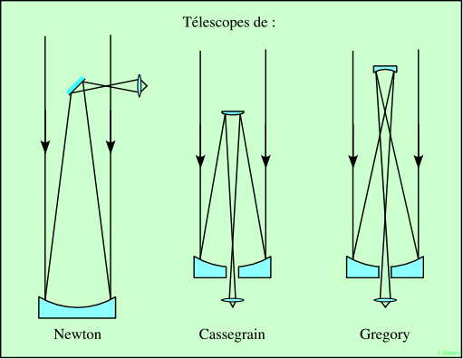

A caractéristiques égales (focale, diamètre), un télescope de Gregory est plus long qu’un télescope de Cassegrain. Leurs qualités étant équivalentes, le modèle de Gregory n’est pas utilisé.

Ces trois types d’instruments ont un primaire parabolique. Le miroir principal possède donc un axe de révolution et un seul (par contre, *une sphère possède une infinité d’axes de révolution*, ce sera utilisé plus bas). En conséquence, les images sont parfaites pour l’étoile alignée avec l’axe, et présentent des défauts hors de l’axe. Ces défauts sont de plus en plus importants en s’éloignant de l’axe, ce qui limite le champ de l’appareil.

Signalons enfin un type plus élaboré, le télescope Ritchey-Chrétien (imaginé simultanément par Georges Ritchey aux Etats-Unis et Henry Chrétien en France). Il a le même aspect qu’un Cassegrain, mais le primaire et le secondaire sont hyperboliques, plus difficiles à réaliser. Pour le primaire, de grandes dimensions, cette différence augmente considérablement le prix, et ces télescopes sont en général réservés aux professionels. L’avantage optique est l’élimination de la coma au troisième ordre. Ces instruments sont bien adaptés à la photographie, l’absence de coma autorisant un champ relativement large.

<table>
<thead>
<tr><th><em>type</em></th><th><em>primaire</em></th><th><em>secondaire</em></th></tr>
</thead>
<tbody>
<tr><td><strong>Newton</strong></td><td>parabolique</td><td>plan</td></tr>
<tr><td><strong>Cassegrain</strong></td><td>parabolique</td><td>hyperbolique</td></tr>
<tr><td><strong>Gregory</strong></td><td>parabolique</td><td>elliptique</td></tr>
<tr><td><strong>Ritchey-Chrétien</strong></td><td>hyperbolique</td><td>hyperbolique</td></tr>
</tbody>
</table>

Dans tous ces montages, on remarque qu’un miroir est placé en face du miroir primaire, qu’il cache en partie, et empêche la lumière d’y entrer en totalité. On parle *d’obstruction centrale*. Il est évident qu’on cherche à la limiter le plus possible, sans pouvoir l’éliminer.

### Les premiers télescopes

Par la suite, ces défauts n’ont pas empêché les astronomes de construire des télescopes de plus grand diamètre. Aussi, l’absence d’aberration chromatique permet de les construire beaucoup plus courts que les lunettes, et donc beaucoup plus lumineux. De nombreuses découvertes ont été faites avec ces instruments, en particulier celle de la planète Uranus par William Herschel en 1781.

Le plus grand télescope qu’il construisit était à miroir métallique de 1,22 m de diamètre et 12,20 m de focale. Il l’a achevé en 1789.

Celui-ci a marqué l’apogée des instruments de ce type. Il faut remarquer à son sujet qu’il n’y avait pas de miroir secondaire&#8239;: le miroir principal était légèrement incliné sur son support, et l’observateur plaçait l’oculaire sur le bord du tube, à sa sortie (on le distingue sur le dessin). L’absence de secondaire évitait une perte de lumière supplémentaire, mais l’inclinaison produisait des aberrations.

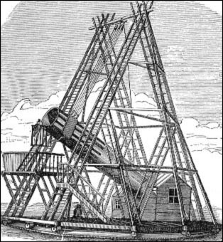

<Encadre type="plus">
<Encadre type="plus">
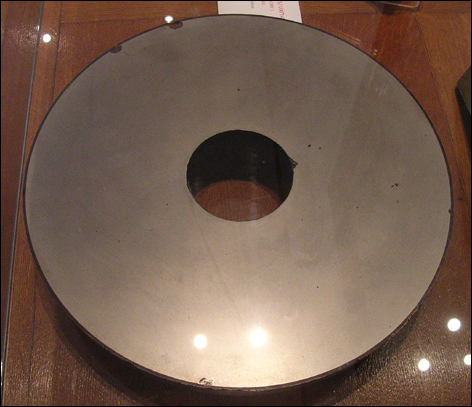

*Miroir primaire du télescope de type Gregory n° 3/1007 réalisé par James Short Londres 1755 Observatoire de Marseille photo J. Gispert*

Cette photo montre un miroir de bronze réalisé pour un télescope qui se trouvait au Musée des Instruments Anciens de l’Observatoire de Marseille. On remarque la faible réflectance du métal, les défauts de surface (piqûres), et la couleur, inhabituelle pour cet alliage, qui s’explique par la forte teneur en étain (bien que l’alliage soit constitué des métaux habituels&#8239;: cuivre et étain).

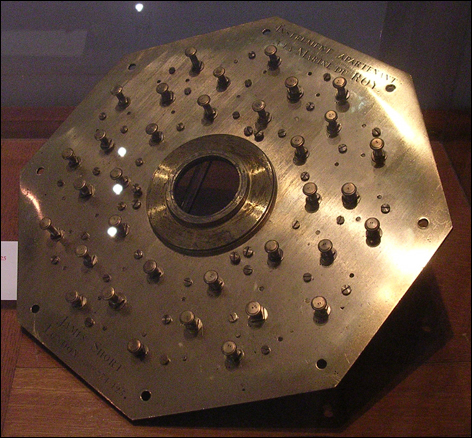

Support du miroir précédent photo J. Gispert

Le support du miroir est garni de vis, permettant de répartir les pressions sur toute la surface du bronze. Bien que statique, et de réglage empirique, cette organisation préfigure les supports modernes d’optique active. Mais pour la réaliser, il fallait inventer l’ordinateur…
</Encadre>
</Encadre>

La précision de polissage nécessaire pour avoir une bonne image est telle, que la plus grosse aspérité à la surface du miroir doit être plus petite que le dixième de la longueur d’onde observée. Dans le domaine visible, c’est donc à mieux que 5 cent-millièmes de millimètre qu’il faut polir le miroir. Cette précision est difficile à atteindre, mais de plus elle doit être conservée. Or le miroir a toujours une certaine souplesse, qui l’amène à se déformer sous son propre poids, selon sa position. Aussi faut-il le rendre assez épais pour limiter suffisammennt les déformations.

### Les miroirs en verre

Un progrès capital a été fait par **Léon Foucault** en 1856. Il a constaté que le verre permet un polissage bien supérieur au bronze, car il est plus dur et plus cassant. Il se laisse polir aussi finement qu’on le souhaite (les petits défauts sont cassés par l’outil, les aspérités subsistant étant plus petites). La qualité du polissage est de ce fait bien supérieure et l’on peut fixer une limite encore plus exigeante, quant à la taille maximale admissible des défauts. Évidemment, il ne peut remplacer seul le bronze, puisqu’il ne réfléchit presque pas la lumière. Mais Foucault a appliqué un procédé chimique inventé par Justus von Liebig (Karl August von Steinheil a appliqué ce procédé à la réalisation de miroirs indépendamment).

<Encadre type="plus">
Léon Foucault est né à Paris en 1819. Ingénieur, il a touché à de nombreux domaines importants pour l’astronomie. Son œuvre est immense&#8239;: il développe la photographie et l’utilise pour l’astronomie (premier daguerréotype du Soleil), crée le pendule (qui prouve la rotation de la Terre), invente le gyroscope, mesure la vitesse de la lumière, découvre les courants de Foucault (utilisés aujourd’hui pour freiner les gros véhicules), et travaille sur la construction des télescopes…

Il a remplacé le bronze des miroirs de télescope par le verre argenté (sur une idée de Huygens). Il a créé un appareil de mesure (foucaultmètre) pour vérifier visuellement la forme des miroirs de télescope et permettre leur retouche.

Mais il a aussi utilisé un coussin d’air placé sous le miroir pour égaliser les pressions (poids) sur toute la surface du verre. Ce coussin, relié à un tuyau mis à disposition de l’observateur, permettait à celui-ci de le gonfler plus ou moins pour obtenir la meilleure image possible. Là encore, ce procédé contient l’idée de l’optique active aujourd’hui possible grâce à l’ordinateur. Il n’est pas sûr que ce procédé ait été appliqué au télescope de Marseille.
</Encadre>

Le procédé de von Liebig consiste à plonger le miroir poli dans une cuve contenant une solution liquide de nitrate d’argent ammoniacal. On ajoute un réducteur doux, par exemple du sucre candy. L’argent métallique se dépose à la surface du verre, en une couche très fine et très régulière, qui épouse parfaitement la forme du miroir. Celui-ci acquiers ainsi un pouvoir réfléchissant excellent, de 92 % à 0,55 µm. C’est le meilleur pouvoir réfléchissant possible.

Dans ces miroirs, les deux fonctions, forme et réflexion, sont dissociées&#8239;:

- le verre donne la forme, que l’argent épouse parfaitement&#8239;;
- l’argent donne la réflexion.

La [taille des miroirs](../taille-miroir/) de télescope est une opération délicate, mais cependant à la portée d’un amateur méticuleux, et parfaitement maîtrisée par les professionels.

Mais… au contact de l’air, l’argent est attaqué par des composés sulfurés présents dans l’air en faibles quantités. Il forme un sulfure noir qui obscurcit le miroir, et le rend inutilisable. Cependant, ce problème n’est pas aussi grave qu’avec le bronze&#8239;: il suffit de tremper le miroir dans une solution chimique qui dissout l’argent, en laissant la surface polie du verre intacte. On peut alors le réargenter pour le retrouver neuf. Cette opération peut se faire en une journée. Cette technique a été utilisée pendant à peu près un siècle. Aujourd’hui, on remplace l’argent par l’aluminium, dont les propriétés optiques sont très proches, et dont l’oxyde (alumine) est transparent.

### Le télescope de Foucault à l’Observatoire de Marseille

C’est le premier télescope moderne, dont le miroir est révolutionnaire&#8239;:

- C’est le **premier** télescope à miroir de verre au monde&#8239;;
- Il est resté le **meilleur télescope du monde** pendant près de trente ans&#8239;;
- Edouard Stephan l’a utilisé pour la première mesure **interférométrique** (diamètre d’une étoile). Cette technique est utilisée aujourd’hui sur tous les grands instruments.

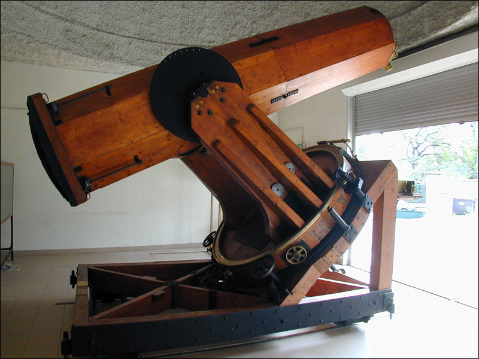

Télescope de Foucault installé en 1864 à l’Observatoire de Marseille photo Sauveur Lisciandra

Il est classé monument historique. Le diamètre du miroir est de 80 cm, sa focale est de 4,50 m. La monture est due à Eychens. Le moteur original a disparu, il était mécanique. Il a été remplacé, dans les années 1930, par un moteur électrique. Pour assurer une vitesse constante, l’alimentation électrique était asservie à une horloge sidérale à balancier (horloge faisant un tour complet en 23 h, 56 mn et 4 secondes).

Ce télescope est visible pour les établissements scolaires et le public dans les [locaux de l'association](http://andromede.id.st/exposition-permanente-p604511).

Sur la photo ci-dessous, on voit le miroir de Foucault dans la coupole d’exposition&#8239;; remarquez l’épaisseur, plus grande au centre pour assurer la rigidité&#8239;:

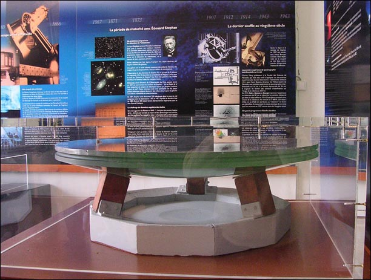

*Miroir du télescope de Foucault, dans la coupole d’exposition du télescope photo J. Gispert*

Le procédé de métallisation utilisé par Foucault consistait à déposer par voie chimique une très fine couche d’argent. Par la suite, le miroir a été aluminé par M. J. Pissavin à l’Observatoire de Haute Provence (tel qu’on le voit sur la photo).

### Foyers d’un télescope

On appelle *foyer* l’endroit où les rayons convergent. Un miroir seul possède donc un foyer dit *foyer primaire*, celui où l’image se forme en l’absence de tout autre dispositif optique. Si on place une pellicule photographique au foyer primaire, elle recueille simplement l’image donnée par le miroir. C’est la première façon de faire une photo astronomique, et la méthode utilisée dans les instruments photographiques à grand champ (Schmidt et Maksutov).

Pour les autres instruments, on renvoie le faisceau à l’aide d’un ou plusieurs miroirs, vers un endroit plus accessible, et où l’on n’est limité ni par la taille ni par le poids. Selon la formule utilisée, on a le *foyer Newton* (dessin de gauche ci-dessus), toujours utilisé dans les instruments d’amateur de premier prix, non par les professionels. Le *foyer Gregory* n’est pas utilisé à cause de la longueur du tube. Le *foyer Cassegrain* par contre est universellement adoptée pour les grands télescopes.

On note toutefois que ces trois types de foyers sont liés au tube mobile du télescope, et entraînés avec lui pour suivre le mouvement des astres, comme tout capteur qui y serait attaché. On peut très bien y placer une caméra CCD, mais pas les spectrographes très dispersifs (qui séparent nettement les différentes raies), trop volumineux et trop lourds. Ces instruments pèsent des centaines de kilogrammes (ils doivent être à température constante). Il fallait donc trouver une solution pour renvoyer le faisceau produit par le télescope vers une direction fixe dans l’observatoire, où l’on pourrait placer les capteurs quel que soit leur poids et leur encombrement.

Pour les montures équatoriales, cette solution est le *foyer Coudé*. Un miroir tertiaire plan, placé dans l’axe du tube au niveau de l’axe de déclinaison creux, y renvoie le faisceau. Un quatrième miroir renvoie l’image parallèlement à l’axe du monde.

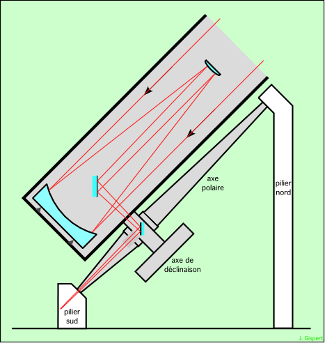

*Foyer Coudé, pour une monture équatoriale*

Ainsi, le foyer final se trouve quelque part dans le pilier sud du télescope (à gauche en blanc). On peut y placer des instruments bien plus lourds qu’au foyer Cassegrain.

Les montures équatoriales sont abandonnées, depuis le télescope soviétique Bolchoï, au profit de montures altazimutales à axe vertical, bien plus robustes. L’axe de déclinaison est remplacé par l’axe de hauteur horizontal. Le troisième miroir renvoi le faisceau dans cet axe creux (qui remplace l’axe de déclinaison). La lumière arrive donc au niveau des paliers de hauteur, sur la plateforme horizontale de la monture qui tourne autour de l’axe d'azimut (vertical). Elle repose sur une base circulaire, et tourne grâce à de multiples roues placées dessous. Les contraintes de poids sont donc très lâches, et placer un instrument lourd au niveau du palier de hauteur ne pose pas de problèmes. Il s’agit du *foyer Nasmith*, et on en trouve un de chaque côté du tube optique. Il suffit donc de renvoyer la lumière vers l’un ou l’autre de ces deux foyers par un miroir qui peut basculer de 90°. On a donc deux emplacements où placer des instruments lourds.

Enfin, le foyer Coudé peut exister encore et renvoyer le faisceau sous la coupole pour certains usages, au prix de 8 miroirs pour le VLT par exemple.

<table>
<thead>
<tr><th>monture</th><th>foyer</th><th>observations</th></tr>
</thead>
<tbody>
<tr><td rowspan="3">équatoriale</td><td>Newton</td><td>Le foyer est solidaire du tube, proche de son ouverture, sur le côté.</td></tr>
<tr><td>Cassegrain et Gregory</td><td>Ces deux foyers sont solidaires du tube, sous le miroir.</td></tr>
<tr><td>Coudé</td><td>Le foyer Coudé (monture équatoriale) renvoie le faisceau dans l’axe de déclinaison, selon une direction fixe.</td></tr>
<tr><td>altazimutale</td><td>Nasmyth</td><td>Le foyer est solidaire du bâti azimutal.</td></tr>
</tbody>
</table>

Pour les télescopes d’amateur, il est parfois intéressant d’allonger la focale, pour diminuer le champ et augmenter le grossissement (planètes par exemple). On peut le faire à l’aide d’une *lentille de Barlow*, qui est général un doublet achromatique divergent.

### Les débuts de l’interférométrie

L’interférométrie est une technique d’observation possible grâce à la nature ondulatoire de la lumière. Elle a été utilisée pour la première fois par Edouard Stéphan à l’observatoire de Marseille, en utilisant le télescope de Foucault. Elle est aujourd’hui appliquée dans tous les grands observatoires, et son importance est donc très grande. [Une section](https://astronomia.fr/1ere_partie/interf) lui est donc consacrée plus loin.

## Les progrès ultérieurs

### Amélioration des verres

Les premiers miroirs étaient en verre ordinaire, et depuis de grands progrès ont été accomplis dans la composition des verres. L’une des améliorations importantes a été de trouver des mélanges à très faible coefficient de dilatation (*zérodur*, *silice fondue*…). En effet, si le miroir se dilate, sa surface se déforme, et ses propriétés optiques en pâtissent. Des progrès ont été réalisés également pour éliminer les bulles du verre fondu, et dans la maîtrise du refroidissement (recuit). On utilise parfois des céramiques.

### Changement de métal

Au XXe siècle, les progrès techniques ont permis de remplacer l’argent, déposé par voie chimique, par de l’aluminium déposé par évaporation sous vide&#8239;: technique due à John Strong, en 1931.

L’avantage de l’aluminium par rapport à l’argent tient dans son oxyde, l’alumine, transparent et imperméable. La fine couche d’alumine qui recouvre l’aluminium, n’altère pas les propriétés optiques du miroir et de plus protège l’aluminium, à tel point que, une fois l’aluminium déposé, on produit une oxydation superficielle protectrice. Un miroir d’amateur ainsi traité ne nécessite pas de retouches pendant de longues années. C’est considérablement plus durable que l’argenture, qui se terni vite à l’air. Les miroirs professionnels, pour lesquels les tolérances sont bien plus faibles, sont réaluminés régulièrement, à intervalle de l’ordre de 1 an et demi à 2 ans. Cette opération se fait dans la coupole même, au sous-sol.

Le pouvoir réfléchissant de l’aluminium est légèrement moins bon que celui de l’argent (89 % au lieu de 92 %), mais cet inconvénient est largement contrebalancé par la constance dans le temps des qualités du miroir, qui permet de comparer des clichés pris à des dates éloignées.

L’aluminium a un autre avantage sur l’argent&#8239;: il réfléchit l’ultraviolet, alors que l’argent lui est transparent. Avec les récepteurs modernes, l’UV a pris beaucoup d’importance, car il est émis en abondance par les étoiles chaudes. Cette caractéristique de l’aluminium est donc décisive. À 0,25 µm, l’argent ne réfléchit que 33 % de la lumière incidente, l’aluminium 75 %.

La comparaison est facile à comprendre sur le graphique ci-dessous&#8239;:

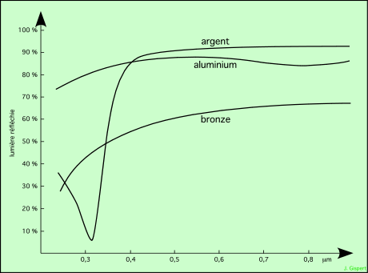

On y voit très bien que l’aluminium, s’il est un peu moins bon que l’argent dans le visible, est bien moins mauvais dans l’ultraviolet, où ses performances ne chutent que très peu (à gauche). La pente des courbes, qui descendent vers la gauche, donc vers le bleu, montre que le coefficient de réflexion baisse dans l’UV. L’aluminium permet d’observer dans le proche UV, l’argent ne le permettrait absolument pas. Pour le bronze, la chute est moins brutale, mais commence à grande longueur d’onde, dans le rouge. Le bleu étant faiblement renvoyé, donne sa couleur au métal&#8239;!

Avec cette technique de fabrication, on a pu aller très au-delà du télescope de Herschell. Les télescopes du Mont Wilson ont marqué un progrès considérable, en permettant de clore le [Grand Débat](https://astronomia.fr/5eme_partie/intro5.php)&#8239;: télescope de 1,52 m en 1909, puis de 2,54 m en 1917. Le diamètre a augmenté jusqu’aux 5 m du télescope *Hale* (Mont Palomar, USA), puis aux 6 m du télescope soviétique *Bolchoï*. Ce dernier marque la limite des miroirs traditionnels (épais pour la rigidité).

Aujourd’hui, avec les télescopes spatiaux, toutes les ondes électromagnétiques sont observables (non absorbées au-dessus de l’atmosphère). Pour l’UV, il faut disposer d’un miroir efficace dans ce domaine, et les trois métaux considérés ci-dessus ne conviennent pas. Par contre, l’or est excellent dans l’UV, et c’est donc lui qui est choisi pour les télescopes réservés à cette étude.

### Remplacement du verre

L’astronomie spatiale a entraîné de nouveaux besoins, le plus évident étant d’envoyer des télescopes dans l’espace hors de l’atmosphère, avec des contraintes sévère de poids, de volume et de résistance aux vibrations du lancement. Un miroir en verre serait à la fois trop lourd et trop fragile&#8239;; il fallait imaginer autre chose.

Pour le [télescope Herschel](https://astronomia.fr/1ere_partie/Herschell), l’ESA a créé un miroir de 3,5 m de diamètre, de technologie entièrement nouvelle, en carbure de silicium SiC. Ce matériau est extrêmement dur, se prête bien au polissage, et peut résister aux vibrations. Le seul ennui étant qu’on est incapable de fabriquer un disque de carbure de silicium si grand… On a donc dû développer une nouvelle technique de soudure, permettant de l’assembler par pétales. Le miroir ne fait que 3 mm d’épaisseur. Ceci est possible car dans l’espace il n’y a pas de forces comme la pesanteur, capables de déformer le miroir. Le miroir a été réalisé par la société Boostec, à Tarbes. Après polissage, il a été recouvert d'une couche réfléchissante de 350 nm d’aluminium.

### Les montures

La *monture* est la partie mécanique de la lunette ou du télescope, celle qui supporte l’instrument. Elle comprend un support (pied fixe) et une partie mobile permettant d’orienter l’instrument vers l’objet à observer.

Depuis le début du XXe siècle, on était capable de faire des photos du ciel, et cette technique a apporté des progrès immenses en astronomie. Mais la photo impose des contraintes. Pour capter l’image d’objets de faible luminosité, il faut faire une pose de longue durée (on a atteint des poses d’une dizaine d’heures au sol). Malheureusement (&#8239;?), la Terre tourne (elle nous entraîne en direction de l’est) et son mouvement fait tourner, en apparence, les étoiles dans le ciel en sens inverse (donc vers l’ouest). Si on laisse un télescope fixe, les étoiles défilent à grande vitesse dans son champ (vitesse multipliée par le grossissement). Il faut donc concevoir une monture qui permette de modifier sans cesse son orientation.

La solution la plus naturelle, pour orienter un instrument, consiste à utiliser un axe vertical et un axe horizontal. C’est la *monture azimutale*. Elle est nommée ainsi car on repère la position d’un astre par l’angle qu’il fait, dans le plan horizontal, avec le méridien. Cet angle se nomme *azimut*. L’autre angle est la *hauteur*, ou distance angulaire entre l’étoile et l’horizon. Pour suivre une étoile, il faut agir sur les deux axes, et ce n’est pas facile… Pour l’observation visuelle avec un grossissement relativement faible, on s’en accomode&#8239;; mais pour la photographie, qui nécessite un mouvement très régulier, c’est strictement impossible, et un autre problème se pose, comme nous allons le voir.

- Un astre se lève à l’est, monte dans le ciel en tournant vers l’ouest jusqu’au méridien, où il culmine, puis continue sa marche vers l’ouest, mais en redescendant vers l’horizon pour aller s’y coucher (dans l’hémisphère nord). Pendant la première partie de la nuit, il monte, et pendant la seconde, il redescend. Son mouvement autour de l’axe horizontal n’est donc pas uniforme.
- La vitesse de l’axe vertical n’est pas constante non plus&#8239;; en projection sur l’horizon, l’astre se déplace plus vite dans le méridien qu’aux couchers et levers, et donc l’instrument doit suivre plus ou moins vite&#8239;;
- Enfin, observons au lever une galaxie elliptique, inclinée à 45° par rapport à l’horizon, Un appareil photo fixé sur le télescope à axe vertical (monture azimutale) enregistrera cette image inclinée de gauche à droite sur le cliché.  Lorsque la galaxie coupe le méridien, elle se présente à l’horizontale, et donc elle sera photographiée parallèle au bord inférieur de la photo. Enfin, au coucher, elle se présentera inclinée à 45° à nouveau, mais dans l’autre sens.  Si on fait un cliché à longue pose, (plusieurs minutes ou des heures), l’image de la galaxie tourne sur le cliché qui sera complètement flou. C’est la *rotation du champ*. Pour y remédier, il faut faire tourner l’appareil photo autour du porte-oculaire.

Cette rotation du champ est une difficulté supplémentaire pour l’utilisation de montures azimutales. Les trois mouvements à contrôler sur une monture azimutale ne sont pas réalisables mécaniquement. Cette monture est donc inappropriée.

*Rotation du champ&#8239;: une galaxie, telle qu’on la voit au lever, au méridien et au coucher, avec une monture azimutale.*

Les astronomes ont trouvé une parade&#8239;: le mouvement de l’étoile étant dû à la rotation de la Terre sur son axe en 24 h (exactement 23 h 56 mn 4 s, il s’agit de la rotation sidérale), il suffit de **faire tourner le télescope sur un axe parallèle, dans le même temps, et en sens inverse**. C’est ce que fait une *monture équatoriale*. Pour pouvoir faire des photos d’un objet précis, avec un long temps de pose, il suffit d’entraîner le télescope d’un mouvement circulaire uniforme&#8239;: un mécanisme d’horlogerie (tel qu’on savait en construire dès le XVIIe siècle) fait parfaitement l’affaire. Sa simplicité d’entraînement, et l’absence de rotation du champ, ont fait le succès de la monture équatoriale.

Le schéma suivant montre deux lunettes, utilisant des montures azimutale et équatoriale, dans la position qu’elles occupent par rapport au sol (le pied de la monture n’est pas représenté). A gauche, l’axe de la monture est vertical&#8239;; à droite, il est incliné suffisament pour être parallèle à l’axe de rotation de la Terre&#8239;:

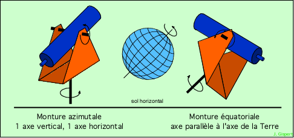

*Les deux types de montures*

Le sol est représenté, ainsi qu’une sphère terrestre montrant l’inclinaison de l’axe de rotation par rapport au sol. L’axe de l’instrument, dans la monture équatoriale, est parallèle à l’axe de rotation de la Terre.

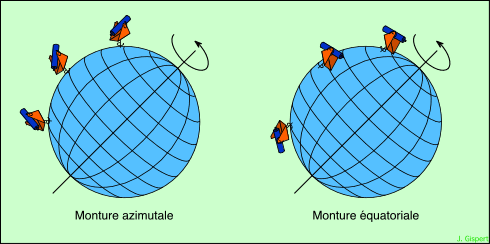

*Position des lunettes en fonction de la latitude*

Remarquez que les lunettes azimutales ont toutes leur axe dirigé vers le centre de la Terre, c’est-à dire selon la verticale du lieu où elles se trouvent. Par contre, celles qui sont en monture équatoriale ont leur axe parallèle à l’axe de rotation de la Terre. Enfin, aux pôles, une monture azimutale serait également équatoriale&#8239;! Il est d’ailleurs question d’installer des instruments au pôle sud, bien que les conditions de vie y soient particulièrement rudes.

Sur le plan mécanique, la monture azimutale est bien plus stable. En effet, le poids du télescope repose sur l’axe vertical (verticale du lieu d’observation), par l’intermédiaire de la fourche, verticale elle aussi. Par contre, dans la monture équatoriale, les bras de la fourche tiennent le télescope en porte-à-faux, et le poids a tendance à les faire plier. Cette position est mécaniquement très mauvaise. De plus, selon l’orientation du télescope, les contraintes mécaniques changent, et entraînent des déformations. On conçoit très facilement que le poids du télescope ne peut être trop élevé.

La monture équatoriale a été déclinée en diverses variantes, qui assurent plus ou moins bien la stabilité. Celle qui est présentée ci-dessous est la *monture à fourche*.

<Encadre type="plus">
Petit télescope photographique de [Maksutov](#TélesMaksu) (diamètre 10 cm, focale 1 m) en monture équatoriale à fourche.

Le bâti est fixé sur un robuste pied de géodésie. L’entraînement est fait par secteur lisse et moteur synchrone (visibles en bas à gauche).

Remarquez l’inclinaison de l’axe polaire, et le porte-à-faux de la fourche. Le poids de l’ensemble fourche-télescope est porté par les paliers de l’axe polaire, noyés dans la poutre dépassant du bâti.

La petite prise électrique visible sur le bâti assure l’alimentation du moteur en courant alternatif 220 V. Un boîtier générateur de courant (non représenté) permet l’utilisation en extérieur. Ce boîtier a été réalisé sur les plans de [Serge Bertorello](http://serge.bertorello.free.fr/).

Cette monture est fortement inspirée de celles construites par Sauveur Lisciandra et Serge Bertorello, au sein de l’Association Marseillaise d’AStronomie (AMAS).

Monture réalisée par J. Gispert.

<Encadre type="plus">
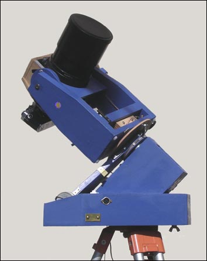

photo J. Gispert
</Encadre>
</Encadre>

Le premier télescope du Mont Wilson, de 1,5 m (60 pouces), est en monture à fourche. Mais le miroir seul pèse 850 kg. La pression sur le palier nord serait trop forte. Le palier a donc été équipé d’un flotteur cylindrique centré sur l’axe. Ce flotteur baigne dans une cuve de mercure.

Si on symétrise la fourche, on obtient la *monture à berceau*&#8239;:

<Encadre type="plus">
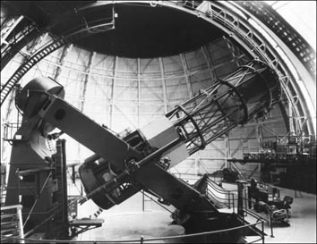

Télescope *Hooker* de 2,5 m, observatoire du Mont Wilson

Le miroir de 2,50 m de diamètre a été coulé par la verrerie de Saint Gobain. Le berceau est une double fourche, qui englobe le tube du télescope. L’axe polaire de l’instrument est composé de deux parties rigoureusement alignées. La première est tenue par le pilier sud (en bas et à droite sur la photo), la seconde par le pilier nord (en haut et à gauche).

L’axe polaire ayant ainsi deux appuis, est beaucoup plus stable. Mais en contre-partie, on perd la possibilité d’observer dans la région polaire, qui est obstruée par le pilier nord (sur le télescope Hale du Mont Palomar, un évidement permet d’observer la région polaire).
</Encadre>

Enfin, la *monture allemande* (créée par Fraunhofer) tient le tube par un seul côté, et l’équilibre par un contre-poids. Le porte-à-faux est sur les deux axes…

<Encadre type="plus">
Lunette Merz-Eychens de l’Observatoire de Marseille.

Objectif de 260 mm, taillé par Merz (Munich), longueur focale de 3,10 m. L’objectif est un doublet achromatique.

Installée en 1872, cette lunette est en monture allemande, construite par William Eichens. Elle est montrée ici en position de repos. Remarquez le pilier, sur lequel est placé l’axe polaire. A l’extrémité nord de l’axe polaire (à droite), se trouve le support de l’axe de déclinaison (bien visible), qui lui-même porte la lunette. On voit le contre-poids en bout d’axe de déclinaison, et on constate le porte-à-faux sur les deux axes.

On distingue le secteur denté de l’entraînement entre le haut du pilier et le support de déclinaison. Il est en contact avec une vis tangente, mue par un petit moteur électrique.

L’inconvénient de cette monture est l’opération de retournement. Si on observe une étoile à son lever, on positionne le tube de la lunette à l’ouest du pilier. Après son passage au méridien, le tube vient buter contre le pilier. Pour poursuivre l’observation, il faut faire passer le tube de l’autre côté du pilier, ce qui constitue le retournement, pendant lequel on ne peut observer.

<Encadre type="plus">
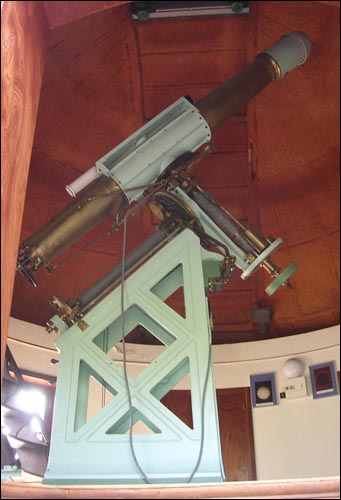

photo J. Gispert
</Encadre>
</Encadre>

Les télescopes d’amateur du commerce sont, soit en monture allemande, soit en monture à fourche. Mais il y a du nouveau… que nous verrons plus loin.

### Le barillet

Pour un petit miroir, jusqu’à 30 cm pour fixer les idées, la solution est simple. Il suffit de le placer sur une surface suffisament rigide, facile à obtenir dans ce petit diamètre.

Pour des instruments plus importants, le support lui-même ne sera pas assez rigide pour garantir la forme parfaite. Le télescope devant s’orienter pour viser l’astre à étudier, le miroir ne reposera que rarement à plat sur le barillet. On peut dire qu’il sera dans une position allant d’horizontale à verticale. Et quelle que soit cette position, il faudra que les forces appliquées à l’envers du miroir soient égales sur toute sa surface.

La première solution qui a été utilisée est un coussin d’air&#8239;! Bien entendu, l’auteur est Léon Foucault, qui l’a appliquée à un miroir de 40 cm, et peut-être à celui de 80 cm de l’Observatoire de Marseille, mais on n’a pas de certitude à ce sujet. L’observateur disposait d’un petit tuyau communiquant avec le coussin, dans lequel il soufflait plus ou moins fort pour équilibrer les pressions. Pour être astronome, il fallait avoir du coffre&#8239;!

Pour des miroirs plus lourds, cette méthode n’est pas applicable, sans un compresseur. Elle a été abandonnée au profit d’une solution mécanique. Au lieu d’appuyer sur toute la surface du miroir, on le pose sur des *leviers astatiques*, comme le montre la figure ci-dessous&#8239;:

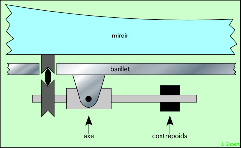

Bien entendu, le miroir est rigide par lui-même, les pressions de deux leviers adjacents se transmettant par les propriétés mécaniques du verre. Le contrepoids est réglable&#8239;; il définit la pression sur le miroir, qui est maximale lorsque le miroir est horizontal, et nulle s’il est vertical. Il est clair que la position et le nombre de ces leviers sont déterminants pour assurer le bon équilibre du miroir, et doivent être calculés très précisément.

Le miroir du télescope de 193 cm de l’Observatoire de Haute Provence repose sur trente leviers astatiques, qui lui assurent une stabilité parfaite.

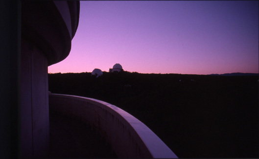

Observatoire de Haute Provence photo J. Gispert

Photo prise depuis la coupole du grand télescope de 1,93 mètre, montrant au loin, sur la droite, la coupole du télescope de 1,52 mètre, et devant, celle du Grand Prisme Objectif.

Voilà le point où on en était à la construction du dernier grand télescope classique (presque), le télescope Bolchoï soviétique. Nous verrons plus loin l’évolution, ou plus précisément, la révolution qui a permis de passer au-delà.

### Le télescope Hale

Le télescope *Hale* est le dernier (le plus grand) construit sur le même modèle que le premier télescope de Foucault, de 84 ans son aîné&#8239;:

- son miroir est en verre pyrex (voir plus loin) rigide, épais de 55 cm en moyenne,
- il est en monture équatoriale (à berceau),
- l’entraînement est mécanique.

Il a été inauguré en décembre 1948, et possède un pouvoir séparateur théorique de 0,024 secondes d’arc, qui est loin d’être atteint à cause de la turbulence atmosphérique. Son miroir fini pèse 13 tonnes (18 tonnes de pyrex brut, avant la taille)&#8239;; le tube pèse 481 tonnes.

<Encadre type="plus">
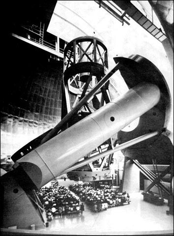

Le poids du miroir est inacceptable pour la monture, au-dessus de 5 m. C’est la raison pour laquelle le télescope du Mont Palomar est resté le plus grand du monde pendant 26 ans&#8239;: il serait très difficile de réaliser un instrument plus important, en utilisant les mêmes principes. Pour réduire le poids du miroir, celui-ci a été creusé derrière, par des alvéoles en nid d’abeille (diminuant la masse en conservant la rigidité).

Remarquez la monture en *fer à cheval*, qui est une modification de la monture à berceau. Cet évidement du berceau côté nord (à droite) permet l’observation du pôle. Mais pour l’obtenir, il a fallu supprimer le demi-axe polaire nord, et le remplacer par un roulement.

La photo a été prise pendant la conférence donnée sous le télescope pour son inauguration&#8239;: l’assistance, une centaine de personnes, y trouve place sans difficulté, et donne l’échelle…

Dernière particularité&#8239;: le tube évidé (pour réduire le poids) permet de voir la cage située en haut. Un astronome peut s’y tenir pour effectuer des observations directement au foyer primaire&#8239;!
</Encadre>

Le télescope Hale est le plus grand télescope en monture équatoriale. Le poids du miroir n’a pas permis d’en construire un plus grand, avec miroir rigide (épais).

### Le verre

Le verre destiné aux lentilles et miroirs a toute une histoire. Sa fabrication est très complexe, car les propriétés doivent être exactement les mêmes en tout point de la masse. Ceci a été très difficile à réaliser.

L’une des difficultés tient à l’existence de deux formes de verre, nommées α et β, qui ne se forment pas à la même température. La variété β est stable à chaud, la variété α à froid. Lorsqu’un gros bloc de verre refroidit, il se forme un noyau de verre β entouré d’une carapace de verre α. Ceci est inutilisable. Pour éviter ce problème, il faut chauffer le bloc à une température de l’ordre de 600°, et le refroidir lentement. Cette opération s’appelle le *recuit*. Elle est nécessaire pour obtenir un disque de qualité.

La composition du verre est aussi très importante, non seulement pour les qualités optiques, mais aussi pour le coefficient de dilatation, qui doit être le plus bas possible. Sur ce plan, les verres au borosilicate (pyrex, créé par le chimiste allemand Otto Schott) sont de bons candidats.

Le miroir du 5 m du Mont Palomar est en pyrex. Son épaisseur totale est de 59 cm en moyenne&#8239;! Mais pour l’alléger, il est creusé de 114 alvéoles au dos qui ne diminuent pas sa résistance mécanique. La coulée a été délicate, à une époque où on n’avait jamais manipulé de telles quantités de verre. Le moule a été chauffé à 1.350° avant la coulée. Le premier disque n’a pas été réussi, il a fallu tout recommencer. Le recuit a duré 11 mois, en abaissant la température chaque jour de 0,8° seulement. Les tensions résiduelles dans le verre sont extraordinairement faibles.

Un verre particulier est nommé *zerodur* (nom de marque). Son coefficient de dilatation est voisin de zéro (d’où son nom). Il permet une grande qualité de polissage, et ces qualités en ont fait pendant longtemps le verre de choix pour les miroirs. Par contre, il présente des inclusions, qui le rendent totalement impropre à la fabrication de lentilles.

### Entretien du miroir

Les miroirs en verre argenté, puis aluminés aujourd’hui, se ternissent et se salissent à l’air. Ils nécessitent donc un entretien. En comparaison avec le bronze, dont le nettoyage nécessitait le fastidieux repolissage complet, sans garantie d’obtenir la même qualité, le verre est là aussi bien supérieur.

La dissociation des deux fonction&#8239;: forme géométrique donnée par le verre, et pouvoir réfléchissant donné par le métal (argent ou aluminium), permet une économie de temps et de travail considérables, et une garantie de maintien de la qualité. Pour nettoyer le miroir, il faut le sortir du télescope, ôter le revêtement métallique par voie chimique, puis en remettre un neuf. L’épaisseur de ce revêtement étant de quelques atomes, la forme du verre est parfaitement respectée.

Le mieux est de voir comment se fait l’entretien du miroir du 193 cm de St Michel l’Observatoire&#8239;: [Entretien du 193.](https://www.canal-u.tv/video/science_en_cours/le_miroir_dans_la_cloche.205)

### Poids du miroir

Le poids du miroir se justifie par la nécessité d’avoir une surface optique parfaite, au 100.000e de millimètre près… Pour maintenir une telle précision en cours d’utilisation (dans toutes les positions possibles), il faut que le miroir soit très rigide, donc très épais. Mais l’épaisseur augmente plus vite que le diamètre.

<Encadre type="plus">
En effet, les déformations d s’expriment par&#8239;:

d = c R4 / e2

où c est une constante, R le rayon du miroir, et e son épaisseur. Si on veut obtenir la même déformation maximale pour un miroir de rayon double 2R, il faut lui donner une épaisseur e′ telle que&#8239;:

c R4 / e2 = c (2R)4 / e′2 = 16 c R4 / e′2

d’où&#8239;: c R4 / e2 = 16 c R4 / e′2 ⇒ e′2 = 16 e2 ⇒ e′ = 4 e

Remplacez le double (2) par un facteur général k&#8239;; vous obtiendrez&#8239;:

e′ = k2 e
</Encadre>

Si le diamètre du miroir est multiplié par k, son épaisseur doit être multipliée par k2. Pour passer de 5 m (Mont Palomar), à 10 m, il faudrait multiplier l’épaisseur par 4. Le volume du miroir serait donc multiplié par 2 × 2 × 4 = 16 fois&#8239;! Donc son poids également… ce qui donnerait 208 tonnes pour le seul miroir. Généralement, si le diamètre du miroir est multiplié par k, son volume et sa masse devront être multipliés par k4.

Fabriquer un tel bloc de verre de qualité optique est inimaginable, au-delà de 6 mètres de diamètre. La masse de verre est coulée à une température de plus de 1.000° C. Il s’y forme obligatoirement des bulles d’air, qu’il faut évacuer sous peine d’avoir des trous dans le miroir&#8239;! Pour cela, il faut faire tourner le moule en refroidissant assez lentement pour assurer le dégazage.

En supposant le refroidissement assez lent pour éviter les bulles, il sera encore beaucoup trop rapide. Etant donnée la grande épaisseur du disque, sa surface en contact avec l’air ambiant, va refroidir et durcir, alors que le cœur est encore liquide. On aura alors une croûte dure, contenant un noyau liquide qui, en se refroidissant à son tour, va se contracter et diminuer de volume. Les tensions mécaniques que cela entraîne risquent au mieux de briser le disque&#8239;; au pire, le disque résistera et se brisera pendant la taille…

Pour éviter ces tensions mécaniques, il faut que toute la masse du verre se durcisse en même temps, donc que la température soit la même partout. Pour atteindre cet objectif, il faut que le refroidissement soit très lent&#8239;: 11 mois pour 5 mètres, 2 ans pour 6 mètres. Pour un miroir de 8 mètres, il faudrait plus de dix ans. L’aventure n’a jamais été tentée au-delà de 6 mètres. Avec cette technique traditionnelle, on est dans une impasse.

## Où l’informatique entre en scène…

### Première révolution&#8239;: la monture

En 1975, les soviétiques ont construit le télescope *Bolchoï* à Zelentchouk, de 6 mètres de diamètre. Le miroir pèse 42 tonnes. Pour passer la limite mécanique atteinte au Palomar, ils ont utilisé une **monture azimutale** (photo ci-contre). Se pose alors le problème des 3 mouvements à contrôler (azimut, hauteur, et rotation du champ). Mais depuis l’installation du télescope Hale, l’informatique avait été inventée, et l’ordinateur a été utilisé pour les piloter. Il est parfaitement capable de calculer à tout instant la vitesse à donner à chaque moteur. C’est la première révolution informatique pour l’astronomie instrumentale.

Nous avons vu la nouvelle limite représentée par le temps de refroidissement du miroir. Il est pratiquement impossible de réaliser un miroir rigide de plus de 6 mètres de diamètre.

Le pouvoir séparateur théorique du télescope Bolchoï atteint 0,02 seconde d’arc. Un regret pour ce bel instrument, il est situé dans le Caucase (sur l’ancien territoire soviétique), dans un lieu qui n’offre pas de qualités atmosphériques suffisantes pour mettre en valeur ses capacités (le seeing descend rarement en-dessous de la seconde d’arc).

### Deuxième révolution&#8239;: l’optique active

La deuxième révolution informatique a été réalisée en 1989 par *l’ESO* (European Southern Observatory), avec le*N.T.T.* (*New Technology Telescope*), équipé d’un miroir de 3,6 mètres seulement. Il s’agit d’un télescope expérimental, destiné à valider une nouvelle méthode. Nous avons vu que le poids du miroir croît très vite avec le diamètre (15 tonnes pour le 5 m évidé, 42 tonnes pour le 6 m). Dans la perspective de construction de très grands miroirs, il fallait trouver un moyen pour les alléger, donc en diminuer considérablement l’épaisseur, sans altérer la forme. Le miroir du N.T.T. ne fait que 24 cm d’épaisseur, c’est donc un miroir relativement mince et souple. La révolution se place dans le support de ce miroir, qui est constitué de 75 vérins commandés en temps réel par un ordinateur. Toute altération très légère de la forme du miroir, mesurée par une méthode optique précise, est immédiatement corrigée par une action sur les vérins, qui modifient la pression exercée sur le verre afin de restaurer la forme idéale.

Cette technique, nommée *optique active*, est maintenant utilisée sur tous les grands télescopes, le coût de l’ordinateur de contrôle étant négligeable devant les économies faites par ailleurs. En particulier, citons le *V.L.T.* (Very Large Telescope, européen). C’est un ensemble de 4 télescopes de 8,20 m de diamètre chacun, remarquable à plus d’un titre, et que nous détaillerons plus loin. Leurs miroirs primaires sont équipés de l’optique active. Placés dans l’un des deux meilleurs sites du monde, ces instruments donnent des images d’une qualité exceptionnelle.

Le réglage des vérins n’est pas fait une fois pour toute&#8239;; lorsqu’on déplace le télescope, les forces changent&#8239;; elles changent aussi s’il y a un peu de vent… Chaque vérin doit être réglé plusieurs fois par seconde. Le problème est alors de savoir comment calculer les poussées. Ceci se fait en observant une étoile du champ&#8239;: on prélève l’image de cette étoile donnée par le miroir primaire à l’aide d’une camera CCD. Une telle caméra est une grille de minuscules cellules photoélectriques, disposées comme une grille de mots croisés (chaque cellule produit un pixel de l’image). A un instant donné, l’image de l’étoile se trouve sur une cellule. Une fraction de seconde plus tard, une déformation la fait passer sur une cellule voisine. L’ordinateur auquel est connectée cette caméra détecte ce changement, et calcule les pressions à exercer par les vérins pour ramener l’image sur la cellule initiale. Ce mécanisme donne un meilleur résultat que ce qu’on obtenait avec la rigidité des miroirs traditionnels. Pour un grand miroir, on gagne&#8239;:

- sur le poids&#8239;;
- sur le coût de réalisation du miroir et de la monture&#8239;;
- sur le temps de mise en température le soir à l’ouverture du dôme&#8239;;
- sur la précision de forme du miroir.

Pour les miroirs au-delà de 6 mètres, la réalisation serait impossible avec un miroir rigide. Des miroirs actifs ont été réalisés jusqu’à 8,20 m de diamètre (Subaru, VLT). Mais peut-on aller au-delà&#8239;? Même mince, un miroir de plus de 8 m est encombrant, fragile, et son transport difficile. Il doit être installé dans un observatoire, loin des grandes voies de communication. Le réaliser sur place poserait bien d’autres problèmes. Nous verrons une [autre solution](#MirComp), qui généralise l’optique active.

### Troisième révolution&#8239;: l’optique adaptative

Avec tous ces progrès, on peut envisager de très grands télescopes, mais leur pouvoir séparateur réel reste limité par le seeing du lieu d’observation. Faut-il donc désormais envoyer les instruments dans l’espace, avec les difficultés de construction, de maintenance, et le prix que cela entraîne&#8239;? Et surtout les limitations de poids et de volume pour le lancement&#8239;!

La réponse était *oui*, dans cette situation. Et rendre possible la construction de très grands télescopes au sol au pouvoir séparateur si limité était quelque peu ubuesque. Aujourd’hui, on peut dire *non*. C’est encore l’informatique qui vient à notre secours, avec une méthode de principe semblable à l’optique active.

La turbulence atmosphérique a été modélisée par Kolmogorov en 1941, à partir de la structure de l’atmosphère et des échanges d’énergie entre les différentes couches, et aux différentes échelles.

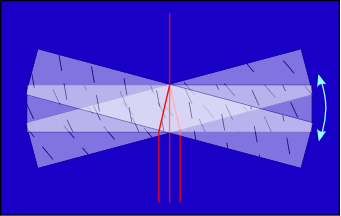

L’atmosphère est ici très simplifiée, sous la forme d’une couche unique oscillant autour d’un point. On la modélise par une plaque de verre assez épaisse.

Lorsque la plaque est horizontale, le faisceau vertical la traverse sans déviation. Lorsqu’elle est inclinée, le faisceau est dévié du côté de l’inclinaison.

L’image de l’étoile donnée par ce faisceau oscille donc de part et d’autre de la position centrale, qu’il ne devrait pas quitter.

Ce shéma montre deux lames de verre identiques&#8239;:

La lame supérieure modélise (très sommairement, comme ci-dessus) l’atmosphère, et oscille aléatoirement comme on vient de le voir.

La lame inférieure a été ajoutée **dans l’instrument**, et on la force à osciller comme la première, mais en opposition de phase&#8239;: lorsque la lame supérieure penche à gauche, la lame inférieure doit pencher à droite d’un même angle.

La déviation du faisceau produite par la lame supérieure est exactement annulée par une déviation opposée en bas. Au bout du compte, le faisceau reste stable pour l’observateur qui se situe en bas.

Cette déformation des images se nomme *TT* pour *Tip and Tilt*. Elle indique la variation angulaire d’arrivée de l’image.

La déformation de l’atmosphère n’est pas aussi simple&#8239;; elle est turbulente, et les déformations sont différentes en chaque point. Tout se passe comme si notre plaque de verre modèle, en plus d’osciller, se gondolait. Il faut donc, pour corriger, imposer à la plaque inférieure des déformations semblables et opposées. C’est l’ensemble de ces dispositifs qui constitue *l’optique adaptative*.

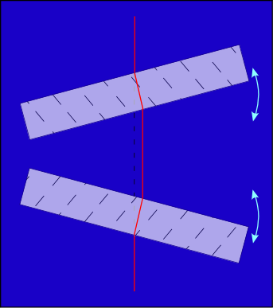

On n’utilise pas une plaque de verre bien sûr, mais un petit miroir souple déformé par des vérins, qui reproduit les défauts de l’atmosphère en sens inverse. Cette idée est due à Babcock en 1953… mais la technique n’était pas prête. C’est finalement en France qu’un premier prototype nommé *Come-on*, a été construit en 1987.

Le *temps de cohérence* est le temps pendant lequel on peut considérer l’image d’une étoile comme stable, sans turbulence. Il est de l’ordre de 2,5 à 70 ms. Une pose plus courte donne donc une bonne image, si on peut se contenter de peu de lumière. Dans une seconde, il y a 400 fois le temps de cohérence minimum de 2,5 ms&#8239;; par conséquent, l’ordinateur doit exécuter plus de 400 corrections par seconde&#8239;!

Pour déformer le petit miroir, il faut connaître les déformations de l’atmosphère. On filme une étoile brillante qui servira de guide. Son image tombe sur l’un des éléments sensibles de la caméra. L’ordinateur l’enregistre. Une fraction de seconde plus tard, l’image se déplace à cause de la turbulence atmosphérique, et tombe sur un autre élément sensible. L’ordinateur le détecte, et commande une pression des vérins pour déformer le miroir afin de ramener l’image à l’endroit où elle était avant. Ce déformations rapides ne peuvent pas s’appliquer au miroir primaire, encore trop rigide pour cela.

Cette méthode, nommée *optique adaptative*, permet de corriger en temps réel les effets de la turbulence, et de se rapprocher du pouvoir séparateur théorique de l’instrument, malgré l’atmosphère. Elle est maintenant utilisée sur tous les grands télescopes.

<Encadre type="plus">
**Sourire** On entend souvent dire que l’astronomie coûte cher, et ne sert à rien. Evidemment, si on n’est pas curieux de comprendre ce qui nous entoure…

Mais remarquez que tous les constructeurs d’appareils photo numériques vous proposent maintenant des systèmes de compensation des mouvements&#8239;! Vous pouvez photographier en courant, et obtenir une image nette. Comment est-ce possible&#8239;?

Tout simplement en utilisant le même principe que les astronomes. On analyse les mouvements de l’image donnée par l’objectif, et on déplace un miroir pour la maintenir en place.

Comme quoi les recherches les plus *inutiles* trouvent des applications… utiles à tout le monde&#8239;!
</Encadre>

L’optique active et l‘optique adaptative sont conçues sur le même principe (déformer un miroir par des vérins, commandés par ordinateur), leur différence tenant dans la nature des déformations corrigées&#8239;:

- **l’optique active** s’applique au miroir principal, et corrige ses déformations provoquées par le vent, par sa position par rapport à la verticale etc. La fréquence des ajustements est de l’ordre de dix par seconde&#8239;; cette technique simule un miroir rigide par un miroir mince&#8239;;
- **l’optique adaptative** corrige les effets de l’atmosphère, qui sont plus rapides&#8239;: il faut agir sur le miroir plus de 400 fois par seconde. Cette fois, c’est un miroir secondaire qui est contrôlé.

Rappelons-nous que la turbulence éparpille la lumière de l’étoile autour de la tache de diffraction théorique (où toute la lumière de la tache d’Airy devrait se trouver). L’amélioration du pouvoir séparateur se fait en ramenant la lumière dans la tache de diffraction. De ce fait, on améliore en plus la sensiblilité de l’instrument&#8239;!

On peut mesurer la qualité de la correction simplement en déterminant la proportion de la lumière qui est ramenée dans cette tache. Elle est nommée *rapport de Strehl*, en l’honneur de l’astronome et opticien allemand Karl Strehl. Un rapport de Strehl de 100 % correspondrait à une correction parfaite. On atteint assez facilement 60 %, plus difficilement au-dessus de 80 %.

Il y a toutefois une limitation à son usage&#8239;: elle nécessite, dans le champ observé ou tout à côté, la présence d’une étoile assez brillante pour permettre le guidage. Ces étoiles ne se trouvant qu’au plus sur 1 % de la sphère céleste, l’emploi de cette technique est limité à une petite partie du ciel seulement. Nous verrons plus loin une [nouvelle technique](#Etoilartif) qui permet de l’appliquer partout.

### Quatrième révolution&#8239;: l’interférométrie

Le pouvoir séparateur d’un instrument, mesurant son aptitude à montrer des détails, est directement lié au diamètre de l’objectif (lentille ou miroir). Il incite donc au gigantisme. Avec les techniques précédentes, on est arrivé à produire des télescopes de 8,20 m (VLT), et il serait difficile de faire plus grand, en particulier pour des raisons de transport.

On dispose de miroirs composites jusqu’à 10,40 mètres, et de bien plus grands sont en cours de construction, mais on a déjà limité les prétentions dans ce domaine. Fort heureusement, une solution complètement différente existe, qui permet d’aller beaucoup plus loin&#8239;: *l’interférométrie*. Cette technique a une longue histoire, et son importance justifie un [traitement à part](#interf). Nous verrons qu’après des débuts en optique pure, l’interférométrie a évolué et nécessite aujourd’hui des traitements informatiques lourds.

Ceci achève le panorama des progrès instrumentaux réalisés grâce à l’ordinateur. On voit bien qu’il serait impossible de s’en passer… Mais ces quatre points ne concernent que l’observation&#8239;; aujourd’hui, les astronomes passent une grande partie de leur temps devant leur clavier, car l’ordinateur les assiste dans toutes leurs autres tâches.

## Autres progrès

### Etoile artificielle

La limitation due à la rareté des étoiles brillantes ne demande qu’à être contournée. Le principe est assez simple&#8239;: placer une source lumineuse artificielle ponctuelle à haute altitude près du champ observé, au-dessus des couches turbulentes. Ce point lumineux apparaîtra semblable à une étoile, et sa lumière traversant l’atmosphère, en subira les perturbations, dont l’analyse permettra de guider le système de reconstruction du front d’onde.

Il est évidemment exclu d’envoyer un appareil là-haut&#8239;! On éclaire l’atmosphère d’en bas, à l’aide d’un laser dont le faisceau cohérent reste cylindrique, sans se disperser, ce que ferait une lumière non cohérente. On applique cela de deux façons différentes&#8239;:

- Utilisation de la diffusion Rayleigh sur les molécules de l’atmosphère. On utilise un laser puissant, dont le faisceau se diffuse. Une partie de la lumière est rétrodiffusée, et revient vers le télescope émetteur. Elle constitue l’étoile artificielle. L’altitude de diffusion est relativement faible, de 10 à 40 km. Pour choisir l’altitude de rétrodiffusion, on focalise le faisceau.
- Utilisation du sodium à haute altitude. L’atmosphère de la Terre contient une couche de sodium autour de 92 km d’altitude (stratosphère), alimentée par les météorites qui se détruisent dans cette zone. On sait que le sodium présente un doublet de raies spectrales dans la partie jaune, qui est responsable de la couleur de certaines lampes d’éclairage urbain. Si on excite le sodium, il se désexcite en émettant en particulier ces raies. On utilise pour cela un faisceau laser très puissant au gaz carbonique. Le pinceau laser étant très étroit, la zone illuminée est toute petite, et constitue une excellente étoile artificielle. Cette technique est utilisée en particulier aux télescopex Keck&#8239;: laser à 589 nm (raie D du sodium), magnitude de l’étoile artificielle entre 9,5 et 11 (selon la puissance du laser, la collimation et l’épaisseur de la couche de sodium).

Dans un champ un peu plus vaste, l’onde est déformée dans plusieurs directions simultanément, et une étoile guide ne suffit pas. Il faut en utiliser plusieurs, forcément artificielles. Les meilleurs systèmes en utilisent jusqu’à cinq.

Nous avons considéré jusqu’ici des observations dans le visible. Mais la turbulence n’est pas la même dans le bleu et dans le rouge, ce qui introduit un léger chromatisme des images. Par contre, dans l’infrarouge proche, elle ne dépend pas de la longueur d’onde. Aussi, les télescopes actuels privilégient-ils ce domaine de longueur d’onde, qui par ailleurs présente un grand intérêt pour étudier les objets froids.

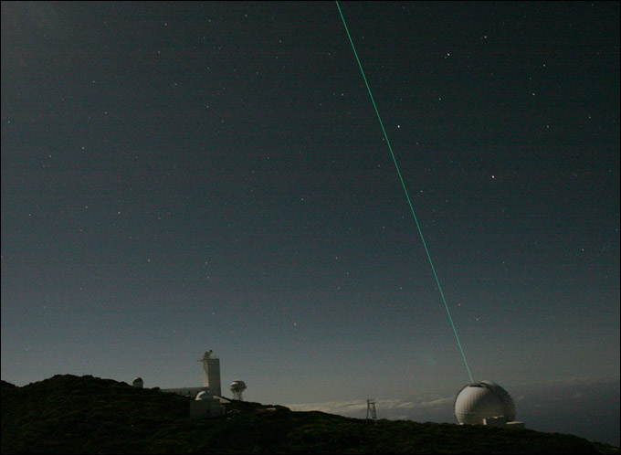

*Diffusion Rayleigh au William Herschel Telescope (4,20 m) La Palma Iles Canaries photo Olivier Martin*

Le défaut principal de l’étoile artificielle est le trajet aller-retour de la lumière, qui ne permet pas de mesurer la déviation de la lumière (*Tip and Tilt*). En effet, si la lumière est déviée dans un sens à l’aller, elle le sera dans le sens exactement opposé au retour, ce qui compense. Pour cela, on utilise une étoile naturelle en plus, mais elle peut être assez éloignée du champ visé pour ne pas limiter la méthode.

### Miroirs composites

Une autre solution est envisageable pour la construction de grands miroirs. Au lieu de couler un disque de la taille requise, il s’agit de juxtaposer de petits miroirs (de forme hexagonale) pour en composer un grand, placés dans une même monture. On le réalise donc par pavage. On peut ainsi aller beaucoup plus loin en diamètre, le principal problème étant d’ajuster tous les segments, dynamiquement, pour qu’ils ne constituent qu’une seule surface parabolique. Ceci se fait tout naturellement en adaptant l’optique active&#8239;: il faut mettre un ensemble de vérins sous chaque segment du miroir, et les régler collectivement pour obtenir la forme désirée. Cette solution a posé des difficultés de mise au point, mais elle est appliquée largement aujourd’hui.

Les deux télescopes américains *Keck*, le *GranTeCan* aux Canaries, ont des miroirs de 10 m de diamètre constitués de 36 segments hexagonaux de 1,80 m. Ce concept de miroir composite a ouvert la voie à de très grands projets de télescopes au sol, et permis l’envoi d’un télescope de 6,50 m dans l’espace (JWST).

## Interférométrie

L’interférométrie est une technique née de la nature ondulatoire de la lumière, et qui dérive directement de l’expérience des [*fentes de Young*](../lumiere/#tacheDiff). La lumière provenant d’un astre doit suivre deux trajets légèrement différents, déphasant plus ou moins les deux ondes l’une par rapport à l’autre. Si elles arrivent en phase, elles s’additionnent et produisent de la lumière&#8239;; si elles arrivent en opposition de phase, elles se détruisent et produisent de l’obscurité. On observe des franges alternativement brillantes et sombres. Hyppolyte Fizeau a calculé que la mesure de ces franges permettrait de déterminer le diamètre angulaire d’une étoile.

<Encadre type="plus">
Cache à lunules

Miroirs de renvoi

Ces deux schémas sont extraits de l’article de Fizeau de 1851 &#91;2&#93;.
</Encadre>

Ce phénomène a été mis à profit en 1873 par Edouard Stéphan, directeur de l’Observatoire de Marseille, sur le télescope de Foucault de Marseille. Il a occulté l’ouverture du télescope à l’aide d’un cache percé de deux trous diamétralement opposés (schéma de gauche). La lumière d’une étoile passait par les deux trous et cheminait dans le télescope, pour se recombiner au niveau de l’oculaire, en produisant des interférences. Avec l’écartement des lunules, si le diamètre de l’étoile est inférieur à 0,158″, il n’y a qu’un système de franges, et elles sont bien visibles&#8239;; S’il est supérieur, il y en a plusieurs qui se chevauchent et se mélangent, provenant de divers point de l’étoile, et elles ne sont pas visibles.

Cette expérience, toute première observation d’interférométrie astronomique, a prouvé que toutes les étoiles de son échantillon étaient *de diamètre inférieur à 0,158″*, résultat qui n’avait jamais été obtenu avant&#8239;: on ignorait tout du diamètre des étoiles.

Stéphan ne pouvait pas réaliser l’amélioration suggérée par Fizeau dans le schéma de droite pour des raisons de poids. Mais bien plus tard, en 1920 à l’aide du télescope Hooker de 2,50 m du Mont Wilson, l’expérience a été reprise par Michelson et Pease, avec l’amélioration suggérée par Fizeau&#8239;: au lieu d’admettre la lumière de l’étoile directement, on écarte les faisceaux incidents à l’aide de deux couples de miroirs plans mobiles, qui permettaient de régler la distance. C’est ainsi qu’on a pu faire la première mesure du diamètre de Bételgeuse. On notera qu’en 1971 on a pu mesurer le diamètre de neuf étoiles grâce à une nouvelle méthode développée par Antoine Labeyrie, l’interférométrie des tavelures.

Cette interférométrie permet seulement de mesurer le diamètre des étoiles, non d’en produire une image. Mais les progrès vont (relativement) vite.

Le plus important de la tentative de Stéphan à Marseille est dans sa nature&#8239;: **c’était la première fois que la méthode interférométrique était appliquée**. Or elle est universellement utilisée aujourd’hui&#8239;! Tout d’abord dans les radio-télescopes (la grande longueur d’onde facilite les mises au point), et maintenant, grâce à [Antoine Labeyrie](https://astronomia.fr/seminaires/annee1314/hypertelescope.php), dans tous les télescopes optiques modernes, à commencer par le VLT. C’est le moyen d’obtenir un pouvoir séparateur qui serait inaccessible avec un télescope unique de grand diamètre.

<Encadre type="plus">
Le télescope de Foucault, à l’observatoire de Marseille, est donc l’ancêtre de tous les télescopes modernes, à deux titres&#8239;: **le miroir de verre, et l’interférométrie**.
</Encadre>

### Bases de l’interférométrie astronomique

En 1974, Antoine Labeyrie a construit sur le plateau de Calern près de Grasse, un petit interféromètre optique avec deux télescopes de 25 cm, *I2T Interféromètre à 2 télescopes*, dont la distance pouvait varier de 4 à 67 mètres. Il a ensuite réalisé un interféromètre plus grand, avec deux instruments de 1,50 m de diamètre, éloignés de 30 m. Son pouvoir séparateur théorique est de 0,005″, à comparer avec le pouvoir séparateur du télescope spatial&#8239;: 0,05″ ou celui d’un des VLT&#8239;: 0,015″. Il a ainsi prouvé qu’il est possible de réaliser des interféromètres optiques, et mis au point un système permettant d’égaliser les chemins optiques (qui a débouché sur les lignes à retard du VLTI en particulier). Il a réussi à mesurer l’assombrissement au bord de quelques étoiles, ce qui est impossible sans cette technique.

Peut-on retrouver une image à partir de ces donnéees&#8239;? Oui, bien que ce ne soit pas aisé. Pour le comprendre, il faut imaginer que les interférences donnent, d’une répartition de lumière dans un plan, une nouvelle répartition de lumière de nature différente, mais qui contient les mêmes informations. Par conséquent, démêler les interférences, c’est-à-dire effectuer l’opération inverse, permet de retrouver la répartition de lumière intiale, donc l’image. Retrouver l’image qui a produit les interférences ne se fait pas par optique, mais par calcul de la fonction inverse.

Mathématiquement, cette opération donne une image parfaite à condition d’avoir des données interférentielles parfaites, qu’on obtiendrait avec des télescopes couvrant entièrement une large surface. Pratiquement, on ne peut acquérir qu’un échantillon de données, avec un ensemble de télescopes régulièrement espacés. Cependant, les régularités dans les images peuvent être reconstruites si le maillage est suffisant. Il s’agit d’un processus complexe que des ordinateurs puissants sont capables de mener à bien.

Les interférences représentent la fréquence à laquelle l’intensité de la lumière change d’un point de l’image à un point voisin, autrement dit si du noir voisine avec du blanc. Une distance donnée entre les deux télescopes permet d’analyser ces changements s’ils sont à la bonne fréquence, ni trop rapides ni trop lents. Par exemple, une feuille de papier portant des bandes alternativement noires et blanches vue dans les télescopes donnera un signal si la largeur des bandes est correcte. Ceci indique que, pour obtenir assez d’information, il faut faire varier la distance entre les deux télescopes, en faisant plusieurs observations successives. Et de plus, les informations sont obtenues le long de la ligne entre les deux télescopes. Pour obtenir des informations selon une ligne perpendiculaire, il faut faire d’autres observations avec des télescopes alignés selon cette perpendiculaire.

### L’observatoire du Paranal

L’*ESO* (*European Southern Observatory*) est un organisme créé pour la réalisation d’un grand observatoire dans l’hémisphère sud. Cet observatoire est situé au sommet du Cerro Paranal, dans la Cordillière des Andes au Chili, à 2 635 m d’altitude, dans le désert d’Atacama, le plus aride du monde. On y enregistre 350 nuits claires par an. L’océan tout proche, à seulement 12 kilomètres, limite les variations thermiques diurnes, mais son humidité reste bloquée plus bas, et l’on voit les nuages de dessus. L’altitude donne un bon seeing. Tout ceci fait du Paranal l’un des rares meilleurs sites du monde. Avec les instruments qui s’y trouvent, il constitue le plus grand observatoire mondial.

*Observatoire du Paranal, ESO photo ESO*

La photo montre les quatre grands télescopes, et les quatre télescopes auxilaires. Les chemins bétonnés visibles sur la plateforme permettent de déplacer les petits télescopes. Leur lumière est envoyée en souterrain jusqu’au bâtiment situé au centre, où elle produit les interférences. On voit la route d’accès, et au loin l’océan. Enfin, à droite de la plateforme, se trouve le petit télescope VISTA. Les instruments visibles sont décrits ci-dessous.

### Le VLTI

Le *VLTI* (*Very Large Telescope Interferometer*), est tout d’abord un ensemble de quatre grands instruments identiques, désignés comme *UT* (*Unit Telescope*). Ils sont parmi les meilleurs télescopes du monde. Les miroirs primaires monolithiques de 8,20 m de diamètre ont une épaisseur de 17,6 cm, et sont donc souples. Ils sont posés sur 150 vérins pour assurer leur forme (optique active). Ces télescopes sont également dotés d’optique adaptative, leur donnant des performances exceptionnelles. Ils peuvent effectuer quatre observations différentes au cours d’une même nuit.

Les UT sont nommées en langue Mapuche (les indigènes du nord du Chili)&#8239;:

<table>
<tbody>
<tr><td>Télescope</td><td>Nom</td><td>Signification</td><td>Première lumière</td></tr>
<tr><td>UT1</td><td>Antu</td><td>Le Soleil</td><td>1998</td></tr>
<tr><td>UT2</td><td>Kueyen</td><td>La Lune</td><td>1999</td></tr>
<tr><td>UT3</td><td>Melipal</td><td>La Croix du Sud</td><td>2000</td></tr>
<tr><td>UT4</td><td>Yepun</td><td>Vénus</td><td>2001</td></tr>
</tbody>
</table>

Les quatre instruments possèdent chacun 4 foyers&#8239;: deux foyers Nasmyth, un foyer Cassegrain, et un foyer coudé. Leur pouvoir séparateur théorique, à 0,55 µm de longueur d’onde, atteint 0,015″, soit presque un centième de seconde d’arc. Ils sont équipés de différents systèmes d’optique adaptative, qui évoluent et s’améliorent dans le temps. Le dernier en date utilise la *tomographie laser* pour analyser et corriger la turbulence à différentes altitudes. En combinant l'instrument MUSE et le module d'optique adaptative GALACSI, on obtient des images meilleures que le HST dans l’espace. Voici une photo de Neptune qui l’atteste&#8239;:

*Photos de Neptune, prise par le VLT et le HST*

L’image prise au sol par le VLT est nettement plus fine que celle prise dans l’espace par le HST.

L’optique adaptative ne fait pas partie de la structure principale des télescopes. Ceci permet de changer les systèmes au cours du temps, pour profiter des avancées techniques.

<Encadre type="plus">
Les recherches faites avec le VLT produisent un article scientifique par jour&#8239;!
</Encadre>

On peut utiliser chacun des 4 UT séparément, déroulant ainsi 4 programmes de recherche simultanés. Dans le même temps, on peut utiliser les 4 AT en mode interférométrique, pour tous les objets dont la luminosité est suffisante pour des miroirs de 1,80 m. On a donc ainsi 5 instruments de premier plan. Mais on peut aussi impliquer les UT dans l’interférométrie, pour des objets plus faibles. On a alors, pour un coût de fonctionnement plus élevé puisqu’on utilise tout le matériel pour un seul programme, le meilleur instrument actuel à la fois pour la luminosité et le pouvoir séparateur. Par contre, le mode interférométrique avec les AT seuls est très économe.

Les quatre UT peuvent aussi fonctionner dans le *mode recombinateur*, en observant simultanément le même objet et en ajoutant ainsi la lumière qu’ils captent. Leur pouvoir séparateur reste le même que pour un seul d’entre eux (0,015″), mais on recueille quatre fois plus de lumière, soit l’équivalent d’un miroir de 16,6 m.

Dans le mode interférométrique (UT ou AT), la luminosité est celle d’un des instruments utilisés (1,80 m ou 8,20 m). Mais le pouvoir séparateur est celui d’un miroir de 200 m de diamètre, soit 0,0006″ (0,6 millisecondes). C’est 100 fois mieux que le télescope spatial dont on admire les magnifiques images&#8239;! Cette performance est obtenue grâce à l’instrument ESPRESSO depuis 2016.

L’interférométrie

Avec l’interférométrie, l’astronomie optique rejoint la radioastronomie, qui obtient ce genre de précision depuis plus longtemps avec des radiotélescopes répartis à la surface de la Terre. Ils réalisent ainsi des interféromètres (plus facilement qu’en optique), qui compensent l’inconvénient lié à la longueur d’onde par un diamètre gigantesque.

Le VLTI est utilisé pour analyser la surface des étoiles, et construire leur image. Les premiers résultats étaient plus ou moins bons, mais ils s’affinent avec le temps, par une définition de meilleurs modèles mathématiques de reconstruction d’image. Il est opérationnel en interféromètre depuis 2005.

Un autre système d’optique adaptative a été installé à la fin de 2001 sur l’UT 4 du VLT&#8239;: c’est le système NAOS (*Nasmyth Adaptive Optics System*, ONERA, Observatoire de Paris, Observatoire de Grenoble), au foyer Nasmyth comme son nom l’indique. Le pouvoir séparateur atteint est de 0,015″ d’arc, alors que le télescope spatial n’atteint que 0,05″, trois fois mieux. Le miroir qui permet la correction de la turbulence est le cinquième… De ce fait, on perd une certaine quantité de lumière dans les différentes réflexions.

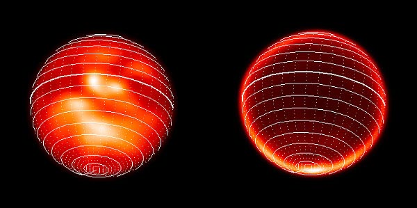

*Titan, VLT Yepun + NACO (NAOS-CONICA) photo ESO*

Cette photo de Titan montre une résolution de 0,03″ d’arc. On distingue un phénomène atmosphérique au pôle sud de Titan. Le rapport de Strehl de NAOS est du même ordre que celui de MACAO.

Voici deux photos prises par le VLT, montrant la différence de qualité que donne un même instrument avec et sans optique adaptative&#8239;:

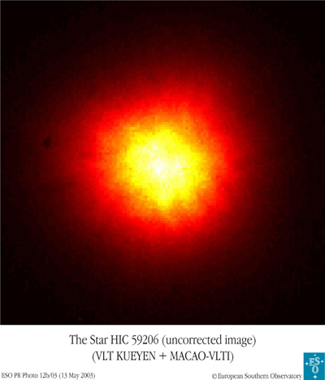

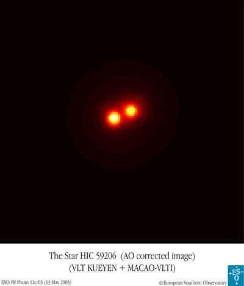

La grosse tache se transforme en deux images d’étoiles très proches, maintenant résolues.

La correction de la turbulence est meilleure si elle est faite par un miroir plus grand. Marc Ferrari, à l’Observatoire de Marseille, a conçu une nouvelle technique de polissage sous contraintes pour réaliser un secondaire actif de 1,14 m de diamètre pour le VLT. Ce miroir doit avoir une épaisseur centimétrique pour le polissage, mais ensuite il doit être fraisé à l’envers pour le réduire à 1,96 mm afin de lui donner la souplesse nécessaire. Installé sur Yepun (UT4), ce secondaire est déformé par 1.170 actuateurs, et le rapport de Strehl approche 95 % grâce à quatre étoiles artificielles pour sonder l’atmosphère. Yepun est le seul télescope au monde à disposer d’une correction adaptative sur le second miroir.

La mise au point de tous ces systèmes accroît les compétences de l’ESO, en vue de la finalisation de l’E-ELT.

Un système nommé *MACAO* (*Multi-Application Curvature Adaptive Optics*) a été installé au foyer Coudé de chacun des 4 grands télescopes du VLT (le foyer Coudé est réservé pour l’interférométrie). Le système MACAO atteint un rapport de Strehl de 55 %.

Pour un télescope classique, l’augmentation du diamètre entraîne l’amélioration des deux paramètres, pouvoir séparateur et quantité de lumière collectée. Mais dans un interféromètre, les deux sont dissociés&#8239;: en associant deux télescopes, la quantité de lumière obtenue est fonction de la surface totale des deux miroirs, qui est constante. Par contre, on peut augmenter le pouvoir séparateur en éloignant les deux instruments.

<Encadre type="plus">
Considérons quatre miroirs de rayon r, chacun ayant la surface sr = π r2. L’ensemble possède une surface de 4 π r2. C’est la même surface que celle d’un miroir de rayon 2 r&#8239;:

S2r = π (2r)2 = π (4r2) = 4 π r2 = 4 sr

Ceci est indépendant de la distance entre les télescopes, qui caractérise le pouvoir séparateur.

Ainsi, le VLTI a le pouvoir séparateur d’un télescope de 200 m de diamètre, mais le pouvoir collecteur d’un 16,4 m seulement.
</Encadre>

Le VLTI est un ensemble d’instruments, et de programmes de traitement des données. Selon la gamme de longueurs d’onde utilisée, le traitement varie. Aussi, quatre instruments ont été réalisés d’abord, qui ont permis d’obtenir des résultats, et de montrer la voie. Ils sont maintenant remplacés par trois nouveaux&amp;nbs&#8239;: MATISSE, pour les bandes infrarouges L, M, et N&#8239;; meilleure résolution 3,5 mas&#8239;; GRAVITY, pour la spectroscopie en bande K&#8239;; résolution jusqu’à 100 μas&#8239;; et PIONIER, pour la bande H.

Photos de l’étoile R Car, de type Mira, prises en janvier 2018 par l’instrument VLTI-GRAVITY, A. Rosales-Guzmán1 et al. *Imaging the innermost gaseous layers of the Mira star R Car with GRAVITY-VLTI*. A&amp;A 674, A62 (2023).

De type Mira, l’étoile variable R Car (600 AL de la Terre) éjecte une partie de son enveloppe, qui constitue un disque épais autour d’elle. Le diamètre apparent de l’étoile est de 5 mas, celui du disque de 16,7 mas. L’étoile est cachée par le disque. Les quatre images correspondent à des longueurs d’onde différentes, c’est comme si on regardait un paysage à travers quatre filtres colorés différents. Ces observations ont montré que le disque contenait beaucoup de poussières, et que celles-ci sont essentiellement des silicates de magnésium. Cet exemple montre comment l’interférométrie permet d’atteindre des résolutions inimaginables autrement.

## Télescopes photographiques

### Télescope de Schmidt

Inventions de **Bernhard Schmidt** en 1930 à Hambourg, et **Dimitri Maksutov** en Russie. Avantage du Schmidt&#8239;: grand champ et grande luminosité, parfait pour la photo. Avantages du Maksutov&#8239;: surfaces sphériques seulement, donc plus facile à construire, et partant moins cher.

Le principe du Schmidt est très simple&#8239;: il consiste à utiliser un miroir sphérique, sur une grande partie de sa surface&#8239;:

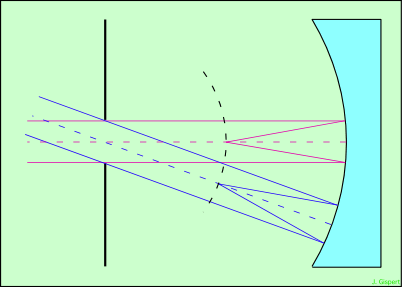

Pour limiter les aberrations, on sait qu’on ne peut pas utiliser les rayons loins de l’axe. Mais le diaphragme placé au centre de courbure du miroir, supprime ces rayons. Remarquez que pour les deux faisceaux représentés, il y a symétrie sphérique autour des axes en pointillés. Donc, on est bien dans les conditions correctes pour l’utilisation du miroir.

On sait aussi que le foyer d’un miroir sphérique se trouve à mi-chemin du centre de courbure. Comme les différents faisceaux ont chacun son axe, les différents foyers se trouvent sur un cercle de même centre que le miroir, et de rayon moitié. Par conséquent, les images se formeront sur une surface sphérique.

Mais ce montage présente une très forte abérration de sphéricité, qu’il faut corriger. Pour ce faire, on constate que les rayons centraux se coupent plus loin que ce cercle, et que les rayons marginaux se coupent plus près. Pour rétablir la situation, il faut modifier le trajet de ces différentes rayons. Ceci se fait par interposition d’une lame transparente, d’épaisseur variable. On la nomme *lame de Schmidt*. Sa forme complexe la rend difficile à tailler. Cependant, les opticiens savent le faire.

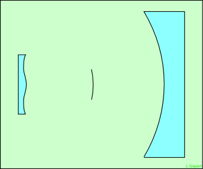

Remarquez que la lame de Schmidt, placée au niveau du diaphragme, est plus petite que le miroir. Ceci donne une curieuse forme aux télescopes de Schmidt, renflés à leur base. L’arc de cercle noir représente la surface focale. Dans un télescope de Schmidt, la pellicule photographique doit épouser cette forme. Les plaques de verre que l’on utilisait autrefois devaient être suffisament souples pour épouser la surface sphérique.

### Télescope de Maksutov

Maksutov est un opticien soviétique, qui s’est posé le même problème que Bernhard Schmidt. Il a trouvé une autre solution, à la fois proche et différente. En lieu et place de la lame de Schmidt, il place un ménisque sphérique&#8239;; c’est une lentille limitée par deux surfaces sphériques concentriques. La lumière traverse le ménisque, se réfléchit sur le miroir sphérique, repart vers le ménisque. Là, un miroir secondaire doit renvoyer la lumière pour permettre l’observation. Plusieurs possibilités s’offrent&#8239;:

- un miroir plan, qui renvoie la lumière vers le miroir principal, lequel doit être percé&#8239;; c’est la formule Maksutov-Newton&#8239;;
- un miroir sphérique, qui joue le même rôle&#8239;; c’est le vrai Maksutov.

Le miroir plan de la première formule est collé sous le ménisque. Le miroir sphérique de la seconde peut avoir la même courbure que le ménisque. Aussi, il suffit d’aluminier le centre du ménisque pour réaliser le miroir secondaire. Ainsi, l’ensemble des deux miroirs et du ménisque nécessite de tailler au total trois surfaces sphériques. C’est bien plus facile que la réalisation d’un Schmidt.

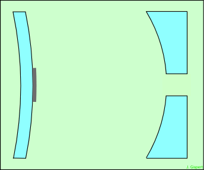

*Télescope de Maksutov*

### Télescope de Schmidt Oschin

Ce principe a été très utilisé, en particulier pour le grand Schmidt du Mont Palomar (télescope *Oschin*), installé en 1948. Grâce à cet instrument, par deux fois, une couverture photographique complète du ciel visible du Mont Palomar a été faite. Ce télescope a une lame de Schmidt de 1,22 mètre, et un miroir de 1,83 mètre. Il a un champ de 36 ° carrés.

Le premier catalogue d’étoiles est le *Palomar Observatory Sky Survey* (ou *POSS I*). Sa magnitude limite est de +21. A partir de 1980, une seconde couverture a été faite, *POSS II*. Elle recense 50 millions de galaxies, 2 milliards d’étoiles, 100.000 quasars. Mais POSS II est limité à la magnitude 21 comme POSS I.

### Formule Schmidt-Cassegrain

C’est une formule hybride, très utilisée pour les télescopes d’amateur du commerce. La firme Celestron en particulier a maîtrisé la production en série des lames de Schmidt. Le miroir secondaire est collé sous la lame, comme dans un Maksutov.

## Les instruments spatiaux

A quoi sert aujourd’hui un télescope spatial, puisqu’au sol on arrive au pouvoir séparateur théorique&#8239;? Le premier télescope spatial a été conçu et lancé avant qu’on ait maîtrisé l’optique adaptative, donc il se justifiait. Mais maintenant, la question peut se poser. Au sol, on ne pourra jamais observer que les longueurs d’onde qui passent la barrière atmosphérique&#8239;: la fenêtre visible, le très proche infrarouge, la fenêtre radio. Dans les autres gammes, seul un télescope spatial peut observer. Aussi, le mot *télescope* prendra, selon la gamme observée, un sens tout à fait différent de ce que nous avons étudié jusqu’ici. Plus la gamme visée est lointaine du visible, plus l’instrument sera exotique.

Nous n’aborderons dans cette section que les principaux télescopes permettant d’explorer l’Univers lointain, dans le visible ou l’infrarouge, en excluant les autres longueurs d’onde, ainsi que les sondes interplanétaires qui observent les planètes *in situ*. Ces dernières font partie des chapitres décrivant les planètes.

### Le HST

Le *HST*, ou *Hubble Space Telescope* est le plus connu. Il s’agit d’un télescope de 2,40 m de diamètre, donc un petit instrument, mais il est placé hors de l’atmosphère à 600 km d’altitude, et peut atteindre sans corrections son pouvoir séparateur théorique. Il est le fruit d’une coopération NASA/ESA (en particulier la caméra à objets faibles *FOC* est européenne), mais la communication de la NASA l’occulte en général.

Le pouvoir séparateur de cet instrument est de 0,05″. Mais juste après le lancement (qui avait été retardé de 5 ans suite à la catastrophe de la navette Challenger), les premières photos étaient floues… La NASA n’avait pas fait les tests nécessaires, et le télescope était affecté d’une forte aberration sphérique&#8239;! Les images ont été améliorées par un algorithme, mais les informations perdues étaient irrécupérables. Il a fallu concevoir une optique de correction (*COSTAR*, *Corrective Optics Space Telescope Axial Replacement*), et l’observatoire de Marseille y a pris part. Cet appareil a été installé sur le télescope par une mission de la navette en décembre 93. Une erreur qui coûte cher, mais les résultats ont été excellents.

Jusqu’à l’année 2018, il a donné les images les plus fines. De très nombreuses découvertes ont été réalisées grâce à cet instrument exceptionnel.

Lancé le 24 avril 1990, il a ét conçu pour être entretenu sur son orbite à une altitude d’environ 600 km lors de missions régulières. Il est assez éloigné de la Terre pour ne pas être gêné par les perturbations de l’atmosphère terrestre, mais insuffisamment pour éviter le passage de la Lune, de la Terre et du Soleil dans son champ de vision.

Le miroir primaire pèse 826 kg, le secondaire mesure 30 cm de diamètre. Il est construit sur un modèle Ritchey-Chrétien, de focale 57,60 m, ce qui lui donne un rapport F/D de 24. Il travaille dans un spectre allant du proche infrarouge jusqu’à l’UV, soit de 1 mm à 1.150 Å. L’aluminium (110 nm) est protégé par une couche de difluorure de magnésium (MgF2) de 25 nm. Outre la protection qu’elle apporte, elle améliore la réflectivité dans l’ultraviolet.

Malheureusement, on découvre peu après son lancement, un défaut d’aberration sphérique sur son miroir primaire. Les images sont floues. Une correction logicielle est mise en place en attendant la première mission de maintenance. Le problème est dû à une erreur de 5 mm sur la longueur de l’instrument, erreur non détectée par des tests au sol insuffisants.

Le 12 février 1993, l’équipage de la navette Endeavour installe un équipement optique correctif, le *COSTAR* (*Corrective Optics Space Telescope Axial Replacement*), conçu en partie par le Laboratoire d’Astronomie Spatiale de Marseille. Cet équipement permet enfin au HST d’obtenir des images de qualité.

Instruments optiques&#8239;: Le télescope peut recevoir jusqu’à 5 équipements optiques, un dans chacune de ses baies axiales et un dernier dans sa baie radiale. Il s’agit de caméras et de spectromètres.

Le HST fonctionne grâce à l’énergie solaire avec deux panneaux de 2,40 × 12,10 m. Ceux-ci alimentent les deux ordinateurs de bord, ainsi que les autres composants électroniques. Six batteries au nickel-hydrogène prennent le relais lorsque le télescope est caché du Soleil par la Terre pendant 25 minutes à chaque orbite.

Système de communication&#8239;: Les données sont transmises au sol par l’intermédiaire du satellite TDRSS&#8239;: Tracking and Data Relay Satellite System. En direct avec le satellite lorsque ce dernier est visible, sinon les informations sont enregistrées sur bande magnétique pour être ensuite transmises.

### Le télescope spatial Herschel

Herschell et un télescope spatial de l’ESA, destiné à observer dans l’infrarouge lointain et les micro-ondes (naissance des étoiles et des galaxies, chimie du milieu interstellaire…) Ces grandes fréquences correspondant à des températures très basses, le télescope observerait son propre rayonnement thermique s’il n’était pas refroidi. Ce refroidissement est réalisé de manière passive par évaporation d’hélium liquide. Sa durée de vie est donc limitée par la quantité d’hélium embarquée au lancement (2 500 litres).

Son miroir a un diamètre de 3,50 m, en carbure de silicium épais de 3 mm seulement, et recouvert d’une couche d’aluminium de 350 nm d’épaisseur. À la date du lancement, c’est le plus grand télescope spatial (le télescope Hubble ne fait que 2,40 m).

### Le télescope spatial JWST

Le télescope spatial *JWST* (*James Webb Space Telescope*) possède un miroir composite de 6,50 m de diamètre et observe dans l’infrarouge proche et moyen. Il a été placé sur une orbite de Lissajou au point de Lagrange L2 de la Terre, à 1,5 millions de km de notre planète. Il est très utile pour observer des objets relativement froids comme des exoplanètes. Mais il a produit un bouleversement dans la connaissance des galaxies primordiales&#8239;: celles-ci ont leur lumière décalée, par l’expansion de l’ Univers, jusquen dans l’infrarouge. Aussi, les télescopes antérieurs, comme le HST qui observent dans le visible, ne les voyaient pas&#8239;! Cette observatopn reporte la formation de ces galaxies à une date bien antérieure, très proche du Big Bang. Elle remet en cause une partie des théories cosmologiques.

### Le télescope spatial GAIA

GAIA est un satellite européen destiné à l’astrométrie de haute précision, successeur d’Hipparcos. Son but est de déterminer les positions, distances et vitesses des étoiles dans un volume important autour du Soleil. D’Hipparcos à Gaia, on passe de la magnitude limite 12 à 20, de 120 000 objets à plus d’un milliard, d’une précision de position de 1 milliseconde à 7 microsecondes pour Mv ≤ 10, 12 à 25 microsecondes jusqu’à Mv = 15, et 100 à 300 jusqu’à 20. Il n’y avait aucun quasar ni même aucune galaxie dans les données Hipparcos, il y en aura 500 000 et de 1 à 10 millions respectivement pour Gaia. La limite de distance pour les mesures était de 1 kiloparsecs pour Hipparcos, elle est de 1 mégaparsec, soit mille fois mieux, pour Gaia. Hipparcos avait provoqué une véritable révolution en améliorant 100 fois les mesures précédentes. Il avait fallu revoir toutes les distances dans l’Univers. Gaia nous promet d’immenses progrès lorsque les données seront vraiment exploitées.

### Le télescope spatial EUCLID

EUCLID est également un télescope européen. Il est destiné à faire le point sur la matière noire et l’énergie noire. En observant les déformations de galaxies lointaines, on espère déterminer la répartition de la matière noire. Il doit également déterminer l’origine de l’accélération de l’expansion de l’Univers, pour caratériser l’énergie noire.

### La fin de l’astronomie spatiale&#8239;?

Les progrès réalisés depuis la construction du télescope Bolchoï sont impressionnants. Comparer les images produites par les grands télescopes aujourd’hui à celles obtenues au Mont Palomar dans les années 1950 en donne une mesure. Il est évident que la compréhension des phénomènes qui se produisent dans l’Univers y a gagné énormément.

Une autre comparaison est instructive&#8239;: depuis 2018, l’optique adaptative installée au VLT surpasse le télescope spatial HST en finesse des images. On peut alors se demander quel est l’avenir des télescopes spatiaux, et même penser qu’il est très sombre… Côté pouvoir séparateur et finesse des images, c’est exact, il est désormais inutile d’aller dans l’espace pour travailler dans le visible et le proche infrarouge. On peut construire au sol des instruments beaucoup plus grands, beaucoup moins coûteux, et les entretenir et même les améliorer à peu de frais.

Mais il y a une autre caractéristique de notre atmosphère que l’optique adaptative ne peut pas corriger&#8239;: c’est l’absorption de la lumière en fonction de la longueur d’onde. Le visible passe la [barrière atmosphérique](#fenetre), mais l’infrarouge (sauf le proche), par exemple, est arrêté. Alors, pour faire des études dans les domaines spectraux filtrés par l’atmosphère, rien ne remplacera un instrument en orbite.

### L’évolution des instruments

<table>
<tbody>
<tr><td>1609</td><td>lunette de Galilée</td><td>première lunette utilisée en astronomie, Florence</td></tr>
<tr><td>1670</td><td>télescope de Newton</td><td>premier télescope (miroir de bronze), Londres</td></tr>
<tr><td>1864</td><td>télescope de Foucault</td><td>premier grand télescope à miroir de verre, Marseille</td></tr>
<tr><td>1948</td><td>télescope <em>Hale</em>, mont Palomar</td><td>limite mécanique de la monture équatoriale, Californie</td></tr>
<tr><td>1974</td><td>télescope Bolchoï, Zélentchouk</td><td>première monture azimutale informatique&#8239;; limite supérieure d’un miroir rigide, Caucase</td></tr>
<tr><td>1987</td><td><em>Come-on</em></td><td>premier système d’optique adaptative (Européen&#8239;: CILAS, ONERA, Observatoire de Paris–Meudon), sur le télescope 3,60 m de l’ESO, La Silla, Chili</td></tr>
<tr><td>1990</td><td>NTT</td><td>premier télescope à optique active complète, c’est un prototype pour le VLT</td></tr>
<tr><td>1990</td><td>HST</td><td>premier télescope optique spatial, NASA</td></tr>
<tr><td>2005</td><td>VLTI</td><td>premier grand interféromètre optique, Cerro Paranal, Chili</td></tr>
</tbody>
</table>

NTT fait suite au Nordic Optical Telescope 2,40 m 1988 optique active essentielle.

NTT Ritchey-Chrétien, 3,58 m de diamètre, focale 7,90 m.

### Les grands instruments

Une liste des grands instruments existants se trouve dans la fiche consacrée à l’[histoire de l’astronomie](https://astronomia.fr/7eme_partie/fiches/fic_histoire.php).

## Instruments accessoires

En dehors des télescopes, les astronomes ont développé des accessoires d’une grande utilité. Certains permettent de renvoyer la lumière des astres vers un instrument fixe. Pour des observations dans la nature (éclipse totale de soleil par exemple), il est difficile d’installer un télescope en monture équatoriale, lourd et encombrant. Il est bien plus simple d’avoir un télescope fixe et un système de renvoi de la lumière. Nous verrons aussi quelques autres accessoires de nature différente.

Les trois premiers instruments, dont le nom porte la même terminaison, ont une caractéristique commune. *Stat* signifie stationnaire. Ce ne sont pas des télescopes, mais des accessoires permettant de diriger la lumière d’un astre dans une direction fixe. L’image de l’objet est donc statique. Voir &#91;3&#93;.

### Cœlestat

Le *cœlestat* est un miroir plan collé sur un axe horaire entraîné comme dans une monture équatoriale, mais à une vitesse deux fois moindre (car la réflexion sur un miroir mobile double l’angle). Par construction, la normale au miroir est dans l’équateur. C’est la bissectrice de l’angle que font le rayon incident et le rayon réfléchi. Par conséquent, l’image est symétrique de l’objet par rapport à cette normale. Donc, si l’objet observé est à une déclinaison δ, son image sera vue à une déclinaison -δ.

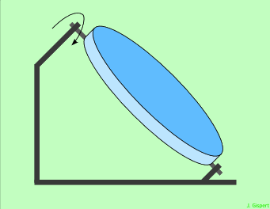

cœlestat

Le télescope ou la lunette qui observe l’image est donc dirigé vers le miroir, et incliné de cette valeur. Si on veut poser l’instrument horizontalement (à cause de son poids par exemple), on intercale un second miroir, orientable en hauteur, et mobile sur un charriot.

Le cœlestat est utilisé dans deux circonstances essentiellement&#8239;:

- par les astronomes en mission pour les éclipses, qui doivent être observées là où se produit le phénomène. Il permet de limiter le poids et le volume des instruments transportés&#8239;;
- pour les observatoires solaires permanents. Dans ce cas, une variante dirige le rayon réfléchi verticalement vers le bas, pour placer les instruments dans un local à température constante (tour solaire).

La construction d’un bon cœlestat est aussi complexe que celle d’un équatorial. Il n’est pas facile, contrairement à ce que l’on peut penser, de polir un miroir plan, c’est même plus délicat que de polir un miroir parabolique. Le miroir étant la plupart du temps incliné, doit être plus grand que l’instrument vers lequel il dirige le faisceau. Et la mécanique doit être réalisée avec le même soin que pour une monture de télescope.

Le cœlestat donne une image fixe, sans rotation du champ&#8239;: on peut faire une photo.

### Sidérostat

Le *sidérostat* est également un instrument à un miroir, mais celui-ci est mobile selon deux axes. L’axe principal a une direction quelconque. L’inclinaison du miroir sur cet axe entraîne une rotation du champ&#8239;: le point central du champ est fixe, le reste tourne à une vitesse variable selon l’inclinaison de l’axe principal.

On peut fixer cette vitesse, à condition d’aligner l’axe principal avec l’axe des pôles. Ceci donne le *sidérostat polaire*. Il permet de diriger le faisceau dans une direction arbitrairement choisie, mais il n’échappe pas à la rotation du champ. Ceci est génant pour la photo, mais n’a pas grande importance pour la spectroscopie.

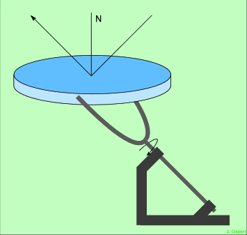

sidérostat polaire

Avec ces principes, de nombreux instruments ont été construits, à des usages divers. La principale motivation est de renvoyer l’image de l’astre observé dans une direction fixe, où se trouve le récepteur, lourd et encombrant.

<Encadre type="plus">
<Encadre type="plus">
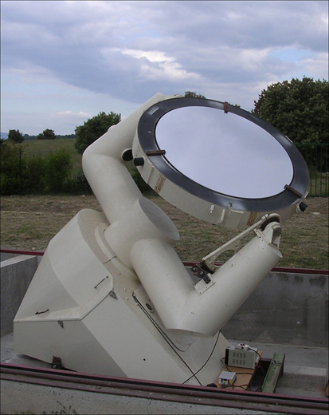

photo J. Gispert
</Encadre>

Sidérostat polaire du Centre d’Astronomie de Saint Michel l’Observatoire, dans les Alpes de Haute Provence.

Le miroir a un diamètre de 1,20 m.

Il renvoie la lumière dans un amphithéatre, où un système de miroirs et un réseau de diffraction permettent de projeter sur grand écran, soit l’image du Soleil dans le visible, soit son spectre à grande dispersion. On peut considérer que l’amphithétre est un récepteur lourd et encombrant…

L’utilisation nocturne permet également de projeter une partie du ciel visible.
</Encadre>

Il est impossible de terminer ce paragraphe sans citer le sidérostat de Foucault&#8239;! On lui doit encore une solution astucieuse à un problème géométrique non évident. Un miroir est placé sur une fourche à axe vertical. A l’arrière du miroir se trouve une tige fixée perpendiculairement.

Un axe polaire est entraîné à vitesse constante, mais l’originalité tient à la liaison entre ces deux éléments&#8239;: elle n’est pas rigide, mais constituée d’une bielle, solidaire de l’axe polaire, et coulissant sur la tige fixée au miroir. Une considération géométrique permet de montrer que l’image est renvoyée dans une direction horizontale fixe. Mais comme tout sidérostat, cet instrument est affecté par la rotation du champ.

### Héliostat

Un *héliostat* est un instrument qui dirige la lumière du Soleil vers une direction fixe, mais sans but astronomique. Les héliostats qui ont été construits sont sur ce plan de mauvaise qualité, et n’ont servi que pour des expériences sur la lumière.

### Spectroscope, spectrographe

Le spectre d’un l’astre s’obtient en étalant sa lumière, en séparant les couleurs. Plus on l’étale, plus on a d’informations mais, la quantité de lumière disponible étant fixée par la luminosité de l’astre, plus longue est la pose pour l’obtenir. Connaître les propriétés d’une étoile mobilise donc un télescope pendant un temps long.

Le spectroscope est l’instrument permettant de visualiser le spectre d’un astre. Il est généralement abondonné aujourd’hui au profit des spectrographes, qui enregistrent le spectre sur un support. Ce fut d’abord sur plaque photographique, c’est aujourd’hui sur des supports électroniques, à l’aide de CCD dont le rendement quantique est infiniment meilleur.

L’utilité des spectres est colossale. Un spectre donne d’abord la composition de la matière qui l’a émis&#8239;; c’est ainsi qu’on connait la composition du Soleil, des étoiles, des nébuleuses etc. L’élargissement des raies spectrales donne de nombreux renseignements&#8239;: agitation thermique d’un gaz (donc sa température), vitesse de rotation d’une étoile, densité du gaz (élargissement collisionnel), champs électrique (effet Stark) et magnétique (effet Zeeman). Un spectre des anneaux de Saturne montre les raies inclinées par la rotation différentielle des anneaux, le plus interne tournant plus vite. Le décalage spectral (glissement d’ensemble du spectre dû à une vitesse de la source par rapport à l’observateur) vers le rouge traduit un éloignement, vers le bleu un rapprochement. L’ampleur du décalage donne la vitesse. C’est ainsi qu‘on mesure les vitesses des étoiles, des galaxies etc. La plupart des connaissances physiques que nous avons sur les astres proviennent des spectres.

La découverte la plus spectaculaire est probablement celle de la première exoplanète&#8239;: on a pu mesurer le décalage spectral périodique qu’elle impose à la lumière de son étoile. La spectroscopie est donc de toute première importance.

Tous les grands télescopes sont équipés d’un spectrographe en plus d’un ipmageur. Il y a une compétition mondiale pour perfectionner ces instruments, qui avaient une précision de 10 m/s (ELODIE, Observatoire de Haute Provence) permettant de découvrir la première exoplanète, puis 1 m/s et maintenant quelques centimètres par seconde seulement, soit quelques kilomètres par heure. Pour atteindre une telle précision, le spectroscope doit être tenu à tempérazture rigoureusement constante, ce qui l’alourdit énormément.

### Prisme-objectif

Prendre un spectre donne donc une grande richesse d’ information sur l’astre qui l’émet. Malheureusement, c’est une opération longue, et par conséquent coûteuse. Or les étoiles ne présentent pas toutes le même intérêt&#8239;! Il serait important de faire un tri rapide dans un champ d’étoiles, afin de sélectionner celles sur lesquelles on investira du temps de télescope.

Un instrument a été inventé pour résoudre ce problème&#8239;: c’est le *prisme-objectif*. Comme son nom l’indique, il s’agit d’un prisme placé devant l’objectif, et non pas derrière le télescope. Alors, la lumière des étoiles est dispersée **avant** de former une image&#8239;; ainsi, on verra sur la photo non pas un spectre, mais autant de tout petits spectres qu’il y a d’étoiles. Ils ne sont pas détaillés, mais ils indiquent de quel type spectral est chaque étoile du champ. Donc, ils permettent d’analyser d’un seul coup d’œil toutes les étoiles visibles dans le champ d’un télescope. Si des étoiles présentent des raies d’émission par exemple, elles sautent aux yeux.

L’idée de départ a été donnée par Karl Schwarzschild en 1913, mais n’a pu aboutir à cause de problèmes techniques (schéma). C’est Charles Fehrenbach, à Marseille, qui l’a développée en associant deux prismes tête-bêche, l’un en flint et l’autre en crown-baryum. Pour une certaine longueur d’onde centrale, les deux prismes ont le même indice de réfraction. Mais pour les autres longueurs d’onde, ils varient en sens inverse. La longueur d’onde centrale n’est pas déviée. On fait une pose, puis on retourne le prisme de 180°, et on fait une seconde pose sur le même cliché. Ceci donne pour chaque étoile deux images parallèles et de sens opposés. Le décalage entre les deux spectres d’une même étoile permet d’estimer sa vitesse radiale.

Principe du prisme-objectif

Après, on peut prendre des spectres à haute résolution des étoiles intéressantes trouvées. Chaque observation ne donnera alors qu’un seul spectre, détaillé.

### Stéréocomparateur

A l’avènement de la photographie, la recherche des astéroïdes et des comètes a bénéficié des nouvelles possibilités, mais une difficulté est vite apparue. Deux photos d’une même région du ciel, prises à un certain intervalle de temps, enregistrent les étoiles dans la même position. Mais une comète ou un astéroïde se déplacent assez rapidement, et leurs images ne seront pas au même endroit sur les clichés. Par conséquent, la comparaison des deux images doit montrer le déplacement, et signaler l’objet mobile.

La difficulté est de comparer visuellement les clichés. L’objet recherché est souvent de faible magnitude, et se trouve noyé dans un fond d’innombrables étoiles faibles. Il s’avère très difficile de le distinguer, d’autant plus qu’on n’est pas sûr de son existence&#8239;!

Pour pallier ces difficultés, on a inventé le *stéréocomparateur*. Son principe est simple&#8239;: c’est un appareil d’optique qui présente les deux clichés alternativement, avec un faible intervalle de temps entre les deux. Si les deux images sont parfaitement superposées, les étoiles fixes sembleront immobiles, alors que l’objet mobile sautera rapidement d’une position à l’autre. C’est tout bêtement le principe du cinéma, qui reconstitue le mouvement par une succession d’images fixes. Vous pouvez utiliser une animation représentant un [stéréocomparateur](https://astronomia.fr/1ere_partie/instruments_js/blinkM_js/blinkM.php).

Ces appareils ont permi de découvrir un grand nombre de petits corps du système solaire. Ils n’ont plus d’intérêt aujourd’hui, car les photos sont prises par des télescopes automatiques, à intervalles réguliers, et comparées par programme. Bien évidemment, cette automatisation multiplie les découvertes, en particulier d’objets géocroiseurs, c’est-à-dire qui s’approchent assez de la Terre pour éventuellement la percuter un jour.

## Instruments méridiens

L’un des problèmes fondamentaux de l’astronomie est la construction de catalogues. Il est en effet indispensable de pouvoir noter les caractéristiques des astres, avec leurs positions, afin de pouvoir les retrouver. Ceci est l’astronommie de position, et elle nécessite des intruments spécialisés.

Un astre, au cours d’une nuit, se léve à l’est, monte dans le ciel, passe au méridien, puis redecend pour aller se coucher à l’ouest. Le point où il passe au méridien est un point particulier, où sa hauteur au-dessus de l’horizon est maximale. L’épaisseur d’atmosphère traversée par sa lumière est alors la plus faible, donc les perturbations qui l’affectent sont minimales.

De plus, l’atmosphère courbe les rayons lumineux, ce qui déplace leur image et affecte leurs positions. Cette courbure est d’autant plus forte que l’astre est plus bas sur l’horizon. Au méridien, elle est minimale pour un astre donné.

Le point de passage au méridien est donc très pratique pour faire les mesures de positions.

### Lunette méridienne

Une *lunette méridienne* est une lunette en monture azimutale particulière, bloquée dans le plan méridien. Elle est posée sur deux piliers, supportant les deux demi-axes horizontaux (tourillons). Par construction, elle ne peut se déplacer que dans le plan du méridien, et il faut attendre, pour observer un astre, qu’il défile dans ce plan.

Bien évidemment, il ne s’agit pas d’observer les propriétés de l’astre, mais *l’instant* de son passage au méridien. À la lunette astronomique est associée une horloge, la plus précise possible. C’est donc un instrument qui a été longtemps utilisé pour la cartographie du ciel. On le nomme, alternativement, *instrument des passages*, terme qui sera conservé pour le cercle méridien.

### Cercle méridien

Le cercle méridien est l’aboutissement de la lunette méridienne. Pour améliorer la lecture de la hauteur, la lunette est associée à des cercles de grand diamètre, sur lesquels sont gravées les hauteurs des astres. La précision et donc augmentée.

## Les oculaires

L’oculaire n’est qu’une simple loupe qui permet de grossir l’image donnée par l’objectif, et en rendre l’examen plus confortable. Mais après avoir taillé l’objectif avec les plus grands soins, il serait dommage de gaspiller cette qualité par l’usage d’un mauvais oculaire. L’oculaire étant, fondamentalement, une lentille, est soumis aux mêmes aberrations que l’objectif d’une lunette. Mais elles ne jouent pas le même rôle, car l’objectif et l’oculaire sont employés dans des conditions très différentes. Il faudra mettre en œuvre des solutions semblables, mais pas forcément corriger les mêmes aberrations. En particulier, l’aberration chromatique doit être corrigée par l’emploi de plusieurs verres.

### Les types d’oculaires

Il existe divers types d’oculaire, qui sont nommé d’après celui qui les a le premier décrits (sauf l’oculaire orthoscopique). Leurs caractéristiques dépendent de la formule optique choisie, et le champ, le grossissement, la clarté diffèrent selon les cas.

Les deux premiers, Huygens et Ramsden, sont assez semblables. Il s’agit de formules dans lesquelles *f1 + f2 = 2 e*, où *f1* est la focale du premier verre, *f2* celle du second, et *e* la distance qui les sépare. Cette condition évite le chromatisme de grandeur susceptible d’affecter les oculaires. L’oculaire de Huygens a un champ de 30°, alors que le Ramsden atteint les 20° seulement. Ces oculaires conviennent mieux à des lunettes qu’a des télescopes, qui sont en général bien plus ouverts (rapport *f / D* plus petit). Ils ne sont pas adaptés aux objets étendus.

L’oculaire Kelner (non représenté sur les schémas) comprend trois lentilles. Il compense un peu mieux les défauts optiques.

Les deux autres types sont plus complexes, nécessitant 4 lentilles au lieu de deux. Ce surcroit de difficulté de construction a un coût, ces oculaires sont plus chers, mais ils corrigent mieux les aberrations. L’oculaire orthoscopique est de bonne qualité, mais avec un champ faible, de 45° au maximum. Le Plössl est assez facile à construire, et donne de bonnes images. De ce fait il est très répandu.

On trouve maintenant des formules plus complexes, comme le Nagler à 7 lentilles. Cette complexité permet de corriger les aberrations tout en augmentant le champ de vision. Ainsi, on peut atteindre 82° de champ visuel, ce qui donne une impression de bien voir le ciel, à grossissement égal. Si on regarde une nébuleuse, on la voit en entier, et on voit des étoiles autour, là où un oculaire plus simple ne montrerait que le principal.

### Sphère armillaire

La sphère armillaire est un instrument explicatif, permettant de représenter les mouvements des astres, et non de les observer (sauf pour les équinoxes…). Vous en trouverez une [description détaillée](../sphere-armillaire/) dans un autre chapitre, avec des plans de montage pour en réaliser une.

## L’avenir proche

### OWL, E-ELT

Un projet européen nommé *OWL* (*OverWhelmingly Large*&#8239;: extraordinairement grand) a été conçu il y a quelques années, concernant un télescope de 100 mètres de diamètre. Naturellement, il n’était pas question de réaliser un miroir monolithique, et ce grand miroir devait être composite. La finesse des images aurait été 40 fois supérieure à celle du télescope spatial&#8239;! Malheureusement, il était *overwhelmingly* coûteux&#8239;!

Lors d’une conférence ESO tenue à Marseille (27 novembre - 1 décembre 2006), réunissant 250 astronomes européens, la décision a été confirmée de remplacer le projet *OWL* par le projet *E-ELT* (*European Extremly Large Telescope*), plus modeste dans ses dimensions, mais plus réaliste aujourd’hui. La volonté affirmée est d’obtenir un délai de construction de trois ans&#8239;; pour un miroir de 100 mètres, qui serait techniquement faisable, le délai serait considérablement plus long.

Le but premier de ces projets est l’étude des planètes extrasolaires, domaine qui a été ouvert en 1995 avec la découverte de 51 Pegasi b à l’Observatoire de Haute Provence, et qui a littéralement explosé depuis, à tel point que l’on connait maintenant plus de 5000 planètes autour d’autres étoiles. Mais elles ont été découvertes par des moyens indirects, qui ne permettent mal d’en connaître les propriétés physiques. On doit améliorer largement ces connaissances maintenant, avec bien évidemment des outils adaptés à créer.

Or l’Europe est en compétition dans ce domaine avec les USA en particulier, et l’attente leur aurait laissé la place libre pour faire les découvertes décisives. Le domaine ayant été initié en Europe, il aurait été regrettable de ne pas continuer dans cette voie.

L’étude d’une exoplanète nécessite l’observation en infrarouge, qui permet d’augmenter considérablement le contraste avec l’étoile centrale (l’étoile&#8239;; -quelques milliers de degrés-, rayonne dans le visible&#8239;; la planète -quelques centaines de degrés-, rayonne dans l’infrarouge). Pour cette raison, l’E-ELT sera adapté au visible et à l’infrarouge.

L’E-ELT sera constitué d’un système complexe de 5 miroirs. Le **primaire M1 fait 39 mètres** de diamètre, et est composé de 798 segments de 1,45 m ajustés par la méthode d’optique active. Son poids total est de 200 tonnes… Il est percé en son centre d’un trou de 11,10 mètres, plus grand que le plus grand miroir primaire de télescope actuel. Pour assurer une qualité optimale en permanence, 133 segments supplémentaires sont réalisés&#8239;; ils seront substitués aux segments à réaluminier, assurant la continuité du service.

Le miroir **M2 mesure 4 m**, et est naturellement monolithique. Il pèse 3,5 tonnes, et son support 8,5 tonnes. C’est le plus grand secondaire jamais réalisé. Son épaisseur est de 100 mm. C’est un miroir convexe asphérique, difficile à polir. M3 est concave, asphérique et épais de 100 mm.

Les miroirs M4 et M5 sont adaptatifs, et corrigent la turbulence atmosphérique. Le M4 a un diamètre de 2,40 m, comme le miroir primaire du HST&#8239;! Il est en vitrocéramique, et son épaisseur est de 1,95 mm seulement. Sa forme est ajustée 1 000 fois par seconde par 5 200 actuateurs (contre 185 pour le miroir adaptatif du VLT). Son barillet est en carbure de silicium, et réalisé par assemblage de six pétales (en appliquant la technologie créée pour la réalisation du miroir de télescope spatial européen Herschell). M5 est plan et mesure 2,70 m, il est mobile selon deux axes pour corriger l’alignement de l’image et la stabiliser. Il la renvoie vers l’un des foyers Nasmysth. L’inclinaison du miroir est modifiée 1 000 fois par seconde. Les corrections de la turbulence seront pilotées par 5 à 9 [étoiles artificielles](#Etoilartif).

La masse mobile de l’ensemble est de 5.500 tonnes… Pourtant, la structure est aérée pour diminuer son poids&#8239;!

La complexe combinaison à cinq miroirs permettra une parfaite correction des diverses aberrations, pour obtenir un instrument quasi parfait. Les pertes de lumière à chaque réflexion ne sont pas ici cruciales, car la surface du miroir primaire de 1.400 m2 collecte suffisament de lumière pour qu’il en reste bien assez.

Dessin de l’E-ELT, miroir principal et structure

Dessin représentant le dôme terminé

<Encadre type="plus">
images ESO
</Encadre>

Les deux plateformes visbles sur les côtés permettront d’installer des instruments lourds et performants, comme par exemple des spectrographes. Une voiture et deux personnes donnent l’échelle…

Le télescope sera installé dans le désert d’Atacama, au sommet du Cerro Armazones, à 3.060 m d’altitude, et à 20 km à vol d’oiseau du Cerro Paranal, où se trouve le VLT. Les études définitives ont été commencées dès janvier 2007, et la mise en service est prévue pour 2027. Le coût total est estimé à 800 millions d’euros. Ci-contre, le Cerro Armazones vu du VLT en février 2015. Les travaux de mise à niveau du sommet sont bien avancés, et on voit la plateforme qui supportera le télescope.

<Encadre type="plus">
Cerro Armazones photo J. Gispert
</Encadre>

*En août 2024, la coupole était bien avancée&#8239;! Photo ESO*

Parmi les cibles à étudier, outre les exoplanètes, on envisage de cibler les premiers objets de l’Univers, qui sont trop peu lumineux pour les télescopes actuels, les trous noirs supermassifs, et enfin la matière noire qui rempli l’Univers, et dont on ne sait pas grand chose aujourd’hui (même pas si elle existe…).

### Les autres projets

A côté du projet européen, les américains ont deux projets en cours&#8239;: le *TMT* (*Thirty Meter Telescope*) qui comme son nom l’indique devrait avoir un miroir de 30 mètres, et le *GMT* (*Giant Magellanic Telescope*), un tout petit télescope de seulement 21,50 m… Ces trois instruments ne sont pas totalement indépendants, pour des raisons d’efficacité une certaine complémentarité a été prévue.

Alors que les interféromètres permettent d’obtenir un excellent pouvoir séparateur sans améliorer la collecte de lumière, ces télescopes géants gagnent sur les deux tableaux. Le gain de lumière est capital pour la spectroscopie, et permettra de déterminer la composition d’objets encore ignorée aujourd’hui.

Les instruments à placer derrière le télescope seront facilement interchangeables, permettant d’adapter rapidement le télescope à des observations de type nouveau. Le bond en avant qu’on va faire nous réserve certainement des surprises, et cette versatilité est indispensable pour y réagir. Le gain en finesse des images (pouvoir séparateur) est de 17 fois par rapport au télescope spatial HST&#8239;!

## L’avenir plus lointain…

### Interféromètre spatial

On projette d’envoyer de grands interféromètres dans l’espace. Le projet européen *Darwin* (ESA), consiste en cinq ou six télescopes séparés de plusieurs centaines de mètres, de 3 à 4 m de diamètre chacun, envoyant la lumière collectée à un module central réalisant l’interférométrie, et communiquant les données à la Terre. Cet ensemble doit être placé au point de Lagrange L2, où la gravité de la Terre équilibre celle du Soleil, autorisant une plus grande stabilité de l’ensemble. Ce système est en cours de développement à l’ESO.

<Encadre type="plus">

Un des télescopes de Darwin

L’ensemble de l’interféromètre

<Encadre type="plus">
photos Alcatel Space Industries
</Encadre>
</Encadre>

Darwin est destiné à rechercher des planètes de type terrestre autour d’étoiles proches, et éventuellement y trouver des traces de vie. Il surveillera 1.000 étoiles proches de la Terre.

Or la vie sur Terre est la seule connue, et c’est elle qui a modifié l’atmosphère en produisant l’oxygène, et du méthane. L’idée est alors très simple&#8239;: on essayera d’obtenir le spectre d’une planète autour d’une autre étoile&#8239;; si on y trouve la signature spectrale de l’oxygène (en fait de sa variété triatomique l’ozone), ce sera un indice pour la présence de vie sur cette planète. Un indice, mais pas une preuve… pour cela, il faudra des études plus poussées.

<Encadre type="plus">
Ce programme est difficile à remplir à cause du contraste entre la planète et son étoile. Cette dernière est 1 milliard de fois plus brillante. Mais en observant dans l’infrarouge moyen, le contraste n’est plus que de 1 million. Ceci s’explique parce que l’étoile est beaucoup plus chaude que sa planète, et par conséquent leurs rayonnements de corps noir sont assez fortement décalés. Le maximum de rayonnement de la planète est dans l’infrarouge, où l’étoile est fortement affaiblie.

Darwin utilsera la technique de *nulling interferometry*. Cette technique consiste à déphaser un télescope par rapport à un autre, de telle manière que l’étoile soit effacée. Mais la planète n’étant pas située au même endroit, sa lumière arrive par un chemin optique différent, et ne subi pas l’extinction.

Une heureuse coïncidence veut que les traces spectroscopiques de la vie terrestre se trouvent dans cette gamme, avec des bandes d’absorption de l’ozone et du méthane.

Cette gamme d’onde est donc, à double titre, bien adaptée à ce genre de recherches.
</Encadre>

Ces observations sont impossibles au sol, d’abord parce que l’infrarouge moyen est absorbé par l’atmosphère, ensuite parce que l’instrumentation elle-même émet de l’infrarouge (rayonnement du corps noir à une température de l’ordre de 20° C). Dans l’espace, la radiation étudiée est disponible, et le télescope est assez froid (40 K) pour ne pas perturber&#8239;; on refroidira le capteur jusqu’à 8 K).

Pour que l’interférométrie se réalise parfaitement, la distance des télescopes doit être constante, avec une précision millimétrique. Ceci n’est pas facile à réaliser, mais devrait être possible. Pour cela, les télescopes seront équipés de moteurs ioniques, éjectant de très petites quantités d’ergols à très grande vitesse. Les corrections étant très petites, 5 kg d’ergol seront suffisants pour les 5 ans de l’expérience&#8239;!

Le projet, en l’état, est abandonné. Mais il est fort probable qu’un autre projet, assez semblable, verra le jour prochainement. Outre les difficultés techniques à surmonter, il faudra aussi convaincre les responsables des finances…

### Les hypertélescopes

Quel peut être l’intérêt de construire un grand télescope, plutôt qu’un interféromètre équivalent&#8239;? C’est la surface du miroir. Jusqu’à présent, nous avons mis l’accent sur le pouvoir séparateur, ce qui est sans doute un bon choix pour voir des détails. Mais quand on construit un miroir de diamètre double, le pouvoir séparateur est deux fois meilleur, et la surface du miroir (donc la quantité de lumière reçue), est 4 fois supérieure. On peut donc voir des objets plus faibles (plus loin, à luminosité égale…). Or l’interféromètre, en éloignant les télescopes, augmente beaucoup le pouvoir séparateur, mais la surface n’est que le double de celle d’un télescope isolé de même diamètre. Si la distance des deux télescopes est 10 fois leur diamètre, le pouvoir séparateur sera dix fois meilleur, mais la quantité de lumière reçue ne sera que le double. Ainsi, il est toujours important de construire de grands miroirs (pour les objets faibles), et des interféromètres (pour les détails). Il y a encore beaucoup de travail à faire dans le domaine instrumental.

Quel est l’intérêt de voir plus finement des objets plus faibles&#8239;? L’une des grandes interrogations, la plus grande peut-être en astronomie, est la quête de la vie ailleurs. Pour ce qui est du système solaire, il est peu probable d’en trouver ailleurs que sur Terre&#8239;: Mercure est brûlante et sans atmosphère, Vénus est encore plus chaude, avec une atmosphère de gaz carbonique, d’acide sulfurique, et pas d’eau. Mars est un immense désert (peut-être trouvera-t-on des bactéries dans le sous-sol, mais on n’espère plus rien de mieux).

Ensuite, les 4 planètes géantes sont gazeuses, n’ont pas de sol (ou alors à une profondeur où la température atteint 10.000 degrés). Il reste une faible possibilité de vie dans certains satellites des planètes géantes. Il en est qui sont couverts d’une banquise épaisse de 100 km, et sous laquelle on soupçonne l’existence d’un océan liquide. Là, peut-être…

Sinon, il faudra chercher plus loin. Hors de notre système solaire, c’est-à-dire autour d’autres étoiles. On a découvert, en 1995, à l’Observatoire de Haute Provence, la première planète autour d’une autre étoile (51 Pegasi). Depuis, les découvertes se sont multipliées et l’on compte plus de 5 000 planètes connues autour d’autres étoiles. Mais ces découvertes ont été faites essentiellement par des moyens de mécanique céleste, en analysant les perturbations gravitationnelles de la planète sur son étoile. Ce qui fait qu’on ne sait pas grand chose de ces planètes, à part une vague idée de leur masse, parfois de leur densité.

Photographier une exoplanète est extrèmement difficile à cause de la proximité de son étoile (quelques secondes d’arc au mieux), et du contraste avec l’étoile (de l’ordre du milliard de fois plus brillante). On arrive cependant à avoir quelques images, mais ce ne sont que des points.

Si on disposait d’instruments beaucoup plus puissants permettant d’obtenir une image de ces planètes, et d’en obtenir un spectre, leur connaissane progresserait beaucoup. Regardons les atmosphères des planètes de notre système solaire (quand elles en ont). Une seule présente de l’oxygène, et il se trouve que c’est la Terre, où il y a de la vie. Est-ce un hasard&#8239;? Non&#8239;!

Lorsque la Terre s’est formée, elle était chaude et agitée par un volcanisme extrêmement important. Le volcanisme crache beaucoup de gaz, du gaz carbonique, des composés soufrés, de la vapeur d’eau. Ces gaz ont constitué une atmosphère primitive à la Terre. En se refroidissant, la vapeur d’eau a pu se condenser et former les océans. Là s’est développée la vie. Les premiers organismes, unicellulaires, s’accommodaient du gaz carbonique. De plus, ils l’ont utilisé pour constituer leur squelette à base de carbone&#8239;: absorbant une molécule de CO2, ils la cassaient, conservaient le carbone pour leur squelette, et rejetaient l’oxygène. Ainsi, petit à petit, ils ont appauvri l’atmosphère en CO2 et l’ont enrichie en O2. C’est la vie qui a produit notre atmosphère actuelle. L’oxygène de la Terre est donc une conséquence de l’apparition de la vie à sa surface.

En extrapolant, si on imagine que les mêmes phénomènes se sont produits ailleurs, la présence d’oxygène dans une atmosphère planétaire serait un indice pour imaginer la vie à sa surface. L’oxygène serait détecté par sa molécule triatomique l’ozone. Construire des instruments capables d’observer le spectre d’une planète extrasolaire est donc un challenge dans le but de découvrir de la vie ailleurs, mais pas seulement. Il y a donc encore beaucoup de travail en perspective&#8239;!

### Projet Carlina

Antoine Labeyrie est aussi l’initiateur des projets d’hypertélescopes. Le *Projet Carlina* concerne la réalisation de tels instruments, au sol ou dans l’espace. Leur but est d’imager les étoiles (taches, éruptions…) et leurs planètes (continents, océans…), avec comme objectif final de trouver de la vie ailleurs évidemment.

Le principe est absolument délirant, pour notre regard classique, mais il porte de grands espoirs. Il consiste à réaliser un miroir composite immense, en disposant de petits miroirs (de 25 cm de diamètre, focale 35 m, pas forcément contigus), sur une très grande surface sphérique au sol. Ces miroirs seront immobiles, assurant un positionnement relativement simple. Ils renverront la lumière vers un point du ciel, où le dispositif focal sera porté par des cables, ou un ballon captif&#8239;! Comme dans le radiotélescope d’Arrecibo, la nacelle portant le dispositif focal pourra se déplacer pour suivre un certain temps l’objet dans le ciel. Par vent faible, les déplacement de la nacelle ne sont que de quelques millimètres.

Deux possibilités s’offrent à ce niveau&#8239;: soit on place directement une caméra pour imager les observations, soit on place un miroir qui renverra l’image au sol pour l’analyser à l’aide d’instruments trop lourds pour le ballon.

Le [projet Carlina](https://astronomia.fr/seminaires/annee1314/hypertelescope.php) n’est pas un télescope définitif, mais un montage de validation réalisable à peu de frais. Il servira à vérifier le fonctionnement des divers organes nécessaires, comme le correcteur de Mertz (correction de l’aberration de sphéricité), le densifieur de pupille (pour corriger l’effet de dilution produit par des miroirs non contigus)…

Il est tout à fait envisageable de construire des instruments plus grands encore, sur le même principe, avec des miroirs composites. On le verra plus loin. Mais déjà, se pointe le nouveau concept d’[hypertélescope](https://astronomia.fr/seminaires/annee1314/hypertelescope.php). Il est développé par Antoine Labeyrie, et sera probablement une solution très intéressante pour augmenter considérablement le pouvoir séparateur, à coût égal. Un démonstrateur a été réalisé à l’Observatoire de Haute Provence (St Michel l’Observatoire). Lui a succédé un instrument installé dans la vallée de l’Ubaye, destiné à mettre au point la monture des miroirs, et surtout le pilotage de la nacelle qui porte le miroir secondaire.

### Autres utilisations de la lumière

Télescopes et lunettes ne sont que des collecteurs de lumière. Il la concentrent en leur foyer, où se forme l’image, qui est grossie par l’oculaire pour une observation confortable.

La photographie est le premier procédé qui remplace l’œil de l’observateur par un autre capteur, la pellicule. La pellicule joue exactement le même rôle que l’œil, elle fixe la position des astres. Dans une image, il y a deux types d’information différents&#8239;: la direction d’où provient la lumière, et son intensité. On distingue deux étoiles lorsque leurs directions diffèrent d’une quantité supérieure au pouvoir séparateur de l’œil&#8239;; on est aussi sensible à sa plus ou moins grande brillance. La pellicule joue exactement le même rôle que la rétine. Aujourd’hui, la pellicule est remplacée par des capteurs CCD, bien plus efficaces. De plus, les images sont traitées par logiciel, et celles provenant d’un CCD sont directement sous forme électronique.

Un spectrographe est un autre capteur, qui traite la lumière d’une façon différente. Il la décompose en ses différentes couleurs, pour une même direction (une même étoile). Les renseignements que l’on tire de cette observation sont d’une autre nature.

Bien d’autre techniques sont mises en œuvre à l’heure actuelle.

## Les nouveaux instruments d’amateur

### Les traitements photographiques

Dans les années 1950, le télescope Hale de 5 m de diamètre prenait des photos sur des plaques argentiques, dont le rendement est très faible. Sur une centaine de photons qui la frappent, seule une vingtaine est utile, le reste est perdu. Pour obtenir une image du ciel, il faut donc poser assez longtemps, et pendant ce temps la turbulence brouille l’image. Les photos prises avec ce télescope exceptionnel, en noir et blanc, montrent ce que l’on peut voir à l’œil dans un petit télescope d’amateur aujourd’hui.

Par contre, un bon capteur CCD a un rendement quantique très élevé, qui dépend de la technologie précise utilisée. Puisqu’on rentabilise la plupart des photons, on peut diminuer d’autant le temps de pose. Avec une pose très courte, de durée inférieure au temps de cohérence, on peut figer la turbulence, mais l’image est peu lumineuse. L’idée est donc de prendre un grand nombre de telles photos et de les additionner. Parmi toutes les poses, on en trouvera qui sont meilleures que d’autres. On peut ne conserver que les bonnes, et l’image finale sera de très bonne qualité. On s’affranchit de la turbulence, au prix d’un traitement long et complexe. Ces traitements sont faits sur ordinateur, avec des logiciels spécialisés.

### Les télescopes photographiques

Dans les années 2010, sont sortis de petits instruments complets, lunettes ou télescopes. Montés en azimutal, ils comprennent un ordinateur qui leur permet de suivre un astre. Mais à la place de l’oculaire, ils intègrent un capteur CCD qui photographie l’objet observé. Un ordinateur récupère et enregistre les images, mais fait bien plus que cela. Il effectue des poses de 10 secondes (par exemple) du même objet, et les accumule. Le traitement de filtrage, alignement, addition et autres, que font les amateurs à la main, est intégré et automatisé.

Ces instruments sont pilotés depuis un téléphone portable, auquel ils sont connectés par WIFI&#8239;; à la mise en marche, ils utilisent son GPS pour déterminer le lieu d’utilisation. Ensuite, l’appareil se dirige vers le ciel, et photographie un champ d’étoiles. Il compare la photo avec son catalogue, et finalise ainsi sa mise en station. La mise en route prend moins de cinq minutes, la seule opération manuelle consiste en une mise à niveau du support.

Pour l’usage, le logiciel de commande contient des catalogues plus ou moins complets, et il suffit en général de taper le nom de l’objet à observer pour obtenir le pointage automatique. Étant en monture azimutale, il y a une rotation du champ, qui est corrigée automatiquement par le logiciel.

Certains appareils offrent un mode mosaïque, permettant de définir une zone à photographier autour de l’objet pointé. Il fait alors toute une suite de photos, qu’il ajuste automatiquement, pour obtenir un champ nettement plus large que celui du capteur.

Les prix de ces appareils varient dans une gamme assez large, mais les moins chers offrent des possibilités déjà très impressionantes. Ils permettent de réaliser de très bonnes photos sans se plonger dans tous les problèmes de suivi et de traitement. Lorsqu’on atteint leurs limites, on éprouve le désir d’aller plus loin avec d’autres matériels et logiciels plus complexes. De ce fait, ils peuvent être un moyen d’initiation à une technique un peu rébarbative si les résultats se font attendre…

*Nébuleuse America, NGC7000, 11 juillet 2024, pose 1 h 30 mn photo J. Gispert*

Cette photo est une mosaïque prise avec une lunette Vespéra premier modèle. Pose de 1 heure 30 mn avec filtre dual band (Hα et OIII). La photo originale (2544 × 3259 pixels) est beaucoup plus détaillée.

### Les nouvelles montures d’amateur

Les progrès de l’électronique permettent maintenant de produire, à des prix très accessibles, des instruments en monture azimutale pilotés par ordinateur. Un microprocesseur délivre largement assez de puissance pour assurer le suivi des deux axes. Une raquette permet de le commander. Deux types de montures existent, la différence portant sur la mise en station&#8239;:

- mise en station assistée&#8239;; l’observateur vise successivement deux étoiles brillantes, en orientant le télescope lui-même. Lorsque l’étoile est au centre de l’oculaire, il enregistre la position en appuyant sur un bouton. Cette opération prend quelques minutes, après quoi le télescope est en station.
- mise en station automatique&#8239;; c’est la Rolls de l’amateur. Le télescope est muni d’un capteur GPS, qui lui permet de déterminer sa position exacte, et de faire la mise en station automatiquement.

Après cette opération, l’observateur utilise la raquette pour pointer un astre. Les principaux sont en mémoire, et il suffit de donner leur nom pour que le télescope les pointe automatiquement. Par exemple, taper M13. Si l’objet n’est pas connu (comète par exemple), on donne les coordonnées équatoriales.

### Photographie

La photographie a été appliquée à l’astronomie dès l’époque des daguéréotypes. Mais uniquement pour des objets très lumineux, à cause de la faible sensibilité. Elle est irremplaçable pour conserver et publier une observation, que l’on peut revoir longtemps après, caractéristique essentielle aux progrès de l’astronomie. Par rapport à l’œil, outre la persistence, elle présente des avantages et des inconvénients&#8239;:

- elle accumule les photons (ils s’additionnent dans la pellicule, et non dans la rétine)&#8239;;
- elle les diffuse, ce qui agrandi la tache de diffraction&#8239;;
- elle présente un *défaut de réciprocité* qui limite sa sensibilité&#8239;;
- elle a un mauvais rendement quantique.

Le premier point est une qualité, les trois autres des défauts. La différence entre la pellicule photo et l’œil est essentielle&#8239;: une image ne dure qu’une fraction de seconde sur la rétine, mais elle s’accumule au cours du temps sur le film. Cette propriété additive des pellicules permet d’atteindre des objets bien plus faibles que ce que l’on voit à l’oculaire.

Une pellicule photographique est un support, soit rigide (plaque de verre, astronomie professionnelle), soit souple (pellicule plastique), sur laquelle est appliquée une couche sensible contenant une substance photosensible. L’action de la lumière sur cette substance (l’apport d’énergie du photon), produit une modification électrochimique. Le développement termine ce processus. Des atomes ou molécules se forment, qui sont opaques à la lumière. La plus ancienne substance utilisée est le nitrate d’argent, et le développement produit des cristaux d’argent. Sur la plaque ou la pellicule, on a donc des molécules côte à côte qui vont former l’image. La première idée qui vient à l’esprit est que l’image d’une étoile va affecter une molécule, et que, pas conséquent, la finesse de la photo est limitée par la taille de ces molécules.

Ceci n’est pas vrai, la taille des grains de l’émulsion n’est pas le facteur limitatif.

Cette taille va de quelques micromètres, à un demi micromètre seulement. Mais l’image d’une étoile n’est pas constituée d’un seul grain&#8239;: la lumière diffuse dans l’émulsion, et de nombreux grains autour de celui qui la reçoit sont affectés. Il s’ensuit une image stellaire bien plus grande que le grain élémentaire. On considère que la zone affectée sur la pellicule est de l’ordre de 50 µm.

Avec un télescope ou une lunette standard, la tache de diffraction est bien plus petite que l’image obtenue. Si deux images stellaires (donc séparées par l’objectif) se projettent dans un cercle de 50 µm de diamètre, elle formeront une seule image. La photo limite donc le pouvoir séparateur de l’instrument, la finesse des images. Des détails facilement visibles à l’oculaire sont absents de la pellicule. Ce problème a été résolu de deux façons différentes&#8239;:

- par une amélioration des pellicules (au fil du temps, de nouvelles émulsions ont été produites, avec un grain plus fin)&#8239;;
- par un allongement de la focale.

Le premier point est évident, mais il ne permet pas de progrès vraiment spectaculaires.

L’allongement de la focale grossit l’image focale. Il suffi donc de l’augmenter suffisamment pour dépasser le diamètre de diffusion dans la pellicule. Mais ceci nécessite des longueurs focales extrêmes, avec un rapport F / D de 100 ou plus… Pour un télescope tel que les VLT, la focale serait de 800 m… C’est donc un moyen pour améliorer la photographie, des planètes par exemple, mais on ne peut atteindre de telles valeurs.

Le défaut de réciprocité est une diminution de la sensibilité avec le temps d’exposition. Une pose de deux minutes accumulera deux fois plus de lumière qu’une pose d’une minute. Mais une photo de dix minutes accumulera bien moins que dix fois plus de lumière. Inutile donc de prolonger indéfiniment une pose pour atteindre des astres plus faibles&#8239;: au bout d’un certain temps, on ne gagne plus rien. La sensibilité indiquée sur l’emballage de la pellicule n’est valable que pour des poses relativement courtes.

Mais la pire difficulté vient du très mauvais rendement des surfaces sensibles. On appelle *rendement quantique* d’une pellicule, le nombre de photons qu’il faut accumuler en provenance d’une étoile pour que l’image apparaisse. Les bonnes pellicules n’ont qu’un rendement de l’ordre de quelques pour cent au mieux. Considérons un cristal de nitrate d’argent à la surface d’un film. Lorsqu’il reçoit 100 photons, 2 ou 3 d’entre eux ont une chance de modifier ses propriétés chimiques, amenant la formation d’une image. Les autres sont totalement perdus. C’est la raison pour laquelle la photographie demande de si longues poses.

Signalons toutefois une amélioration des pellicules à destination astronomique&#8239;: *l’hypersensibilisation*. Il s’agit d’un traitement physico-chimique qui augmente nettement le rendement quantique d’une pellicule, mais sans atteindre les 10 %.

La véritable nouveauté est venue des capteurs électroniques, dont nous parlerons plus loin.

Avant de terminer ce paragraphe, il faut tout de même considérer le champ de la photo. Il est, avec un télescope normal, de quelques dizaines de minutes d’arc, au mieux. Or l’une des taches les plus importantes qui ont été faites depuis l’invention de la photo, est la cartographie du ciel. Il s’agit donc de couvrir la surface entière du ciel, et nous allons calculer combien de photos sont nécessaires si le champ est d’un demi-degré (30 minutes). On divise le ciel en carrés de 30 minutes de côté. Le ciel entier est gradué de -90° à +90° en hauteur, et de 360° en azimut (toutes autres coordonnées donneraient le même résultat). En hauteur, on aura donc 180° / 0,5° = 360 carrés. En azimut, ce sera 360° / 0,5 = 720. Pour paver tout le ciel, il faudra donc 360 x 720 = 259.200 photos… On n’a pas encore fini&#8239;!

De plus, si on veut photographier la galaxie d’Andromède par exemple, on s’appercevra vite qu’elle ne tient pas toute entière dans le champ. Il faudra photographier par petits morceaux, et les rassembler ensuite.

Ces deux remarques vous montrent que les télescopes construits pour l’observation visuelle ne sont pas adaptés à certains usages. Les opticiens ont travaillé pour construire des instruments spécialisés pour la photo, nous en verrons deux types plus loin.

### CCD

Depuis peu, on dispose d’un nouveau type de capteur dont le rendement quantique (la proportion de photons utiles) est radicalement meilleur&#8239;: il atteint 80 % dans le domaine visible. Il n’est donc plus nécessaire d’attendre très longtemps pour accumuler assez de photons pour former l’image.

Les progrès sont absolument spectaculaires. Les photos planétaires prises par le télescope du Mont Palomar (télescope Hale de 5 m de diamètre) dans les années 50 sont concurencées aujourd’hui par les amateurs équipés de télescopes somme toute modestes. Il n’y a pas de miracle là-dessous, mais une explication simple.

Pour obtenir une image de Mars, le télescope du Palomar devait poser plusieurs secondes. Pendant ce temps, l’atmosphère vibre par la turbulence, et dégrade gravement les images. Le pouvoir séparateur résultant est limité à 1 seconde d’arc à peu près.

Aujourd’hui, un amateur disposant d’une webcam derrière un télescope de 25 cm peut prendre une série d’une centaine de clichés, avec un temps de pose petit devant le temps de turbulence. Parmi ces clichés, certains seront affectés par la turbulence, d’autres non. On sélectionne les bons, et on les additionne pour obtenir une image pratiquement exempte de turbulence. Elle atteint le pouvoir séparateur de l’instrument, qui est de l’ordre de la demi-seconde…

Voilà une façon de contourner un problème, celui de la stabilité des images&#8239;: disposer d’un capteur suffisament sensible pour faire des poses très courtes, qui figent la turbulence&#8239;!

Vous avez parfaitement compris que cette technique ne s’appliquera pas aux objets faibles, pour lesquels le temps de pose reste long, même pour un capteur CCD. L’optique adaptative est indispensable dans ce domaine.

### Les spectres

Les informations portées par un spectre solaire ou stellaire sont tellement importantes, que leur obtention est primordiale. On pourrait presque penser, si on devait choisir entre l’imagerie et la spectroscopie, que la seconde est plus importante (vous savez, si vous deviez emporter un seul livre sur une île déserte…).

Aussi, toutes les techniques permettant d’obtenir ces précieux spectres présente un intérêt capital en astronomie. Pour obtenir un spectre, la première difficulté est la faible lumière. Dans le cas du Soleil, premier étudié, il n’y a pas de problème. C’est plutôt l’excès de lumière qui gêne.

Mais pour la plus brillante des étoiles, il faut déjà un instrument sensible&#8239;: un bon collecteur de lumière, c’est-à-dire un télescope présentant une surface la plus grande possible (le plus grand diamètre). Ce fut l’un des moteurs de la recherche astronomique, et de la course aux grands instruments. Aujourd’hui, on dispose de nombreux télescopes suffisants pour prendre les spectres des étoiles jusqu’à une magnitude assez élevée.

Comment fait-on&#8239;? Tout simplement en plaçant un prisme **derrière** le télescope. Attention, le prisme n’a pas une réponse linéaire. Il disperse davantage le bleu que le rouge. Aussi, un spectre photographié derrière un prisme n’a pas la même échelle sur toute la gamme. Difficile d’en déduire des informations numériques. Par contre, un réseau de diffraction presque linéaire, aussi ce sont les réseaux qui sont utilisés aujourd’hui.

Mais un autre problème se présente&#8239;: l’obtention d’un grand nombre de spectres demande un temps dont on ne dispose pas. Une étoile prise au hasard peut avoir n’importe quel spectre&#8239;: l’étudier en détail est parfois passionant, le plus souvent décevant… Comment trier entre les étoiles intéressantes et les autres&#8239;? La solution est très simple&#8239;: si on pouvait prendre des spectres à basse résolution d’un grand nombre d’étoiles, on pourrait faire le tri entre elles. On saurait lesquelles sont intéressantes, et demandent une étude poussée, lesquelles ne méritent pas qu’on s’y attarde.

## Les autres rayonnements

Après la lumière, qui saute aux yeux (&#8239;! ), serait-il judicieux de s’intéresser aux autres longueurs d’onde&#8239;?

La réponse est très simple&#8239;: oui, pour la raison suivante. Les phénomènes physiques qui nous permettent, grâce à la technologie, de produire les autres rayonnements, peuvent se réaliser naturellement dans l’Univers. La lumière est émise lorsqu’il y a assez d’énergie, et ce sont les atomes et molécules qui la produisent. Tous ces ingrédients sont disponibles à profusion dans l’Univers, ce qui suffit pour croire que tous les rayonnements peuvent être émis par les astres. Le sont-ils réellement&#8239;? La possibilité de la chose ne fait pas la chose elle-même, et seule l’observation est à même de trancher.

Comment les observer&#8239;? Cette question présente deux aspects&#8239;:

- les rayonnements en question arrivent-ils jusqu’à la Terre&#8239;?
- comment peut-on les capturer pour former des images&#8239;? ou pour en tirer d’autres informations&#8239;?

Voyons tout d’abord le premier point. La Terre est entourée d’une atmosphère, composée essentiellement d’azote, d’oxygène, ainsi que de composants mineurs&#8239;: gaz carbonique, méthane, argon… Nous savons que les atomes et molécules absorbent certains rayonnements&#8239;: c’est ainsi qu’on détermine la composition du Soleil par analyse de la lumière qui traverse son atmosphère. Il se passe la même chose dans notre atmosphère, et certains rayonnements sont absorbés. Dans le visible, seules quelques raies, nommées raies telluriques dans le spectre du Soleil, sont éliminées. Mais d’autres longueurs d’ondes sont éliminées en totalité. Le schéma ci-dessous montre la transparence (et l’opacité…) de notre atmosphère à l’ensemble des rayonnements électromagnétiques. On constate que le visible arrive au sol en totalité (raies telluriques mises à part), mais la plupart des autres longueurs d’onde sont supprimées. On nomme *fenêtres* les bandes de rayonnements qui atteignent le sol&#8239;:

L’absorption des rayonnements est représentée avec des couleurs différentes, depuis le bleu jusqu’au rouge, c’est-à-dire des plus énergétiques aux moins énergétiques. On voit ainsi que la partie bleue correspond aux rayons gamma, X et UV. Les gammas sont absorbés à une vingtaine de kilomètres d’altitude, les X et les UV disparaissent plus haut. Dans le domaine X, on voit que les ondes autour de 10 nm parviennent jusqu’à 100 km d’altitude, hauteur à laquelle atteignaient les fusées dans les années 1950 à 1060.

La fenêtre visible est presque totalement transparente, et ses ailes IR et UV sont elle-mêmes accessibles sur une faible largeur. Les UV qui arrivent au sol sont ceux qui produisent le bronzage ( pas seulement hélas). L’IR est presque totalement absorbé. Enfin, plus loin apparaît la fenêtre radio, pour les ondes millimétriques à décamétriques. C’est le domaine de la radio-astronomie. Remarquez enfin la bande rouge&#8239;: les rayonnements de grande longueur d’onde sont totalement absorbés, et jusqu’à une altitude élevée (400 km).

Ce graphique explique que l’astronomie se soit développée dans le visible (l’œil est le récepteur naturel), dans le proche IR et le proche UV (la pellicule photo, moyennant quelques adaptations, convient), plus récemment dans le domaine radio. Les autres zones ne peuvent être exploitées depuis le sol, et des moyens à la fois physiques (récepteurs) et de transport (ballons, fusées, satellites), ont été nécessaires. Aujourd’hui, presque tout le domaine électromagnétique a été plus ou moins exploré, à l’exception des ondes radio au-dessus de quelques dizaines de mètres de longueur d’onde. Dans ce domaine, il faudrait des antennes de grande dimension pour avoir un pouvoir séparateur non ridicule, placées dans l’espace…

Dans l’étude de ces différents rayonnements, un chapitre est consacré aux [radiotélescopes](../radiotelescopes/) et un autre aux observations [millimétriques](../telescopes-millimetriques/).

## Bibliographie

&#91;1&#93; *Relecture mécanologique de l’histoire des télescopes*, Thomas Guy et Vincent Bontems, http://journals.openedition.org/artefact/3981  &#91;2&#93; *La mesure du diamètre des étoiles*, Hippolyte Fizeau, http://www.bibnum.education.fr/physique/astronomie/la-mesure-du-diametre-des-etoiles  &#91;3&#93; *Sur la loi de rotation diurne du champ optique fourni par le sidérostat et l’héliostat*, Alfred Cornu, Bulletin astronomique, tome 17, 1900. pp. 49-63  &#91;4&#93; *Lunettes et télescopes*, André Danjon et André Couder  &#91;5&#93; *La construction du télescope d’amateur*, Jean Texereau (épuisé, disponible en ligne sur http://www.astrosurf.com/texereau/)
