import Encadre from '../../../components/chapitre/Encadre.astro';
import SimulateurInterferences from '../../../components/lumiere/SimulateurInterferences.astro';

## Rayonnements électromagnétiques

Commençons par une énumération, qui peut paraître un peu hétéroclite&#8239;:

- la lumière visible, avec les 7 couleurs de l’arc-en-ciel&#8239;;
- les infrarouges, que l’on détecte par la chaleur qu’ils transportent&#8239;;
- les U.V. qui provoquent le bronzage (et autres…)&#8239;;
- les ondes radio, qui nous permettent de transmettre des programmes radio ou T.V., mais aussi le téléphone portable, les communications avec les avions et les bateaux et, ce qui intéresse directement les astronomes, la transmission des données et images recueillies par les sondes spatiales&#8239;;
- les ondes radar, qui permettent de guider les avions, ou de piéger les chauffards, mais aussi de cuire des poulets dans les fours à micro ondes&#8239;;
- les rayons X utilisés en radiographie&#8239;;
- les rayons Gamma, si dangereux dans les centrales nucléaires&#8239;;
- *et un raton-laveur&#8239;!*

Seuls la lumière visible et l’infrarouge sont sensibles. U.V., Gammas et X ont cependant des effets biologiques, quelquefois très graves.

Tous les éléments de cette énumération sont de même nature&#8239;: ce sont des *rayonnements électromagnétiques*.

### Le visible

Le visible est la partie du rayonnement électromagnétique que nous voyons, autrement dit celle à laquelle nos yeux se sont adaptés au cours de l’évolution. C’est une toute petite fenêtre dans les rayonnements électromagnétiques, dont les longueurs d’onde vont de 0,4 à 0,8 µm. Nos yeux sont cependant capables de discerner dans ce faible intervalle toutes les couleurs que nous connaissons, et de voir toutes les merveilles que la nature nous offre. Quelles beautés nous seraient accessibles si notre vision était plus performante&#8239;?

Pour répondre à cette question, il faut d’abord s’interroger sur notre environnement immédiat. Nous vivons à la surface de la Terre, et sommes baignés par son atmosphère. La source de lumière est le Soleil, qui émet tous les rayonnements, mais dans des proportions diverses. En fonction de sa température superficielle de 5 500 K, son maximum d’énergie se situe dans le visible, dans la partie jaune-verte. C’est donc tout naturellement que nos yeux, comme ceux des animaux, se sont adaptés à cette partie où l’énergie est à profusion. Mais il y a une autre explication&#8239;: l’atmosphère absorbe certains rayonnements. Les rayons ultra-violets et gamma ne passent pas la barrière, fort heureusement pour nous car ils ont des effets biologiques destructeurs. En fait, seuls le visible, le tout proche infra-rouge, et certaines ondes radio traversent l’atmosphère.

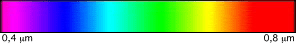

*Spectre visible seul (le reste ne peut être vu…)*

On appelle *spectre* une analyse de la lumière en ses composantes colorées. Pour l’obtenir, il faut disperser les couleurs, ce qui se fait en faisant passer le faisceau lumineux dans un prisme de verre. Nous verrons plus loin un autre procédé plus performant.

L’astronomie a utilisé l’œil nu pour tout instrument pendant des millénaires. Aussi, seuls les rayonnements visibles servaient à décrire l’univers. Les ondes radio ont été utilisées dès qu’on a su les détecter, ce qui s’est produit après la première guerre mondiale. La situation a radicalement changé depuis peu, lorsque les moyens spatiaux ont permis de détecter les ondes qui ne traversent pas l’atmosphère. L’astronomie infra-rouge, ultra-violette, gamma est donc toute récente, et ne se fait que dans l’espace.

### Les autres rayonnements

Si tous les rayonnements cités au début sont semblables, pourquoi leurs effets sont-ils si différents&#8239;? Parce qu’ils ne transportent pas la même énergie.

Ils se classent de la manière suivante&#8239;:

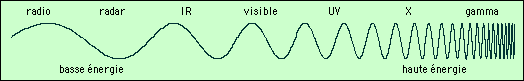

Plus les ondes sont serrées (haute fréquence = courte longueur d’onde) plus elles transportent d’énergie.

Vous voyez sur le schéma que les rayons gamma sont beaucoup plus énergétiques que les ondes radio par exemple. Le tableau suivant montre les fréquences et longueur d’onde des divers rayonnements&#8239;:

<table>
<tbody>
<tr><td rowspan="2"><strong>rayons gamma</strong></td><td>λ &lt; 5 10-12 m</td></tr>
<tr><td>ν &gt; 6 1019 Hz</td></tr>
<tr><td rowspan="2"><strong>rayons X</strong></td><td>λ de 5 10-12 m à 5 10-9 m</td></tr>
<tr><td>ν de 6 1019 Hz à 6 1016 Hz</td></tr>
<tr><td rowspan="2"><strong>ultra-violet</strong></td><td>λ de 5 10-9 m à 8 10-7 m (<em>= 0,8 µm</em>)</td></tr>
<tr><td>ν de 6 1016 Hz à 7,5 1014 Hz</td></tr>
<tr><td rowspan="2"><strong>visible</strong></td><td>λ de 4 10-7 m <em>= 0,4 µm</em> à 8 10-7 m <em>= 0,8 µm</em></td></tr>
<tr><td>ν de 7,5 1014 Hz à 3,75 1014 Hz</td></tr>
<tr><td rowspan="2"><strong>infra-rouge</strong></td><td>λ de 8 10-7 m <em>= 0,8 µm</em> à 10-3 m</td></tr>
<tr><td>ν de 3,75 1014 Hz à 3 1011 Hz</td></tr>
<tr><td rowspan="2"><strong>micro-ondes</strong></td><td>λ de 10-3 m à 1 m</td></tr>
<tr><td>ν de 3 1011 Hz à 3 108 Hz</td></tr>
<tr><td rowspan="2"><strong>ondes radio</strong></td><td>λ de 1 m à 105 m</td></tr>
<tr><td>ν de 3 108 Hz à 3.000 Hz</td></tr>
<tr><td rowspan="2"><strong>ondes longues</strong></td><td>λ &gt; 105 m</td></tr>
<tr><td>ν &lt; 3.000 Hz</td></tr>
</tbody>
</table>

Légende Les différentes gammes d’ondes notées dans ce tableau n’ont pas d’existence réelle. Il y a continuité parfaite dans tout le spectre électromagnétique, et les limites sont partiellement arbitraires. Partiellement seulement, car elles correspondent à des énergies différentes, et donc des sources de production et des systèmes de réception differents aussi. On ne capte pas des ondes radar avec des intruments optiques, mais les webcams captent l’infrarouge proche.

Les ondes radio et radar n’ont pas d’effets biologiques connus (excepté peut-être de cuire les poulets dans les fours à micro-ondes). A l’autre extrémité du spectre, les rayons gamma sont très dangereux. Cela est dû au fait qu’ils apportent beaucoup d’énergie, et détruisent les molécules biologiques.

La plus grande partie de ce que nous savons aujourd’hui sur l’Univers nous est apportée par les rayonnements électromagnétiques. Il faut en connaître parfaitement les propriétés, savoir dans quelles circonstances ils sont émis par les astres, et le lien qui existe entre les circonstances d’émission et leurs propriétés. En déterminant les propriétés des rayonnements que l’on capte, on arrive à remonter aux circonstances de l’émission, et donc à connaître l’objet responsable.

L’Astronomie est une formidable école de patience, et nécessite beaucoup de connaissances en physique et d’astuce pour obtenir des résultats.

L’atmosphère de la Terre est transparente pour la lumière visible, et certaines ondes radio&#8239;; elle est opaque pour tous les autres rayonnements, d’où l’intérêt pour les observations spatiales.

On subdivise l’infrarouge, pour des raisons pratiques, en trois parties&#8239;: proche, moyen et lointain. Le proche infrarouge va de 0,8 à 2,5 µm, l’infrarouge moyen va de 2,5 à 25 µm, et l’infrarouge lointain s’étend de 25 à 1.000 µm (= 1 mm).

Les explications à propos de la lumière nécessitent la connaissance élémentaire des ondes. Nous continuerons donc par là. Si vous possédez déjà ces notions, vous pouvez aller directement au paragraphe sur la [nature de la lumière](#Naturlumiè).

## Les ondes

### Caractérisation

Les rayonnements électromagnétiques sont des ondes. Une onde est une variation périodique d’un phénomène physique, comme les ronds que l’on produit à la surface de l’eau en jetant une pierre.

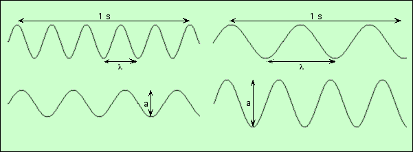

*Schéma de 4 ondes*

Une onde est caractérisée par&#8239;:

- sa *longueur d’onde*, qui est la distance entre deux maxima ou minima successifs. On la note en général λ (lambda). Elle se mesure en mètres, (très souvent dans une subdivision, millimètre, micromètre, nanomètre). L’onde de droite a une longueur d’onde double de celle de gauche.
- sa *fréquence* est le nombre d’oscillations qui se produisent en une seconde, elle se mesure en *hertz* (abbréviation Hz, 1 Hz = 1 oscillation par seconde) et se note le plus souvent ν (nu). Les flèches placées au-dessus des courbes montrant une durée d’une seconde, l’onde de gauche a une fréquence de 5 Hz, celle de droite de 2,5 Hz. Plus la fréquence est grande, plus les ondes sont serrées.
- son *amplitude* est la hauteur de l’onde. L’amplitude de l’onde en bas à droite est double de celle de gauche.

Les ondes sont partout dans la nature&#8239;: à la surface de l’eau, dans les sons (les fréquences audibles sont comprises entre 20 et 20.000 hertz), dans la lumière (les longueurs d’onde du visible sont comprises entre 0,4 et 0,8 µm, et leurs fréquences de 4 1014 à 8 1014 hertz)… Ces diverses ondes sont produites par des phénomènes physiques différents.

Lorsque la longueur d’onde double, le nombre d’oscillations par seconde diminue de moitié. Ces deux grandeurs sont donc liées. Pour les ondes électromagnétiques, on a relation très simple entre la longueur d’onde et la fréquence&#8239;:

<Encadre type="plus">
λ ν = c
</Encadre>

où c est la vitesse de la lumière.

Une dernière grandeur est nécessaire pour caractériser totalement une onde&#8239;: la *phase*. L’examen des trois courbes ci-dessous montre une même onde (même fréquence et même amplitude), mais décalée d’un dessin à l’autre&#8239;:

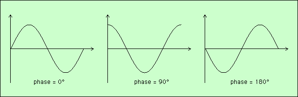

La phase est le décalage. On la note le plus souvent φ (phi). Elle s’exprime en degrés ou en radians. Le premier dessin est réalisé avec une phase nulle, le second avec φ = 90°, et le dernier avec φ = 180°. Remarquez que le premier et le dernier dessin sont symétriques par rappport à l’axe horizontal&#8239;: là où le premier est maximum positif, le dernier est maximum négatif. Pour exprimer celà, on dit qu’ils sont en *opposition de phase*.

L’opposition de phase a une importance capitale en physique. Si on ajoute deux ondes identiques mais en opposition de phase, le résultat est une absence d’onde&#8239;! En effet, en chaque point, la valeur de l’une est exactement l’opposée de celle de l’autre, et donc elles s’annulent…

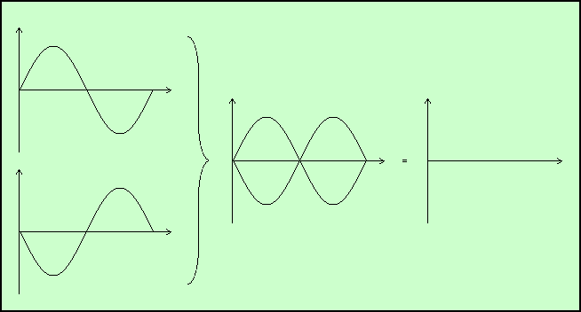

Sur le schéma ci-dessus, vous voyez à gauche deux ondes de même fréquence, et en opposition de phase. Si on ajoute ces ondes, on obtient le schéma au centre, où les deux courbes sont représentées. Vous voyez qu’en chaque point sur l’axe horizontal, les valeurs correspondantes sur les deux courbes sont égales et opposées. Leur somme est donc nulle, ce qui se voit sur le graphique de droite.

Si on applique cela à du son, un bruit et son opposé donnent… du silence&#8239;! Ceci s’explique très facilement, si on se rappelle que le son est une onde de compression qui agit sur le tympan&#8239;: une surpression le pousse, une dépression le tire. Il communique cette information au cerveau. Il est alors évident que si deux ondes arrivent en même temps, l’une poussant et l’autre tirant, à même intensité, le résultat est nul. Silence !…

Ce principe a été effectivement envisagé pour insonoriser une pièce&#8239;: un micro capte le bruit extérieur, un amplificateur le restitue en opposition de phase et l’injecte dans des haut-parleurs. Vous entendez simultanément le son extérieur et sa copie en opposition de phase, c’est-à-dire rien. La lumière étant aussi une onde, ce phénomène se produit également.

Ce principe est à la base de l’interférométrie, qui permet de construire des télescopes dont la puissance dépasse largement celle qu’on peut escompter par les méthodes élémentaires.

Si les deux ondes, au lieu d’être rigoureusement en opposition de phase, sont décalées d’une phase différente de 180°, il y aura aussi addition des valeurs des deux ondes, mais le résultat sera très différent.

<SimulateurInterferences />

#### Explications

Cette animation a pour but d’expliquer les interférences. Elle présente deux sinusoïdes *A* et *B* à gauche, et leur somme *R* à droite. Tout point de la courbe *R* est la somme des points correspondants de *A* et *B*.

La courbe *A* représente la fonction y = sin(x), c’est une sinusoïde pure.

Trois curseurs permettent de régler les paramètres de la courbe *B*. La phase φ décale la courbe vers la droite, jusqu’à revenir à la situation intiale (φ = 360°). La fonction représentée est donc y = sin(φ + x).

L’amplitude *a* détermine la hauteur de la courbe, donc l’intensité de son influence sur le résultat. Elle modifie donc la courbe, qui devient y = *a* sin(φ + x).

Enfin, la fréquence fixe le nombre d’oscillations de la courbe, et donc la comprime (augmentation) ou dilate (diminution). Plus la fréquence est élevée, plus vite varie la fonction.

Au lancement, la courbe *B* est nulle. Le résultat *R* est égal à *A*. Augmentez progressivement l’amplitude. La courbe *B* est une sinusoïde semblable à *A*, dont l’amplitude croît. Observez comment l’amplitude de la courbe *R* augmente, jusqu’à en atteindre le double.

Laissez l’amplitude au maximum, et jouez sur la phase. La courbe *R* évolue. Lorsque la phase atteint 180°, elle disparaît&#8239;! La courbe *B* est alors l’opposé de *A* (leurs valeurs en chaque point sont égales et de signe contraire). Leur somme est nulle. Si elles représentent deux ondes lumineuses, leur somme est de l’obscurité… C’est ce qui explique l’expérience des fentes de Young.

Remettez la phase à 0. On va jouer maintenant sur la fréquence. En l’augmentant, la courbe *B* oscille de plus en plus rapidement, et *R* devient plus complexe. Vous pouvez remarquer une forme particulière de *R*&#8239;: pour une fréquence de 3 exactement, la moitié à gauche est entièrement sous l’axe horizontal, et l’autre entièrement au-dessus. Baissez alors l’amplitude. Les creux et bosses de *R* se rapprochent. Lorsque l’amplitude vaut 0,33 (1/3 de celle de *A*), la courbe *R* ressemble, de loin, à un créneau.

Si on voulait obtenir un créneau quasiment parfait, il faudrait ajouter une sinusoïde de fréquence 5 et d’amplitude 1/5, puis une de fréquence 7 et d’amplitude 1/7… Ceci est un exemple, la théorie de Fourrier montre que l’on peut, en additionnant des sinusoïdes de fréquence et d’amplitude bien choisies, représenter toute fonction périodique donnée.

C’est ainsi que l’on a bâti la théorie des planètes&#8239;: la position à l’instant *t* est la somme d’un nombre assez important de sinusoïdes dont l’amplitude et la fréquence sont bien déterminées.

La radiotéléphonie (radio) utilise des ondes électromagnétiques comme support. Il faut des fréquences assez élevées pour assurer une bonne transmission. Or les fréquences de la voix sont beaucoup trop faibles. On utilise alors l’onde électromagnétique comme *porteuse*, et on la module pour lui faire transporter le signal. La modulation se fait sur l’un des paramètres de l’onde. On distingue donc *modulation d’amplitude*, *modulation de fréquence* et *modulation de phase*. La modulation d’amplitude a été, et reste, utilisée pour les communications en ondes longues, moyennes et courtes&#8239;; elle est assez sensible aux perturbations. La modulation de fréquence est principalement utilisée aujourd’hui pour la radio&#8239;; elle est bien plus résistante aux parasites, et donne un grand confort d’écoute. La modulation de phase est peu usitée, mais elle est de nature très semblable à la modulation de fréquence. Tous ces systèmes sont analogiques&#8239;; aujourd’hui, on les remplace par une transmission numérique (DAB). La porteuse est modulée en tout ou rien, pour transmettre des informations binaires. À l’arrivée, ces informations numériques reconstituent le signal sonore.

### Nature de la lumière

C’est l’un des grands problèmes de la physique. Historiquement, les Grecs de l’Antiquité pensaient que la lumière était formée de particules trop petites pour être distinguables, qui étaient émises par les yeux et nous renseignaient sur les objets qu’elles touchaient. C’est une conception *corpusculaire*.

Après avoir créé l’interprétation géométrique de la lumière (Descartes), les physiciens du XVIIIe siècle ont cherché à comprendre l’arc-en-ciel, la dispersion des couleurs par le prisme… Sur un plan plus pratique, ils s’inquiétaient des aberrations dans les instruments d’optique. Tout ceci les a amenés à étudier la lumière dans des conditions très particulières, par exemple dans l’expérience des fentes de Young.

L’explication de cette expérience passe nécessairement par un aspect *ondulatoire* de la lumière&#8239;: la lumière est une onde qui interfère. Du coup, la conception corpusculaire a été rejetée. A la fin du XIXe siècle, les jeux étaient faits, mais l’Histoire n’était pas finie.

L’effet photoélectrique, découvert à cette époque-là, permet le passage d’un courant électrique entre deux électrodes distantes, lorsqu’elles sont éclairées par une lumière bleue, et rien si on les éclaire en rouge. **Ce seuil est inexplicable dans le cadre ondulatoire**, et a obligé les physiciens à reconsidérer la lumière comme corpusculaire.

La lumière est donc assez complexe pour nous présenter, selon notre façon de l’observer, deux aspects qui *a priori* sont contradictoires. La Mécanique Quantique a unifié ces deux aspects.

### Les interférences

La première observation de ce phénomène a été faite par Young, avec l’expérience des *fentes de Young*. Une source lumineuse assez puissante éclaire un écran percé de deux fentes parallèles. La lumière passe par ces fentes, et va éclairer un second écran derrière le premier. La théorie géométrique de Descartes dit que l’on devrait voir une image de chaque fente, dans l’alignement de la source. Au lieu de cela, on observe une série de raies sombres et brillantes&#8239;:

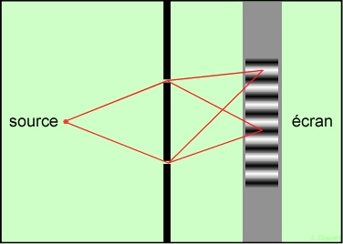

La théorie géométrique est donc prise en défaut. Pour expliquer un tel comportement de la lumière, il faut considérer qu’elle est une onde.

### Explication des fentes de Young

Au lieu d’envoyer des rayons rectilignes, la source émet un système d’ondes concentriques. Ces ondes vont frapper l’écran percé, et le traverser par les deux fentes. Mais puisqu’il n’y a pas de direction privilégiée à l’entrée des fentes, il n’y en aura pas non plus à la sortie. Alors, chaque fente va se comporter comme une nouvelle source, et émettre son propre système d’ondes. Ces ondes ont les mêmes propriétés que celles émises par la source, donc même fréquence et même amplitude. Mais la traversée des fentes va modifier la phase.

Imaginez que deux ondes quittent les fentes avec la même phase (par exemple elles sont toutes les deux à leur maximum, on observe une crête). Si elles parcourent jusqu’à l’écran une distance multiple exact de la longueur d’onde, elles arriveront avec la même phase (par exemple le maximum, une crête). Mais si l’une fait un trajet un peu plus long, alors, elle sera en retard par rapport à la première, et n’arrivera pas au maximum. Si l’écart est exactement d’une demi-longueur d’onde, elle arrivera au minimum, dans un creux. Alors, la lumière éclairant l’écran en ce point sera la somme Max + Min, ou crête + creux, qui est nulle, puisque le Min a la même valeur que le Max, mais négative. Donc en ce point on aura l’obscurité&#8239;:

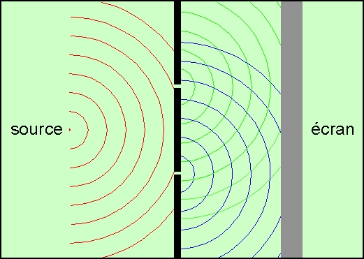

Aux endroits où les ondes arrivent en phase, elle s’additionnent et donnent un maximum de lumière (Max + Max). Aux endroits où elles arrivent en opposition de phase, l’interférence est destructrice, et on obtient l’obscurité totale. Ceci explique donc parfaitement l’aspect observé. On peut également calculer la distance des franges brillantes, et on constate que le calcul est vérifié par l’observation.

Vous pouvez par exemple imaginer que les cercles dessinés sur le schéma représentent les crêtes des ondes. Alors, les points de l’écran où se croisent deux cercles sont ceux où les deux ondes arrivent en une crête. Elles donnent donc une amplitude maximum. Ce sont les points où l’on observera l’éclat maximum.

L’expérience des fentes de Young est donc parfaitement expliquée par la théorie ondulatoire de la lumière, qui trouve ainsi son explication… provisoire&#8239;!

<Encadre type="plus">
La lumière est donc de nature ondulatoire
</Encadre>

## Propriétés corpusculaires

### L’effet photoélectrique

C’est lui qui a provoqué la grande surprise à la fin du XIXe siècle.

On place dans une cellule de verre sous vide, une plaque et une tige métalliques qui ne se touchent pas. La plaque est connectée au pôle négatif d’une pile, la tige au pôle positif (on crée donc une différence de potentiel entre les deux électrodes, et par suite un champ électrique entre elles). Un ampèremètre est placé en série dans le circuit. En l’absence d’éclairage, aucun courant ne passe puisque le circuit est ouvert. Lorsqu’on éclaire la plaque avec une lumière rouge, si intense soit-elle, il ne se passe rien. Si on éclaire avec une lumière bleue, un courant passe. On vérifie de plus que ce courant est proportionnel à l’intensité de la lumière.

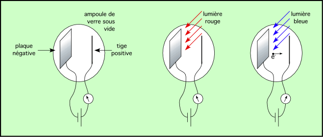

On ne sait pas expliquer cet effet avec une onde, la présence de ce seuil n’est pas justifiée&#8239;: l’énergie d’une onde est proportionnelle à son intensité&#8239;!

Considérons que la lumière est de nature corpusculaire, faite de petites particules qui possèdent chacune une petite énergie, proportionnelle à leur couleur (leur fréquence)&#8239;:

<Encadre type="plus">
E = h ν loi de Planck
</Encadre>

Alors l’explication devient naturelle&#8239;: à basse fréquence (rouge, ν petite), l’énergie de chaque particule est trop petite pour arracher un électron à la plaque. Si nombreuses soient-elles, aucune ne peut y parvenir. Par contre, à fréquence plus élevée (plus bleue, ν plus grande), l’énergie de chaque particule dépasse le minimum nécessaire pour arracher un électron. Alors, l’électron est libéré de la plaque, attiré par l’électrode positive (la tige) et se dirige vers elle. Le flux d’électrons crée un courant électrique (qui par convention est en sens inverse du déplacement des électrons&#8239;: le courant va du plus vers le moins, alors qu’il est produit par un flux d’électrons du moins vers le plus). Si on augmente l’intensité de cette onde, il y a plus de particules, et donc plus d’électrons arrachés. L’intensité du courant augmente proportionnellement.

C’est Albert Einstein qui a expliqué ainsi l’effet photoélectrique, et proposé de nommer *photon* ce petit grain de lumière.

<Encadre type="plus">
La lumière est donc de nature corpusculaire
</Encadre>

Malheureusement, ces deux caractéristiques différentes de la lumière semblent contradictoires.

### Le rayonnement de corps noir

Lorsqu’on regarde un objet -en physique on dit un corps-, on lui attribue une couleur. Celle-ci est déterminée par les ondes lumineuses qui l’éclairent, et qui sont réfléchies par le corps. Par exemple, une boule rouge présente cette couleur parce qu’elle réfléchit les rayons rouges, et absorbe les autres. Lorsqu’on la regarde, on ne perçoit que les seuls rayons qu’elle renvoie, rouges. Si la boule est bleue, elle réfléchit le bleu, et absorbe le reste. Certains corps sont neutres. La neige par exemple est blanche parce qu’elle réfléchit pareillement toutes les couleurs. Lorsqu’on la regarde, on voit donc toutes les couleurs de l’arc-en-ciel, dont le mélange est blanc. Les nuages sont gris, parce qu’ils réfléchissent pareillement aussi toutes les couleurs, mais ils en absorbent une partie, la même pour toutes. C’est pourquoi ils apparaissent moins lumineux, gris.

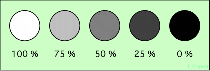

Le schéma ci-dessus montre des disques gris, plus ou moins brillants. Celui de gauche renvoie 100 % de la lumière qu’il reçoit, il apparaît blanc. Les suivants sont de moins en moins réfléchissants, et paraissent donc de plus en plus sombres. Celui de droite est noté 0 % réfléchissant. Mais ce n’est pas le cas vraiment… En fait, il réfléchit très peu de lumière. On peut maintenant définir le corps noir, qui est une notion théorique.

<Encadre type="plus">
Un *corps noir* est **un corps en équilibre thermique**
</Encadre>

Cet équilibre a deux aspects, selon les particules considérées&#8239;: l’équilibre thermique des atomes qui constituent le corps, et celui des photons. Pour les atomes, ce sont les chocs entre eux qui uniformisent leurs vitesses (agitation thermique). On conçoit assez facilement que ces chocs puissent, à la longue, leur communiquer une vitesse bien répartie autour d’une moyenne. Pour les photons, les choses sont un peu plus subtiles. Ils possèdent aussi une énergie, fonction de leur couleur (de leur fréquence). Imaginez que des photons entrent dans le corps noir considéré (depuis l’extérieur)&#8239;: ils apporteraient de l’énergie, et donc rompraient l’équilibre. Réciproquement, si des photons sortaient, ils emporteraient de l’énergie et rompraient l’équilibre dans l’autre sens. Pas d’échange avec l’extérieur, donc température stable.

Ceci donne l’autre aspect d’un corps noir&#8239;: **c’est un objet matériel qui n’échange aucune énergie avec l’extérieur**. De ce fait, il n’émet rien, donc ne brille absolument pas, c’est ce qui justifie son nom. On devrait même dire qu’il est super noir, parce que les corps réels n’atteignent jamais cette limite.

Alternativement, on peut considérer que le bilan énergétique du corps noir est nul, puisqu’il n’émet ni n’absorbe d’énergie. Mais une autre façon d’obtenir un bilan nul est que l’entrée soit exactement égale à la sortie&#8239;! C’est le cas si le corps est parfaitement absorbant, et aussi parfaitement émissif, indépendamment de la longueur d’onde. C’est pourquoi le spectre d’un corps noir ne dépend que de sa température, et nullement de sa composition.

*Corps noir approché (au mieux, dans les trous bien brillants) photo J. Gispert*

C’est dans les trous de la braise que le corps noir est le mieux approché, parce que la surface par laquelle la braise peut émettre un rayonnement (celui qu’on voit) est la plus petite. Dans les laboratoires de physique, un corps noir est approché par un four très bien isolé, et percé d’un tout petit trou, nécessaire pour l’observation.

Le corps noir n’existe pas en réalité, mais certains objets s’en approchent beaucoup. C’est le cas de&#8239;:

- la photosphère du Soleil serait un très bon corps noir, s’il n’y avait pas des raies sombres, produites par l’atmosphère du Soleil&#8239;; ce cas est celui où tout rayonnement incident est absorbé, et également tout rayonnement est émis&#8239;;
- un morceau de fer chauffé… le confinement est moins bon.

L’équilibre entre les atomes et les photons s’explique par leurs interactions, par divers mécanismes dont les contributions cumulées représentent bien la courbe du corps noir.

Les lois de l’émission de lumière par un corps noir ont été décrites par Stefan et Wien, et sont inexplicables dans le cadre ondulatoire. Elles sont parfaitement compatibles avec l’aspect corpusculaire de la lumière. Nous les traiterons plus loin, bien qu’elles aient leur place ici, parce qu’elles découlent d’un mode de [production de la lumière](#Produrayon), que nous verrons avec les autres.

### La solution

Interprétation **corpusculaire**, pour expliquer l’effet photoélectrique et le rayonnement de corps noir, **ondulatoire**, pour expliquer les interférences, comment concilier l’inconciliable&#8239;?

On doit donc **admettre** que la lumière présente *à la fois* ces deux aspects. Ainsi, le photon est une particule accompagnée d’une onde. On a appellé la théorie qui le décrit *Mécanique Ondulatoire*.

A la suite de ce travail, Louis de Broglie a généralisé cette dualité&#8239;: **toute** particule doit être accompagnée d’une onde, et posséder donc des propriétés à la fois ondulatoires et corpusculaires. Cette idée de génie est à la base de la *Mécanique Quantique* (qui généralise la Mécanique Ondulatoire), qui nous permet aujourd’hui de comprendre les objets compacts, naines blanches, étoiles à neutrons ou autres objets plus exotiques encore&#8239;!

Maintenant que nous connaissons la nature de la lumière, nous pouvons étudier ses propriétés, et ses modes d’émission.

Le photon est donc la particule de lumière, associée à l’onde lumineuse. Le photon possède une énergie, qui est proportionnelle à la fréquence de son onde. Ceci sera très important plus loin.

## Propriétés de la lumière

### Optique géométrique

La lumière se propage en ligne droite, c’est un fait d’observation courante. Il suffit pour s’en aperçevoir d’éclairer le ciel par une nuit humide avec une lampe torche (ou mieux avec un laser). Ou encore, de voir les rayons issus du Soleil former une gloire.

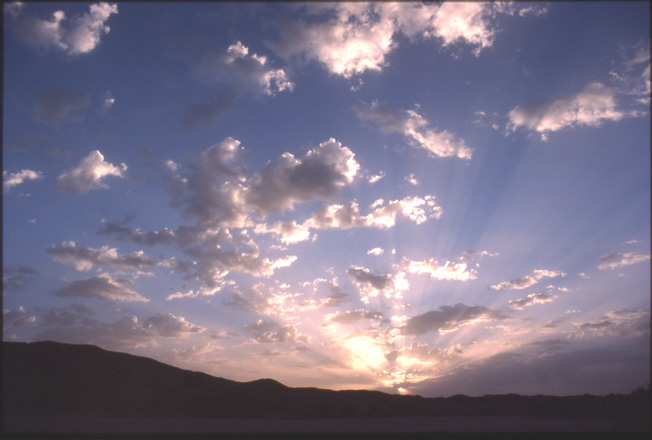

Soleil en gloire, oued Tamenkrist, Tassili du Hoggar photo J. Gispert

Cette simple constatation a donné naissance à une théorie, *l’optique géométrique*. Cette théorie est empirique, puisqu’elle ne se base pas sur une explication des propriétés de la lumière, sinon cette simple constatation qu’elle se propage normalement en ligne droite. Cependant, ses résultats sont impressionants, et les instruments d’optique courants en sont la preuve. Ce qui suit est basé sur cette théorie.

### Réflexion

Mais l’expérience quotidienne nous montre que ce principe de base admet des exceptions. La première est la réflexion. Certaines surfaces, par exemple métalliques, bien polies, renvoient la lumière dans une direction différente. Descartes a été le premier à s’intéresser scientifiquement à ce phénomène, et il en a donné la première loi de Descartes&#8239;:

**le rayon incident et le rayon réfléchi font un même angle par rapport à la normale**

La normale est une droite perpendiculaire, que l’on imagine élevée au point où le rayon incident touche le miroir (la surface réfléchissante). Le schéma ci-dessous l’explique&#8239;:

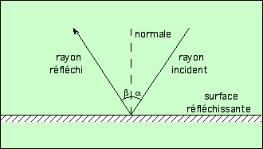

Les angles α et β sont égaux.

Ceci s’explique très bien, si on garde en mémoire que la lumière se propage en ligne droite. Le miroir introduit une perturbation, que la lumière négocie pour continuer le plus droit possible. Le schéma ci-dessous montre que le rayon réfléchi est tout simplement le symétrique du rayon qui continuerait en l’absence du miroir.

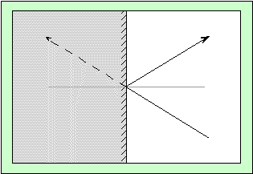

Le rayon incident en bas à droite, et le rayon fictif à gauche font le même angle par rapport à la normale. Et par symétrie, le rayon fictif et le rayon émergeant font le même angle par rapport au miroir&#8239;: c’est son symétrique.

On remarque que dans la réflexion la lumière ne change pas de milieu&#8239;: elle reste dans l’air.

### Principe de Héron d’Alexandrie

Le principe de Héron d’Alexandrie est le premier *principe variationnel*. Il s’applique à la réflexion et dit simplement que la lumière, pour aller d’un point A à un point B, emprunte le plus court chemin. Par rapport à la loi de Descartes ci-dessus, c’est un changement de paradigme&#8239;: au lieu de donner les conditions en A et de chercher *où* va la lumière (donc en déduire le point B), on donne A et B et on cherche par quel chemin va passer la lumière&#8239;:

**Principe de Héron d’Alexandrie** Pour aller de A à B, la lumière emprunte le chemin le plus court

Par conséquent, les angles d’incidence et de réflexion sont égaux. Le principe de Héron d’Alexandrie implique donc la première loi de Descartes.

Dans le cas de la réfraction, le principe de Héron ne s’applique pas, car il suppose la vitesse de la lumière partout égale, ce qui est le cas pour la réflection puisqu’on reste dans l’air. Pierre de Fermat a trouvé un autre principe, nommé naturellement *principe de Fermat*, qui s’applique à la réfraction&#8239;:

**Principe de Fermat** Pour aller de A à B, la lumière emprunte le chemin le plus rapide

Ceci tient compte de la vitesse de la lumière, différente dans les deux milieux.

On remarque immédiatement que le principe de Fermat englobe celui de Héron&#8239;: dans la réflexion, la lumière reste dans l’air, et donc le chemin le plus rapide est aussi le plus court puisque sa vitesse est partout la même. On peut donc utiliser le principe de Fermat dans les deux cas, et constater qu’il contient en fait toute l’optique géométrique&#8239;!

Les lois de Descartes permettent de *calculer* comment la lumière se comporte, mais le principe de Fermat *explique pourquoi*, et permet de les *retrouver*. Il est donc plus informant.

Ceci a amené de nombreux physiciens à définir des principes variationnels dans bien d’autres situations, avec beaucoup de succès.

Mais il s’est avéré que l’optique géométrique a des limites.

### Réfraction

Prenons une bassine pleine d’eau, et plongeons-y une règle. Nous avons l’impression que le bâton est cassé au niveau de la surface de l’eau. C’est parce que l’eau n’a pas les mêmes propriétés optiques que l’air, on dit le même *indice de réfraction*.

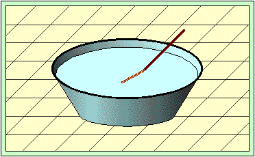

La lumière va toujours en ligne droite, à l’approximation géométrique près, tant que le milieu traversé est à indice de réfraction constant. Mais si la lumière traverse une surface où l’indice change, elle est déviée. Ceci se produit toujours quand il y a variation d’indice, qu’elle soit brutale ou continue. Si la variation d’indice est continue, le rayon est courbe. L’indice de réfraction de l’air est différent de celui de l’eau, et c’est pourquoi la règle semble cassée à l’interface entre l’air et l’eau.

Comme pour la réflexion, la lumière continue le plus droit possible, en s’accomodant de la perturbation imposée par le changement d’indice.

### La diffraction

Plus généralement, dès qu’une onde lumineuse rencontre un obstacle, elle est perturbée par *diffraction*&#8239;: le bord de l’obstacle se comporte un peu comme les fentes de Young, et produit une nouvelle source lumineuse. Toutes ces sources vont interférer, donc perturber l’onde, et sont la cause des limitations de l’optique.

Diffraction sur des feuilles photo J.Gispert

Sur cette photo, le soleil est caché par la grosse branche du platane. Les feuilles sont donc éclairées par derrière, et montrent la diffraction tout autour, qui leur fait une auréole de lumière. Cette lumière devrait continuer sa route en ligne droite et échapper à la prise de vue, mais le bord de la feuille la diffracte vers l’objectif. C’est un phénomène ondulatoire.

### Vitesse de la lumière

La lumière, et plus généralement tous les rayonnements électromagnétiques, se déplace à vitesse finie. Nous avons l’impression, quand on allume une pièce, que tout s’éclaire instantanément. C’est faux, mais c’est des milliers de fois trop rapide pour que nous voyions le déplacement des rayons. A cause de cette extrême rapidité, on a longtemps pensé que la propagation de la lumière était instantanée.

Mais certains savants ont pressenti au cours des siècles que la lumière pourrait se déplacer à une vitesse finie. Il a fallu attendre 1675 pour que Römer en donne une mesure&#8239;: la théorie des satellites de Jupiter était faite, grâce à la Gravitation Universelle. Il était possible de prévoir avec précision les éclipses des satellites galiléens. Or les instants calculés étaient en avance ou en retard sur les observations. De plus, le décalage était cyclique, avec une période d’un an&#8239;! (d’une année synodique de Jupiter plus exactement, celle-ci dépendant de l’année terrestre). Ceci prouvait que les écarts étaient liés au mouvement de la Terre sur son orbite, et Römer en a donné l’explication (attention, sur le schéma les orbites ne sont pas à l’échelle)&#8239;:

<Encadre type="plus">
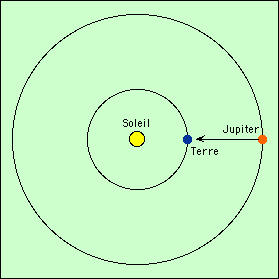

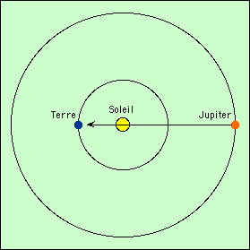

La Terre et Jupiter (en opposition) sont séparées de 780 - 150 = 630 millions de km

6 mois plus tard (conjonction), elles sont séparées de 780 + 150 = 930 millions de km.
</Encadre>

Lorsque Jupiter est en [opposition](https://astronomia.fr/2eme_partie/systSol.php#oppConj), la distance Terre-Jupiter est de 630 millions de km. La lumière provenant d’une éclipse met 35 minutes pour parvenir à la Terre (35 minutes → 2.100 secondes à 300.000 km par seconde → 630 millions de km). On voit l’éclipse 35 minutes après qu’elle se soit effectivement produite.

Six mois plus tard (Jupiter est en [conjonction](https://astronomia.fr/2eme_partie/systSol.php#oppConj)) la distance est de 930 millions de km. La lumière provenant d’une autre éclipse met 52 minutes pour parvenir à la Terre. Cette seconde éclipse sera vue de la Terre 52 minutes après qu’elle se soit produite. Donc, selon la position relative de la Terre et de Jupiter, on verra l’écart de temps entre deux éclipses augmenté de 52 - 35 = 17 minutes, ou diminé d’autant. Une théorie des éclipses des satellites de Jupiter ne tiendra pas compte de cette différence, et les instants observés seront donc en avance ou en retard d’un bon quart d’heure sur les instants calculés.

Cet écart de temps correspond à la différence de distance parcourue par la lumière, donc à 300 millions de km (deux fois la distance Terre-Soleil). Si la lumière met 17 minutes (1.020 secondes) pour parcourir 300.000.000 km, c’est qu’elle effectue 300.000.000 / 1.020 = 294.000 km s-1.

Avec les données dont il disposait, Römer a déduit une vitesse de 225.000 km s-1 (il utilisait une valeur fausse de la distance Terre-Soleil&#8239;; avec la valeur exacte, son calcul aurait donné 298.000 km s-1). La valeur admise maintenant est de presque 300.000 km s-1, exactement&#8239;:

299.792,458 km s-1

Il faut bien comprendre que c’est la vitesse de la lumière DANS LE VIDE. Dans tout milieu matériel transparent, la lumière se propage à une vitesse moindre. Et c’est cette différence de vitesse qui explique la réfraction.

La lumière blanche résulte d’un mélange de toutes les couleurs. Un arc-en-ciel, un vase en cristal taillé frappé par un rayon de soleil, séparent les couleurs et les rendent visibles. Lorsqu’on a séparé les couleurs, on dit qu’on a réalisé un *spectre*. Le spectre d’une lumière montre donc de quelles couleurs elle est composée. Là s’arrête l’expérience quotidienne.

Si on analyse la lumière d’une ampoule à incandescence à l’aide d’un prisme assez dispersif, ou d’un réseau de diffraction, on y découvre les couleurs de l’arc-en-ciel, passant graduellement de l’une à l’autre, sans rupture. Ces couleurs constituent un *spectre*. Le changement de couleur étant continu, on dit qu’on observe un **spectre continu**.

Réseau de diffraction

Un réseau de diffraction est une alternative au prisme. Il consiste en une plaque de verre rayée de nombreux traits parallèles. Les pentes des rayures captent la lumière, et de l’une à l’autre produisent des interférences. Ceci permet de décomposer la lumière.  Un réseau donne de meilleurs résultats qu’un prisme, parce que la distance entre deux raies d’absorption est proportionnelle à la différence de longueur d’onde entre ces deux raies. Ceci permet, en mesurant l’écart entre deux raies, de déduire leur différence de longueur d’onde. Ce n’est pas le cas avec un prisme.  On fait des copies en plastique d’un réseau en verre, bien plus économiques, et donnant de bons résultats.

Maintenant, captons sur le prisme la lumière du Soleil, passant par un petit trou dans les volets fermés. Faisons tomber le spectre sur une feuille de papier blanc. Nous y voyons le spectre continu, assez semblable à celui de l’ampoule (à incandescence). Mais avec un peu d’attention, on arrive à distinguer des raies sombres, qui coupent le spectre continu. Ces raies semblent réparties au hasard, mais les scientifiques n’admettent le hasard que s’ils y sont obligés. Dans le cas des raies sombres du spectre, on constate que leur position ne varie jamais. Ce n’est donc pas le hasard qui les produit&#8239;! On a donc cherché à comprendre d’où venaient ces raies.

Dès 1814, Fraunhofer avait observé de telles raies d’absorption dans le spectre du Soleil, sans savoir ce qui les produisait. Ils les a désignées par des lettres, qu’on utilise encore, par exemple les raies H et K du calcium ionisé. Ces raies correspondent à des éléments chimiques du Soleil, mais relativement froids. Pour cela, ils doivent être loin du Soleil, c’est-à-dire dans son atmosphère.

On peut encore changer de source lumineuse, et observer le spectre de la lumière émise par une petite ampoule témoin, qu’on utilise dans certains interrupteurs. Ces ampoules sont de petits tubes à décharge au néon, et leur lumière est jaune-orangée. Le spectre nous réserve des surprises&#8239;: il n’y a pas de spectre continu, mais seulement quelques raies brillantes (les plus brillantes étant dans la partie jaune-orangé, ce qui explique la couleur globale de la lumière émise).

Quels mécanismes produisent le spectre continu, et les raies sombres ou brillantes&#8239;? Pour le savoir, il a fallu comprendre la nature de la lumière et la structure de l’atome.

Rappelons-nous que la lumière est à la fois ondulatoire (c’est une onde électromagnétique) et corpusculaire (elle est constituée de photons). Nous avons vu un [schéma](#Rayonélect) qui montre que la couleur de la lumière provient de sa longueur d’onde. On peut le dire différemment, si on considère le photon associé à l’onde&#8239;: la couleur provient de l’énergie de ce photon. Un photon de faible énergie correspondra à une onde radio, un photon de très haute énergie est un photon gamma (c’est pour cela que les rayons gammas sont très dangereux pour la vie, car avec leur énergie, ils détruisent les molécules biologiques). Dans le domaine visible, les photons rouges sont moins énergétiques que les photons bleus.

La constance de la vitesse de la lumière dans le vide est surprenante, car la Mécanique Classique admettait l’addition des vitesses, qui est contradictoire avec cette observation. Si un avion éclaire ses phares, la lumière émise devrait se déplacer à la vitesse de l’avion PLUS la vitesse de la lumière. Ce n’est pas le cas, elle va à la même vitesse que si elle était émise par une source au repos. Ceci est à la base de la théorie de la Relativité Restreinte, et par suite de la Relativité Générale.

A cette vitesse, la lumière met 1,3 secondes pour aller de la Terre à la Lune, 8 minutes pour aller du Soleil à la Terre, 6 heures pour aller du Soleil à Pluton…

## Production des rayonnements

L’émission de rayonnements électromagnétiques peut se faire par divers mécanismes. Selon leur nature, on distingue&#8239;:

- le rayonnement thermique&#8239;;
- les luminescences&#8239;;
- le rayonnement synchrotron&#8239;;
- le rayonnement de freinage (bremsstrahlung, free-free).

Ces rayonnements possèdent des propriétés différentes, donc des spectres d’aspect différent, dont l’analyse permettra de déterminer les conditions physiques et les mécanismes qui ont présidé à l’émission. Ils seront donc la source essentielle des renseignements obtenus sur les objets observés.

### Le rayonnement thermique

Le rayonnement thermique est produit par tout corps chauffé. Il n’est pas nécessaire de chauffer **fortement** pour produire un rayonnement, mais il le faut pour le rendre visible. En effet, comme nous l’avons déjà signalé plus haut à propos du morceau de fer, la couleur du rayonnement émis varie selon la température. Le filament d’une ampoule à incadescence est porté à 2.000 ℃&#8239;; il rayonne une lumière blanche. Lorsque le morceau de fer refroidit, la couleur émise va du bleu vers le rouge puis, lorsque nous ne voyons plus rien, vers l’infrarouge. Mais il continue d’émettre tant que sa température dépasse le zéro absolu (-273 ℃). Autant dire qu’il émet toujours…

Certaines pellicules photographiques, ou capteurs CCD, sont sensibles à l’infrarouge, et permettent de photographier la nuit. Le paysage apparaît assez sombre&#8239;; les êtres vivants, par leur rayonnement propre, sont plus clairs (sauf peut-être les reptiles…).

Ces rayonnements thermiques ont posé un très gros problème à la physique de la fin du XIXe siècle&#8239;: la Mécanique Classique, qui expliquait si bien les phénomènes connus alors, ne parvenait pas à représenter la répartition de ces rayonnements. L’étude de cette répartition, et l’effet photoélectrique, sont à la base d’une grande révolution&#8239;: la naissance de la Mécanique Quantique. Un changement très profond de point de vue a permis d’expliquer parfaitement les émissions thermiques, connues sous le nom de *rayonnement du corps noir*.

L’énergie totale rayonnée par un corps noir, par unité de temps et de surface, est fonction de sa température&#8239;; elle est donnée par la loi&#8239;:

<Encadre type="plus">
E = σ T4 loi de Stefan-Boltzman
</Encadre>

où σ = 5,670374 × 10−8 W m−2 K−4 est la constante de Stefan-Boltzmann.

A une température double, l’énergie rayonnée est donc 24 = 16 fois plus grande. Ceci nous montre que les étoiles chaudes perdent beaucoup plus d’énergie que les autres.

Dans la vie courante, on sait bien qu’un café brûlant refroidit rapidement. Mais un café tiède ne devient froid qu’au bout d’un temps bien plus long.  Lorsque le café est très chaud, sa température T est élevée, et l’énergie rayonnée grande. Il se refroidit en perdant cette énergie, en peu de temps.  Losqu’il est tiède, T est plus basse, donc l’énergie rayonnée plus faible, et le refroidissement plus lent&#8239;!.

Un corps réel quelconque peut être comparé au corps noir à la même température&#8239;: ses propriétés sont proportionnelles. L’étude du corps noir, idéal, est donc très utile. Elle débute par le tracé de la courbe donnant l’intensité lumineuse en fonction de la longueur d’onde (donc de la couleur), qui est présentée ci-dessous.

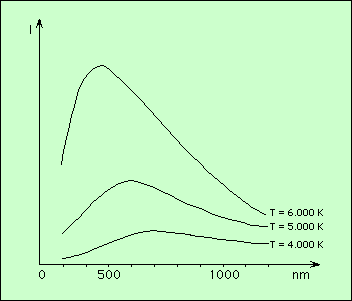

Considérons la courbe du haut. On remarque immédiatement qu’elle est fort loin d’être constante, et présente un maximum très marqué vers 500 nm (c’est dans le vert). Elle correspond à une température de 6.000 K (proche de la température du Soleil). Elle nous indique qu’un corps noir à 6.000 K émet de la lumière à toutes les longueurs d’onde (de toutes les couleurs), mais beaucoup plus dans le vert que dans le rouge.

La seconde courbe correspond à une température de 5.000 K, et son maximum se trouve vers 600 nm. La dernière enfin a son maximum vers 700 nm pour T = 4.000 K.

La longueur d’onde du maximum λm est donnée **en micromètres** par (T en Kelvins)&#8239;:

<Encadre type="plus">
λm = 2.898 / T loi de Wien
</Encadre>

On en déduit tout de suite que la comparaison de ces courbes théoriques avec le spectre réel d’une étoile permet de déterminer la température de surface (de la photosphère) de cette étoile, à la condition qu’on puisse l’assimiler à un corps noir, ce qui est faisable en première approximation. C’est une des méthodes permettant de déterminer la température du Soleil.

### Pourquoi un corps chauffé rayonne-t-il&#8239;?

C’est Max Planck qui a trouvé l’explication. La température d’un corps mesure l’agitation des particules qui le composent. Ces particules sont des atomes, ionisés ou non, comprenant des protons (de charge électrique positive) dans leurs noyaux, et des électrons liés aux noyaux ou libres. Toutes ces particules chargées, en se déplaçant, s’entrechoquent et émettent des photons. L’énergie du photon émis correspond exactement à celle perdue par la particule, en diminuant sa vitesse.

Dans un gaz à la température T, toutes les particules ne vont pas à la même vitesse. La température correspond à une vitesse moyenne des particules, mais chacune prise à part peut s’éloigner beaucoup de cette moyenne. Certaines vont beaucoup plus vite, d’autres beaucoup plus lentement. En se heurtant, leur vitesse change, et elles émettent éventuellement un photon. Ce mécanisme détermine une vitesse moyenne&#8239;; il est nommé *thermalisation*.

On conçoit donc qu’on puisse trouver, dans le rayonnement, des photons de toutes les longueurs d’onde, mais avec un maximum correspondant à la vitesse moyenne, qui est celle du plus grand nombre de particules. Ainsi, l’origine physique du phénomène est comprise, et le fond continu de rayonnement des étoiles avec.

Nous allons maintenant passer à un tout autre mécanisme, qui donne un spectre *discret* (en mathématiques, et par extension en physique, discret signifie non continu&#8239;; les entiers constituent un ensemble discret, car entre 1 et 2 il n’y en a aucun&#8239;; les nombres réels par contre sont continus&#8239;: entre x et y il y a toujours leur moyenne, qui est aussi un nombre réel).

### Lois de Kirchhoff

Gustav Kirchhoff a étudié les émissions de lumière, et en a déduit des lois&#8239;:

- **Tout corps chaud émet un rayonnement continu**, qui contient toutes les couleurs (spectre continu&#8239;: on passe continûment d’une couleur à une autre)&#8239;;
- **Ce rayonnement est le même quelle que soit la substance chauffée**&#8239;;
- Le spectre de la lumière émise par un gaz, **sous faible pression** (qui empêche la thermalisation), n’est pas continu, mais **présente seulement quelques raies brillantes**, sur un fond sombre (sans lumière). Donc, un gaz dans ces conditions n’émet que quelques radiations bien précises. L’important est que ces couleurs changent d’un gaz à un autre&#8239;: **elles le caractérisent**. Le spectre est comme les empreintes digitales&#8239;: une signature du gaz. On les appelle *raies d’émission*.
- Enfin, si la lumière émise par un corps chaud (contenant toutes les couleurs) traverse un gaz froid, **elle en ressort privée de certaines couleurs**, qui laissent donc des raies noires dans le spectre. Ces couleurs disparues sont exactement celles que ce gaz émettrait s’il était chaud (confirmant donc bien le fait qu’elles constituent sa signature). On les appelle *raies d’absorption*, et elles indiquent donc qu’un gaz froid a été traversé par la lumière, et quel est ce gaz (vous pouvez consulter le [spectre du Soleil](https://astronomia.fr/2eme_partie/soleil.php#specSolDet) à titre d’exemple).

Le schéma ci-dessous explicite ces trois lois&#8239;:

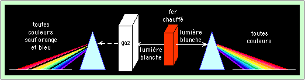

Un morceau de fer chauffé est placé entre deux prismes. À droite, sa lumière arrive directement sur un écran, alors qu’à gauche, elle doit traverser un gaz. On constate que le spectre de droite est continu, alors qu’à gauche il manque les couleurs correspondant aux raies d’absorption du gaz interposé (orange et bleu sur le schéma). Dans un spectre, la partie continue, le fond coloré, est nommé *continuum*.

La première de ces lois peut se constater simplement&#8239;: mettez un morceau de fer dans la cheminée. Lorsque sa température augmente, il va se mettre à briller, d’abord en rouge sombre, puis en rouge vif, et enfin en blanc si on le chauffe très fortement. Les corps les moins chauds émettent une lumière à dominante rouge, les plus chauds une lumière à dominante bleue (c’est le contraire des robinets&#8239;! ). Donc la couleur dominante de la lumière indique la température du corps. C’est de cette manière qu’on a déterminé la température du Soleil (5.500).

### Représentation des atomes

*Atome* vient du grec *a* (privatif, indiquant la négation), et du verbe *tomein* couper. Littéralement donc, il signifie *insécable*. L’idée vient des philosophes grecs, qui pensaient qu’on ne pouvait indéfiniment couper en deux un morceau de matière. On devait arriver à une plus petite fraction, nommée atome. Cette idée a été reprise à partir de l’étude du mouvement brownien. Mais peu après leur mise en évidence, on a compris que les atomes étaient… sécables&#8239;!

Mouvement brownien

Prenez un peu d’eau, et recueillez du pollen dans une fleur. Mélangez les grains de pollen à l’eau. Examinez ce mélange au microscope. C’est l’expérience réalisée par Brown, et il a vu que les grains de pollen étaient agités d’un mouvement saccadé. Ils parcourent une petite distance, puis brusquement changent de direction, et de vitesse aussi. Brown a faist l’hypothèse que des particules minuscules, bien plus petites que les grains et invisibles, étaient agitées et les percutaient, leur communiquant ces mouvements. C’est la mise en évidence observationnelle des atomes. Ce mouvement est nommé *mouvement brownien*.

La découverte de *l’électron*, particule qui transporte l’électricité, a rendu le mot atome inapproprié. On le garde cependant pour des raisons historiques. Les électrons portent une charge électrique négative, tous la même. L’atome est donc constitué d’un *noyau*, entouré d’électrons. On a compris ensuite que le noyau lui-même est composite, formé de deux types de particules&#8239;: les *protons* et les *neutrons*. L’histoire de leur découverte, passionante, n’est pas de mise ici. Mais les protons portent une charge électrique positive, de même valeur absolue que celle de l’électron. Comme leur nom l’indique, les neutrons sont neutres. Nous en parlerons plus en détails ailleurs.

<Encadre type="plus">
hydrogène

deutérium

hélium 3

hélium 4

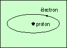

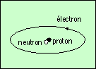

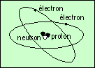

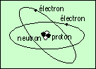
</Encadre>

Le schéma montre des atomes neutres&#8239;: les charges électriques des électrons compensent exactement celles des protons, étant de signe opposé et en même nombre. Le premier est l’atome d’hydrogène, dont le noyau est formé d’un seul proton. Le second est une variante de l’hydrogène, nommé *deutérium*. Son noyau comprend un proton, et un neutron. N’ayant qu’une seule charge électrique positive (le proton), il a les mêmes propriétés chimiques que l’atome précédent. C’est aussi de l’hydrogène.

Le troisième est un atome d’hélium. Il a deux protons, et un neutron&#8239;; on le nomme *hélium 3*. Le dernier est aussi un atome d’hélium (deux protons), mais avec un neutron de plus&#8239;; on le nomme *hélium 4*.

**Attention**&#8239;: le modèle d’atome de Bohr, illustré ci-dessus, a été défini au début du XXe siècle. Il découle d’une condition empirique ajoutée à la mécanique&#8239;: **les électrons ne peuvent circuler autour du noyau que sur certaines orbites bien précises.** Ceci permet de rendre compte des spectres lumineux. Depuis, la Mécanique Quantique a modifié la vision que l’on a d’un atome. Pour être totalement correct, on ne doit plus parler d’orbites (notion classique) mais *d’orbitale*. La différence est que dans une orbite, on connaît exactement, à un instant donné, à la fois la position et la vitesse de la particule. En Mécanique Quantique, le principe d’incertitude d’Heisenberg interdit cette connaissance simultanée, et donc sur une orbitale, on peut savoir où se trouve l’électron, sans connaître se vitesse, ou bien connaître sa vitesse sans savoir où il est…

Le modèle de Bohr ne sert plus que pour des raisons pédagogiques (sous la réserve indiquée ci-dessus). Il reste cependant une première approche très instructive.

### Les luminescences

La *luminescence* est une émission de rayonnements électromagnétiques par un mécanisme non thermique. La lumière émise par les vers luisants, par les souches pourrissantes, est une luminescence.

La luminescence est produite en deux temps&#8239;: excitation puis émission. On distingue deux formes différentes&#8239;: la fluorescence et la phosphorescence&#8239;:

- la *fluorescence*&#8239;:   l’émission est presque immédiate après l’excitation (délai de l’ordre de 10-8 s)&#8239;;   elle ne dépend pratiquement pas de la température&#8239;;
- la *phosphorescence*&#8239;:   l’émission se produit de quelques dizaines de secondes à plusieurs jours après l’excitation&#8239;;   elle dépend fortement de la température.

Le schéma ci-dessous distingue les sources thermiques et les luminescences.

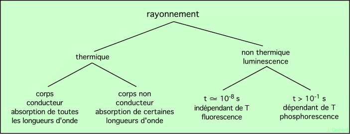

Ces lois sont empiriques, elles décrivent et synthétisent les résultats des expériences, résultats qu’il faut maintenant expliquer. Tournons-nous donc vers la structure des atomes, et voyons d’abord de quoi est fait le plus simple d’entre eux.

### Fluorescence

La *fluorescence* est un phénomène produisant un spectre de raies&#8239;: il ne contient que certaines longueurs d’onde bien particulières, et rien ailleurs.

<Encadre type="plus">
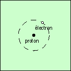

**L’atome d’hydrogène**

Le noyau de l’atome est constitué d’une seule particule, nommée **proton**. Le proton possède une charge électrique unitaire positive.

Un **électron** (autre particule portant une charge électrique unitaire négative, et 1 840 fois plus légère), est lié par l’attraction électrostatique au proton autour duquel il tourne (attraction entre charges de signes opposés, répulsion entre charges de même signe).

Ce **modèle planétaire** de l’atome d’hydrogène a été proposé par Niels Bohr au début du XXe siècle.

Contrairement aux planètes, qui peuvent circuler à n’importe quelle distance de leur étoile, l’électron n’a à sa disposition que des orbites bien particulières. La plus proche du noyau est appellée**orbite fondamentale**, ou de niveau 1. La seconde est de niveau 2, etc. Entre les orbites de niveau 1 et 2, il n’y en a pas d’autres possibles.

Chaque orbite est caractérisée par une certaine valeur de l’énergie, qui est d’autant plus grande que l’orbite est plus loin du noyau (analogue de l’énergie potentielle des planètes).

Dans la figure ci-contre, l’électron est sur l’orbite fondamentale, de plus basse énergie. Il y est donc stable, comme un pendule est stable en position verticale (plus basse énergie potentielle).

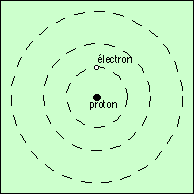

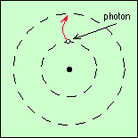

L’électron peut passer sur une orbite plus éloignée (d’énergie supérieure), à condition qu’on lui fournisse l’énergie correspondant à la **différence d’énergie entre les deux niveaux**.

Cette énergie peut lui être communiquée par des chocs avec d’autres atomes, par un champ électrique, ou bien par un photon dont la couleur correspond à cette énergie (rappelez-vous que l’énergie d’un photon est proportionnelle à sa fréquence, donc à sa couleur E = h ν, loi de Planck). Dans ce dernier cas, le photon est absorbé, son énergie ayant été consommée pour déplacer l’électron.

C’est là l’origine des *raies d’absorption*.

Puisque les orbites basses sont de moindre énergie que les orbites hautes, elles sont plus stables. L’électron aura donc toujours tendance à retomber vers une orbite basse, en diminuant son énergie.

Pour assurer la conservation de l’énergie, il émet un photon dont la couleur est exactement celle qui correspond à la différence d’énergie entre les deux orbites.

C’est l’origine des *raies d’émission*.

Puisque les raies d’émission et d’absorption correspondent à des transitions dans les deux sens entre les mêmes niveaux d’énergie, elles ont nécessairement la même couleur. On peut dire aussi que **la même raie pourra se manifester en émission ou en absorption selon les circonstances**.

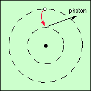
</Encadre>

Lorsqu’un atome est fortement excité, l’électron passe sur une orbite haute en sautant les orbites intermédiaires. Ensuite, pour se désexciter, il a la possibilité de retomber sur toute orbite de niveau inférieur. Il peut donc retomber sur une orbite proche, en émettant un photon de longueur d’onde correspondante, puis de là retomber encore à un autre niveau inférieur, jusqu’à revenir au niveau de base. Il va donc effectuer une cascade en émettant un photon à chaque saut. On observera alors autant de raies d’émission qu’il y a de sauts dans la cascade&#8239;:

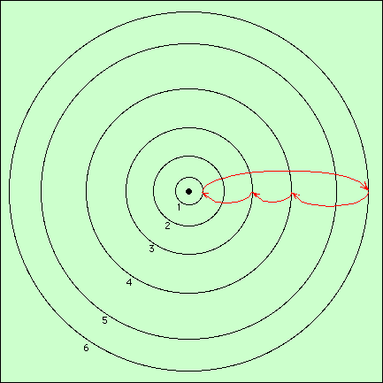

Dans cette cascade, l’énergie initiale est donnée par un photon. Elle est restituée en trois étapes, chaque photon émis possèdante une certaine énergie. La somme de ces énergies est égale à l’énergie du photon excitateur. Sur ce plan, on peut considérer que le photon a été transformé en trois photons possédant ensemble la même énergie. Puisque l’énergie initiale a été scindée en trois, chacune est inférieure. Donc, les photons émis sont plus rouges que le photon incident. Celui-ci pourrait être ultraviolet, et les photons émis visibles ou infrarouges.

Application

Ce mécanisme est mis à profit dans les tubes fluorescents. Ils contiennent du néon dont les atomes sont excités par des décharges électriques leur apportant l’énergie. Ils se désexcitent en émettant un photon ultraviolet. Ce photon est absorbé par la peinture appliquée sur le verre à l’intérieur du tube. Les électrons des atomes qui la constituent sont excités, et se désexcitent en cascade. Les photons de la cascade sont de moindre énergie, dans le visible, et ce sont eux qui nous éclairent.

Si l’électron retombe sur le niveau d’où il provient, on parle de *fluorescence de résonance*&#8239;:

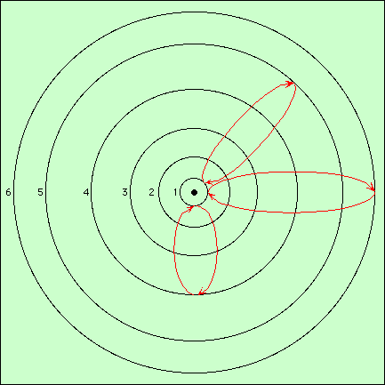

Les raies qui constituent cette fluorescence sont nommées *raies de résonance*.

### Pourquoi des raies d’absorption&#8239;?

Le mécanisme que nous venons de voir pour expliquer les raies d’absorption pose un problème&#8239;: l’absorption se fait lorsqu’un photon ayant la bonne énergie touche l’atome. L’électron est expédié sur une orbite plus haute, instable (à cause de l’énergie plus grande). Il va donc retomber spontanément vers l’orbite plus basse, en émettant un photon de même énergie, de même couleur. Par conséquent, un photon a été absorbé, un photon identique émis, donc il n’y a pas de perte, et il ne devrait pas y avoir de raie d’absorption&#8239;!

Considérons une expérience qui mette en jeu ce phénomène.

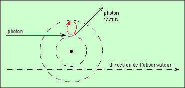

On voit que le photon absorbé venait vers l’observateur, alors que le photon réémis se dirige dans n’importe quelle direction&#8239;! On n’a que très peu de chances pour que le photon émis prenne la même direction que le photon absorbé. Les raies d’absorption s’expliquent ainsi&#8239;: bien que le nombre de photons réémis soit égal au nombre de photons absorbés, leur direction est très rarement la même. Par conséquent, le flux arrivant à l’observateur est considérablement diminué.

Tout ce que nous venons d’exprimer à propos de l’atome d’hydrogène se transpose pour n’importe quel autre élément. Mais l’atome d’hydrogène est le plus simple de tous. Précisons que le noyau d’un atome quelconque est constitué de protons et de neutrons. Les raies sont dues aux influences électriques de ces particules.

Lorsqu’un électron est excité (placé sur une orbite haute), il va retomber spontanément sur une orbite plus basse. Le temps qu’il passe sur l’orbite haute est très bref, et pendant ce temps-là il n’arrive en général rien à l’atome. La transition peut donc se produire et la raie est émise.

### Emission et absorption

Ces deux phénomènes sont basés sur le même mécanisme d’*excitation-désexcitation* des atomes. Ils sont donc très proches. Pourtant, leurs manifestations sont pratiquement opposées. Une précision s’impose.

Pour produire une émission, il faut exciter l’atome (lui fournir l’énergie de la transition). Bien sûr, l’absorption d’un photon peut fournir l’énergie nécessaire. Mais ce n’est pas la seule possibilité. Dans un milieu chaud, et assez dense, comme certaines nébuleuses, les atomes sont agités par l’énergie thermique, et s’entrechoquent. L’énergie cinétique dissipée lors du choc est tout à fait capable d’exciter, et même parfois d’ioniser, ces atomes. Il n’est donc pas forcément nécessaire d’envisager une absorption pour provoquer l’émission.

### Phosphorescence

La phosphorescence est très semblable à la fluorescence, elle procède du même mécanisme d’absorption-émission. La différence vient de l’état excité, qui est instable pour la fluorescence, et métastable pour la phosphorescence. Les états instables ne durent qu’au plus 10-8 secondes, les métastables de 0,1 s à plusieurs heures.

Ce phénomène de phosphorescence produit un rayonnement dans certaines nébuleuses, nous le préciserons plus loin.

### Largeur des raies

Les raies spectrales, telles que nous venons de les découvrir, devraient avoir une largeur infiniment petite. En effet, tous les photons émis proviennent d’une différence d’énergie exactement identique, donc leur fréquence doit être rigoureusement la même. C’est ce qu’on appelle une lumière monochromatique. Mais la réalité est un petit peu différente.

Toute raie présente une largeur finie, petite (la plupart du temps), mais non nulle. Ce qui veut dire qu’elle ne présente pas une seule longueur d’onde strictement, mais une très petite dispersion autour de la valeur centrale. Comment l’explique-t-on&#8239;?

- Tout d’abord, la durée de vie d’un niveau excité a une valeur finie, de l’ordre de 10-8 à 10-9 seconde pour les états instables. Ceci entraîne un élargissement de la raie, dû à l’application du principe d’incertitude (voir détail ci-dessous). Cette largeur de raie est nommée *largeur naturelle*&#8239;;
- Ensuite, les atomes émetteurs sont à température non nulle, et donc entraînés dans l’agitation thermique. Ils présentent donc des vitesses aléatoires, qui par effet Doppler-Fizzeau, décalent légèrement certains photons vers le rouge, d’autres vers le bleu. Et donc élargissent la raie. Cet élargissement est bien plus important que la largeur naturelle.
- Enfin, les collisions entre les atomes émetteurs perturbent l’émission, et élargissent les raies.

La précision de l’énergie sur le niveau excité est fonction du temps que dure le niveau&#8239;: plus le temps est long, plus est précise l’énergie (par le principe d’incertitude). Donc, si l’état excité est métastable (durée supérieure à 0,1 s), sa grande durée donne une énergie très précise, et par conséquent une raie fine. Les états instables par contre, de très faible durée, produisent une imprécision sur l’énergie, qui par conséquent élargit la raie.

Précisions

Le Principe d’Incertitude établit que ΔE Δt ≥ ℏ / 2, où ΔE est la dispersion de l’énergie, et Δt la durée de vie de l’état.  En utilisant la définition E = ℎ ν (loi de Planck), on a ΔE = ℎ Δν. La notation ℎ représente la constante de Planck, ℏ la constante de Planck normalisée qui vaut ℎ / 2 π.  On substitue ΔE dans l’inégalité&#8239;: ℎ Δν Δt ≥ ℏ / 2, qui se simplifie en Δν ≥ ℏ / 2 ℎ Δt = 1 / 4 π Δt.  On divise les deux membres par ν&#8239;: Δν / ν ≥ 1 / 4 π Δt ν.  En utilisant ν = c / λ, on arrive à Δν / ν ≥ λ / 4 π c Δt.

**Résultat&#8239;: Δν / ν ∝ 1 / Δt.**

Δt représente la durée de vie du niveau, et Δν / ν est la largeur relative de la raie. On constate que plus Δt est grand, plus petit est Δν / ν, la largeur naturelle de la raie.

Au total donc, toute raie spectrale présente une largeur finie, mais sa forme n’est pas rectangulaire, elle présente un profil en cloche&#8239;: c’est une *courbe de Gauss* ou *gaussienne*. On peut vérifier cela sur tous les spectres à bonne résolution. Cette forme des raies ne permet pas de les comparer directement. Aussi, les astronomes ont-ils défini la *largeur équivalente*&#8239;: c’est la largeur qu’aurait une raie rectangulaire hypothétique, de même surface, et qui descendrait jusqu’au continuum. Ceci est une normalisation de la largeur de raie.

## Séries de raies

### L’atome de Bhor

Niels Bhor a étudié le spectre de l’hydrogène, qui présente les raies apparemment les plus régulières. Il en a déduit un modèle de l’atome d’hydrogène, connu sous le nom d’*atome de Bhor*. Ce modèle s’inscrit dans la Mécanique Classique, et doit être abandonné maintenant au profit d’un modèle compatible avec la Mécanique Quantique. Mais il possède des propriétés didactiques assez intéressantes pour qu’on l’étudie en première approximation. Il a d’ailleurs permis des découvertes, comme celle du Deutérium, ainsi que les séries de raies hors du visible.

Deutérium

Le spectre de l’hydrogène a été étudié en détails, il était bien connu. Mais on a observé des raies, bien plus faibles, qui formaient un motif très semblable et très proche. Il fallait l’expliquer.

L’explication a été trouvée en modifiant très légèrement l’atome de Bhor. Dans celui-ci, l’électron tourne autour du proton, qui est 1 800 fois plus lourd. On considérait que le proton restait immobile, mais ce n’est qu’une approximation. En tenant compte de l’entraînement du proton dans le mouvement de l’électron, on a affiné la théorie.

Le spectre mentionné ci-dessus s’explique alors en considérant que le noyau est deux fois plus massif, constitué d’un proton et d’un neutron, et donc moins entraîné. Puisqu’il n’y a qu’un proton, c’est l’isotope lourd de l’hydrogène nommé *deutérium*. Les longueurs d’onde des différentes raies sont très bien obtenues par la formule modifiée.

Lorsque l’électron retombe, il émet un photon dont la longueur d’onde (la couleur) est déterminée par les positions des deux orbites. Chaque couple d’orbites donne donc une raie différente de toutes les autres.

### Les séries de l’hydrogène

Pour l’atome d’hydrogène, on considère les séries de raies, déterminées par l’orbite sur laquelle l’électron retombe. Les six premières orbites donnent les séries suivantes&#8239;:

<table>
<tbody>
<tr><th>Série</th><td>Lyman</td><td>Balmer</td><td>Paschen</td><td>Bracket</td><td>Pfund</td><td>Humphreys</td></tr>
<tr><th>Niveau</th><td>1</td><td>2</td><td>3</td><td>4</td><td>5</td><td>6</td></tr>
</tbody>
</table>

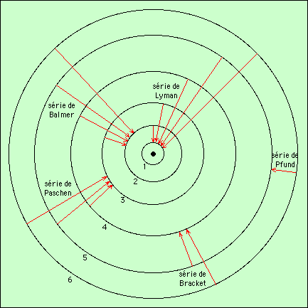

Ce schéma est indicatif, les distances entre les différentes orbites ne sont pas respectées.

Il existe une infinité de niveaux d’énergie dans chaque série, et il existe une infinité de séries. Balmer a étudié la série des raies de l’hydrogène dans le visible (depuis nommée *série de Balmer*), et a obtenu empiriquement la formule&#8239;: νm = R0 (1/4 - 1/m2) pour m &gt; 2, R0 est une constante.

<Encadre type="plus">
Balmer a trouvé la formule avec 1/4. On a vite généralisé en remplaçant 1/4 par 1/22, puis par 1/n2&#8239;:

νn,m = R0 (1/n2 - 1/m2)

Alors, il devint évident qu’il devait y avoir aussi des séries de raies pour n = 1, n = 3… C’est ainsi que Lymann a observé la série qui porte son nom dans l’UV (après avoir calculé les longueurs d’onde théoriques des raies à l’aide de cette formule)&#8239;; puis la même démarche a été suivie par Paschen dans l’infrarouge…
</Encadre>

### Les séries de l’hydrogène

A chaque orbite correspond une énergie de liaison de l’électron. L’énergie correspondant à l’orbite n est donnée par&#8239;:

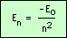

où E0 est une constante, caractéristique de l’élément considéré. L’énergie du niveau 1 est donc -E0 (n = 1)&#8239;; l’énergie du niveau 2 est -E0 / 4 (n = 2)&#8239;; celle du niveau 3, -E0 / 9. On voit donc que cette énergie diminue très rapidement lorsqu’on s’éloigne du noyau.

L’énergie n’est pas définie de façon absolue, mais seulement relative. On ne peut définir que des variations d’énergie. Aussi, pour fixer une valeur, le choix est arbiraire. On décide alors de fixer à 0 l’énergie de liaison de l’électron, lorsqu’il est totalement libre du noyau, c’est-à-dire lorsqu’il est renvoyé à l’infini (influence du noyau nulle). Avec ce choix, l’énergie E0 vaut -13,6 eV. Elle est forcément négative. Pour l’hydrogène, la formule se simplifie en En = -13,6 eV / n2. On peut faire le tableau des premières valeurs&#8239;:

<table>
<thead>
<tr><th>n</th><th>énergie (eV)</th></tr>
</thead>
<tbody>
<tr><td>1</td><td>-13,6</td></tr>
<tr><td>2</td><td>-3,4</td></tr>
<tr><td>3</td><td>-1,5</td></tr>
<tr><td>4</td><td>-0,85</td></tr>
<tr><td>5</td><td>-0,54</td></tr>
<tr><td>6</td><td>-0,38</td></tr>
<tr><td>7</td><td>-0,28</td></tr>
<tr><td>8</td><td>-0,21</td></tr>
</tbody>
</table>

En tombant de l’orbite m à l’orbite n, l’électron émet un photon dont l’énergie correspond à la **différence d’énergie** Em - En entre les deux niveaux Em et En&#8239;; en application de la loi de Planck, sa fréquence ν est telle que&#8239;:

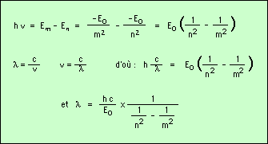

On définit la *constante de Rydberg* par l’inverse du premier terme de la relation obtenue, et on considère d’autre part l’autre terme tm,n&#8239;:

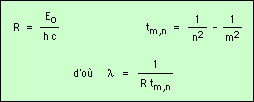

Prenons le cas de la **série de Balmer de l’hydrogène**&#8239;; elle est caractérisée par **n = 2**, m &gt; 2. Calculons tm,2 pour diverses valeurs de m&#8239;:

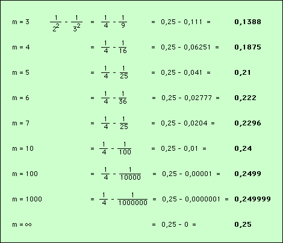

On voit que ce terme tm,2 tend vers une limite de 0,25 lorsque m tend vers l’infini. Les raies correspondantes se déduisant de ce terme constituent une série dont les espacements sont de plus en plus faibles, jusqu’à ce qu’elles ne soient plus discernables.

On peut maintenant calculer les longueurs d’onde des différentes raies de Balmer&#8239;:

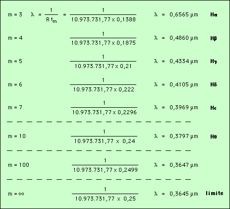

Ce calcul montre que les deux premières raies sont éloignées (0,6565 - 0,4860 = 0,1705 µm entre Hα et Hβ), les deux suivantes un peu moins (0,4860 - 0,4334 = 0,0526 µm entre Hβ et Hγ), et ensuite les raies se rapprochent tellement vite, que le spectroscope ne pourra même plus les distinguer. La valeur t = 0,25 correspond à ce que l’on appelle la *limite de Balmer*&#8239;; la longueur d’onde précise de la limite de Balmer est λ = 0,364771 µm.

C’est exactement ce qu’on observe sur un spectre de l’hydrogène, en partie dans le visible pour la série de Balmer. La première raie est isolée, la seconde et les quelques suivantes aussi, mais elles se rapprochent de plus en plus&#8239;; puis vient une bande constituée d’un grand nombre de raies indiscernables. Mais la limite de Balmer se trouve dans l’ultraviolet (toutes les raies sont dans l’ultraviolet à partir de Hε). Le nombre de raies séparées dépend de la finesse du réseau utilisé.

Au-delà de la série de Balmer, on note encore de la lumière&#8239;: l’énergie correspondante est alors supérieure à l’énergie d’ionisation de l’atome d’hydrogène, et la lumière est émise par un électron qui arrive de l’infini pour se recombiner à l’atome. L’énergie de l’électron est quelconque, et le spectre produit est continu. Mais cette émission faiblit rapidement en s’éloignant de la limite de Balmer.

On peut faire le même calcul pour les autres séries. Pour la première, la **série de Lyman** qui correspond à**n = 1**, on obtient t2,1 = 0,75 pour le premier terme, et t2,∞ = 1 pour la limite. Les longueurs d’onde associées sont donc&#8239;: λ = 0,1215 µm pour la première raie (Lyman α) et λ = 0,0911 µm pour la limite de Lyman. Toutes les raies de Lyman étant comprises entre ces valeurs, ont des longueurs d’onde plus petites que 0,4 µm, et sont donc dans l’ultraviolet. Elles sont donc inobservables à l’oeil.

Pour la série de Paschen, n = 3. On trouve t = 0,0486 pour le premier terme et t = 0,1111 pour la limite, ce qui donne les longueurs d’onde&#8239;: λ = 1,875 µm pour la première raie et λ = 0,820 µm pour la limite. Ces deux longueurs d’onde étant supérieures à 0,8 µm, toute la série se trouve dans l’infrarouge.

Le même calcul donne pour la série de Bracket les longueurs d’onde λ = 4,050 µm pour la première raie, et λ = 1,458 µm pour la limite. Toute la série est dans l’infrarouge.

Enfin, pour la série de Pfund&#8239;: λ = 7,409 µm et λ = 2,278 µm. La série entière est dans l’infrarouge.

On peut résumer tout ceci par le tableau suivant&#8239;:

<table>
<thead>
<tr><th>série</th><th>λ première raie</th><th>λ limite</th><th>domaine</th></tr>
</thead>
<tbody>
<tr><td>Lyman</td><td>0,1215 µm</td><td>0,0911 µm</td><td>ultraviolet</td></tr>
<tr><td>Balmer</td><td>0,6570 µm</td><td>0,3647 µm</td><td>UV / visible</td></tr>
<tr><td>Paschen</td><td>1,875 µm</td><td>0,820 µm</td><td>infrarouge</td></tr>
<tr><td>Bracket</td><td>4,050 µm</td><td>1,458 µm</td><td>infrarouge</td></tr>
<tr><td>Pfund</td><td>7,409 µm</td><td>2,278 µm</td><td>infrarouge</td></tr>
<tr><td>Humphreys</td><td>12,365 µm</td><td>3,281 µm</td><td>infrarouge</td></tr>
</tbody>
</table>

Seule la série de Balmer est partiellement dans le visible&#8239;; pour toutes les autres, il faut utiliser des récepteurs sensibles à l’infrarouge ou à l’ultraviolet pour les détecter.

Les raies de l’hydrogène sont caractéristiques de cet élément. Celles du deutérium, dont le noyau est plus lourd, lui ressemblent beaucoup. Enfin, les autres éléments chimiques, lorsqu’ils sont suffisamment ionisés pour qu’il ne leur reste qu’un seul électron, présentent aussi un spectre semblable à celui de l’hydrogène. On les appelle *hydrogénoïdes*.

### L’atome de Bhor est-il stable&#8239;?

Un reproche grave a été fait au modèle de Bhor dès sa publication. L’électron est en orbite autour du noyau, donc il subit une accélération, donc il rayonne (ce qu’on a dit plus haut). Par conséquent, il perd de l’énergie et doit inéluctablement se rapprocher du noyau, jusqu’à tomber dessus&#8239;! C’est une instabilité liée à la théorie, qui n’est pas observée, donc la théorie est fausse…

La solution est très simple, mais il faut raisonner en termes d’énergie. Lorsque l’électron se trouve au niveau fondamental de l’atome de Bhor, il est à son **minimum d’énergie**. Il ne peut donc pas en rayonner… lorsqu’il se trouve au deuxième niveau, soit le fondamental est libre, et il y retombe spontanément en émettant un photon&#8239;; soit le fondamental est occupé, et notre électron est donc au niveau d’énergie le plus bas pour lui. Il ne peut donc, là encore, rien émettre. Cette bonne interprétation de la théorie résoud le paradoxe.

Dans les nuages d’hydrogène, les électrons libres n’ont pas cette contrainte quantique, et peuvent par conséquent rayonner lorsqu’ils sont accélérés.

### Rapport avec la Mécanique Classique

La Mécanique Quantique marque une rupture avec la Mécanique Classique. Cette rupture était nécessaire pour expliquer les phénomènes qui résistaient à toute tentative classique. Mais on a exprimé le *principe de correspondance*, qui dit que lorsqu’on se rapproche des conditions macroscopiques, les lois de la Mécanique Quantique doivent converger vers celles de la Mécanique Classique. On peut le vérifier ici sur les raies spectrales d’une série d’ordre élevé.

La formule de Balmer ν = R0 (1/n2 - 1/m2) (m &gt; n), pour n élevé, est équivalente à un oscillateur classique (mouvement vibratoire simple). En effet, pour des niveaux m voisins de n (m ≈ n), la différence m - n est petite devant m et n. Le terme 1/n2 - 1/m2 = (m2 - n2) / n2 m2 = (m + n)(m - n) / n2 m2 ≈ 2n (m - n) / n4 = 2 (m - n) / n3. Donc ν = 2R0 (n - m) /n3. La fréquence est donc proportionnelle à m - n. C’est-à-dire que pour n - m = 2, on obtient le double de la fréquence de base (n = 1). Pour n - m = 3, on obtient le triple… On reconnait là les harmoniques d’un oscillateur (note de musique par exemple). Par conséquent, lorsqu’on considère les électrons les moins liés à l’atome (n élevé), **on retrouve un comportement quasi classique**.

Enfin, signalons que ce principe de correspondance permet de calculer la constante de Rydberg, qui jusqu’ici n’était qu’une valeur numérique introduite pour les besoins de la formule.

### Autres atomes

La théorie de l’atome d’hydrogène était, toutes proportions gardées, facile à faire… en comparaison des autres atomes. Plus le nombre de protons augmente, plus les choses se compliquent par les interactions entre les électrons, et par la complexification du champ produit par les protons, la charge positive n’étant plus ponctuelle. La détermination théorique des niveaux d’énergie demande des calculs tout juste à la portée des grands ordinateurs actuels.

Lorsque les atomes ont la facheuse idée de se regrouper en molécule, ce qu’ils font volontiers (minimum d’énergie), le physicien quantique n’a plus qu’à rendre son tablier… ou presque. La complexité du champ produit par les noyaux qui constituent la molécule entraîne la disparition des simples raies spectrales au profit de véritables bandes larges. C’est ainsi qu’on observe les bandes de la vapeur d’eau, de la chlorophylle…

### Ionisation

Que se passe-t-il si un atome d’hydrogène dans l’état fondamental (son électron au niveau 1) est frappé par un photon de longueur d’onde 0,0900 µm par exemple&#8239;? Cette longueur d’onde étant plus courte que la limite de la série de Lyman, le photon dispose d’une énergie supérieure. Par conséquent, il est capable de faire sauter l’électron au-delà de l’orbite la plus lointaine. Alors, l’électron ne sera plus du tout attaché au noyau. Il deviendra un électron libre, et l’atome d’hydrogène aura perdu son électron. On dit qu’il est *ionisé*.

L’énergie excédentaire est communiquée à l’électron sous forme d’énergie cinétique, et lui communique une vitesse proportionnelle à l’excès d’énergie.

Puisque la neutralité électrique de l’atome provenait de l’équilibre entre la charge positive du noyau et la charge électrique de l’électron, l’atome présente maintenant une charge positive.

Un atome est dit ionisé s’il a perdu un ou plusieurs électrons. Un atome ionisé n’est plus neutre, mais porte une charge électrique correspondant à l’excès de ses protons par rapport aux électrons qu’il lui reste.

Un atome peut être ionisé de plusieurs façons différentes, qui consistent à lui donner de l’énergie sous une forme quelconque. Nous avons déjà vu que, si on fournit à l’atome une énergie correspondant à la différence d’énergie entre deux niveaux, on peut faire passer un électron d’un niveau à un niveau supérieur. Il découle de ce que nous venons de calculer que si on lui fournit une énergie supérieure à celle de la limite de Lyman, on peut arracher l’électron. Appliquons la formule trouvée plus haut à la limite de Lyman, et déduisons-en l’énergie nécessaire&#8239;:

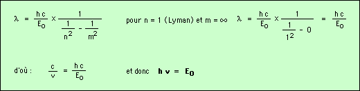

Par conséquent, la valeur E0 que nous avons utilisée plus haut représente **l’énergie d’ionisation de l’hydrogène**.

### Notation

On note un élément ionisé par son symbole chimique, suivi d’un nombre en chiffres romains dont la valeur donne le **nombre d’électrons perdus + 1**.

Ainsi, le fer neutre se note Fe I, le fer ionisé une fois (qui a perdu 1 électron) Fe II, le fer ionisé deux fois Fe III etc. Dans certaines circonstances, à très haute température, on peut trouver de fortes ionisations, comme par exemple Fe XIV.

### Raie Hα

La raie Hα appartient à la série de Balmer, il s’agit donc d’une raie résultant d’une transition à partir du niveau 2 de l’atome d’hydrogène&#8239;: transition du niveau 2 au niveau 3 en absorption, du 3 au 2 en émission. Elle apparaîtra donc dans des milieux suffisamment chauds pour que les atomes d’hydrogène soient excités au second niveau. Sa longueur d’onde de 0,6563 µm la situe dans le visible, dans le rouge… Elle donne sa couleur caractéristique, et par suite son nom, à la [chromosphère](https://astronomia.fr/2eme_partie/soleil.php#chromosphere) du Soleil. Elle est aussi la lumière émise par de nombreuses nébuleuses.

### Raies interdites

On a observé dans certaines nébuleuses des raies spectrales impossibles à interpréter en fonction des spectres obtenus au laboratoire. On a cru un temps à la découverte d’un nouvel élément, bien vite nommé *nébulium*&#8239;! Mais on a bientôt trouvé une autre explication.

Nous avons vu qu’un atome excité (dont l’électron est sur une orbite supérieure) se désexcite spontanément en émettant un photon, et que le temps de résidence dans l’état excité est soit très bref, soit long. Cette différence de durée a une implication importante.

Dans les conditions normales, comme celles qui règnent sur Terre par exemple, les atomes d’un gaz sont animés de grandes vitesses dues à l’agitation thermique, de quelques centaines de mètres par seconde. La distance qu’ils pourraient parcourir en 10-8 s à cette vitesse est de quelques millièmes de millimètre. Mais la densité du milieu ne leur donne qu’un libre parcours moyen, avant de subir un choc avec un autre atome, bien plus petit, de l'ordre de 60 nm. Le choc subit avant la désexcitation détruit l’état métastable, et donc interdit l’émission spontanée. On dit que c’est une *raie interdite*.

Dans les nuages interstellaires par contre, la densité est assez faible pour que les atomes se désexcitent spontanément avant d’en heurter un autre, leur libre parcours moyen étant bien plus long (des kilomètres). La raie peut donc se produire. C’est le cas par exemple de la raie &#91;OIII&#93; (oxygène ionisé deux fois), de couleur verte qu’on observe dans certaines nébuleuses. OIII signifie que la raie est produite par l’oxygène ionisé deux fois (il lui reste tout de même six électrons), et les crochets indiquent que c’est une raie interdite.

Les raies interdites ont été expliquées en 1927 par Bowen. Le nombre entier n qui désigne le numéro d’orbite dans l’atome de Bhor est devenu le *nombre quantique principal*. Il est le seul dans la théorie de Bhor. On lui a ajouté deux autres nombres quantiques, l dit *nombre quantique azimutal* tel que l &lt; n, et m *nombre quantique magnétique* tel que -l ≤ m ≤ +l. Ces nombres multiplient les raies possibles, ce qui donne la *structure fine* et même la *structure hyperfine*. Les noms s’expliquent par l’observation, ces structures nécessitant des spectroscopes plus dispersifs pour être visibles.

*A contrario*, les raies que l’on peut produire au laboratoire, dans un gaz sous faible pression, sont dites *raies permises*.

### Spectre simplifié du Soleil

Il montre un fond continu brillant, de toutes les couleurs, coupé par des raies sombres (les raies d’absorption).

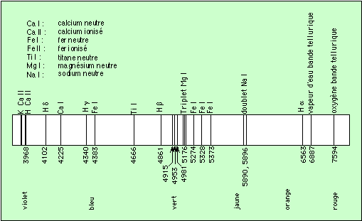

Un spectre détaillé du soleil est visible dans le chapitre consacré au [soleil](https://astronomia.fr/2eme_partie/soleil.php#specSol).

### La raie à 21 cm

Il existe une raie particulière, dans le domaine radio, qui est d’une grande importance en astronomie, et ne s’explique pas par le mécanisme précédent. Le transfert d’un électron d’une orbitale à une autre demande une quantité d’énergie excessive dans certains milieux trop froids. Mais il existe un mécanisme plus fin, qui est reponsable d’une raie à 21 cm de longueur d’onde.

Un atome d’hydrogène neutre (dans un milieu froid) est constitué d’un proton (noyau) et d’un électron. Ces deux particules possèdent une propriété quantique dont nous n’avons pas encore parlé. On la nomme [spin](https://astronomia.fr/5eme_partie/hNeutre.php#spin) (de l’anglais tourner).

Considérons toujours nos particules comme de petites boules dures (cette image n’est pas correcte en Mécanique Quantique, mais elle permet de se faire une idée approximative de la question). Comme de petites boules, elles peuvent tourner sur elles-mêmes. Mais dans le monde quantique, les choses ne se font pas n’importe comment&#8239;: tous les axes de rotation et toutes les vitesses ne sont pas permis, loin de là. En fait, deux possibilités seulement se présentent. On peut se figurer une particule tournant (toujours à la même vitesse) avec un axe vertical, soit dans un sens soit dans l’autre.

Avec toutes ces restrictions, le proton et l’électron peuvent donc tourner dans le même sens (parallèles) ou bien en sens inverse l’un de l’autre (antiparallèles). Ces deux états diffèrent d’une très faible énergie, et par conséquent il est facile de modifier l’état de rotation (le spin) de l’électron.

L’énergie nécessaire à ce changement d’état peut être fournie par un photon qui sera absorbé, ou par tout autre moyen. Et l’atome ainsi excité se désexcite en émettant un photon de 21 cm de longueur d’onde, dans le domaine radio, car l’énergie concernée est faible.

### Utilité de la spectroscopie

L’astronome dispose, grâce à cette propriété, de LA solution pour sonder les planètes et les étoiles à distance (ça tombe bien, car pour aller faire les analyses sur place…). Deux ans seulement avant ces découvertes, le philosophe Auguste Comte expliquait dans son cours qu’on ne saurait jamais de quoi était fait le Soleil, puisqu’on ne pouvait pas aller prélever des échantillons…

La lumière (dans toutes les longueurs d’ondes) est le moyen le plus important de connaissance des astres (on a quelques informations provenant de la physique des particules (neutrinos), et on en obtient maintenant des ondes gravitationnelles&#8239;; tout le reste provient de la lumière, et plus généralement des ondes électromagnétiques). C’est la lumière qui nous a apporté la plus grande part de ce que nous savons de l’Univers, et principalement par la spectroscopie&#8239;:

- **Température**. La couleur générale d’une étoile nous indique sa température. Un morceau de fer chauffé est rouge sombre si sa température reste assez basse, puis rouge vif, puis blanc… ceci à mesure que la température s’élève. Ainsi, en déterminant quelle couleur est la plus brillante dans le spectre d’une étoile, on détermine sa température de surface. Ceci a donné une température de 5 500 ℃ pour la surface visible du Soleil. D’autres étoiles sont beaucoup plus chaudes, jusqu’à 50.000 ℃. D’autres plus froides, jusqu’à 2.000 ℃.
- **Composition des astres**. On photographie dans le laboratoire les spectres de tous les éléments chimiques. Nous avons vu qu’ils étaient tous différents. On photographie ensuite le spectre d’une étoile. On met côte à côte ce spectre et celui de l’hydrogène (pris au laboratoire)&#8239;; si les raies spectrales de l’hydrogène se voient sur le spectre de l’étoile, c’est que son atmosphère contient de l’hydrogène&#8239;: 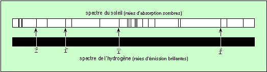 En répétant cette opération pour tous les éléments, on détermine leur présence dans les étoiles. N’oublions pas toutefois que la lumière que nous recevons d’une étoile provient de sa photosphère, c’est-à-dire de sa basse atmosphère. La composition qu’on en déduit est donc celle de ses couches superficielles, et pour connaître sa composition interne, il faut faire appel à la théorie, notamment des réactions nucléaires et du transport de l’énergie.
- **Proportions**. Si dans l’atmosphère du Soleil un élément est peu abondant, une partie seulement de la lumière correspondant à ses raies spectrales sera absorbée&#8239;; la raie dans son spectre sera moins sombre. En mesurant l’assombrissement d’une raie, on arrive donc à mesurer la quantité de l’élément correspondant dans l’atmosphère d’une étoile. On ne se contente pas d’une analyse quantitative (savoir si oui ou non un élément est présent dans l’atmosphère de l’étoile), mais on dispose aussi d’une analyse quantitative, déterminant en quelle proportion il y est.
- **Vitesse**. Lorsqu’une voiture passe rapidement devant nous, le bruit de son moteur change&#8239;: il est aigu lorsqu’elle se rapproche, puis grave lorsqu’elle s’éloigne. Avec la lumière, le même phénomène se produit&#8239;; si un objet lumineux se rapproche de nous, son spectre glisse vers le bleu, et si elle s’éloigne, il glisse vers le rouge. Les raies spectrales ne correspondent plus alors à celles mesurées en laboratoire. Pour rétablir la correspondance, il faut faire glisser le spectre photographié au laboratoire par rapport à celui de l’étoile.
    - La mesure du déplacement nécessaire donne la vitesse des étoiles par rapport à nous. On détermine ainsi leurs déplacements dans la Galaxie.
    - C’est ainsi qu’on a découvert expérimentalement **l’expansion de l’Univers**&#8239;: toutes les galaxies s’éloignant de nous, leurs spectres sont systématiquement décalés vers le rouge. Ce phénomène est nommé *décalage spectral*. Dans l’Univers proche, il peut se produire vers le rouge ou vers le bleu (le bleu correspondant à une vitesse de rapprochement) par suite de mouvements locaux, tandis que dans l’Univers lointain il est toujours vers le rouge, la vitesse d’expansion étant bien plus élevée que celle des mouvements locaux.
    - Par ce procédé, on a même découvert **des planètes autour d’autres étoiles**, car leur présence modifie légèrement la vitesse de l’étoile autour de laquelle elles tournent.
- **Rotation**. Lorsqu’une étoile tourne sur elle-même, l’un de ses bords s’approche de nous alors que l’autre s’éloigne. La différence de vitesse entre les deux bords nous donne la **vitesse de rotation de l’étoile**.
- **Champ magnétique**. Si dans le laboratoire on photographie un spectre, mais en plaçant l’expérience dans un champ magnétique, on s’aperçoit que les raies spectrales sont dédoublées. Et d’autant plus que le champ magnétique est plus intense (effet Zeeman). Lorsque les raies spectrales d’une étoile apparaissent ainsi dédoublées, on sait donc qu’elle possède un champ magnétique, et on peut en mesurer l’intensité par l’écartement des raies dédoublées.  On sait que les taches solaires, qui traduisent l’activité du Soleil, sont dues à de forts champs magnétiques, car les raies spectrales y sont dédoublées. Par l’analyse spectrale du champ magnétique, on peut donc avoir des indications sur **l’activité des autres étoiles**.

## Autres rayonnements

### Le rayonnement synchrotron

Il est dû à des électrons, qui se déplacent dans un champ magnétique. Un électron se déplaçant dans un champ magnétique parcourt une trajectoire en spirale, dont l’axe est la direction du champ. Puisqu’il ne va pas en ligne droite, il subit une accélération, et donc émet un rayonnement. La fréquence du rayonnement, nommée *fréquence de Larmor*, est donnée par f = 2,8 H, où H est le champ magnétique (H en gauss et f en mégahertz). On conçoit donc que la mesure de f donne immédiatement la valeur de H. Ce sera un excellent moyen de déterminer le champ magnétique interstellaire.

Mais cette relation n’est valable que pour des vitesses faibles de l’électron (classique). Lorsque l’électron est relativiste (sa vitesse est une fraction notable de la vitesse de la lumière), il émet aussi des harmoniques&#8239;: des photons dont la fréquence est un multiple entier de la fréquence de Larmor. De plus, le maximum d’énergie est émis non pas sur le fondamental, mais sur un harmonique de rang élevé. Pour ces hamoniques élevés, la différence de fréquence entre deux harmoniques consécutifs est plus petite que la largeur de chaque harmonique. Les différents harmoniques autour du maximum se chevauchent donc, et on obtient un spectre continu au lieu d’un spectre de raies.

Le spectre synchrotron d’un électrton unique présente une montée progressive, un maximum net, et une descente rapide.

Dans un nuage interstellaire, très vaste, tous les électrons n’ont pas la même énergie, et le champ magnétique n’est pas rigoureusement constant. Le spectre observé sera donc la somme des spectres, ce qui en modifie la forme.

Enfin, le rayonnement synchrotron est fortement polarisé. Cette dernière caractéristique permettra de le distinguer parfois d’un rayonnement thermique.

L’émission synchrotron ne peut se produire que dans les plasmas de très haute température, où les électrons sont très fortement accélérés, par exemple dans les gaz éjectés par les supernovæ.

La particule décrit une spirale autour des lignes de champ magnétique. Le rayon de cette spirale est d’autant plus grand que la particule va plus vite. Et puisqu’elle perd de l’énergie, elle ralentit et donc décrit une spirale de plus en plus serrée. Bien sûr, elle continue d’émettre des photons, mais ceux-ci sont de plus en plus rouges à mesure que le temps passe.

Considérons un unique électron, lancé à une vitesse v. Le premier photon qu’il va émettre dans le champ magnétique correspond à cette vitesse, et sera par exemple bleu, pour fixer les idées. Après cette émission, sa vitesse aura diminué, et le prochain photon émis sera moins bleu, plus rouge. **Le premier photon émis est donc le plus bleu possible**.

Considérons maintenant une source émettant un grand nombre d’électrons rapides, par un mécanisme physique quelconque. Tous les électrons n’auront pas exactement la même vitesse, mais il y aura une vitesse maximum. Ceux qui posséderont cette vitesse émettront les photons les plus bleus. Le spectre de ce rayonnement aura donc une limite&#8239;: on n’observera aucun photon plus énergétique que cette limite, et on verra par contre des photons de toutes couleurs en allant vers le rouge.

Autre propriété de ce rayonnement&#8239;: si la source émet une bouffée d’électrons, puis plus rien, on verra des photons bleus au début, puis des photons de plus en plus rouge. La couleur changera avec le temps, et rapidement il n’y aura plus de photons bleus. Pour qu’on observe toujours des photons correspondant à la vitesse maximale, il faut que la source soit permanente.

Un spectre synchrotron émis par une source permanente est donc continu, comme les spectres thermiques. Mais l’existence d’une limite vers le bleu les en distingue facilement. La répartition des intensités n’est pas non plus semblable.

Le nom de ce rayonnement vient d’un type d’accélérateur de particules utilisé par les physiciens au début du XXe siècle. Le mouvement des particules chargées dans ce système était synchronisé par des variations de champ magnétique. De ce fait, ces machines ont été nommées *accélérateurs synchrotrons*.

### Le rayonnement de freinage

Ce rayonnement se produit dans un milieu ionisé, où des électrons légers se déplacent à grande vitesse dans un gaz de noyaux (positifs) beaucoup plus lents (parce que beaucoup plus massifs). Les noyaux sont des ions positifs, qui influencent par attraction électrostatique les électrons négatifs passant à proximité. Un électron influencé voit sa vitesse changer, en particulier sa direction est modifiée. L’accélération subie provoque une émission de lumière.

L’émission elle-même découle du même processus que pour le rayonnement synchrotron, mais dans celui-ci la perturbation par le champ magnétique est continue, alors qu’ici elle est électrique, et très brève le temps de la rencontre.

En passant près du noyau, l’électron l’entraîne légèrement, en lui communiquant une faible énergie. C’est ce transfert d’énergie qui produit le rayonnement. La quantité d’énergie échangée étant très faible, le photon sera de grande longueur d’onde, c’est un photon radio.

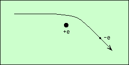

Comme le freinage est proportionnel à la distance à laquelle l’électron passe, et à sa vitesse par rapport au noyau, toutes les énergies sont possibles, elles ne sont pas quantifiées. On obtient par conséquent un rayonnement continu.

Le terme de *free-free* signifie que l’électron est libre avant l’interaction, et qu’il est toujours libre après. Il passe donc de l’état libre à l’état libre. Le nom de *rayonnement de freinage* s’explique tout naturellement. Enfin, le mot de *bremsstrahlung* est le terme allemand couramment utilisé (de *bremsung* = freinage, *strahlung* = rayonnement).

Si l’électron est stoppé, toute son énergie cinétique est transformée en rayonnement. Il n’est donc pas possible, pour un flux d’électrons de vitesse donnée, de produire un rayonnement plus énergétique. Par conséquent, il existe une longueur d’onde minimale produite par ce rayonnement. Pour des longueurs d’onde plus courte, on n’observera aucun rayonnement. C’est la première caractérisation du bremsstrahlung.

λ0 = h c / E0  où E0 est l’énergie cinétique de l’électron

Ensuite, si l’électron passe de plus en plus loin du noyau, l’interaction est de plus en plus faible, et l’énergie rayonnée de plus en plus basse. Dans un plasma, un flux d’électrons présente toutes les approches possibles, et donc le spectre du rayonnement montrera la quantité totale d’énergie produite par l’ensemble des électrons, selon leur distance d’approche au noyau. On observe alors un spectre qui présente un maximum d’intensité pour une longueur d’onde λmax telle que&#8239;:

λmax = (3 / 2) λ0

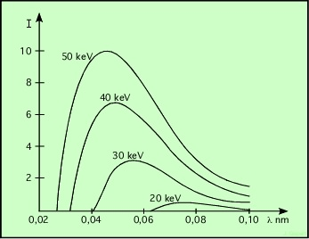

*intensité du bremsstrahlung dans les rayons X*

L’énergie rayonnée par bremsstrahlung est aussi d’autant plus grande que les noyaux responsables sont plus lourds. Aussi, le schéma ci-dessus ne porte pas d’indication absolue d’intensité.

Le spectre n’a pas la même forme qu’un spectre thermique (rayonnement de corps noir), mais la caractéristique essentielle est la coupure aux courtes longueurs d’onde, qui n’existe pas dans un spectre de corps noir. C’est donc ce qui permet de les différencier dans un spectre réel, et nous donne ainsi des indications sur le phénomène qui produit la lumière observée.

## Effet de la vitesse

### L’effet Doppler-Fizeau

L’effet Doppler concerne le son. Lorsqu’une source sonore s’approche, le son qu’elle émet est décalé vers les aigus, par la compression de l’onde sonore. Lorsque la source s’éloigne, le son est décalé vers les graves par la dilatation. Cet effet est très facile à constater dans la vie de tous les jours (train qui passe sans s’arrêter dans une gare, s’approchant puis s’éloignant en klaxonnant). Christian Doppler l’a théorisée, comme phénomène associé à une onde se propageant dans un milieu matériel (l’air, ou l’eau…).

Hippolyte Fizeau a montré qu’un effet de même nature se produisait sur les ondes lumineuses, qui se propagent aussi bien dans le vide (donc en dehors d’un milieu matériel). Cet effet porte le nom de Doppler-Fizeau.

L’effet Doppler (milieu matériel) a des applications pratiques, par exemple en médecine où il permet de mesurer la vitesse du sang dans les vaisseaux, pour en déterminer l’état. L’effet Doppler-Fizeau (radar) sert aussi dans les aéroports pour contrôler les mouvements des avions, et sur les routes où il offre aux gendarmes les moyens de traquer les contrevenants…

Mais l’application qui nous concerne ici est relative à la vitesse des objets célestes qui nous entourent. Le radar permet de mesurer la distance précise des planètes à la Terre, et par là même une détermination très précise de l’unité astronomique. Il utilise une source d’énergie terrestre, et ne permet donc pas d’atteindre des objets très lointains. Pour ceux-là, la mesure des décalages spectraux de leur propre lumière utilise en général la partie visible du spectre.

Toutes les application de cet effet donnent la vitesse radiale (par rapport à l’observateur, en éloignement ou rapprochement). La vitesse est rarement dirigée exactement vers la Terre, ou à son opposé, aussi on ne mesure que la composante radiale, la composante tangentielle étant en général innaccessible.

La [cosmologie](https://astronomia.fr/6eme_partie/cosmologie.php) est basée sur cette connaissance des vitesses radiales, qui ont donc une importance capitale. Pour les galaxies assez lointaines, la vitesse tangentielle est négligeable devant la vitesse radiale.

### Décalage spectral

Le décalage spectral, exprimé en termes de Doppler-Fizeau, se définit par le nombre z tel que z = Δλ / λ0, où λ est la longueur d’onde de la lumière observée, et λ0 la longueur d’onde au repos telle que mesurée au laboratoire. De ce fait&#8239;:  Δλ = z λ0 = λ - λ0  z λ0 + λ0 = λ  et enfin&#8239;:

λ = λ0 (1 + z)

Ceci signifie que les longueurs d’onde reçues d’un astre dont le décalage spectral est z, sont toutes multipliées par 1 + z. Pour z = 1 par exemple, elles sont multipliées par 2, ce qui signifie que la partie violette du spectre est observée en rouge. Au-delà, la lumière glisse même dans l’infrarouge. Ceci a des conséquences sur l’observation&#8239;: si on utilise un instrument qui travaille dans le visible, une grande partie de la lumière ne sera pas captée au-delà de z = 1.

## Diffusions et polarisation

Lorsque la lumière rencontre de la matière, il se produit des interactions qui en changent les propriétés. Les transformations produites dépendent du rapport entre la longueur d’onde de la lumière, et la taille des objets rencontrés. Ces différentes possibilités ont été étudiées chacune par un chercheur particulier, dont le nom est attaché au phénomène.

### Diffusion de Rayleigh

Elle est produite par des atomes, bien plus petits que la longueur d’onde de la lumière. Elle produit un changement de direction de la lumière.

Lorsqu’une onde incidente vient frapper un atome, le noyau de celui-ci est trop lourd pour être influencé par l’énergie de l’onde. Mais il n’est est pas de même des électrons qui constituent son cortège électronique. Légers, ils sont entraînés par l’onde, qui leur donne un mouvement oscillatoire de même fréquence qu’elle. Bien sûr, l’énergie qui sert à déplacer les électrons est prise à l’onde, qui se trouve donc affaiblie. Les électrons étant des particules chargées, émettent de la lumière lorsqu’ils sont mis en mouvement. Mais cette lumière est émise dans une direction quelconque.

On montre que l’absorption produite est en **1 / λ4** (c’est l’intensité de la lumière diffusée). Elle dépend donc fortement de la longueur d’onde.

Le violet ayant une longueur d’onde plus courte que le rouge, sera beaucoup moins diffusé&#8239;: le rapport de longueur d’onde est de l’ordre de 2 (0,4 et 0,8 micromètres), donc le rapport des intensités est 24 = 16. Le violet est 16 fois plus diffusé que le rouge. Si on éclaire un tel milieu par une lumière blanche, le rouge sera transmis en grande partie, alors que le violet et le bleu seront fortement diffusés.

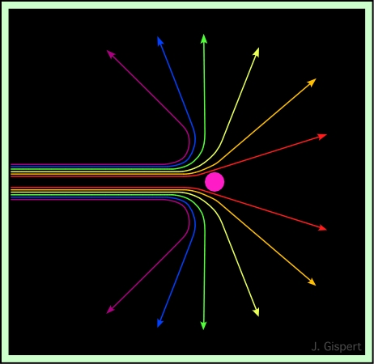

*Diffusion par un atome ou une molécule*

C’est ce qui se passe dans notre ciel. Les molécules qui constituent le ciel de la Terre (O2, N2) sont plus petites que la longueur d’onde de la lumière visible. Elle vont donc diffuser selon la loi de Rayleigh. Par conséquent, le bleu est fortement diffusé dans toutes les directions.

Si on regarde en direction du Soleil, celui-ci nous apparaîtra privé de ses radiations bleues&#8239;: on voit le Soleil plutôt jaune, alors que son maximum d’intensité est dans le jaune-vert. Mais en éparpillant le bleu, on augmente la proportion de jaune. Si au contraire on regarde dans une autre direction, on verra la lumière diffusée par les molécules, c’est-à-dire la radiation bleue. C’est ce qui donne sa couleur à notre ciel.

Lorsque le Soleil se couche, ses rayons traversent une bien plus grande épaisseur d’atmosphère. La diffusion en est fortement augmentée. Les rayons bleus sont totalement diffusés, et le Soleil apparaît rouge, et beaucoup moins brillant.

### Diffusion de Mie

C’est celle qui est produite par des particules dont la taille est bien supérieure à la longueur d’onde de la lumière. Les interactions sont bien plus complexes, et surtout **dépendent peu de la longueur d’onde**. L’absorption produite ici est en **1 / λ**.

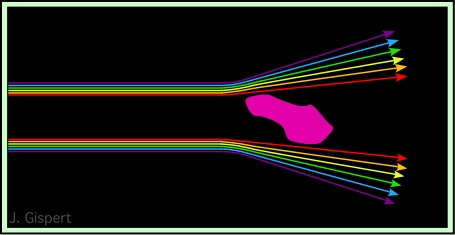

Entre le bleu et le rouge, il n’y a qu’un rapport 2 en longueur d’onde. Il n’y aura donc qu’un rapport 1/2 sur la diffusion des deux couleurs. Pratiquement, toutes les couleurs sont diffusées de manière sensiblement égale, et assombries pareillement. C’est ce qui explique que les nuages, constitués de goutellettes d’eau minuscules mais bien plus grosses que la longueur d’onde de la lumière, diffusent également toutes les couleurs. Ils nous apparaissent par conséquent de blancs à gris, selon leur densité qui détermine la quantité de lumière absorbée.

### Polarisation

La lumière naturelle est constituée d’un ensemble d’ondes, produites chacune par une source différente. Chaque onde vibre donc dans un plan particulier, et la lumière est leur superposition. Cette lumière n’est pas polarisée.

La [polarisation](https://astronomia.fr/1ere_partie/polarisation.php) est une sélection d’un plan de vibration particulier de la lumière. Si toutes les sources vibrent dans le même plan, toutes les ondes sont dans ce plan, et la lumière est *totalement polarisée*. Si certains plans sont seulement favorisés, la lumière est *partiellement polarisée*.

De nombreux mécanismes physiques polarisent la lumière, et l’étude de cette polarisation donne donc des informations sur ce qui l’a produite. En particulier, les poussières interstellaires, si elles sont légèrement magnétiques, s’orientent suivant les lignes du champ magnétique galactique. Elles présentent alors toutes la même orientation, et leur interaction avec la lumière qui les traverse produit une polarisation partielle. L’analyse de cette polarisation nous renseigne sur les poussières, et sur le champ magnétique qui les oriente.
