import Encadre from '../../../components/chapitre/Encadre.astro';

Ce chapitre n’est pas un cours de mécanique céleste, sujet bien trop complexe pour le cadre de ce cours. Au contraire, il est destiné à donner les connaissances essentielles, accessibles avec un niveau de maths-physique de terminale. Vous y trouverez une démonstration géométrique des propriétés des orbites elliptiques, et quelques formules importantes pour comprendre le comportement des planètes.

La Mécanique Céleste est l’application de la [Gravitation Universelle](https://astronomia.fr/seminaires/annee1112/gravitationUniverselle.php) au mouvement des corps célestes.

## Définition et propriétés de l’ellipse

### Définition

L’ellipse est l’ensemble des points du plan dont la somme des distances à deux points fixes appellés *foyers*, et notés S et S', est constante.

D’autres définitions de l’ellipse existent, mais celle-ci est la plus simple.

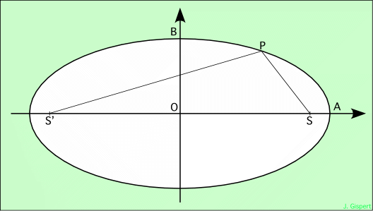

Pour tout point P de l’ellipse, on a&#8239;: S'P + SP = cste

Notons&#8239;: OA = a le *demi grand axe*, OB = b le *demi petit axe*, OS = OS' = c la *demie distance focale*

**Première conséquence**&#8239;: A étant un point de l’ellipse, on a donc en particulier&#8239;: S'A + SA = cste

or S'A = S'O + OA = c + a et SA = OA - OS = a - c

donc S'A + SA = c + a + a - c = 2a

Par conséquent la constante est 2a, et pour tout point P de l’ellipse&#8239;:

<Encadre type="plus">
pse S'P + SP = 2a
</Encadre>

**Deuxième conséquence**&#8239;: appliquons la somme des distances pour le point B. Il vient S'B + SB = 2a. Mais l’axe vertical est un axe de symétrie pour l’ellipse. Donc, S'B = SB. Alors, S'B + SB = SB + SB = 2 SB = 2a&#8239;; SB = a.

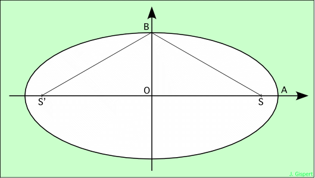

Nous avons un triangle rectangle&#8239;: SOB. Appliquons le théorème de Pythagore&#8239;:

SB2 = SO2 + OB2 = c2 + b2 = a2

En extrayant la racine, il vient&#8239;:

<Encadre type="plus">
c = sqrt(a2 - b2)
</Encadre>

On sait maintenant où se trouvent les foyers.

### Equation de l’ellipse

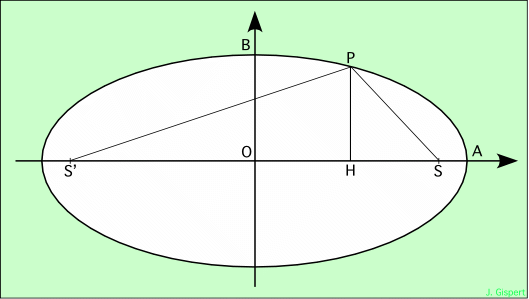

La définition de l’ellipse permet de trouver directement son équation cartésienne. Il suffit d’évaluer les deux distances. Pour cela, remarquons que nous avons deux triangles rectangles. Chacun permet d’évaluer une distance&#8239;:

<table>
<tbody>
<tr><td>S'P2 = S'H2 + HP2 = (c + x)2 + y2</td><td></td><td>SP2 = SH2 + HP2 = (c - x)2 + y2</td></tr>
</tbody>
</table>

Prenant la racine de chacune de ces expressions, nous avons les distances recherchées&#8239;:

<table>
<tbody>
<tr><td>S'P = sqrt((c + x)2 + y2)</td><td></td><td>SP = sqrt((c - x)2 + y2)</td></tr>
</tbody>
</table>

Il ne reste qu’à substituer ces expressions dans la définition de l’ellipse&#8239;:

sqrt((c + x)2 + y2) + sqrt((c - x)2 + y2) = 2a

Ceci constitue une équation tout à fait exacte de l’ellipse, mais assez complexe. Il est élémentaire, mais pas très facile, de la réduire pour obtenir la forme habituelle&#8239;:

<Encadre type="plus">
x2 / a2 + y2 / b2 - 1 = 0
</Encadre>

Remarque&#8239;: si b = a, l’équation devient x2 / a2 + y2 / a2 - 1 = 0

Ou encore&#8239;: x2 + y2 = a2.

C’est l’équation du cercle de rayon a. Le cercle est donc un cas particulier d’ellipse. Et par suite, l’ellipse apparaît comme un cercle plus ou moins aplati.

### Excentricité

On peut envisager de mesurer l’aplatissement de l’ellipse par rapport au cercle. En traçant diverses ellipses de même demi grand axe, mais plus ou moins aplaties, on remarque que les deux foyers se rapprochent du centre lorsque l’ellipse tend vers le cercle. On peut alors comparer la distance focale c au demi grand axe a pour mesurer l’aplatissement. On défini l’*excentricité* e comme le rapport c / a&#8239;:

<Encadre type="plus">
e = c / a
</Encadre>

Pour le cercle, puisque c2 = a2 - b2 = a2 - a2 = 0, l’excentricité e = c / a = 0. Un cercle est donc une ellipse d’excentricité nulle, ce qui correspond bien avec la notion intuitive d’aplatissement.

Il est fréquent d’insérer une sonde en orbite autour d’une planète sur une orbite fortement elliptique et, par des manœuvres appropriées, de la *circulariser*. La remarque ci-dessus le justifie.

### Transformation

*L’ellipse se déduit de son cercle principal par une similitude de rapport* b / a

Considérons une ellipse, et son cercle exinscrit (de rayon a donc). L’équation du cercle est x2 + y2 = a2.

Appliquons à cette équation une similitude de rapport k, k &lt; 1, perpendiculaire au grand axe. Ceci revient à ne pas changer la coordonnée horizontale x, et à multiplier la coordonnée verticale par k&#8239;:

<table>
<tbody>
<tr><td>x</td><td>→</td><td>x</td><td></td><td>y</td><td>→</td><td>k y</td></tr>
</tbody>
</table>

L’équation du cercle devient&#8239;: x2 + k2 y2 = a2

Divisons tout par a2&#8239;: x2 / a2 + k2 y2 / a2 = 1

Soit b, défini par b2 = a2 / k2. L’équation prend la forme&#8239;: x2 / a2 + y2 / b2 = 1

On reconnait l’équation d’une ellipse de demi-axes a et b.

L’excentricité de cette ellipse est e = c / a. Donc e2 = c2 / a2. Nous avons vu que c2 = a2 - b2. Par conséquent&#8239;: e2 = (a2 - b2) / a2.

Par la définition de b&#8239;: e2 = (a2 - a2 / k2) / a2

En simplifiant le membre de droite par a2&#8239;: e2 = 1 - 1 / k2

L’excentricité de l’ellipse en fonction du rapport de similitude est&#8239;: e = sqrt(1 - 1 / k2).

On peut inverser cette formule pour trouver le rapport de similitude en fonction de l’excentricité&#8239;: k = sqrt(1 / (1 - e2)).

### Surface

La surface de l’ellipse se calcule par une intégrale. Elle vaut&#8239;:

<Encadre type="plus">
s = π a b
</Encadre>

On peut la rapprocher de celle du cercle, puisqu’un cercle est une ellipse d’excentricité nulle, a et b jouant chacun le même rôle qu’un rayon r. Si on rapproche jusqu’à confondre les deux foyers, ils forment le centre d’un cercle. Dans la même opération, b tend vers a, et a devient le rayon de cercle. Donc, π a b tend vers π r2.

## Cinématique

### Mouvement elliptique

On trace un schéma montrant l’ellipse décrite par la planète, avec les axes de coordonnées placés en son centre O. Les deux foyers de l’ellipse sont notés S et S', S est du côté positif de l’axe x. Le Soleil est placé en S.

Ce qui suit est illustré pour le Soleil et une planète, mais convient parfaitement pour tout objet de faible masse tournant autour d’un objet beaucoup plus massif (on peut négliger la masse de celui qui orbite). De manière générale, le sommet A de l’orbite est nommé *périastre*, le sommet opposé sur le grand axe A' est nommé *aposatre*.

A est l’un des sommets du demi grand-axe, le périhélie de l’orbite (à remplacer par périgée, ou périastre selon la nature de l’astre central). Le point P sur l’ellipse est la planète. La longueur OA du demi grand-axe est notée a.

On construit le cercle exinscrit à l’ellipse (on l’appelle *cercle principal*). Ce cercle de centre O est tangent aux sommets du grand axe, donc son rayon est égal au demi grand-axe de l’orbite.

On construit P' la contre-projection de la planète P sur le cercle circonscrit à l’orbite. OP' est donc un rayon du cercle exinscrit, et par suite OP' = OA = a. Le *rayon vecteur* est la ligne SP qui joint la planète à l’objet qui la tient en orbite, c’est-à-dire au foyer positif de l’orbite. H est la projection de la planète sur le demi grand-axe. H, P et P' sont donc alignés.

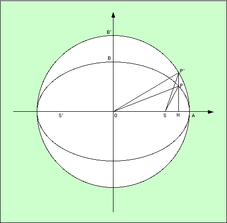

L’*anomalie vraie* est l’angle que fait le *rayon vecteur* SP avec la direction du périhélie SA, donc l’angle v = (SA, SP).

L’*anomalie excentrique* est l’angle que fait le demi grand axe avec la ligne joignant le centre de l’ellipse à la contre-projection de la planète sur le cercle circonscrit&#8239;: c’est l’angle u = (OA, OP').

*La lettre représente la surface d’une figure&#8239;; par exemple représente la surface du triangle OSP'.*

L’angle u étant l’angle entre les axes OA et OP'&#8239;:

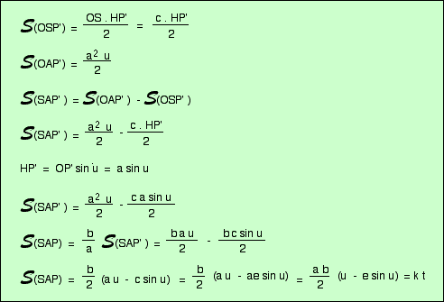

Soit S la surface de l’ellipse&#8239;:

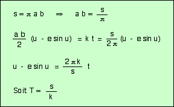

Il vient enfin&#8239;:

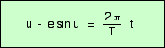

C’est l’**équation de Kepler**.

La constante M = 2 π / T est nommée *moyen mouvement*. C’est la vitesse angulaire qu’aurait un mobile parcourant le cercle circonscrit à l’ellipse à vitesse constante. L’équation de Kepler se met sous la forme&#8239;:

<Encadre type="plus">
u - e sin u = M t
</Encadre>

Bien sûr, M dépend de la planète considérée, mais il est constant dans le temps. La quantité M × t est l’*anomalie moyenne*.

Pour déterminer la position d’une planète sur son orbite à un instant t, il faut tout d’abord résoudre l’équation de Kepler, qui donne u. La position de la planète est vraiment définie par son anomalie vraie, angle v fait par les axes OA et OP. Il existe une relation simple entre u et v.

### Résolution de l’équation de Kepler

Nommons m l’anomalie moyenne. Ce qui donne m = M t

u - e sin u = m

On utilise une méthode d’approximations successives. Si u était petit, on aurait sin u ~ u et donc on utilise cette approximation&#8239;:

u - e u = m ⇒ u (1 - e) = m et

<Encadre type="plus">
u0 = m / (1 - e)
</Encadre>

On utilise cette valeur pour calculer une meilleure approximation, en remplaçant sin u par sin u0

u1 = e sin u0 + m

Et plus généralement, on calcule la suite

<Encadre type="plus">
un = e sin un-1 + m
</Encadre>

jusqu’à ce que |un - un-1| &lt; ε

La dernière valeur calculée de u est la solution de l’équation de Kepler à ε près.

C’est une méthode de point fixe, car on a trouvé une valeur telle que u = f(u) avec f(u) = e sin u + m

Cette méthode converge très vite, il suffit de trois itérations pour obtenir une précision de 3 chiffres après la virgule (millième).

### Passage de l’anomalie excentrique à l’anomalie vraie

Une fois l’anomalie excentrique calculée, il faut revenir à l’anomalie vraie, qui définit la position de la planète sur son orbite dans des coordonnées centrées sur l’objet attracteur, et non sur le centre de l’ellipse. La formule de passage s’obtient par des considérations trigonométriques simples&#8239;:

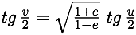

Pour achever le calcul, on doit donc calculer k = le terme de droite. Ensuite, on en prend l’arc tangente (fonction inverse sur les calculettes), puis on multiplie par 2.

Les formules ci-dessous permettront de calculer les valeurs que l’on désire connaître, comme le rayon vecteur ou la position cartésienne de la planète

### Formules utiles

**Rayon vecteur**&#8239;: r = SP = a (1 - e cos u)

**Coordonnées**&#8239;: si le centre des coordonnées est au foyer de l’ellipse, on a&#8239;:

<table>
<tbody>
<tr><td>SH = x = a (cos u - e)</td></tr>
<tr><td>HP = y = a sqrt(1 - e2) sin u</td></tr>
</tbody>
</table>

**Distance périhélique**&#8239;: c’est la distance q entre le foyer S et le périhélie (périastre). Un coup d’œil sur la figure montre que q = a - c. Puisque e = c / a, q = a - a e = a (1 - e).

**Distance aphélique**&#8239;: c’est la distance Q entre le foyer S et l’aphélie (périastre). La figure montre que Q = c + a. Puisque e = c / a, Q = a e + a = a (1 + e).

<table>
<tbody>
<tr><td>q = a (1 - e)</td></tr>
<tr><td>Q = a (1 + e)</td></tr>
</tbody>
</table>

La variation de distance au Soleil, entre le périhélie et l’aphélie, est donc Q - q = a (1 + e) - a (1 - e) = 2 a e. La variation relative est donc (Q - q) / a = 2 a e / a = 2 e. Pour une planète d’excentricité e = 0,02 (la Terre), la variation relative est de 0,04, soit 4 %. On voit clairement qu’une si petite variation de distance au Soleil ne peut pas expliquer les saisons…

### Vitesse orbitale

Les variations de vitesse entre le périastre et l’apoastre découlent de la conservation de l’énergie. Nous ne donnerons que le résultat. La vitesse de la planète, lorsqu’elle se trouve à la distance r du Soleil, vaut&#8239;:

<Encadre type="plus">
v2 = G (M + m) (2 / r - 1 / a)
</Encadre>

Si on néglige la masse de la planète, on obtient la formule approchée&#8239;: v2 = G M (2 / r - 1 / a)

On peut en déduire immédiatement les vitesses périhélique et aphélique. Il suffit de remplacer r par les valeurs q et Q correspondantes.

Périhélie&#8239;: vp2 = G M (2 / q - 1 / a) = G M (2 /( a (1 - e)) - 1 / a) = (G M / a) (2 /(1 - e) - 1) = (G M / a) × (1 + e) /(1 - e)

Aphélie&#8239;: va2 = G M (2 / Q - 1 / a) = G M (2 /( a (1 + e)) - 1 / a) = (G M / a) (2 /(1 + e) - 1) = (G M / a) × (1 - e) /(1 + e)

<Encadre type="plus">
vp2 = (G M / a) × (1 + e) /(1 - e)  va2 = (G M / a) × (1 - e) /(1 + e)
</Encadre>

### Période orbitale

C’est la durée de l’année, pour une planète, temps mis pour effectuer une orbite complète. La voici sans démonstration&#8239;:

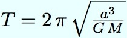

où G est toujours la constante de la gravitation universelle, et a le demi grand axe de l’orbite. Cette formule est la même approximation que précédemment, elle est valable lorsque la masse de la planète est négligeable devant celle du Soleil.

La masse du Soleil est au dénominateur, donc plus elle est grande, plus courte est la période (à demi grand-axe constant). C’est bien normal, pour contrabalancer une attraction plus forte, il faut une plus grande vitesse…

Justification de la formule&#8239;: élevons-la au carré. On obtient&#8239;:

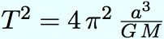

qui donne&#8239;:

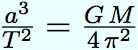

Ce n’est pas sans nous rappeller la loi harmonique de Kepler&#8239;! C’est bien elle en effet qui nous donne la période, connaissant le demi grand axe et la masse du Soleil. Kepler l’a énoncée en disant que le rapport est constant, sans expliciter la constante. Nous connaissons maintenant sa valeur.

### Progression de la vitesse avec l’éloignement

Considérons une orbite circulaire, de rayon a (c’est le demi grand axe d’une ellipse d’excentricité 0). La longueur de la circonférence est le trajet à parcourir pour accomplir un tour complet autour du Soleil. Elle s’écrit L = 2 π a. Elle est parcourue dans le temps T (la période de l’orbite, durée de l’année pour cette planète). La vitesse moyenne de la planète sur son orbite au cours de son année, est v = L / T = 2 π a / T. Donc, T = 2 π a / v. Oublions la constante 2 π, en écrivant que T est proportionnelle à a / v&#8239;: T ∝ a / v. Prenons maintenant la troisième loi de Kepler a3 / T2 = cste. D’où a3 = k T2, et là aussi oublions la constante&#8239;: a3 ∝ T2. Enfin, remplaçons T par sa valeur proportionnelle trouvée plus haut&#8239;:

T ∝ a / v et a3 ∝ T2 donnent T2 ∝ (a / v)2 et donc a3 ∝ (a / v)2.

Donc a3 ∝ a2 / v2, ce qui se simplifiie en&#8239;:

a ∝ 1 / v2 et v2 ∝ 1 / a

<Encadre type="plus">
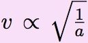
</Encadre>

Avec l’éloignement au Soleil croissant, la vitesse des planètes diminue comme la racine carrée de l’inverse de la distance. Une planète 4 fois plus loin, va deux fois moins vite.

## Orbite de transfert de Hohmann

Pour envoyer une sonde depuis la Terre vers une planète, de nombreuses trajectoires sont possibles, qui diffèrent par le temps de parcours, et la quantité de carburant nécessaire. La trajectoire la plus économique est la trajectoire de Hohmann, qui est tangente aux orbites de départ et d’arrivée. C’est celle qui minimise la différence de vitesse entre la cible (planète visée) et la sonde à l’arrivée. Elle minimise de façon symétrique la différence de vitesse au départ.

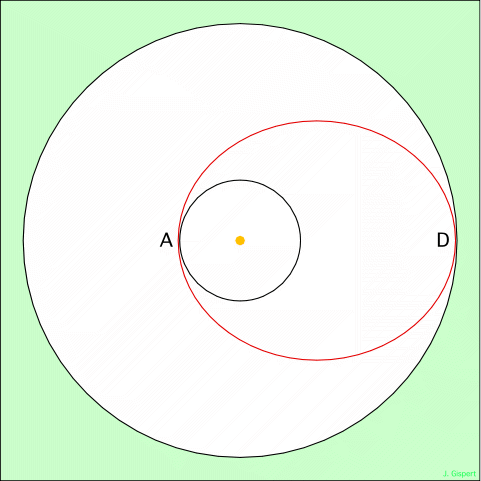

Pour simplifier un peu le problème, on considère seulement des orbites circulaires pour les deux planètes. L’aphélie de l’orbite cherchée est au niveau de l’orbite de départ, disons à la distance R du Soleil. A l’arrivée, le périhélie est au niveau de la planète cible, soit r. On a donc, q et Q dénotant les distances périhélique et aphélique de l’orbite de Hohmann&#8239;: Q = R, q = r. Donc Q = a (1 + e) = R et q = a (1 - e) = r.

On tire la valeur de a des deux équations&#8239;: a = R / (1 + e)&#8239;; a = r / (1 - e)

En égalant les deux valeurs de a&#8239;: R / (1 + e) = r / (1 - e), d’où R (1 - e) = r (1 + e)

Effectuant&#8239;: R - R e = r + r e

Regroupant les termes en e&#8239;: R - r = R e + r e = e (R + r)

D’où&#8239;: e = (R - r) / (R + r)

Il est plus facile encore de calculer le demi grand axe de l’orbite de Hohmann. En regardant la figure, on voit que le grand axe est tout simplement la distance entre A et D. AD = AS + SD = r + R. Le demi grand axe est la moitié de cette distance. L’ellipse de Hohmann de ce transfert est donc définie par&#8239;:

<Encadre type="plus">
e = (R - r) / (R + r)  a = (R + r) / 2
</Encadre>

Dans le cas où l’orbite cible n’est pas circulaire, l’orbite de tranfert l’atteint tangentiellement à l’aphélie et au périhélie, mais pas en les autres points. Si donc on est amené à atteindre cette orbite ailleurs qu’en un sommet du grand axe, l’approche se fera sous un certain angle, nécessitant davantage de carburant pour freiner la sonde. Nous ne rentrerons pas dans les détails ici.

### Application au lancement de Messenger

Le départ est la Terre, l’arrivée Mercure. Les calculs ci-dessus concernent une sonde déjà placée sur l’orbite de la Terre. Ils ne tiennent pas compte du départ du sol de la Terre pour atteindre cette orbite (11,2 km s-1). De même, la mise en orbite autour de la cible n’est pas considérée. Calculons la vitesse à donner à la sonde pour que, au départ de l’orbite terrestre, elle aille tangenter l’orbite de Mercure. L’orbite est donc l’orbite de Hohmann, où R = 150 106 km, et r = 58 106 km.

Le demi grand axe de l’orbite est a = (R + r) / 2 = (150 + 58) / 2 = **104 106 km**. L’excentricité est e = (R - r) / (R + r) = (150 - 58) / (150 + 58) = 92 / 208 = **0,442**.

Pour savoir s’il est possible de lancer une sonde, il faut déterminer le coût en carburant, donc la vitesse à impulser à la sonde. Calculons le terme commun aux deux vitesses&#8239;: G M / a = 6,67 10-11 m3 kg-1 s-2 × 2 1030 kg / 104 109 m = 0,128 1010 m2 s-2

va2 = (G M / a) × (1 - e) /(1 + e) = 0,128 1010 m2 s-2 (1 - 0,442) / (1 + 0,442) = 0,0495 1010 m2 s-2

Prenant la racine carrée va = 0,223 105 m s-1 = 0,223 102 km s-1 = 22,3 km s-1.

La sonde est animée de la vitesse orbitale de la Terre, soit 30 km s-1, puisqu’elle est sur son orbite. Il faut donc la freiner de 30 - 22,3 = **7,7 km s-1** pour l’expédier en direction de Mercure.

A l’arrivée, elle possède la vitesse périhélique, soit&#8239;: vp2 = (G M / a) × (1 + e) /(1 - e) = 0,128 1010 m2 s-2 (1 + 0,442) /(1 - 0,442) = 0,331 1010 m2 s-2

Prenant la racine carrée va = 0,575 105 m s-1 = 0,575 102 km s-1 = 57,5 km s-1.

La sonde arrive à 57,5 km s-1, alors que la vitesse orbitale de la planète n’est que de 47,9 km s-1. Là encore, la sonde doit freiner pour éviter de retourner vers la Terre. Le freinage est de l’ordre de 57,5 - 47,9 = **9,5 km s-1**. En totalisant les deux manœuvres, on arrive à un coût de 7,7 + 9,5 = **17,2 km s-1**&#8239;! Il faut 1 fois et demi autant de carburant que pour quitter la Terre. Ajoutons à cela qu’il n’y a pas de station-service dans l’espace, et que ce carburant doit être emporté depuis la Terre. On comprend vite qu’il prend toute la place des instruments scientifiques…

### Durée du vol

Ce point est important, étant donné que nous sommes toujours pressés&#8239;! Nous avons donné la période orbitale plus haut. Evidemment, pour aller de la Terre à Mercure (par exemple), la durée du voyage est la moitié de la période. Donc&#8239;:

T = 2 π sqrt(a3 / G M) = 2 π sqrt((104 109)3 m3 / 6,67 10-11 kg-1 m3 s-2 2 1030 kg)

T = 2 π sqrt(1 124 864 1027 m3 / 6,67 10-11 kg-1 m3 s-2 2 1030 kg) = 2 π sqrt(84 322,64 108 s-2) = 2 π × 290,4 104 s = 1 825 104 s = 304 166 mn = 5 069 h = 211 jours. Remarquez que c’est bien une durée intermédiaire entre les 365 jours de la Terre, et les 88 jours de Mercure.

La durée du vol est la moitié, soit 106 jours… 3 mois et demi. On peut aller rapidement sur Mercure, si on a les moyens d’y mettre le prix&#8239;! Comparez cette durée aux 7 ans et demi du voyage réel !…

### Discussion des autres trajectoires

Si, au départ de la Terre, on communique à la sonde une vitesse moindre (freinage plus efficace, donc plus coûteux), il est facile de constater que la sonde plongera plus vite vers le centre du système solaire, et atteindra plus rapidement la cible. A l’arrivée, elle aura une vitesse plus grande que précédemment, et donc le freinage d’arrivée devra aussi être plus fort. Départ et arrivée sont donc plus coûteux… La trajectoire de Hohmann est bien la plus économique… pour un voyage direct&#8239;!

Si nous envisageons au contraire, une vitesse plus grande que celle de Hohmann au départ, la sonde descendra moins vers le Soleil, et n’atteindra pas du tout la planète. Le but est raté. La trajectoire de Hohmann reste bien la meilleure dans ce sens-là. Mais imaginons qu’au lieu de faire deux manœuvres, une au départ et une à l’arrivée, on accepte d’en faire davantage, en fait de ne pas aller directement vers la cible. Comme si on pouvait se ravitailler en cours de route… L’idée semble saugrenue, mais elle ne l’est pas. Si on ne trouve pas de carburant à mettre dans les moteurs en cours de voyage, on peut tout de même trouver de l’énergie… gravitationnelle&#8239;!

Nous pouvons refaire le calcul en remplaçant la cible Mercure par Vénus. Plus proche de la Terre, celle-ci nécessite bien sûr moins de dépenses pour y aller (les différences de vitesses sont moindres). Maintenant, si notre sonde arrive à proximité de Vénus, elle est prise dans le champ gravitationnel de cette planète. A condition d’arriver sous le bon angle, elle peut être déviée de telle sorte qu’elle aille vers Mercure. Si on calcule bien pour que la nouvelle orbite soit une trajectoire de Hohmann entre Vénus et Mercure, elle arrive à proximité de cette dernière avec une vitesse moindre que depuis la Terre, puisque Vénus en est moins éloignée. Le freinage à l’arrivée est moins violent, et là aussi, on économise du carburant.

Pour tout dire, les choses sont encore délicates, et pour arriver à une consommation acceptable, il faut encore un peu d’imagination. Par exemple, ne pas ambitionner de se mettre en orbite immédiatement. Pourquoi, en effet, ne pas utiliser également le champ gravitationnel de Mercure elle-même pour abaisser l’aphélie de la nouvelle orbite, afin que la sonde ne retourne pas vers Vénus, mais reste à proximité de l’orbite de Mercure, qu’elle pourra retrouver un peu plus tard (un tour de Soleil plus tard à peu près), avec une vitesse bien moindre, et donc un nouveau gain sur le carburant de freinage.

Cette technique se nomme [*assistance gravitationnelle*](https://astronomia.fr/seminaires/annee1415/assistanceGravit.php). Elle est maintenant bien utilisée. Elle a le gros désavantage d’allonger considérablement la durée du voyage, mais elle est tellement plus économique… On peut remplacer le carburant par des instruments scientifiques, et lorsque la sonde est à l’œuvre, elle glane de bien plus amples renseignements avec ses instruments puissants, et lourds.

Le voyage de Messenger est décrit dans le chapitre consacré à [Mercure](https://astronomia.fr/2eme_partie/planetes/1Mercure/Mercure.php#voyageMessenger).

## Accès aux diverses planètes

Les formules établies plus haut permettent de calculer les paramètres des trajectoires de Hohmann pour atteindre les diverses planètes. Les résultats sont instructifs pour évaluer nos chances d’explorer les planètes.

***Orbites de Hohmann de la Terre vers chacune des planètes***

<table>
<thead>
<tr><th></th><th>Mercure</th><th>Vénus</th><th>Mars</th><th>Jupiter</th><th>Saturne</th><th>Uranus</th><th>Neptune</th><th>Pluton</th></tr>
</thead>
<tbody>
<tr><td>a planète visée (UA)</td><td>0,3871</td><td>0,7233</td><td>1,5237</td><td>5,2034</td><td>9,5371</td><td>19,1913</td><td>30,0690</td><td>39,4817</td></tr>
<tr><td>vitesse orbitale</td><td>47,87</td><td>35,02</td><td>24,9</td><td>13,07</td><td>13,07</td><td>13,07</td><td>13,07</td><td>13,07</td></tr>
<tr><td>a Hohmann (UA)</td><td>0,695</td><td>0,862</td><td>1,263</td><td>3,102</td><td>5,271</td><td>10,097</td><td>15,535</td><td>20,241</td></tr>
<tr><td>e Hohmann</td><td>0,4423</td><td>0,1628</td><td>0,2063</td><td>0,6767</td><td>0,8098</td><td>0,9007</td><td>0,9355</td><td>0,9505</td></tr>
<tr><td>Vitesse aphélique (km/s)</td><td>22,2</td><td>27,2</td><td>21,5</td><td>7,4</td><td>4,2</td><td>2,1</td><td>1,4</td><td>1,1</td></tr>
<tr><td>Vitesse périhélique (km/s)</td><td>57,4</td><td>37,8</td><td>32,7</td><td>38,5</td><td>40,0</td><td>41,0</td><td>41,4</td><td>41,5</td></tr>
<tr><td>impulsion départ (km/s)</td><td>7,79</td><td>2,79</td><td>2,66</td><td>8,51</td><td>10,01</td><td>11,00</td><td>11,37</td><td>11,53</td></tr>
<tr><td>impulsion arrivée (km/s)</td><td>9,6</td><td>2,77</td><td>3,41</td><td>5,65</td><td>8,86</td><td>10,93</td><td>11,69</td><td>12,02</td></tr>
<tr><td>impulsion totale (km/s)</td><td>17,4</td><td>5,6</td><td>6,1</td><td>14,2</td><td>18,9</td><td>21,9</td><td>23,1</td><td>23,5</td></tr>
<tr><td>T (années)</td><td>0,580</td><td>0,801</td><td>1,420</td><td>5,464</td><td>12,103</td><td>32,091</td><td>61,242</td><td>91,081</td></tr>
<tr><td>durée vol (années)</td><td>0,290</td><td>0,400</td><td>0,710</td><td>2,732</td><td>6,052</td><td>16,045</td><td>30,621</td><td>45,541</td></tr>
<tr><td>durée vol</td><td>3 mois 1/2</td><td>presque 5 mois</td><td>8 mois 1/2</td><td>2 ans 9 mois</td><td>6 ans</td><td>16 ans</td><td>30 ans</td><td>45 ans</td></tr>
</tbody>
</table>

La notation *a planète visée* indique le demi grand axe de la planète cible de la sonde. *a Hohmann* est le demi grand axe de l’orbite de la sonde. *e Hohmann* est l’excentricité de l’orbite de Hohmann. Les vitesses aphélique et périhélique sont celle de la sonde en ces points de l’obite de Hohmann. Si la planète visée est intérieure (Mercure ou Vénus), l’aphélie est au niveau de la Terre, le périhélie au niveau de la cible. Si la planète visée est supérieure, c’est le contraire, le départ est le périhélie et l’arrivée l’aphélie. *T* est la période de l’orbite de Hohmann.

Ce tableau est assez instructif. Remarquons d’abord que le voyage vers Vénus (presque 5 mois) est bien plus long que celui à destination de Mercure&#8239;! Ceci peut paraître bien paradoxal, mais s’explique parfaitement&#8239;: la route vers Mercure tombe plus directement en direction du Soleil, et donc à plus grande vitesse (comparez les vitesses périhéliques des deux trajectoires&#8239;: 20 km/s de plus à l’arrivée sur Mercure). De plus, le trajet est plus tendu, plus droit, et bien qu’il soit plus long, il l’est moins que ce que la différence de distance des deux planètes le laisserait supposer. Au bout du compte, la durée est plus courte. Un autre argument consiste à imaginer une planète cible qui serait très proche de l’orbite de la Terre. La trajectoire de Hohmann pour atteindre cette planète serait elle aussi très proche de l’orbite de la Terre, donc pour faire un demi-tour autour du Soleil, il lui faudrait presque six mois&#8239;!

Mais le prix à payer pour atteindre Mercure est bien plus élevé que pour Vénus&#8239;: l’impulsion totale à donner à la sonde (donc sa consommation de carburant) est de 17,5 km/s contre 5,6. Une sonde de même poids emporte donc beaucoup moins de carburant pour aller vers Vénus, et ce carburant peut être remplacé par des instruments scientifiques. Ceci explique sans doute que Vénus ait été très courtisée, contrairement à Mercure…

Si vous considérez Mars, vous voyez que le voyage dure 8 mois et demi. C’est effectivement le temps que mettent les sondes pour accomplir le trajet. On pourrait aller vers Mars plus rapidement, en accélérant davantage au départ, et en freinant davantage aussi à l’arrivée. Ce serait peut-être envisageable pour un équipage humain, afin de l’exposer moins longtemps aux conditions spatiales. Mais pour assurer sa survie, il faut un surcroît très important de matériel, qui alourdit le vaisseau… D’où l’idée de transporter par la trajectoire de Hohmann le matériel nécessaire à la vie sur Mars, et celui de retour, tandis que l’équipage est amené par un vaisseau léger sur une trajectoire plus tendue, plus rapide. On atteint le but au prix d’une complication très importante de la logistique.

Venons en aux planètes plus lointaines maintenant. Pour atteindre Jupiter, le voyage dure presque 3 ans et coûte 14,2 km/s, ceci sur la trajectoire directe la plus économique. C’est encore acceptable. Mais pour Saturne, 6 ans et 18,9 km/s deviennent vraiment difficiles à supporter. Aussi, il ne faut pas s’étonner si les sondes à destination de Saturne font un petit tour du côté de Jupiter, pour profiter de son assistance.

Pour atteindre Pluton, il faut patienter pendant 45 ans avant l’arrivée de la sonde. Quels sont les jeunes chercheurs qui travailleront sur une sonde, dont les premiers résultats seront disponibles lorsqu’ils seront à la retraite&#8239;? C’est difficilement envisageable. D’autant plus que rien ne garantit la survie de la sonde pendant une telle durée dans l’espace. L’assistance gravitationnelle s’impose donc. Dans ce cas, elle permet d’utiliser, grâce à l’énergie prélevée aux planètes, une trajectoire plus tendue, et finalement plus rapide&#8239;!

La sonde *Dawn*, à destination de Vesta (dans la Ceinture Principale des astéroïdes) a utilisé l’assistance gravitationnelle de Mars. Elle s’est mise en orbite autour de Vesta.

*New Horizons*, en route vers Pluton, a profité de l’aide de Jupiter. Dans ce dernier cas, il ne s’agit que d’un simple survol, et l’énergie de freinage à l’arrivée est évitée. Sans assitance gravitationnelle, ce serait seulement une impulsion de 11,53 km/s qu’il faudrait communiquer à la sonde au départ. L’assitance de Jupiter permet de réduire encore ce coût.

### Fenêtre de lancement

Considérons le lancement d’une sonde vers Jupiter. A quelle date doit-on la lancer pour qu’elle soit au rendez-vous avec la planète&#8239;?

On suppose que les orbites des planètes sont des cercles, ce qui est acceptable pour une approximation, et simplifie le calcul des positions.

**Données du problème**&#8239;:

- Dans le tableau ci-dessus, nous voyons que la durée du vol vers Jupiter (notée d) est de 2,732 ans. Transformons cette valeur en jours&#8239;: d = 2,732 × 365,25 = **997,9 jours**.
- Jupiter fait un tour complet autour du Soleil (360°) en 11 ans 312,85 jours (voir la [fiche](https://astronomia.fr/7eme_partie/fiches/fic_planetes.php)) soit 11 × 365,25 + 312,85 jours = **4.330,6 jours**. Par conséquent, Jupiter se déplace sur son orbite à la vitesse angulaire ωJ = 360° / 4.330,6 jours = 0,0831 °/jour.
- Pareillement, la Terre met 365,25 jours pour accomplir un tour complet autour du Soleil. Donc elle parcourt ωT = 360° / 365,25 jours = 0,986 °/jour.

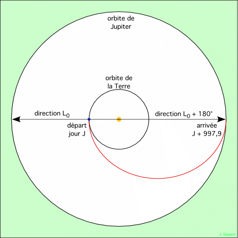

Au jour J du lancement, la Terre et Jupiter se trouvent quelque part sur leur orbite. La position de la Terre est repérée par sa longitude L0. C’est aussi la position de la sonde au lancement. Lorsque la sonde arrive au rendez-vous, 997,9 jours plus tard, elle se trouve exactement de l’autre côté du Soleil, puisqu’elle a parcouru la moitié de l’orbite de Hohmann. Donc, le jour J + 997,9 la sonde se trouve à la longitude L0 + 180°.

Pour que le rendez-vous se réalise, il faut que Jupiter soit là également. Donc, Jupiter doit se trouver à la longitude L0 + 180° le jour J + 997,9.

Jupiter se déplaçant à raison de ωJ = 0,0831 °/jour pendant 997,9 jours il parcourt 0,0831 °/jour × 997,9 jours = 82,9°. Le jour du lancement, Jupiter est donc à 82,9° du lieu de rendez-vous. Sa longitude est donc L0 + 180° - 82,9° = L0 + 97,1°. **Jupiter est en avance de 97,1° par rapport à la Terre**. C’est la condition que doivent satisfaire les orbites pour que le rendez-vous soit réalisé. Le jour du lancement, les directions de la Terre et de Jupiter sont pratiquement perpendiculaires vues du Soleil&#8239;:

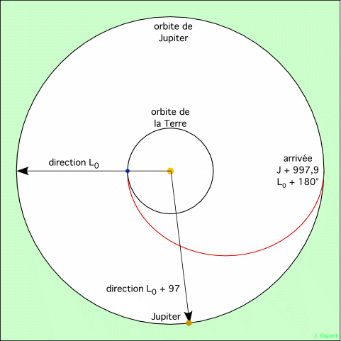

Ce schéma montre les positions de la Terre et de Jupiter le jour du lancement. Planètes et sonde tournent dans le sens inverse des aiguilles d’une montre.

Il ne reste qu’à déterminer la date de lancement. Pour cela, il faut savoir où se trouvent les planètes à un instant donné. On peut choisir par exemple l’instant de l’opposition de Jupiter, qu’on trouve dans les éphémérides. A ce moment-là, la Terre, Jupiter et le Soleil sont alignés. Par conséquent, la longitude de Jupiter est égale à celle de la Terre (c’est d’ailleurs la définition même de l’opposition). Notons lop cette longitude.

A une date t comptée à partir de l’opposition, la Terre se trouve à la longitude lT = lop + ωT × t = lop + 0,986 °/jour × t, et Jupiter se trouve à la longitude lJ = lop + ωJ × t = lop + 0,0831 °/jour × t.

Pour que le rendez-vous se réalise, il faut que Jupiter soit en avance de 97,1° sur la Terre, donc que lop + 0,0831 °/jour × t = lop + 0,986 °/jour × t + 97,1°. lop se simplifie, et il reste 0,0831 °/jour × t = 0,986 °/jour × t + 97,1°. On en tire (0,0831 °/jour - 0,986 °/jour) × t = 97,1° et enfin t = 97,1° / (0,0831 °/jour - 0,986 °/jour) = -107,5 jours. Le signe - indique que cette position est 107,5 jours **avant** l’opposition. Ce résultat est évident, puisque Jupiter va moins vite que la Terre, c’est elle qui l’a rattrapé&#8239;!

L’approximation faite en considérant les orbites circulaires donne un résultat approché. Il est assez facile de l’affiner pour obtenir une date de lancement exacte, que nous allons considérer par la suite.

Si on s’en tient à cette valeur, on devrait lancer la sonde précisément ce jour-là. De multiples problèmes peuvent survenir, par exemple un orage sur le pas de tir. Et le lancement peut être retardé de quelques jours. Si c’est le cas, on ne pourra pas utiliser exactement la trajectoire de Hohmann, et le coût sera plus élevé. La fenêtre de tir est donc la période, autour de cette date, pendant laquelle les réserves de carburant permettent le tir sur une trajectoire un peu plus coûteuse.

#### Exemple

En 1977, l’opposition de Jupiter a eu lieu le 23 décembre, le 357e jour de l’année. Une fenêtre de tir était donc centrée sur le 357 - 107e jour de l’année, soit le 250 e jour de l’année, c’est-à-dire le 7 septembre. Or les deux sondes Voyager ont été lancées les 20 août (Voyager 2) et 5 septembre (Voyager 1), c’est-à-dire 17 jours et 2 jours avant la date calculée respectivement. Cette différence est assez faible pour être compensée par une dépense de carburant un peu plus importante. Mais si ce lancement est celui qui illustre le mieux notre propos, il est toutefois entaché d’un biais, car le but n’était pas de viser Jupiter seul, mais de poursuivre vers Saturne ensuite. Et donc, la position de Saturne jouait un peu dans le choix de la date, en modifiant légèrement l’angle d’arrivée des sondes au niveau de Jupiter.

Le lancement de la sonde Galileo, qui partait elle aussi pour Jupiter, ne peut être considéré, puisqu’elle a largement utilisé l’assistance gravitationnelle (deux fois sur la Terre, puis une fois sur Vénus).

### Calcul général

En généralisant l’exemple ci-dessus, on obtient facilement les équations du problème pour toute planète supérieure. Les données sont&#8239;:

- J le jour du lancement&#8239;;
- d la durée du vol&#8239;;
- ωT la vitesse angulaire de la Terre&#8239;;
- ωP la vitesse angulaire de la planète visée&#8239;;
- l0 la longitude de la Terre le jour J.

La date d’arrivée de la sonde est da = J + d. Ce jour-là, la longitude de la planète est l0 + 180°. Le jour J, elle était donc l0 + 180° - ωP d.

La différence de longitude le jour J entre la planète et la Terre est ΔPT = (l0 + 180° - ωP d) - l0 = 180° - ωP d.

Les éphémérides donnent la longitude des planètes. Il faut déterminer quel jour cette relation est satisfaite. Mais on peut le trouver bien plus rapidement par rapport à l’opposition, comme plus haut.

Soit lop la longitude de l’opposition (longitude commune à la Terre et la planète). Considérons un jour j inconnu. Ce jour-là, la longitude de la Terre est lop + ωT j, et celle de la planète est lop + ωP j.

La différence de longitude est Δ,PT = lop + ωP j - lop - ωT j = ωP j - ωT j = (ωP - ωT) j. Cette différence doit satisfaire la condition ci-dessus&#8239;: (ωP - ωT) j = 180° - ωP d. De là on tire immédiatement&#8239;:

<Encadre type="plus">
j = (180° - ωP d) / (ωP - ωT)
</Encadre>

La valeur obtenue est le nombre de jours entre la date de lancement et celle de l’opposition. La date de l’opposition étant indiquée dans les éphémérides, le problème est résolu.

Nous avons précisé que la solution convenait pour une planète supérieure (l’exemple pris étant Jupiter). Mais où est la limitation pour l’appliquer à une planète inférieure&#8239;? Uniquement dans l’utilisation de l’opposition, qui n’existe pas pour une planète inférieure. Mais l’opposition étant caractérisée par l’alignement des deux planètes avec le Soleil (longitudes égales), ceci à lieu également pour une planète inférieure, le seul changement étant le point d’observation. La Terre n’est plus à l’intérieur, mais à l’extérieur. Ce point particulier se nomme conjonction inférieure. Il suffit donc de considérer que l’opposition pour une planète supérieure est remplacée par la conjonction inférieure pour une planète inférieure.

### Sphère d’influence

On appelle *sphère d’influence* la sphère, centrée sur une planète, à l’intérieur de laquelle une sonde (de masse négligeable) ressent plus fortement l’attraction de la planète que celle du Soleil. A l’intérieur de cette sphère, une sonde est donc sur une orbite centrée sur la planète. Les satellites (naturels ou artificiels) sont à l’intérieur. Si une sonde arrive à proximité d’une planète, avec une vitesse supérieure à la vitesse d’évasion de la planète, elle sera soumise à l’influence de la planète, mais lui échappera malgré tout. Sa trajectoire autour du Soleil en sera modifiée. C’est le principe de l’assistance gravitationnelle.

Il est très facile de définir cette sphère. La force attractive que la sonde ressent du Soleil est Fs = G Ms m / ds2, où ds est la distance de la sonde au Soleil (G constante de la Gravitation Universelle, Ms masse du Soleil, m masse de la sonde). Celle qu’elle ressent de la planète est Fp = G Mp m / dp2, où dp est la distance à la planète, et Mp la masse de la planète. La planète domine à l’intérieur de la sphère où Fp ≥ Fs, c’est-à-dire où G Mp m / dp2 ≥ G Ms m / ds2.

La limite (égalité) défini la surface de la sphère d’influence. Elle est telle que Mp / dp2 = Ms / ds2.

On en tire&#8239;: dp2 = (Mp / Ms) ds2, et dp = ds sqrt(Mp / Ms).

Attention, ce calcul ne tient pas compte de la force centrifuge produite par le mouvement de la sonde autour du Soleil et de la planète. Cette force revient à diminuer l’attraction ressentie. Le résultat correct est dp = ds sqrt(Mp / Ms)2/5.

### Assistance gravitationnelle simple

Reprenons le voyage vers Mercure. Nous avons vu que le vol direct était très coûteux, et nous envisageons maintenant une assistance gravitationnelle de Vénus. Pour cela, on décompose le voyage entre une trajectoire de Hohmann Terre-Vénus d’abord, puis Vénus-Mercure. On donne à la sonde une impulsion pour aller vers Vénus, là on utilise l’assistance gravitationnelle de Vénus pour expédier la sonde vers Mercure, et enfin on donne l’impulsion de freinage au niveau de Mercure. Les deux arcs de Hohmann se raccordent parfaitement, puisque l’arrivée comme le départ de Vénus se font tangentiellement. Les vitesses d’arrivée et de départ au niveau de Vénus sont donc parallèles. Par conséquent, on peut ne tenir compte que de leur module dans le calcul des impulsions.

Le premier segment de ce voyage a été calculé plus haut. Pour la seconde partie, on refait les mêmes calculs, mais en remplaçant les données de la Terre par celle de Vénus. Le demi grand axe est a = (108 + 58) / 2 = 83 millions de km. L’excentricité est e = (R - r) / (R + r) = (108 - 58) / (108 + 58) = 50 / 166 = 0,301. Les vitesses aphélique et périhélique se calculent de la même manière que précédement. Le terme GM / a utilise le demi grand axe de l’orbite de Hohmann. On obtient va = 29,3 km/s et vp = 54,6 km/s.

La sonde arrive vers Vénus à 37,8 km/s (vitesse périhélique de la trajectoire de Hohmann Terre-Vénus, prise dans le tableau). Elle doit en repartir à 29,3 km/s dans la même direction tangentielle. L’impulsion à donner à la sonde est donc un freinage de 37,8 - 29,3 = 8,5 km/s. Elle est prise à la planète par assistance gravitationnelle. Il faut donc calculer précisément l’approche de la sonde (faire de petites corrections de trajectoire) pour que son interaction lui donne exactement cette impulsion. Nous ne calculerons pas ici les détails de cette approche.

La sonde est maintenant en route pour Mercure, où elle arrivera tangentiellement à la vitesse périhélique de sa trajectoire. Cette vitesse est de 54,6 km/s. Mercure se déplaçant à 47,9 km/s, l’impulsion à donner est un freinage de 54,6 km/s - 47,9 km/s = 6,7 km/s.

Le coût total du voyage est maintenant de 2,79 km/s (départ de la Terre, voir tableau) + 6,7 km/s (arrivée sur l’orbite de Mercure) = 2,79 + 6,7 = 9,3 km/s. Par rapport aux 17,4 km/s du voyage direct, ce sont 17,4 - 9,3 = 8,1 km/s. Le gain est appréciable&#8239;! Mais il se paye par une durée accrue. De la Terre à Vénus, il faut 146,3 jours (voir tableau), et de Vénus à Mercure 75,7 jours. Donc un total de 146,3 + 75,7 = 222 jours au lieu de 106 jours. Le voyage est deux fois plus long…

Ceci est une explication qualitative du problème. Aucun calcul n’a été fait au niveau de Vénus, car cette approche complique la situation. En effet, soumise à l’attraction de Vénus, la sonde voit sa trajectoire s’incurver. Elle ne reste donc pas tangentielle comme elle était arrivée. Aussi, faut-il tenir compte de la variation d’angle à la fois pour déterminer le segment Terre-Vénus, que pour le segment Vénus-Mercure. Les deux trajectoires&#8239;; ne sont donc plus des trajectoires de Hohmann pures.

## Utilisation d’un tableur

Si vous voulez faire des calculs, vous pouvez très simplement utiliser un tableur.

### Equation de Kepler (résolution numérique)

Présentez les calculs comme suit&#8239;:

*A gauche, les formules à taper&#8239;; à droite, le résultat visible dans le tableur*

<table>
<tbody>
<tr><td></td><td>A</td><td>B</td></tr>
<tr><td>1</td><td>e</td><td>0,1</td></tr>
<tr><td>2</td><td>M</td><td>0,04</td></tr>
<tr><td>3</td><td>t</td><td>30</td></tr>
<tr><td>4</td><td>m</td><td>=B2&#42;B3</td></tr>
<tr><td>5</td><td>u0</td><td>=B4/(1-B1)</td></tr>
<tr><td>6</td><td>u1</td><td>=B&#36;1&#42;sin(B5)+B&#36;4</td></tr>
<tr><td>7</td><td>u2</td><td>=B&#36;1&#42;sin(B6)+B&#36;4</td></tr>
<tr><td>8</td><td>u3</td><td>=B&#36;1&#42;sin(B7)+B&#36;4</td></tr>
<tr><td>9</td><td></td><td></td></tr>
<tr><td>10</td><td>u3 - e sin u3</td><td>=B8-B&#36;1&#42;sin(B8)</td></tr>
</tbody>
</table>

<table>
<tbody>
<tr><td></td><td>A</td><td>B</td></tr>
<tr><td>1</td><td>e</td><td>0,1</td></tr>
<tr><td>2</td><td>M</td><td>0,04</td></tr>
<tr><td>3</td><td>t</td><td>30</td></tr>
<tr><td>4</td><td>m</td><td>1,2</td></tr>
<tr><td>5</td><td>u0</td><td>1,333333333</td></tr>
<tr><td>6</td><td>u1</td><td>1,29719379</td></tr>
<tr><td>7</td><td>u2</td><td>1,296280373</td></tr>
<tr><td>8</td><td>u3</td><td>1,296255653</td></tr>
<tr><td>9</td><td></td><td></td></tr>
<tr><td>10</td><td>u3 - e sin u3</td><td>1,20000067</td></tr>
</tbody>
</table>

<table>
<tbody>
<tr><td></td><td>A</td><td>B</td></tr>
<tr><td>1</td><td>e</td><td>0,1</td></tr>
<tr><td>2</td><td>M</td><td>0,04</td></tr>
<tr><td>3</td><td>t</td><td>30</td></tr>
<tr><td>4</td><td>m</td><td>1,2</td></tr>
<tr><td>5</td><td>u0</td><td>1,333333333</td></tr>
<tr><td>6</td><td>u1</td><td>1,29719379</td></tr>
<tr><td>7</td><td>u2</td><td>1,296280373</td></tr>
<tr><td>8</td><td>u3</td><td>1,296255653</td></tr>
<tr><td>9</td><td></td><td></td></tr>
<tr><td>10</td><td>u3 - e sin u3</td><td>1,20000067</td></tr>
</tbody>
</table>

Les données e, M et t ont été placées dans les cellules B1, B2 et B3 respectivement. A la ligne 4 vous trouvez le calcul de l’anomalie moyenne m = M t. A la ligne 5, c’est la valeur initiale u0 de l’itération. Les trois lignes suivante effectuent l’itération.

Enfin, après une ligne vide pour séparer le calcul, vous trouvez en ligne 10 la vérification&#8239;: on calcule u - e sin u en utilisant le résultat u3 obtenu dans la cellule B8, et vous pouvez le comparer avec la valeur de m. Vous constaterez que les deux valeurs 1,2 et 1,20000067 sont égales, à 7 10-7 près en seulement trois itérations.

Si vous voulez calculer l’anomalie vraie, ajoutez deux lignes&#8239;:

<table>
<tbody>
<tr><td>11</td><td>k</td><td>=racine(1+B1)/(1-B1))&#42;tan(B8)</td></tr>
<tr><td>12</td><td>v</td><td>=2&#42;atan(B11)</td></tr>
</tbody>
</table>

<table>
<tbody>
<tr><td>11</td><td>k</td><td>3,92519316116114</td></tr>
<tr><td>12</td><td>v</td><td>2,64267689886839</td></tr>
</tbody>
</table>

Vous pourrez utiliser cette méthode (un tableur) pour faire de nombreux calculs, comme par exemple [éditer un calendrier](../calendrier/#construction).

### Problème des N corps

Dans la réalité, on n’observe jamais deux corps isolés. Il y a toujours d’autres objets massifs qui participent aux forces d’attraction, et qui compliquent un petit peu la situation&#8239;: ce cas d’école ne se réalise pas. En fait, le problème se traduit, mathématiquement, par un système d’équations différentielles (équations qui gouvernent la façon dont les diverses variables évoluent d’un point à un point voisin). Ce système est du douzième ordre, ce qui signifie qu’il faudrait 12 étapes successives pour en atteindre la solution. On passe facilement (&#8239;!?) au huitième ordre. On démontre qu’il est possible de monter jusqu’au sixième… et pas plus loin&#8239;! Il est impossible de trouver des formules qui donnent les positions et vitesses des objets en cause. On dit que le problème n’a pas de *solution analytique*. Et ceci dès qu’il y a trois corps.

Seul le problème képlérien admet une solution analytique&#8239;: les formules données plus haut. Et puisque ce problème n’est pas réaliste, que faire&#8239;?

### Perturbations

Ce que nous avons dit n’est pas pour autant à jeter sans autre forme de procès&#8239;; le problème képlérien peut donner une approximation, si on peut s’en contenter. Mais il sert aussi à comprendre les problèmes, avant d’en apporter une solution numérique.

Nous avons envisagé le problème des N corps général. Ne pourrait-on pas le simplifier&#8239;? Intuitivement, que se passerait-il si on cherchait le mouvement d’une poussière placée quelque part dans un univers ne contenant par ailleurs que le Soleil et la Terre&#8239;? Ce n’est pas cette poussière qui risquerait de beaucoup perturber le Soleil, ni même la Terre. En fait, sa masse est totalement négligeable. On peut imaginer que Soleil et Terre se conduiraient comme si la poussière n’était pas là, et par conséquent, comme s’il n’y avait que deux corps. Ce serait un mouvement képlérien pur. Nous connaissons donc le mouvement des deux corps principaux, il n’y a plus qu’a déterminer celui de la poussière soumise aux deux. Et on montre que le problème, dans ce cas simplifié, a effectivement une solution.

Un autre cas peut être intéressant. Imaginez un couple d’étoiles proches l’une de l’autre, et une troisième étoile qui orbite loin des deux premières. Vu de cette dernière, on comprend que les deux étoiles ne sont guère distinguables, et que le champ de gravité qu’elles produisent de si loin est à peu près le même que si elles étaient mêlées. On est encore ramené à deux corps.

Dans le système solaire, on peut remarquer que les choses ne sont pas quelconques&#8239;:

- les forces non gravitationnelles sont négligeables (les planètes se déplacent dans le vide sans friction, la pression de radiation est négligeable, le champ magnétique n’a pas d’action…)&#8239;;
- tous les corps (sauf les petits astéroïdes) sont sphériques, et peuvent être assimilés à des points matériels&#8239;;
- pour chaque corps, il existe un corps largement prépondérant, auprès duquel les autres sont négligeables en première approximation, soit parce qu’il est très massif, soit parce qu’il est très proche.

Il y a une explication à cela&#8239;: si ces conditions ne sont pas vérifiées, le système est instable, donc il ne peut durer très longtemps. Alors, ce qu’il reste après un temps long, est ce qui est stable, c’est-à-dire qui respecte les propriétés ci-dessus.

### Système solaire

Considérons d’abord le mouvement de la Terre autour du Soleil. Le Soleil est de loin le corps principal. En effet&#8239;:

<Encadre type="plus">
La masse de Jupiter est à peu près le millième de la masse du Soleil. Et en plus, même au plus près, Jupiter est quelques 5 fois plus loin que le Soleil. L’accélération ressentie par la Terre d’un de ces objets est&#8239;: γ = G M / d2

où G est la constante de la gravitation universelle, M la masse de l’objet, et d sa distance à la Terre.

Si on fait le rapport R de l’accélération due à Jupiter sur celle due au Soleil, on obtient&#8239;:

R = G MJ / dJ2 × d2 / G M

En simplifiant&#8239;: R = MJ / M × (d / dJ)2  MJ / M = 10-3&#8239;; d / dJ = 150 / 630 = 0,24 (630 est la distance minimum Terre-Jupiter)  En remplaçant on trouve&#8239;: R = 0,242 10-3 = 0,057 10-3 = 5,7 10-5 soit **moins d’un dix-millième**.
</Encadre>

On voit donc que, pour ce problème, la contribution de Jupiter est petite, **sans être négligeable à long terme**. On peut donc envisager de traiter le problème comme si Jupiter n’existait pas, pendant un temps bref. Mais ensuite, il faut changer légèrement l’orbite pour tenir compte de l’action de la planète géante.

Pour résoudre le mouvement d’une planète autour du Soleil, en tenant compte de l’action faible de Jupiter (et des autres planètes), on peut considérer que pendant un temps bref, la seule force à considérer est celle du Soleil. C’est la force prépondérante. Ceci permet évidemment de déterminer où sera la planète au bout de ce temps. Là, on ajoute à l’attraction du Soleil celle de l’astre perturbateur, ce qui modifie très légèrement position et vitesse de la planète. Les méthodes basées sur ce principe sont nommées *méthode des perturbations*. Elles se déclinent en deux variantes&#8239;:

- **perturbations spéciales** c’est l’utilisation directe de la loi de Newton. On détermine la force totale exercée sur la planète à la fois par le Soleil et par l’astre perturbateur. Partant d’un point connu de l’orbite, on détermine le point suivant, atteint dans un temps assez bref pour considérer que la planète se déplace en ligne droite pendant ce temps. Et là, on recalcule la force subie et on recommence… C’est une méthode d’intégration numérique&#8239;;
- **perturbations générales** on peut aussi considérer que, puisque la force exercée par le Soleil est prépondérante, la planète se déplace, pendant un temps bref, sur une orbite képlérienne. A l’aide de cette orbite, on détermine où sera la planète et quelle sera sa vitesse un bref instant plus tard. Là, tenant compte de la force perturbatrice, on modifie légèrement la vitesse de la planète, ce qui change un peu l’orbite. On utilise cette nouvelle orbite pour calculer où sera la planète à l’instant suivant.

Précisément, les perturbations spéciales sont de gros calculs, dont les ordinateurs modernes sont parfaitement capables. Les perturbations générales sont plus mathématiques. Elles consistent à remplacer l’orbite képlérienne rigide, dont les éléments (demi grand axe, excentricité) sont des constantes, par une orbite souple dont ces mêmes éléments varient au cours du temps. On appelle cette orbite *orbite osculatrice*, et ses éléments sont les *éléments osculateurs*.

### Exemple d’intégration numérique

L’exemple ci-dessous est naïf, au sens où nous allons faire un calcul direct, tiré de la loi de Newton. A chaque pas, des erreurs de calcul sont faites, qui se propagent et s’amplifient. On ne peut donc pas poursuivre bien loin le calcul. Mais il est facile à comprendre, et on peut imaginer faire les calculs avec des méthodes plus difficiles à saisir (méthode de Runge-Kutta par exemple), mais plus efficace. Il ne sert donc qu’à comprendre l’idée de base, et non à obtenir un résultat.

La loi de la gravitation universelle s’écrit sous forme vectorielle pour mettre en évidence les composantes&#8239;:

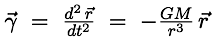

Cette formule se traduit par deux formules (on est dans un plan), une pour chaque composante&#8239;:

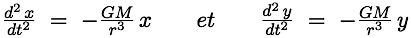

La distance r entre la planète et le Soleil s’obtient, d’après les coordonnées cartésiennes, par application du théorème de Pythagore&#8239;:

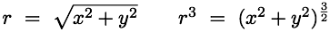

Reportant cette valeur dans l’expression des composantes de l’accélération, on obtient&#8239;:

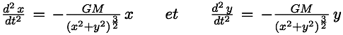

L’accélération est la dérivée de la vitesse par rapport au temps&#8239;:

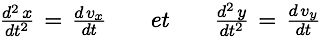

Donc&#8239;:

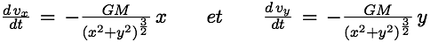

Multipliant les deux termes par dt, on obtient&#8239;:

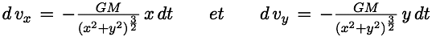

Le calcul est terminé. Les deux composantes ont la même forme&#8239;; on définit k par&#8239;:

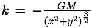

Avec cette définition, nous avons maintenant&#8239;:

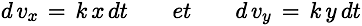

Le calcul se fait donc en commençant par évaluer k selon la formule de définition ci-dessus. Bien évidemment, x et y dans cette expression changent à chaque étape&#8239;! Une fois k connue, on détermine dvx et dvy, quantités qui représentent les petites variations des composantes de la vitesse dans l’intervalle de temps dt. La nouvelle vitesse est l’ancienne, augmentée de cette valeur, et ceci se fait donc composante par composante&#8239;: la nouvelle vx est la somme de l’ancienne, et de dvx. Idem pour y.

Une fois la vitesse connue, le déplacement pendant le temps dt est le produit de cette vitesse par dt. Et la nouvelle position s’obtient en ajoutant ce déplacement à l’ancienne.

Nous avons maintenant tous les éléments pour faire le calcul pas à pas, dans l’ordre donné ci-dessus.

Dans la première ligne, on indique ce qui est en-dessous&#8239;: G est la constante de la gravitation universelle, et sa valeur est placée en A2&#8239;; M est la masse du Soleil, en kilogrammes&#8239;; dt est l’intervalle de temps qui définit un pas du calcul.

A la ligne 2, on trouve les valeurs référencées au-dessus. La ligne 3 reste vide pour séparer visuellement.

A la ligne 4, on indique les titres des colonnes&#8239;: x pour la première, signifiant que les valeurs successives de x seront placées au-dessous, en colonne. On note les deux coordonnées x et y, puis les deux composantes de la vitesse vx et vy, et enfin un coefficient k qui exprime la loi de la gravitation&#8239;:  k = - G M / r2&#8239;; mais r = sqrt(x2 + y 2)&#8239;; donc

<table>
<tbody>
<tr><td></td><td>A</td><td>B</td><td>C</td><td>D</td><td>E</td></tr>
<tr><td>1</td><td>G</td><td>M</td><td>dt</td><td></td><td></td></tr>
<tr><td>2</td><td>6,67E-11</td><td>2E30</td><td>0,1</td><td></td><td></td></tr>
<tr><td>3</td><td></td><td></td><td></td><td></td><td></td></tr>
<tr><td>4</td><td>x</td><td>y</td><td>vx</td><td>vy</td><td>k</td></tr>
<tr><td>5</td><td>1,5E11</td><td>0</td><td>0</td><td>30000</td><td>=-A&#36;2&#42;B&#36;2&#42;C&#36;2/(A5&#42;A5+B5&#42;B5)^1,5</td></tr>
<tr><td>6</td><td>=A5+C5&#42;C&#36;2</td><td>=B5+D5&#42;C&#36;2</td><td>=C5+E5&#42;A5&#42;C&#36;2</td><td>=D5+E5&#42;B5&#42;C&#36;2</td><td>=-A&#36;2&#42;B&#36;2&#42;C&#36;2/(A6&#42;A6+B6&#42;B6)^1,5</td></tr>
</tbody>
</table>

Il reste à recopier la dernière ligne vers le bas, autant de fois que vous voudrez d’itérations.

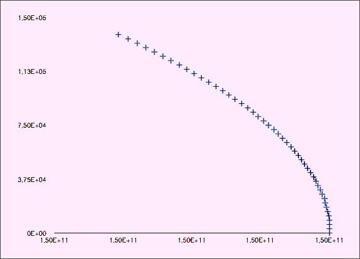

Graphique produit d’après ce tableau, par le tableur *Numbers* (Apple)

La méthode utilisée est bien trop grossière pour donner de bons résultats sur une grande durée. Si vous voulez faire mieux, il faudra utiliser des méthodes d’intégration numérique, comme par exemple les méthodes de Runge-Kutta. Le but de cet exercice était de montrer le principe de l’intégration numérique.
