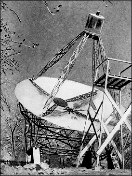
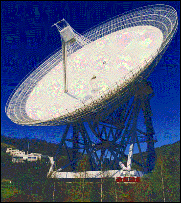
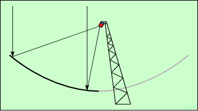
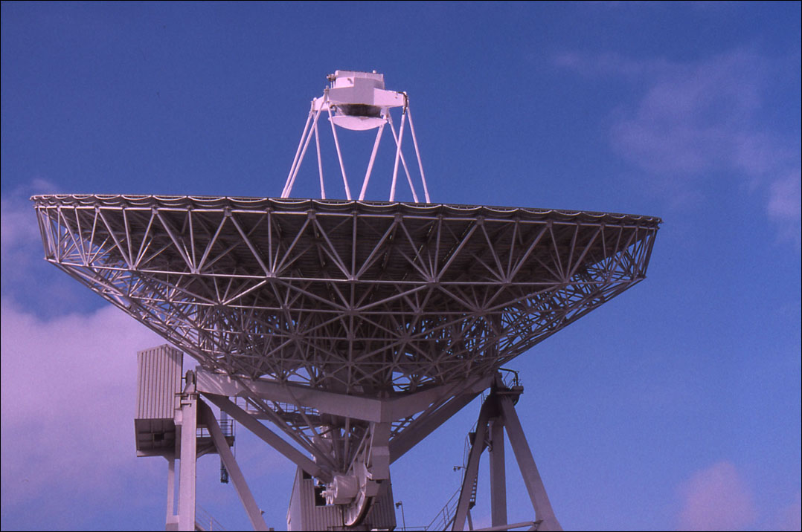
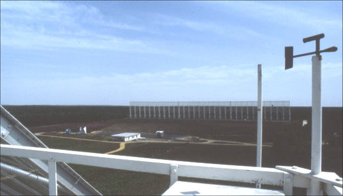
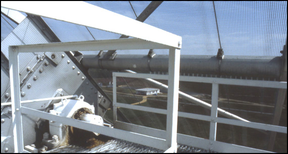
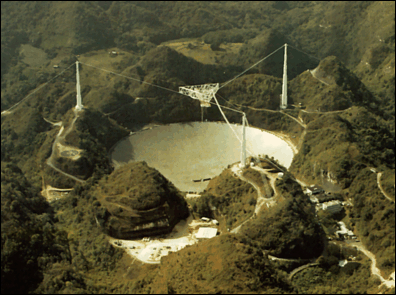

import Encadre from '../../../components/chapitre/Encadre.astro';

La première observation radioastronomique a été faite accidentellement par Karl Jansky en 1933. Il cherchait à éliminer le bruit de fond d’un récepteur de radio dans le domaine décamétrique. Le bruit de fond est produit par l’agitation thermique des électrons dans l’appareil lui-même, et ne peut être supprimé que si le récepteur est à la température de 0 K. A une température non nulle (donc à toute température réelle), un bruit de fond est inévitable. Il est d’autant plus intense que la température est plus élevée.

Jansky mesurait le bruit de fond qu’il recevait, et le trouvait plus intense que ce que le calcul prévoyait. Après avoir éliminé toutes sortes de sources possibles, il ne restait plus qu’une seule explication&#8239;: un rayonnement radioélectrique provenait de l’espace. Il a remarqué que le bruit capté était variable au cours de la journée et, mesurant la période de cette variation, il a trouvé 23 h 56 mn. On reconnait là la période sidérale de rotation de la Terre, ce qui montre que le surcroît de bruit n’était pas lié à la Terre, mais à l’espace extérieur. Les antennes utilisées par Jansky étaient simplement des dipôles, des fils électriques tendus.

Vers 1935, en utilisant des antennes directrices, il a montré que le rayonnement était plus intense vers la Voie Lactée, et particulièrement dans la direction du Sagittaire.

## Premier radiotélescope

Son travail a été repris en 1945 par Groote Reber, qui a construit lui-même une antenne à miroir parabolique de 9 m de diamètre. Le miroir renvoie les ondes vers son foyer, où est placé l’antenne réceptrice. Il a établi, à la longueur d’onde de 1,87 m, la première carte du ciel montrant les isophotes (lignes qui émettent la même intensité lumineuse) de la Voie Lactée.

*Premier radiotélescope, de Groote Reber*

Karl Jansky est donc le découvreur des ondes radio cosmiques, et Groote Reber le créateur de la radioastronomie. Ce radiotélescope a été transporté, il est aujourd’hui visible à Green Bank en Virginie.

Le radar a été inventé et utilisé lors de la seconde guerre mondiale. A la fin de celle-ci, certains appareils ne servant plus ont été récupérés par des astronomes pour constituer des paraboles réceptrices à peu de frais. Ce sont les ancêtres des radiotélescopes.

## Pouvoir séparateur

La radioastronomie s’est heurtée dès le début à son problème de fond&#8239;: le pouvoir séparateur d’un radiotélescope est catastrophique. Ce n’est pas dû à une mauvaise construction, mais aux longueurs d’onde observées. Nous avons vu que le [pouvoir séparateur](../instruments/#pouvoirSeparateur) d’un instrument est lié à son diamètre et à la longueur d’onde observée, mais nous nous sommes limités à la partie visible du spectre. Entre 0,4 et 0,8 µm, la variation du pouvoir séparateur en fonction de la longueur d’onde est négligeable. Mais si on passe aux longueurs d’ondes radioélectriques, tout change.

Le pouvoir séparateur d’un instrument dépend du diamètre ET de la longueur d’onde. Soient D le diamètre de l’instrument et λ la longueur d’onde&#8239;; le pouvoir séparateur est donné en radians par&#8239;:

p = 1,037 λ / D

En multipliant par 180 / π, on obtient la valeur de p en **degrés**&#8239;:

p = 59,42 λ / D

Le diamètre et la longueur d’onde doivent être donnés dans la même unité.

A une longueur d’onde plus grande correspond un pouvoir séparateur plus mauvais. Or, les ondes radios utiles en astronomie sont de l’ordre de la dizaine de centimètres ou du mètre, au lieu de 0,4 à 0,8 millièmes de mm en optique. Pour λ = 1,87 m = 1.870.000 µm (Groote Reber), le pouvoir séparateur sera 1.870.000 / 0,5 = 3.740.000 fois plus mauvais que dans le visible… p = 59,42 × 1,87 / 9 = 12,35°. Vous avez bien lu, 12 degrés&#8239;! 24 fois le diamètre apparent du Soleil (à la même époque, le plus grand télescope optique faisait 2,5 m&#8239;; le miroir de Groote Reber était donc bien plus grand).

Autant dire que sans l’imagination des radioastronomes, leur discipline serait morte dans l’œuf.

C’est pour cette raison qu’il n’existe pas de petit radiotélescope, mais bien au contraire des géants.

## Constitution

Un radiotélescope est comme un télescope optique&#8239;: il allie un collecteur de lumière à un détecteur. Comme en optique, les signaux les plus faibles sont les plus intéressants, et on doit les capter dans de bonnes conditions. Il faut donc, pareillement, augmenter la surface de réception des ondes, et les concentrer en un point où se trouve le détecteur. On utilise donc des miroirs qui renvoient les ondes vers le détecteur, comme on le fait dans un télescope optique.

Mais la longueur d’onde n’est pas du tout la même, ce qui est fortement contraignant pour le pouvoir séparateur. Toutefois, c’est un avantage pour la réalisation des miroirs&#8239;: les défauts de surface d’un bon miroir doivent être inférieurs au dixième de la longueur d’onde observée. En radio, l’observation à 21 cm de longueur d’onde (hydrogène neutre) se contente donc d’une surface réalisée à 2 cm près&#8239;! Pour faire de grands miroirs, c’est infiniment plus pratique.

Mais il y a une autre caractéristique liée à la longueur d’onde. Une surface conductrice réfléchit une onde dès lors que sa maille est bien plus petite que la longueur d’onde. En optique, ce sont les distances interatomiques qui constituent la maille du miroir (en gamma, ces distances sont trop grandes…). En radio, un grillage fait parfaitement l’affaire&#8239;! Pour observer à 21 cm, une maille de l’ordre du centimètre suffit largement. Il s’ensuit un considérable allègement des miroirs&#8239;! Inutile de construire des plaques continues et massives. Ceci est vrai pour les longueurs d’onde assez grandes, lorsqu’on va jusqu’au millimétrique (longueur d’onde de l’ordre du millimètre), les contraintes se rapprochent de celles de l’optique.

## Monture

Comme en optique, il faut pointer et suivre les objets à observer, et le plus simple pour cela consiste à placer l’instrument sur une monture mobile. La plus adaptée est la monture équatoriale, comme dans le visible, et celle-ci a été utilisée pour certaines radiotélescopes. Le radiotélescope de 43 m de Green Bank est le plus grand en monture équatoriale. Mais le poids des miroirs limite l’usage de cette solution.

Comme en optique, encore une fois, les mêmes causes produisant les même effets, on doit envisager des montures azimutales pour porter des miroirs plus lourds. La plupart des radiotélescopes mobiles sont ainsi montés. Ils sont formés d’un bâti, qui roule sur un rail circulaire pour pointer en azimut. Sur le bâti, un axe horizontal permet de pointer en hauteur.

## Effelsberg

Le plus grand radiotélescope mobile a été, jusqu’à l’an 2000, celui d’Effelsberg en Allemagne, donc le diamètre du miroir attteint 100 mètres&#8239;!

*Effelsberg*

Ce radiotélescope a été construit en 1971. Sa distance focale est de 30 m, et la surface collectrice de 1.850 m2. La précision d’usinage de la surface est meilleure que 0,5 mm.L’ensemble pèse 3.200 tonnes. Le miroir est une *parabole homologue*, ce qui signifie que ses supports ont été calculés de telles manière que leurs déformations inévitables maintiennent une forme parabolique à la surface, au prix d’un léger déplacement du foyer (le récepteur est ajustable de manière à suivre les déplacements du foyer). La déformation homologue a été imaginé en 1960 par Hoerner.

## Green Bank GBT

Le radiotélescope GBT (Green Bank Telescope) de Green Bank, aux Etats-Unis, présente une particularité intéressante. Alors que tous les autres miroirs sont des calottes paraboliques (l’axe du paraboloïde passe par le centre de la calotte), le miroir de Green Bank est aussi un morceau de paraboloïde, mais découpé dans une portion ne contenant pas l’axe. L’axe est en bordure, ce qui fait que le support et l’antenne ne font pas d’obstruction comme il est d’ordinaire de le voir.

*Green Bank*

La partie en grisé du paraboloïde n’existe pas&#8239;; elle a été dessinée pour bien montrer quelle partie a été utilisée.

Le radiotélescope d’Effelsberg n’a été surpassé que d’un cheveu (&#8239;?) par celui de Green Bank aux USA, dont la parabole, de bord elliptique et non circulaire, fait 100 × 110 m. On peut vraiment dire que ces deux instruments sont équivalents.

## Radiotélescope de Torun

La ville natale de Nicolas Copernic s’est dotée d’un grand radiotélescope de 32 m de diamètre, qui a été installé en 1994.

*Radiotélescope de 32 m de Torun, Pologne photo J. Gispert*

La photo montre la structure qui supporte le miroir principal, ainsi que le miroir secondaire et son support. Le faisceau radio est renvoyé vers le centre du primaire&#8239;: il s’agit d’un montage Cassegrain, le récepteur se trouvant au niveau du miroir primaire.

Cet instrument est utilisé en VLBI (Very Large Base Interferometer) en conjonction avec ceux de Merlin, Nançay et Bonn.

L'observatoire de Jodrell Bank a construit un radiomètre qui a été monté sur la sonde européenne Planck. Depuis 2000, réutilisant cette pratique, il développe un récepteur multi-pixel, nommé OCRA (*One Centimetre Receiver Array*), destiné au radiotélescope de Torun. Comme son nom l'indique, cet appareil observera à 1 cm de longueur d'onde, ce qui correspond à une fréquence de 30 GHz. OCRA comprendra 100 pixels, en une matrice 10 × 10.

Deux instruments de validation ont été construits&#8239;:

- OCRAp, qui comprend deux cornets de réception&#8239;;
- OCRA-F (OCRA FARADAY), qui en comprend 8 (4 × 2), extensible à 16.

OCRAp a fonctionné jusqu'en 2009, année où il a été remplacé par OCRA-F.

L'intérêt de ces instruments, naturellement cryogéniques, est le remplacement des composants traditionnels par des circuits intégrés spécialisés.

La multiplicité des cornets permettra de réaliser une couverture du ciel beaucoup plus rapidement. L'un des buts de cette expérience est d'analyser l'effet SZ (Sunayev-Zel'dovitch), interaction entre le fond cosmologique (photons) et des électrons de grande énergie, par effet Compton inverse. Les électrons communiquent leur énergie aux photons, dont la fréquence augmente. L'observation de ce rayonnement modifié permet en particulier de détecter des amas de galaxies qui, trop éloignés, sont difficiles à distinguer du fond du ciel.

## Radiotélescopes non orientables

Mais là encore, les montures ont des limites, qui sont atteintes pour des miroirs d’une centaine de mètres de diamètre. Pour aller plus loin, il faut sacrifier la mobilité, au moins en partie.

## Nançay

Sacrifice partiel d’abord. On utilise le principe de l’héliostat (encore un instrument créé dans le visible...). Un miroir plan renvoie le faisceau vers le miroir principal, qui peut être fixe. C’est le principe qui a été retenu pour le radiotélecope de Nancay, en France. Le miroir plan est mobile en hauteur (pivotant suivant un axe horizontal), mais pas en azimut. Il est dirigé vers le méridien sud, et ne peut renvoyer le faisceau que lorsque l’astre à observer passe dans le méridien. Alors, les ondes sont réfléchies vers le miroir principal qui est horizontal et fixe. Au foyer de celui-ci est placée l’antenne. Si les conditions énoncées ci-dessus étaient rigoureusement respectées, les observations ne dureraient qu’un fraction de seconde… Il faut donc les assouplir. On observera non pas au méridien strict, mais dans le voisinage du méridien. Ce qui veut dire que la source va se déplacer horizontalement dans le miroir principal. Si celui-ci était parabolique, comme on s’y attendrait, on aurait une image correcte seulement au méridien. Pour tolérer les mouvements, il faut que le miroir primaire soit sphérique. Ce qui introduit bien sûr une aberration de sphéricité, qu’il faudra corriger par ailleurs. Mais le faisceau se déplaçant, le foyer va se déplacer aussi, le long d’une ligne courbe, parallèle au miroir primaire. L’instrument permet une observation de l’ordre d’une heure, le foyer se déplaçant d’une soixantaine de mètres.

Cette technique a été développée à Nançay, en France. Le miroir sphérique, pour simplifier la construction, n’est pas inscrit dans une calotte sphérique, mais dans une bande placée horizontalement. Il est fixe.

*Radiotélescope de Nançay photo J. Gispert*

On voit sur cette photo, au premier plan à gauche, une petite partie du miroir plan, incliné, qui renvoie les ondes du ciel vers le miroir sphérique, tout au fond de l’image. Ce dernier concentre le faisceau vers son foyer, où se trouve l’antenne de réception. Cette antenne est dans le tout petit bâtiment cubique au centre de l’image. L’antenne est mobile, elle se déplace sur une voie ferrée circulaire, afin de suivre le déplacement de la source pendant une durée raisonnable vis-à-vis des aberrations.

Le miroir plan mesure 200 m de longueur, et 40 m de hauteur. Il est situé à 460 m du miroir sphérique. Le miroir sphérique est long de 300 m et haut de 35 m (remarquez qu’il est plus long que le miroir plan, pour permettre une utilisation prolongée)&#8239;; sa distance focale est de 460 m.

Son pouvoir séparateur est de 1 minute d’arc à 6 cm de longueur d’onde, et de 3 minutes à 21 cm (la raie de l’hydrogène neutre). La précision de pointage est de quelques millièmes de degrés.

Ce radiotélescope a été achevé en 1965.

*Détail du miroir plan photo J. Gispert*

Sur cette image, on voit le grillage qui sert de miroir plan, photographié depuis l’une des plateformes de service. Les longueurs d’onde observées étant supérieures à 6 cm, un grillage à mailles fines est suffisant pour constituer un très bon miroir. On voit, à gauche et vers le bas, l’axe qui permet d’incliner le miroir plan, pris dans l’un des paliers qui le supportent.

## Arecibo

La dernière solution, pour construire des instruments encore plus grands, consiste à placer un miroir fixe, et à attendre que la source à observer veuille bien défiler devant par la rotation de la Terre. Evidemment, tout le ciel n’est pas accessible avec cette méthode, mais seulement une étroite zone autour du point visé par l’appareil. On mesure l’intensité du signal reçu et on la reporte sur un écran d’ordinateur&#8239;: la brillance de chaque point sera proportionnelle au signal. On arrive comme cela à construire une image. Mais le plus petit détail visible sur cette image est défini par le pouvoir séparateur de l’instrument.

Pour agrandir un peu la zone exploitable, on place l’antenne sur un support mobile, comme à Nançay, et on la déplace au-dessus du miroir. Cette technique a été mise en œuvre à Arecibo, dans un cratère naturel dont le fond a été tapissé par le miroir. Le diamètre atteint 300 mètres.

*Arecibo*

## RATAN

Le radiotélescope RATAN 600 est situé à proximité du télescope Bolchoï (le 6 m russe). Mis en service en 1974, il est le plus grand radiotélescope du monde. Son nom vient de son diamètre de 600 m. Mais ce n’est pas un miroir sphérique complet. Il s’agit d’un anneau de miroirs, qui renvoient le flux vers le centre de l’anneau. Là, un récepteur capte la totalité du faisceau.

Il observe de 610 MHz à 30 GHz. Il est utilisé principalement dans la bande centimétrique, et son pouvoir séparateur atteint 2 secondes d’arc. Il est très utilisé pour l’observation du Soleil, en particulier de la couronne.

La rotation de la Terre sert pour le balayage de la source, qui permet de construire l’image.

Avec les grands radiotélescopes mentionnés ci-dessus, on atteint un pouvoir séparateur qui est presque de l’ordre des performances des télescopes au sol sans optique adaptative. Mais les radioastronomes ont plus d’un tour dans leur sac, et ils ont développé une technique de performances bien supérieures.

## Interféromètres

Même avec de très grands instruments comme ceux décrits ci-dessus, les radioastronomes ne disposaient pas du pouvoir séparateur nécessaire pour la compréhension de nombreux phénomènes. Il leur a fallu faire preuve de beaucoup d’imagination...

La solution qu’ils ont trouvée est *l’interférométrie*. Une onde provenant d’un point lumineux, et voyageant selon deux trajets optiques différents (de longueur différente), arriveront avec un léger décalage dans le temps. Ce décalage se traduit par un déphasage&#8239;: les ondes n’oscillent plus au même moment. Si on les additionne, on produit des [interférences](../lumiere/#nature).

Pour obtenir la même onde par deux trajets optiques différents, on utilise deux radiotélescopes. Le décalage dépend de la distance entre les deux antennes. Le pouvoir séparateur de l’ensemble est donné par la distance qui sépare les 2 antennes, et non par leur diamètre. Il suffit donc d’éloigner les antennes le plus possible pour améliorer la qualité des images. La longueur d’onde en radio permet de faire cela assez facilement, car les réglages ne sont pas trop précis. Les radioastronomes ont même pu enregistrer séparément les signaux reçus par les deux antennes, puis les recombiner plus tard (pour cela, ils enregistrent en même temps des signaux horaires très précis, donnés par une horloge atomique).

En poussant la méthode au maximum, ils sont arrivés à utiliser le radiotélescope de Jodrel Bank en angleterre, avec celui de Parkes en Australie&#8239;! La distance entre les deux est de l’ordre de 10.000 km, ce qui donne l’équivalent d’un miroir de 10.000 km de diamètre&#8239;!!! 10 millions de mètres alors que les astronomes optiques en étaient à 1 m dans les années 40. Donc les radioastronomes avaient obtenu un pouvoir séparateur bien meilleur que leur collègues optiques.

Mais attention, ce n’est vrai que dans la direction des deux antennes. Dans la direction perpendiculaire, on n’a que le pouvoir séparateur correspondant aux antennes, c’est-à-dire à leur diamètre. On peut alors associer 4 instruments, selon une disposition en croix, et le tour est joué. Les radioastronomes ont construit de tels instruments sur certains sites, par exemple à Nançay.

En utilisant tous ces instruments, les radioastronomes ont découvert beaucoup d’astres émettant des ondes radios, produites par divers mécanismes physiques intéressants. Des astres d’un type nouveau, non prévu, ont été observés&#8239;: c’est le cas des pulsars et des quasars.

Evidemment, les opticiens ne sont pas restés sur ce constat. Ils ont à leur tour développé l’interférométrie. Pour eux, la tâche a été beaucoup plus difficile, car les tolérances de construction sont liées à la longueur d’onde&#8239;: elles sont un million de fois plus draconiennes en optique qu’en radio. Mais Antoine Labeyrie, sur le plateau de Calern, près de Grasse, a montré le chemin. Tous les grands intruments optiques en cours de réalisation seront des interféromètres.

## Liste des plus grands radiotélescopes

<table>
<thead>
<tr><th><strong>nom</strong></th><th><strong>date</strong></th><th><strong>lieu</strong></th><th><strong>dimension</strong></th><th><strong>λ</strong></th></tr>
</thead>
<tbody>
<tr><td>Arecibo</td><td>1963</td><td>Porto Rico</td><td>305 m</td><td>50</td></tr>
<tr><td>Effelsberg</td><td>1972</td><td>Allemagne</td><td>100 m</td><td>17</td></tr>
<tr><td>Green Bank</td><td>1998</td><td>USA (Virginie)</td><td>100 m</td><td>60</td></tr>
<tr><td>Nançay</td><td>1965</td><td>France</td><td>miroir sphérique 300 m × 35 m de haut&#8239;; miroir plan 200 m × 40 m</td><td>9 à 21 cm</td></tr>
<tr><td>Jodrell Bank</td><td>1957</td><td>G.-B.</td><td>76 m</td><td>200</td></tr>
<tr><td>Parkes</td><td>1961</td><td>Australie</td><td>64 m</td><td>6</td></tr>
<tr><td>Algonquin</td><td>1967</td><td>Canada</td><td>50 m</td><td>30</td></tr>
<tr><td>Nobeyama</td><td>1970</td><td>Japon</td><td>45 m</td><td>3</td></tr>
<tr><td>Green Bank</td><td></td><td>USA</td><td>42 m</td><td>20</td></tr>
</tbody>
</table>

