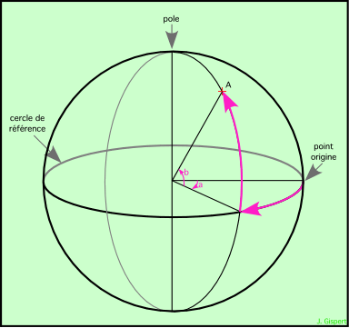
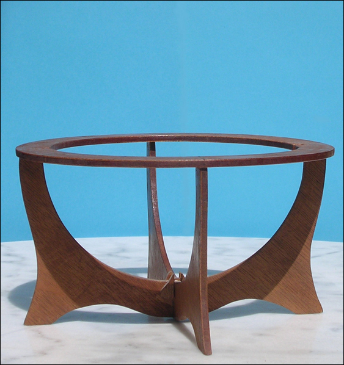
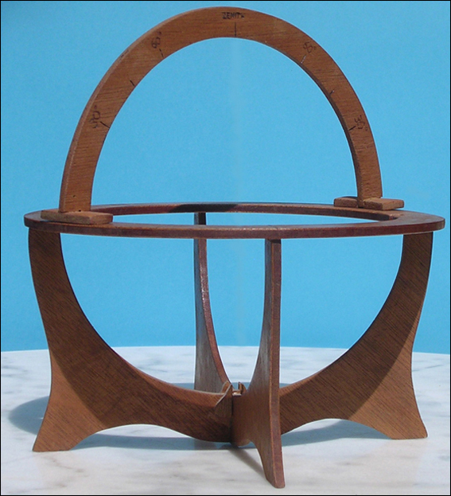
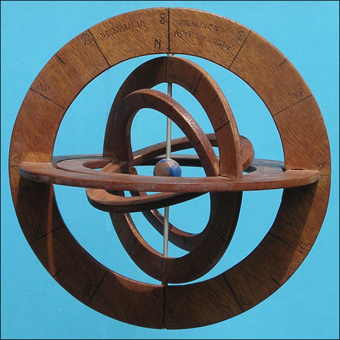
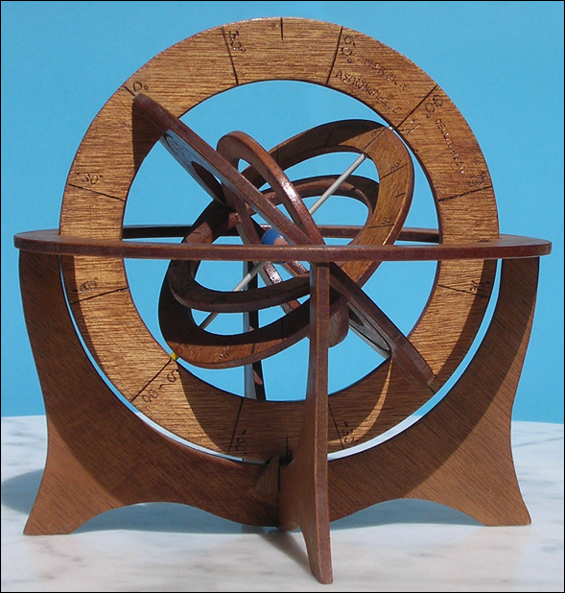
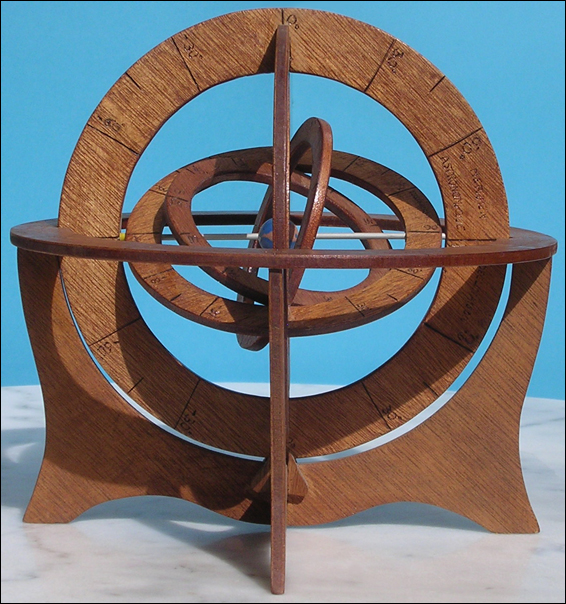
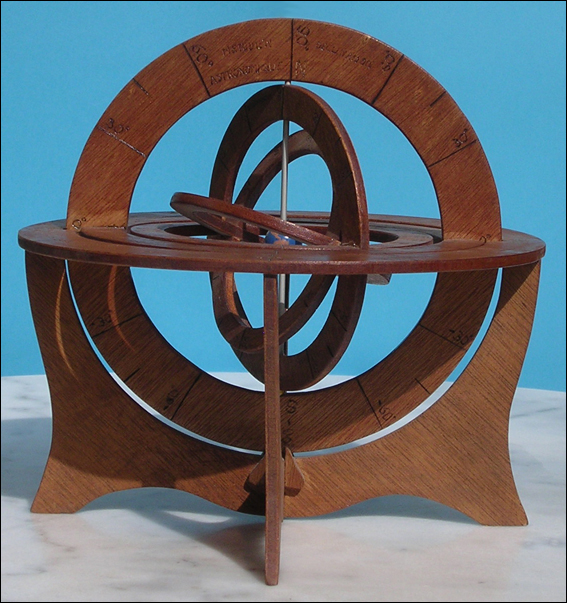
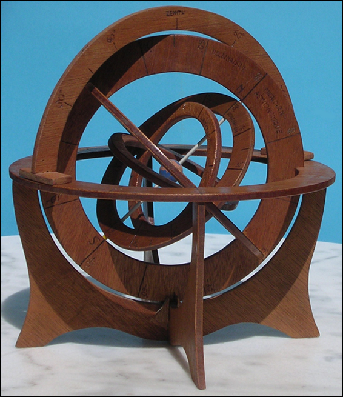

import Encadre from '../../../components/chapitre/Encadre.astro';

La *sphère armillaire* est un instrument utilisé au deuxième siècle avant JC en Grèce, au premier siècle avant JC en Chine. Mais elle a probablement été imaginée bien avant.

Une *armille* est un bracelet, ce mot venant du latin *armilla*&#8239;: anneau de fer, bracelet, ou collier. Armille désigne également un anneau que certains champignons portent au pied (*armillaires*).

La sphère armillaire est une combinaison de cercles emboîtés, permettant de représenter certains mouvements des astres. Une sphère armillaire simple (deux cercles perpendiculaires) a permis à Ptolémée de déterminer l’heure de l’équinoxe. Plus tard, Sosigène a repris cette observation pour la réforme du calendrier de Grégoire XIII.

Des sphères armillaires extrêmement complexes ont été construites, dont l’usage devait nécessiter un long appprentisage. En particulier celle d’Antonio Santucci construite à Florence en 1585.

La sphère présentée ici est une version pédagogique, destinée à illustrer les différents systèmes de coordonnées astronomiques (à l’exception des coordonnées galactiques). Son utilisation permet de comprendre les saisons, les mouvements des étoiles et du Soleil en différents points de la Terre (équateur, latitudes moyennes, pôles). On peut expliquer le soleil de minuit, les tropiques et les cercles polaires.

Des plans sont fournis pour exécuter une sphère armillaire en contreplaqué. Sa réalisation est facile, quoique nécessitant pas mal de soins.

Les explications qui suivent sont détaillées, afin de décrire pas-à-pas les composants de la sphère, et d’en expliquer l’utilité. Vous pourrez trouver une photo de la sphère complète à la fin de ce chapitre.

Un *système de coordonnées* est un couple d’angles, mesurés sur deux cercles perpendiculaires. L’un des cercles est un cercle de référence, sur lequel on choisit un point origine (angle d’intersection avec un autre cercle perpendiculaire). L’astre visé est le point A de la sphère céleste. Par définition, il est sur un grand cercle passant par le pôle. Les deux coordonnées sont&#8239;: l’angle a que fait la direction de l’astre avec la direction origine, et l’angle b qui mesure la distance de l’astre au cercle de référence&#8239;:

On peut construire une infinité de tels systèmes de coordonnées, le choix du cercle de référence et du point origine étant arbitraires, ainsi que le sens de rotation. Quatre systèmes sont utilisés en astronomie, dont les propriétés dépendent du choix des références.

Une même étoile possède, à chaque instant, des coordonnées dans chacun des systèmes considérés. Des calculs de trigonométrie sphérique permettent, plus ou moins facilement, de passer de l’un à l’autre. Le point capital est que, pour un astre donné&#8239;:

- dans un premier système, ses deux coordonnées varient à chaque instant&#8239;;
- dans le second, une seule coordonnée varie&#8239;;
- dans le troisième, les deux coordonnées sont fixes (en négligeant la précession des équinoxes, qui est très lente)&#8239;;
- le dernier système est particulier pour le Soleil&#8239;; l’une de ses coordonnées y est fixe.

## Le bâti

Cette première photo montre le bâti de la sphère, constitué de trois pièces principales&#8239;: deux pieds à angle droit, et un cercle horizontal. Remarquez sur le cercle les deux encoches, qui permettront le glissement de l’équipage mobile. Ces encoches sont dans le plan nord-sud du pied.

Remarquez également sur ce pied nord-sud, en bas, les quatre petites pièces en forme de goutte d’eau, qui sont destinées à guider l’équipage mobile.

Le cercle qui constitue le haut du bâti est le *cercle horizon*. C’est le cercle de référence pour le système de *coordonnées horizontales*.

Lorsque la sphère est posée sur une table, en s’inclinant pour placer les yeux à la hauteur du cercle horizon, tout ce qu’on voit au-dessus est dans le ciel, tout ce qui est au-dessous est sous l’horizon, donc invisible pour l’observateur.

L’horizon est gradué selon *l’azimut*. L’azimut est l’angle que forme un point quelconque avec le sud. L’origine de l’azimut (azimut 0°) est le point sud de l’horizon, à l’encoche de gauche ici. L’azimut est croissant du sud vers l’ouest (le point ouest a pour azimut 90°&#8239;; il est au fond sur la photo), puis vers le nord…

Attention, les marins ont aussi la notion d’azimut, orienté dans le même sens, mais avec l’origine au point nord de l’horizon.

L’utilisation de ce système se justifie par la possibilité de déterminer précisément la verticale du lieu (à l’aide d’un fil à plomb, ou mieux par l’utilisation d’un bain de mercure qui donne l’horizontale).

Le *cercle de hauteur* a été mis en place. Il s’agit en fait d’un demi-cercle, muni de deux pieds permettant de le poser dans une orientation quelconque sur l’horizon. Le cercle de hauteur porte également le joli nom d’*almucantarat*.

Le cercle de hauteur est gradué en degrés, de 0° sur l’horizon, à 90° au zénith (même graduation de chaque côté). La partie en-dessous de l’horizon, non matérialisée, est graduée de 0° à -90° (*nadir* = point opposé au zénith).

La sphère doit être posée sur une table, horizontalement, de telle manière que le pied portant les gouttes d’eau soit orienté nord-sud. L’une des deux encoches du cercle horizon est donc au nord, l’autre au sud.

Pour repérer un astre dans le ciel, la méthode la plus simple est de repérer d’abord sa hauteur dans le ciel (angle qu’il fait avec l’horizon). On tourne le cercle de hauteur pour qu’il contienne l’astre. En imaginant qu’on place l’œil au centre de la sphère, l’angle qu’on lirait sur le cercle de hauteur est la hauteur de l’astre.

Puisque le cercle de hauteur contient l’astre visé, il suffit de lire la graduation sur laquelle il se trouve sur le cercle horizontal&#8239;: par définition, c’est l’azimut de l’astre.

L’horizon et le cercle de hauteur matérialisent donc le premier système de coordonnées astronomiques&#8239;: l’azimut et la hauteur. Remarquez que ces deux angles sont relatifs à l’horizon. Si on se place en un endroit différent de la Terre, l’horizon sera différent, et les deux coordonnées du même astre aussi. Pour cette raison, on dit que l’azimut et la hauteur sont des *coordonnées locales*.

Il serait difficile de communiquer le résultat d’observations si on les donnait en coordonnées locales. Le destinataire serait obligé de faire un calcul de trigonométrie sphérique non évident pour adapter les données communiquées à son propre lieu d’observation. Pour cette raison, les astronomes ont cherché un repère plus universel.

## L’équipage mobile

Ils l’ont vite trouvé en considérant l’équateur de la Terre, qui est un plan particulier commun à tout le monde. Remarquez qu’au pôle nord, l’horizon est parallèle à l’équateur&#8239;! Cette remarque permet de dire que les coordonnées que nous allons définir sont simplement les coordonnées horizontales pour un observateur idéal qui se trouverait au pôle nord. Lorsqu’on fait une observation, on doit donc noter les coordonnées qu’aurait l’astre pour cet observateur idéal. Un correspondant à qui on communiquerait ces coordonnées ferait le calcul inverse.

Mais aucun calcul n’est nécessaire. Les télescopes en monture équatoriale permettent de lire directement les bonnes coordonnées&#8239;: il suffit de placer un cercle gradué perpendiculaire à l’axe polaire de l’instrument, donc parallèle à l’équateur, pour y lire directement l’une des coordonnées. L’autre coordonnée se lira sur un cercle placé perpendiculairement à l’axe de déclinaison.

*L’équipage mobile présenté suspendu à la verticale*

L’équipage mobile comprend trois couples de cercles. Chaque couple représente un système de coordonnées (cités ici dans l’ordre du plus grand au plus petit)&#8239;:

- à l’extérieur, les cercles de *coordonnées horaires* (*angle horaire* et *déclinaison*)&#8239;:
    - *cercle horaire*&#8239;: le plus grand cercle présenté ici horizontalement. Il porte *l’angle horaire*, gradué en heures (l’heure est une unité d’angle, 24 h correspondent à 360°, une heure correspond donc à 15°). Il est orienté dans le sens des aiguilles d’une montre (vu de dessus, c’est-à-dire du nord). Son origine 0 h est au méridien sud. Ce cercle ne tournant pas par rapport au bâti, **au cours de la nuit, l’angle horaire d’une étoile augmente** constamment.
    - *méridien astronomique*. C’est le grand cercle vertical visible ici. Il porte la *déclinaison*. Il sera placé dans le bâti, et pourra basculer entre les deux encoches du cercle horizontal, pour régler la latitude. La latitude est correctement réglée lorsque le cercle horaire est parallèle à l’équateur de la Terre. L’angle qu’il fait alors avec le point sud du cercle horizon est égal à la latitude du lieu. **La déclinaison d’un astre ne change pas** au cours du temps.
- le second couple tourne autour de l’axe polaire (gris, vertical sur la photo). Il est identique au précédent, mis à part cette rotation. En le faisant tourner en 23 h 56 mn 4 s, il suivra rigoureusement les astres. C’est le système de *coordonnées équatoriales*.
    - le cercle perpendiculaire à l’axe polaire (ici horizontal) porte *l’ascension droite*, graduée en heure, mais orienté, contrairement à l’angle horaire, dans le sens trigonométrique (sens inverse des aiguilles d’une montre, toujours vu du nord). L’origine des ascensions droites est le *point gamma*, ou *point vernal*, ou *équinoxe de printemps*, qui se voit devant et à droite, à l’intersection avec le plus petit cercle. Au cours de la nuit, ce système tourne autour de l’axe polaire en un jour sidéral (23 h 56 mn 4 s). Ce qui fait qu’une étoile reste constamment en face de la même graduation des ascensions droites.
    - l’autre cercle porte la *déclinaison*. Cette coordonnée porte le même nom que dans le système horaire, et ses valeurs sont identiques (elle n’est pas affectée par la rotation). Ce cercle est perpendiculaire au cercle d’ascension droite, qu’il coupe au niveau des deux équinoxes. Il est nommé *colure des équinoxes*. **Les deux coordonnées équatoriales d’une étoile sont indépendantes du temps**.
- le dernier couple, qu’on voit incliné, représente les *coordonnées célestes*.
    - Le cercle presque horizontal représente le trajet parcouru par le Soleil au cours de l’année, vu de la Terre. Son *obliquité* est égale à 23° 26', inclinaison de l’équateur sur l’écliptique. Le 4 juillet, le Soleil se trouve au point le plus haut à droite, le 4 janvier il se trouve au point le plus bas, en bas à gauche. Il porte la *longitude céleste*, graduée en degrés, croissant dans le sens trigonométrique (vu du nord), son origine étant au point vernal.
    - le cercle perpendiculaire est la *latitude céleste*. Elle est graduée de la même manière que la déclinaison. Ce système est adapté au calcul des éphémérides du Soleil et des planètes. Une fois les calculs de position effectués, une conversion permet de trouver les coordonnées équatoriales de ces astres, afin de les pointer avec un télescope.

## Temps sidéral

Par définition, le *temps sidéral* T est l’angle horaire du point gamma. Alors, la relation liant l’angle horaire H d’un astre à son ascension droite α est très simple&#8239;:

H = T - α

On peut la réécrire sous la forme α = T - H&#8239;; T et H variant avec la même période (le jour sidéral) et en sens inverse, il est facile de comprendre que a soit constant pour une étoile donnée. Bien sûr, ce raisonnement ne tient pas compte de la précession des équinoxes, qui introduit une lente dérive de H par rapport à T.

Il n’est pas possible de montrer des photos de chaque détail de la sphère. Pour plus de précision, vous pouvez consulter [les plans](https://astronomia.fr/1ere_partie/sphereArmillaire/plansSphere.php) qui permettent de la construire.

L’équipage mobile est ici en place, réglé pour une latitude moyenne, de 43° nord. Le cercle horaire (vu par la tranche) est parallèle à l’équateur (le cercle de hauteur n’a pas été mis pour une plus grande clarté).

Les deux autres systèmes de cercles de l’équipage mobile tournent autour de l’axe polaire. Leur rotation, se faisant autour d’un axe parallèle à l’axe du monde, et en sens inverse, annule la rotation des astres. C’est ce qui permet d’avoir des coordonnées équatoriales fixes pour un astre donné (puisque le cercle qui les repère est entraîné à la même vitesse que les étoiles).

Remarque&#8239;: la précession des équinoxes fait varier très lentement les coordonnées équatoriales d’une étoile. Il faut toujours préciser par rapport à quel équinoxe (1950, 1975, 2000…) elles sont données. Mais cette dérive n’altère pas la sphère armillaire, car il suffit de placer son point gamma dans la bonne direction.

## Utilisation de la sphère armillaire

Le principe de son utilisation consiste à orienter l’équipage mobile en fonction de la latitude du lieu d’observation, puis à le faire tourner autour de l’axe polaire, les astres étant supposés fixes par rapport aux cercles des coordonnées équatoriales.

**I-** Collez un petit morceau de pâte à coller, ou de mie de pain, sur le cercle de longitude céleste. Il représentera le Soleil, à sa position du jour. Au cours de l’année, il se déplace dans le sens des longitudes croissantes. A certaines époques, il est en-dessous de l’équateur (entre l’équinoxe d’automne et l’équinoxe de printemps, donc pendant l’automne et l’hiver), à d’autres au-dessus (entre l’équinoxe de printemps et l’équinoxe d’automne, donc pendant le printemps et l’été). Au point gamma, il traverse l’équateur en allant vers le dessus (au nord).

Choisissez de placer le Soleil au point d’intersection des cercles, au point gamma (équinoxe de printemps). Faites tourner l’équipage dans le sens des aiguilles d’une montre (vu du nord). Vous constaterez que le Soleil effectue son tour en passant alternativement au-dessus et au-dessous de l’horizon&#8239;: c’est l’alternance du jour et de la nuit. Remarquez tout d’abord qu’à son coucher, le Soleil descend vers l’horizon en suivant une ligne inclinée de 43° à peu près. Une [animation pilotable](https://astronomia.fr/2eme_partie/planetes/3Terre/Terre_java/coucherSol.html), simulant en partie une sphère armillaire, donne des explications complémentaires.

Notez les endroits, sur l’horizon, où le Soleil se lève et se couche&#8239;: ce sont les points *est* et *ouest* de l’horizon. En regardant la sphère du dessus, vous verrez que la partie qui correspond au jour est égale à celle qui correspond à la nuit. Dans cette position du Soleil, on a donc les nuits égales (aux jours)&#8239;; en latin, *equæ nox* = équinoxe. Nous sommes à l’équinoxe de printemps, car en continuant sa course apparente, le Soleil va monter au-dessus de l’équateur. Avant de changer de position, notez, sur le cercle de hauteur placé en postion nord-sud, la hauteur du Soleil à midi (point le plus haut). Vous devez lire une valeur de l’ordre de 43°. Nous l’expliquerons plus loin.

Positionnez maintenant le Soleil au point le plus haut du cercle de longitude. Effectuez un tour complet de l’équipage, et notez les positions de lever et de coucher du Soleil sur l’horizon. Vous verrez qu’elles se situent au nord-est et au nord-ouest. Et en regardant le cercle horizon de dessus, il vous sera facile de constater que le trajet diurne du Soleil est à peu près double de son trajet nocturne&#8239;: le jour dure 16 h, et la nuit 8 h seulement. On est au solstice d’été. Notez maintenant la hauteur du Soleil à son point le plus haut. Vous devriez touver à peu près 67°.

Enfin, positionnez le Soleil au point le plus bas du cercle de longitude, et faites les même manipulations. Vous constaterez que la durée de la nuit est double de celle du jour. On est au sosltice d’hiver. La hauteur du Soleil n’est que de l’ordre de 20°.

Ainsi, ces trois opérations simples vous montrent la variabilité de la durée des jours, et comment le Soleil se déplace en apparence dans le ciel au cours de l’année, et vous permet de visualiser la hauteur du Soleil au-dessus de l’horizon, à midi, aux différentes époques.

En résumé&#8239;:

- au solstice d’hiver, la nuit est deux fois plus longue que le jour, donc la Terre se refroidit deux fois plus longtemps qu’elle ne se chauffe au Soleil&#8239;; c’est le contraire au solstice d’été&#8239;;
- le Soleil est très haut sur l’horizon en été, et très bas en hiver. La même quantité d’énergie qu’il apporte s’étale sur une grande surface en hiver, et sur une surface toute petite en été.

Ces deux phénomènes jouent dans le même sens&#8239;: le Soleil nous apporte bien plus d’énergie au mètre-carré en été qu’en hiver. C’est ce mécanisme qui explique les différences de température, sans faire intervenir la distance légèrement variable entre le Soleil et la Terre (qui d’ailleurs joue dans l’autre sens, elle est plus courte en hiver qu’en été).

**II-** Modifiez maintenant la position de l’équipage mobile&#8239;: basculez-le complètement pour amener l’axe polaire dans le plan de l’horizon, comme il est montré sur la photo&#8239;:

Où se trouve-t-on&#8239;? Faites un petit dessin représentant la Terre, son axe polaire, et un plan tangent à la sphère, et parallèle à l’axe. Ce plan est forcément à l’équateur. C’est là qu’on se trouve…

Pour le comprendre autrement, imaginez le ciel, tel qu’on le voit en France Métropolitaine par exemple. En regardant vers le nord, vous verrez l’étoile polaire à une hauteur de l’ordre de 45° (la latitude du lieu). Imaginez que vous alliez VERS le sud. La Terre étant ronde, l’étoile polaire descendra dans le ciel. Si vous arrivez à l’équateur, vous aurez l’étoile polaire exactement à l’horizon. Puisqu’elle figure l’axe de la Terre, vous constaterez que cet axe est parallèle à l’horizon. C’est justement la position dans laquelle on vient de placer la sphère armillaire. Donc, le réglage ainsi fait correspond à l’équateur.

Refaites toutes les manipulations faites à 43° de latitude nord, avec le Soleil successivement placé à l’équinoxe de printemps, au solstice d’été, et au solstice d’hiver. Notez, comme précédemment, selon la latitude&#8239;:

- l’inclinaison du trajet du Soleil sur l’horizon à son coucher (il se couche verticalement à l’équateur, pratiquement horizontalement aux pôles)&#8239;;
- la vitesse du coucher de Soleil&#8239;;
- la durée du jour et de la nuit.

Comparez aux valeurs trouvées pour une latitude moyenne.

**III-** Modifiez encore la position de l’équipage mobile&#8239;: redressez-le complètement pour mettre l’axe polaire vertical, comme il est montré sur la photo&#8239;:

*au pôle nord*

Où se trouve-t-on maintenant&#8239;? L’axe polaire étant perpendiculaire au sol, l’étoile polaire est au zénith. On est donc au pôle nord.

Pour finir de comprendre les mouvement apparents du Soleil, refaites toutes les manipulations précédentes. Vous constaterez qu’au solstice d’hiver, le Soleil effectue tout son tour diurne (24 heures), en restant au-dessous de l’horizon. Il n’y a donc pas de jour, c’est la longue nuit polaire.

De jour en jour, le Soleil se déplace sur le cercle de longitude céleste, dans le sens des longitudes croîssantes. Il se rapproche donc doucement de l’horizon. Un mois à peu près avant l’équinoxe de printemps, le jour commence à poindre. Mais on ne voit toujours pas le Soleil… Finalement, il va poindre tout juste, et faire un tour complet pratiquement sans grossir… Au fil des jours, il s’élève doucement au-dessus de l’horizon, pour être totalement levé au bout d’une semaine à peu près. Le coucher de Soleil, à l’automne, durera tout autant. Le Petit Prince apprécierait-il d’avoir un si long coucher de Soleil, mais unique&#8239;?

Continuez à déplacer le Soleil, et vous verrez qu’au solstice d’été, il se trouvera à 23° au-dessus de l’horizon, à son point le plus haut. Le Soleil de minuit est maintenant expliqué.

## Autre utilisation

Réglez la sphère pour une latitude moyenne (45°). Placez le Soleil au solstice d’été, et regardez à quelle hauteur il se trouve à midi. Vous noterez 67° à peu près, comme on l’a déjà vu plus haut. Ce qui signifie que le Soleil n’est pas au zénith, mais bien en dessous. Déplacez le Soleil sur le cercle de longitude, vous constaterez que jamais, quelle que soit la date, le Soleil n’atteint le zénith. N’en déplaise aux romanciers qui prétendent le contraire…

Pourriez-vous trouver un réglage de la sphère tel que le Soleil passe effectivement au zénith&#8239;? Réponse affirmative, il suffit de se placer à l’équateur. Mais pas à n’importe quelle date&#8239;! A l’équateur, le Soleil passe au zénith deux fois par an, aux deux équinoxes. Au cours de l’année, il se balance dans le ciel (à midi) de part et d’autre du zénith, s’en éloignant au maximum aux deux solstices.

Déplacez la sphère, en réglant une latitude à 10°. Le Soleil passe au zénith à deux dates dans l’année, mais ce n’est plus aux équinoxes. Si vous continuez à vous déplacer vers le nord, jusqu’à 23°, ces deux dates se rapprochent du solstice, et l’une de l’autre. Finalement, à 23° de latitude nord, vous constaterez que les deux dates ont convergé vers une seule&#8239;: le sosltice d’été. C’est la limite en latitude, des zones où le Soleil passe au zénith. Par définition, cette limite est le Tropique du Cancer. Bien sûr, on peut effectuer les manipulations symétriques dans l’hémisphère sud, et mettre en évidence le Tropique du Capricorne. Par conséquent, les tropiques délimitent, à la surface de la Terre, une bande dans laquelle le Soleil passe une à deux fois par an au zénith.

Maintenant, vous avez une maîtrise suffisante de la sphère armillaire pour trouver vous-même les manipulations à faire pour mettre en évidence les cercles polaires. Ils jouent un rôle symétrique à celui des Tropiques, mais le phénomène sur lequel ils sont basés est le Soleil de minuit. Ils délimitent les calottes polaires, dans lesquelles le Soleil ne se couche pas au moins un jour par an.

## Autre inclinaison de l’équateur

Que se passerait-il si l’inclinaison de l’équateur sur l’écliptique avait une valeur différente de 23°&#8239;? Il est difficile de construire une sphère armillaire dans laquelle cette inclinaison serait réglable. Mais [l’animation](https://astronomia.fr/2eme_partie/planetes/3Terre/Terre_java/coucherSol.html) montrant le coucher de Soleil permet de le faire très simplement&#8239;!

*la sphère complète*

## Plans de la sphère

Vous pouvez construire votre propre sphère armillaire sur le modèle décrit, en téléchargeant [les plans](https://astronomia.fr/1ere_partie/sphereArmillaire/plansSphere.php).
