import Encadre from '../../../components/chapitre/Encadre.astro';

## Principe

La taille des miroirs se fait de façon très simple, bien que les contraintes soient très fortes. Cependant, il faut être très méticuleux. On utilise deux disques de verre de même diamètre&#8239;: l’un sera le miroir, l’autre sera un outil. Si on veut réaliser un bon miroir, il faut utiliser des disques spéciaux, qui sont fournis en général avec les divers abrasifs nécessaires à la taille. Pour faire des essais, on peut toujours se procurer de la glace de St Gobain (verre à vitre), qui se trouve chez les bons vitriers. Le plus difficile dans ce cas, est de couper la glace en disques…

Les manipulations décrites ici concernent la réalisation d’un miroir d’amateur&#8239;; mais la technique est assez semblable pour les instruments professionnels. La différence importante tient dans l’automatisation nécessaire pour les gros miroirs, susceptible de produire des défauts systématiques.

## Taille

### Ebauchage

Sur une table ronde légèrement plus grande que le miroir, on pose les deux disques l’un sur l’autre. Le futur miroir est dessus, l’outil dessous. Si on les aligne bien, le poids du miroir appuie régulièrement sur toute la surface de l’outil&#8239;:

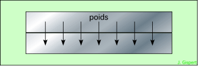

Mais si on le fait déborder, la partie débordante est dans le vide, et ne subit donc aucune pression. Tout le poids du miroir produit une pression forte sur son centre, et sur le bord de l’outil&#8239;:

On dépose maintenant un peu d’eau et d’abrasif (du *carborundum*, ou carbure de silicium SiC, que l’on appelle plus simplement *carbo*&#8239;; c’est une sorte de sable noir à grains très durs, plus durs que le verre) au centre de l’outil avant d’y poser le miroir&#8239;:

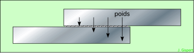

Puis on frotte le miroir sur l’outil, en lui faisant décrire des mouvements en forme de huit, faisant déborder le miroir d’un côté de l’outil, puis de l’autre, etc… En même temps, on tourne autour de la table. Ainsi, les frottements vont user là où se fait la pression&#8239;: au centre du miroir (dessus), et au bord de l’outil (dessous). Le miroir se creuse, et l’outil se bombe.

L’abrasif arrache de petits morceaux de verre, qui se mélangent à lui. Les grains eux-même s’usent, et s’arrondissent en diminuant de taille. Petit à petit, on obtient une boue grise qui finit par sécher (évaporation de l’eau). Il faut arrêter, laver le miroir, et remplacer le carbo et l’eau. Une telle manipulation s’appelle une *séchée*.

Considérez un instant deux surfaces de forme **quelconque** exactement complémentaires. Etant complémentaires, elle s’emboîtent parfaitement dans UNE position (la tête d’une vis et le bout du tournevis par exemple). Mais elles ne peuvent pas glisser ni tourner l’une par rapport à l’autre (pour le tournevis, c’est préférable). Par contre, si les surfaces sont des plans, vous pouvez les faire glisser et tourner librement en les maintenant parfaitement en contact (un livre sur la table étant une approximation). Il en est de même pour deux sphères concentriques de même rayon, qui peuvent tourner l’une dans l’autre dans tous les sens, en restant parfaitement en contact. Un exemple se voit tous les jours dans la rue&#8239;: le crochet de traction d’une caravane sur la voiture qui la tracte est une sphère de métal&#8239;; l’attache de la caravane est une sphère en creux. Les deux ont le même diamètre, et s’emboîtent parfaitement l’une dans l’autre. Ainsi, la voiture peut tirer la caravane malgré les virages et les cahots.

Le plan et la sphère sont les **seules** surfaces assez régulières (possédant les symétries suffisantes) pour vérifier ces propriétés. On peut remarquer d’ailleurs que le plan est la limite d’une sphère dont le rayon tend vers l’infini. Puisque notre miroir se creuse au centre, ce ne peut pas être un plan. Ce sera donc une sphère. Par conséquent, le miroir et l’outil seront deux sphères qui s’emboîtent parfaitement l’une dans l’autre.

### Mesure de la courbure

En procédant de la sorte, on taille le miroir jusqu’à ce qu’il ait la courbure souhaitée (qui décidera de ses propriétés optiques). Pour mesurer cette courbure, on utilise un *sphéromètre*. Un sphéromètre simple peut être réalisé à l’aide d’une bonne règle métallique, percée en son centre d’un trou taraudé. La règle est posée sur le bord du miroir en cours de taille. Un boulon est vissé au centre, jusqu’à ce qu’il touche le verre. Connaissant le pas du boulon, il suffit de compter combien de tours on effectue pour atteindre le verre, depuis le bord de la règle, pour connaître la flèche.

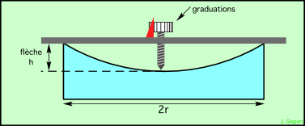

Sphéromètre

La molette graduée est placée de telle manière que le bout de la vis affleure sous la règle. On note la graduation, repérée par l’index rouge. On tourne alors la molette jusqu’à ce que la vis touche le verre, et on note la nouvelle graduation. La différence entre les deux mesures donne le nombre (fractionnaire) de tours effectués. Connaissant le pas de vis, on en déduit la longueur de vis entre la règle et le verre, donc la flèche du miroir.

Notons&#8239;: h la flèche mesurée, r le rayon du miroir, et R son rayon de courbure. La focale étant la moitié du rayon de courbure (f = R / 2), il est très facile de montrer que&#8239;:

Connaissant le diamètre du miroir à tailler (donc r), et la focale f voulue, on calcule la flèche à donner. Au cours de l’ébauchage, on vérifie périodiquement la flèche, et on arrête lorsqu’elle est atteinte.

### Doucissage

Il ne faut plus creuser, mais l’abrasif utilisé jusqu’ici a fait de gros dégats&#8239;! Les deux surfaces sont approximativement sphériques, mais ne s’adaptent pas bien l’une à l’autre, les irrégularités étant importantes. On va continuer le travail avec du carbo plus fin, qui diminuera les défauts, sans creuser davantage. Après quelques séchées (une dizaine, ou une vingtaine), on passe à un abrasif encore plus fin… Ou utilise souvent de *l’émeri*, ou corindon Al2O3. A chaque étape, il faut vérifier la surface du futur miroir, pour s’assurer de son uniformité.

Lorsque les deux disques sont parfaitement sphériques et bien doucis (doux au toucher), cette phase est terminée. Le miroir est dépoli, et ne réfléchi que très peu de lumière.

## Finition

### Polissage

Il est temps maintenant de polir. On utilise pour cela un abrasif extrêment fin. Il y a essentiellement trois substances utilisées&#8239;: le *rouge à polir* (oxyde de fer qu’on fabrique en calcinant de l’oxalate ferreux), le *rose* (oxyde de cérium), et le *blanc* (oxyde de zirconium ou oxyde de titane).

Pour ne pas abimer la surface du miroir, il faut garnir l’outil d’une couche de cire (mélange de cire d’abeille et de *poix* = résine de pins nordiques). On dépose à la surface de l’outil une couche épaisse de ce mélange, on y ménage un réseau orthogonal de stries profondes destinées à évacuer le trop plein d’abrasif (comme les structures d’un pneumatique évacuent l’eau). On place l’outil sur le miroir, et un poids sur l’outil. On laisse reposer assez longtemps (au moins 24 h) pour que la poix s’écrase un peu et prenne parfaitement la forme sphérique du miroir.

Le travail est semblable à celui de la phase précédente, mais miroir **dessous**. Lorsque le miroir est parfaitement transparent, sans présenter le moindre voile, le polissage est terminé. Si le miroir ne dépasse pas 10 cm de diamètre, le travail est achevé. En effet, pour cette petite taille, la différence entre la sphère et la parabole est négligeable, et le miroir sphérique obtenu est suffisant.

Mais pour un miroir plus grand, la surface doit être parabolique (comme les antennes de télévision par satellite, puisque le problème est le même). La différence entre le paraboloïde et la sphère reste très faible, il est donc possible de modifier la sphère pour obtenir le résultat souhaité. Mais ce travail est très délicat, et demande des vérifications précises. Un appareillage de contrôle est nécessaire.

### Foucaultmètre

C’est Léon Foucault (toujours lui) qui a créé cet instrument, qu’on nomme *foucaultmètre*. Il utilise les propriétés de la lumière pour visualiser les défauts de surface du miroir.

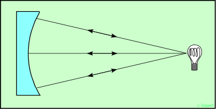

Ce schéma montre une source lumineuse, supposée ponctuelle, placée au centre de courbure du miroir. Tout rayon issu de la lampe se propage donc selon un rayon de la sphère que constitue le miroir. Il arrive à la surface de celui-ci perpendiculairement, et repart donc exactement en sens inverse.

Par conséquent, tous les rayons issus de la source repartent vers la source.

Ce schéma montre une source lumineuse, supposée ponctuelle, placée au centre de courbure du miroir. Tout rayon issu de la lampe se propage donc selon un rayon de la sphère que constitue le miroir. Il arrive à la surface de celui-ci perpendiculairement, et repart donc exactement en sens inverse.

Par conséquent, tous les rayons issus de la source repartent vers la source.

On décale légèrement la source lumineuse hors de l’axe, de façon à faire la place pour l’œil de l’observateur. Le déplacement étant faible, les rayons issus de la source vont tous converger, à très peu près, en un point symétrique par rapport à l’axe. L’observateur verra donc, en chaque point du miroir, la même quantité de lumière. Le miroir doit apparaître uniformément gris (on parle de *teinte grise*, l’aspect du miroir est représenté à droite)&#8239;:

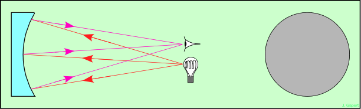

On place maintenant un *couteau* (lame de métal à bord très franc) juste à côté du point de convergence. Les rayons lumineux n’en sont pas affectés, puisqu’ils passent en totalité. L’apect du miroir reste le même, en teinte grise&#8239;:

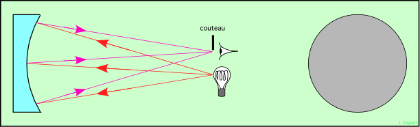

Si on pousse légèrement le couteau vers le bas (sur le dessin), il va intercepter **tous les rayons simultanément**. Le miroir s’éteint **instantanément** sur toute sa surface&#8239;:

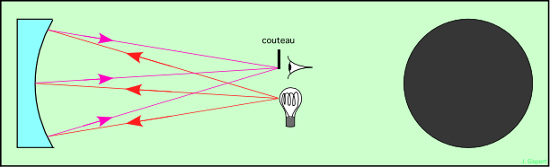

Est-on sûr de placer le couteau exactement au centre de courbure&#8239;? D’ailleurs, comment déterminer la position de ce centre&#8239;? On sait à peu près où il se trouve par construction (sphéromètre). Mais la précision ne suffit pas. Pour répondre à ces deux questions, il suffit de faire un schéma avec le couteau en avant ou en arrière du centre de courbure&#8239;:

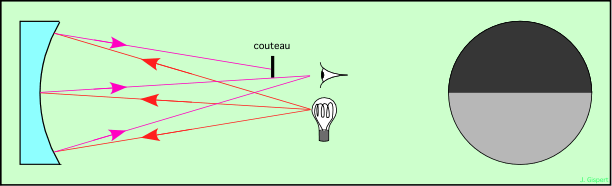

Sur le schéma ci-dessus, le couteau est figuré en avant du centre de courbure. Lorsque le couteau descend, il intercepte d’abord les rayons venant du haut, et le miroir s’obscurcit en partie. A mesure que le couteau descend l’ombre se propage sur le miroir. L’ombre vient du**même côté** que le couteau. Faites un schéma semblable avec le couteau en arrière du centre de courbure, et vous constaterez que l’obscurcissement se fait alors par le bas (parce que les rayons se croisent au centre de courbure), c’est-à-dire qu’elle se déplace en **sens inverse** du couteau. Le côté d’où vient l’ombre nous indique donc si le couteau est en avant ou en arrière du centre de courbure. Il suffit de le déplacer d’avant en arrière jusqu’à produire l’extinction brutale de toute la surface. On est alors sûr que le couteau est au centre de courbure, et sa distance au miroir nous permet de mesurer précisément la focale (qui est la [moitié du rayon de la sphère](../instruments/#foyer)).

Supposons maintenant qu’il y ait un défaut à la surface du miroir. Le défaut se traduit par une pente anormale, et les rayons qui y parviennent ne seront pas réfléchis vers le centre de courbure. Pour simplifier l’explication, considérons un cas fréquent, où le centre est relevé et le bord rabattu&#8239;:

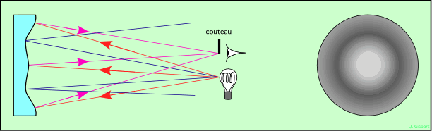

Les parties anormales du miroir font perdre des rayons, réfléchis en dehors du centre de courbure. Elles apparaissent en teinte plus sombre. Ainsi, visuellement, on peut déterminer exactement où se trouvent les défauts de réalisation du miroir, et savoir si ce sont des creux ou des bosses. Il ne reste plus qu’à les corriger… ce qui est plus facile à dire qu’à faire&#8239;! Mais l’outil de mesure est défini, sa réalisation est assez facile. En voici un exemplaire&#8239;:

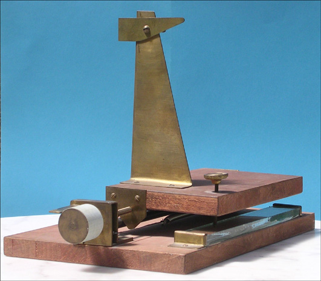

Foucaultmètre réalisé par J. Gispert, d’après des plans de J. Texereau photo J. Gispert

Sur cette photo, la source lumineuse a été retirée pour une plus grande clarté. Le foucaultmètre est constitué d’un bâti sur lequel se déplace un chariot. Le chariot est posé sur une tige métallique, sur laquelle il coulisse par deux pièces de cuivre taillées en V. Il s’appuie de l’autre côté sur le bâti, par une vis (à droite de la photo) posée sur une plaque de verre (glissement sans heurts). La vis permet d’incliner le chariot, et par suite le couteau que l’on voit au sommet de ce dernier. Sous le chariot, un ressort de rappel est visible, qui le tire vers la vis de réglage. Celle-ci est munie d’un tambour gradué (à gauche de la photo), qui permet de lire précisément le nombre fractionnaire de tours effectués.

Avec ce montage, le couteau peut être déplacé très précisément d’avant en arrière, et latéralement. L’éclairage, non présenté sur la photo, se pose sur le bâti, près du couteau. La source lumineuse est constituée d’un support muni d’une douille portant une ampoule. Celle-ci est dépolie pour une meilleure répartition de la lumière. L’ampoule est enfermée dans un cylindre métallique, dans lequel est percé un petit trou qui constituera la source pour l’observation du miroir.

On observe le futur miroir en plaçant l’œil le plus près possible du couteau. En réglant l’avancement du couteau, on le place très précisément dans le plan focal du miroir. Ensuite, par des déplacements latéraux, on vérifie la forme comme il a été indiqué plus haut.

### Retouches

Les retouches du miroir sont locales. A l’aide du foucaulmètre, on a déterminé les zones à corriger. Il reste à fabriquer un petit outil (petit disque de verre garni de poix) et à retoucher **localement** le miroir, aux endroits déterminés à l’aide du foucaultmètre. Après une séance de retouche (courte), il faut laisser refroidir le miroir, afin d’éviter toute dilatation du verre. Lorsqu’il est en équilibre thermique avec la pièce (24 h plus tard), on peut le vérifier au foucaultmètre (il faut établir un bulletin de contrôle). On détermine la suite du travail à faire, et on la fait immédiatement. On recommence ce cycle tant que le miroir n’est pas satisfaisant.

Le travail de retouche est donc à la fois délicat et long. Il faut beaucoup de patience pour tailler son propre miroir… Au fil des jours, on arrivera à lui donner la forme parfaite.

Pour qu’un miroir soit optiquement bon, il faut que les défauts qui subsistent à sa surface soient petits devant la longueur d’onde de la lumière. On note λ celle-ci, et on indique la qualité du miroir en donnant la taille, en fraction de longueur d’onde, du plus grand défaut du miroir.

Vous pourrez constater, si vous regardez des catalogues de miroirs proposés par certains magasins, que les miroirs vendus sont à λ / 6 ou λ / 8. Ceci signifie que le plus gros défaut est inférieur au 1/6e (resp. 1/8e) de la longueur d’onde de la lumière observée (visible).

Un amateur soigneux et patient peut réaliser ses miroirs à mieux que λ / 10.

### Aluminiure

Il reste à rendre le miroir réfléchissant, en déposant à sa surface une fine couche d’aluminium.

Cette opération nécessite un appareillage relativement complexe, pompe à vide assez poussé (10-5 mm de Hg), et générateur de courant assez intense pour vaporiser l’aluminium. On trouve un tel matériel dans certains laboratoires, mais c’est sans doute là le point le plus aléatoire de la fabrication d’un miroir.

On suspend le miroir de verre dans une cloche à vide, face utile en-dessous. Au dessous du miroir, on place de petits morceaux d’aluminium dans un creuset électrique. Une fois le vide réalisé dans la cuve, on envoie un fort courant pour chauffer le creuset à 1.300°, ce qui a pour effet de vaporiser l’aluminium. Les atomes d’aluminium forment une atmosphère dans la cuve, et vont se déposer sur toutes les surfaces froides. Le verre du miroir est ainsi recouvert d’aluminium, mais les parois de la cloche également. Si celle-ci est en verre, elle devient brusquement miroir elle-même et renvoie l’image de la pièce où l’on se trouve. Les irrégularités du dépôt ne dépassent pas 1 %.

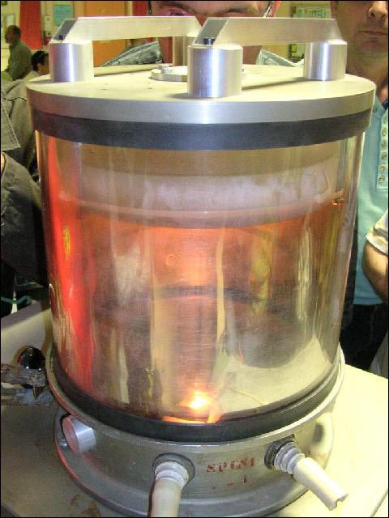

Cuve à vide contenant le miroir (en haut)&#8239;; l’aluminium est vaporisé en bas photo J. Gispert

Cette photo montre un miroir en cours d’aluminiure. Le miroir est accroché en haut de la cuve, ce qui évite la chute de gouttes d’aluminium, qui se produisent parfois si la résistance est au-dessus du miroir. La pompe à vide est dans le bâti qui supporte la cuve. L’aluminium est en cours d’évaporation, et la paroi de la cuve commence à réfléchir la lumière de la pièce.

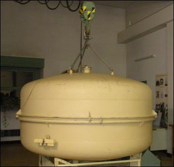

Cloche à vide, Observatoire de Haute Provence photo J. Gispert

La photo ci-dessus montre la cloche à vide pour l’aluminiure du miroir du télescope 193 cm. Elle est située juste en-dessous de la coupole. Lorsque le remplacement de l’aluminium est nécessaire, le miroir est sorti de son barillet, descendu au sous-sol, et placé, après nettoyage, dans cette cuve pour réaluminiure.

### Méthode

Si vous envisagez de tailler un miroir, il est bien préférable, avant toute chose, de prendre contact avec un club d’astronomes amateurs dans votre région, qui pourra -on peut l’espérer- vous guider. Les explications ci-dessus ont pour but de faire comprendre comment on peut tailler un miroir et le contrôler, mais sont bien trop concises pour en permettre la réalisation sans autres données.

Il existe un excellent ouvrage sur ce sujet, intitulé *la construction du télescope d’amateur 2* (dit CTA2), écrit par Jean Texereau. Mais ce livre est maintenant très ancien, sur certains points dépassé, et de toutes façons non réédité. Avec un peu de chance, vous pouvez le trouver chez un antiquaire… Cependant, une [version informatique](http://astrosurf.com/texereau/) est accessible sur le site d’Astrosurf.

Pour les grands miroirs, trop lourds pour être manipulés à la main, une machine à tailler est indispensable. Mais elle pose un problème majeur&#8239;: par construction, elle présente des erreurs périodiques, qui vont se traduire par des défauts sur le miroir. A la main, on ne fait jamais deux fois le même geste, exactement. Mais on sait aujourd’hui fabriquer des machines à polir de grande qualité. Il ne serait en effet pas possible de tailler et polir à la main de grands miroirs.

Les télescopes étant totalement exempt d’aberration chromatique, on peut fabriquer des miroirs beaucoup plus ouverts que les lunettes. Ces dernières sont couramment à F/D = 15 ou 20, obligeant à construire des tubes démesurément longs. Les télescopes sont ouverts à moins de 6. Celui du Mont Palomar est à 3,3&#8239;! Ceci permet de diminuer la longueur du tube, donc son poids, et autorise donc de faire des instruments de plus grand diamètre. Mais la contrepartie est un champ exempt de coma de seulement 10'.

Toutefois, il existe des formules optiques plus complexes donnant un champ plus important&#8239;: les télescopes photographiques de [Schmidt](../instruments/#TélesSchmi) (une lame de fermeture complexe et un miroir sphérique), les [Maksutov](../instruments/#TélesMaksu) (un ménisque sphérique de fermeture et un miroir sphérique), les Ritchey-Chrétien (des miroirs hyperboliques).
