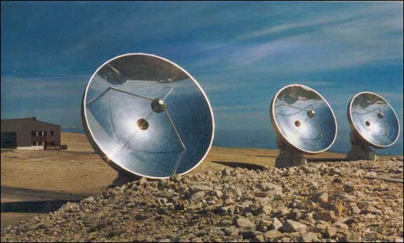
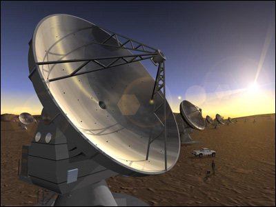
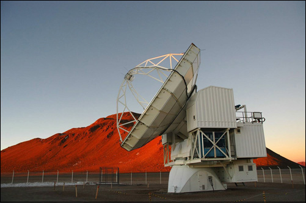
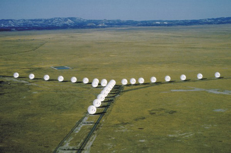
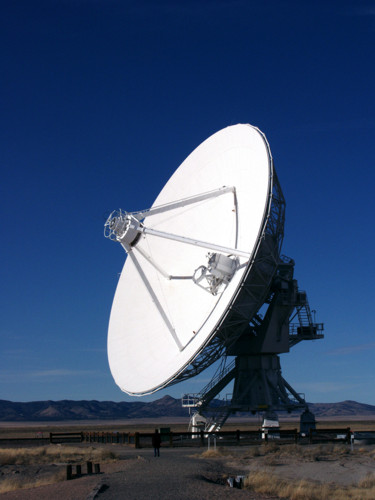
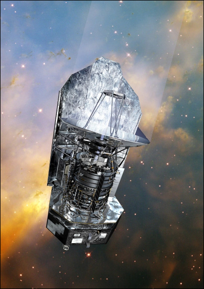

import Encadre from '../../../components/chapitre/Encadre.astro';

## Buts de l’astronomie millimétrique

Dans la conquête du domaine électromagnétique, l’astronomie millimétrique est assez récente. Elle se trouve à la limite entre la radio proprement dite (micro-ondes), et les ondes infrarouges. Elle s’adresse à des objets assez froids, et concerne donc la formation de nombreux objets&#8239;: planètes, étoiles (nuages en effondrement), galaxies, amas de galaxies, et même la chimie des nombreuses molécules présentes dans les nuages qui peuplent l’espace.

Comme pour l’astronomie optique, on peut envisager des observations au sol, ou dans l’espace. Pour observer du sol, il faut considérer l’absorption de l’atmosphère&#8239;: la vapeur d’eau, abondante sur Terre, possède des bandes d’absorption juste dans le domaine de longueur d’onde considéré. Aussi, il faut se placer dans un endroit où la vapeur d’eau est le moins abondante. C’est le cas des déserts. Mais même au Sahara, il reste un peu de vapeur dans l’atmosphère. Pour s’en affranchir, il est bon de s’installer en altitude.

La longueur d’onde considérée étant plus longue qu’en optique, il faut de grands instruments pour avoir un pouvoir séparateur correct. On doit donc envisager de grandes paraboles, un peu comme en radioastronomie. Mais la différence tient dans la réalisation de surface&#8239;: les défauts admissibles sur le miroir doivent être, dans tous les cas, plus petits que le dixième de la longueur d’onde. Dans le cas de la radioastronomie, cette contrainte est assez facile à réaliser&#8239;; mais ici, il faut construire une grande parabole à mieux que le dixième de millimètre d’erreur. Ce qui représente un problème important pour de grands miroirs. C’est pourquoi on n’a pas encore construit d’antenne de plus de 15 m de diamètre.

Comme en radioastronomie (et même en astronomie optique), on se tourne donc vers les interféromètres. Les techniques nécessaires sont intermédiaires entre celles de l’optique et celles de la radioastronomie.

Enfin, il est évident que l’observation spatiale serait, comme en optique, libérée de tous les défauts de l’atmosphère. Mais là aussi, il faut tenir compte des limites technologiques, pour construire le miroir, et pour le lancer dans l’espace.

Dans ce qui suit, nous allons voir les différents instruments existant ou en cours de développement.

## Le Pico Veleta (au sol)

L’*IRAM* (***I**nstitut de **RA**dioastronomie **M**illimétrique*) a été fondé en 1979&#8239;; c’est une coopération entre la France, l’Espagne et l’Allemagne. L’IRAM s’est doté de deux instruments, celui du Pico Veleta en Espagne, et celui du Plateau de Bure à 2.552 m d’altitude, dans les Alpes françaises, près de Gap.

Le Pico Veleta est doté d’une antenne unique de 30 m de diamètre, observant dans la gamme de 0,8 à 3 mm (qui correspond à des fréquences de 80 à 350 GHz). Cet instrument a découvert plus de 20 molécules dans le milieu interstellaire, dans des comètes, et dans les atmosphères de certaines planètes ou satellites. L’observation, en particulier, de la chute de la comète Shoemaker-Levy 9 sur Jupiter, a montré que des molécules d’oxyde de carbone CO, d’acide cyanhydrique HCN, et de sulfure de carbone CS, ont été formées au moment de l’impact.

## L’interféromètre du Plateau de Bure (au sol)

L’instrument du Plateau de Bure est un interféromètre. Commencé en 1985, les premières observations de l’interféromètre ont été effectuées en 1988. Il comprend actuellement 6 antennes de 15 m de diamètre chacune, montées sur rails, ce qui permet d’ajuster leur distance pour modifier le pouvoir séparateur. La distance maximale sur l’axe est/ouest est de 760 m, et de 368 m sur l’axe nord/sud. Les observations se font à 1,3 mm de longueur d’onde, ou 230 GHz de fréquence.

*Trois antennes du Plateau de Bure photo IRAM*

L’accès au plateau se faisait par un téléphérique, qui a été accidenté en 1999. La malchance continuant, un hélicoptère de liaison s’est écrasé quelques mois après. Total&#8239;: 25 morts. L’astronomie peut parfois être dangeureuse, comme toute activité humaine…

Récemment, une expérience impressionante a été réussie entre ces deux instruments (celui du Pico Veleta, et une seule antenne au Plateau de Bure). A une distance de 1.150 km, il n’est pas question de faire entre eux de l’interférométrie directe. Mais il est possible d’enregistrer les signaux reçus par chacun, en même temps que des signaux horaires très précis fournis par des horloges atomiques. Plus tard, ces signaux seront combinés par un ordinateur pour simuler les interférences, et donc obtenir une résolution correspondant à la distance entre les deux antennes (et la longueur d’onde observée). Ces expériences ont été menées à deux longueurs d’ondes différentes&#8239;: 1,4 mm (0,25 milliarcseconde), et 3 mm (0,5 milliarcseconde).

Les cibles ont été des quasars, et la source Sagittarius A (proche du centre de la Voie Lactée). L’observation des quasars permettra de préciser leur structure interne, et celle de Sagittarius A devrait discriminer entre certains modèles d’acrétion par un trou noir supposé être au centre de la Galaxie.

Ces observations, effectuées en octobre 1994, ont été les premières en interférométrie dans le domaine millimétrique.

Dans la gamme 3 mm, aucun autre télescope n’atteint les performances de ceux de l’IRAM.

## JCMT James Clerck Maxwell Telescope (au sol)

Le JCMT est un télescope millimétrique, de 15 mètres de diamètre, observant dans la gamme de 0,35 à 2 mm. Il est en monture alt-azimutale, et comprend un système d’optique active pour compenser les déformations de surface en fonction de la gravité ou de la température. Le faisceau est accessible par un foyer Cassegrain ou par un foyer Nasmyth.

Il a été construit par le Royaume Uni, le Canada et les Pays Bas. Il est installé près du sommet du Mauna Kea à Hawaï, à 4.092 m d’altitude.

## ALMA

*ALMA* (c’est le sigle ***A**tacama **L**arge **M**illimeter **A**rray*, mais le mot *alma* signifie *âme* en espagnol) observe dans la fenêtre millimétrique&#8239;; il est installé dans le désert d’Atacama, et utilise un réseau d’antennes. En fait, le nom dit tout&#8239;! Quoi que…

Tout d’abord, qu’est-ce que la fenêtre millimétrique&#8239;? A strictement parler, il s’agit d’ondes radio&#8239;; mais comme les ondes électromagnétiques sont une(s) et indivisible(s), il n’existe pas de barrière physique entre les différents domaines. Les barrières sont seulement définies par les récepteurs utilisés. Ainsi, le domaine d’ALMA s’étend de 9,6 à 0,3 mm, c’est-à-dire des ondes millimétriques à proprement parler, à la frontière de l’infra-rouge (qu’on place un peu arbitrairement vers 1 mm).

Reportons-nous au rayonnement du corps noir, comme d’habitude. Un objet de température T rayonne le maximum de son énergie à la longueur d’onde λ. Inversement, si on connait λ, on retrouve la température T, c’est ce qui permet de dire qu’ALMA va observer des objets dont la température est comprise entre 3 et 100 K (entre -270° et -170° C, correspondant à des ondes de 30 à 950 GHz). C’est l’Univers froid qui est sa cible, donc&#8239;:

- étude du fond cosmologique à 3 K&#8239;;
- imagerie à 0,1″ de résolution&#8239;;
- étude des nuages de gaz moléculaires (10 K), à partir desquels se forment les étoiles et leurs planètes&#8239;; donc étude de la formation (actuelle) de ces objets, mais aussi des molécules organiques présentes dans le nuage&#8239;;
- détection des raies d’émission de CO et de CII (Carbone ionisé) dans une galaxie normale (Voie Lactée) jusqu’à un redshift de z = 3 en moins de 24 heures d’observation&#8239;;
- imagerie des mouvements de gaz dans les protoétoiles, et dans les disques protoplanétaires autour de jeunes étoiles de type solaire, à des distances atteignant 150 pc (distance du nuage d’Ophiucus par exemple). Ceci permettra d’étudier leur composition chimique, les phénomènes physiques qui s’y déroulent, et leur champ magnétique. Mieux, la finesse des images permettra d’observer les lacunes gravitationnelles produites par la présence de planètes en formation à l’intérieur&#8239;;
- les galaxies (toutes les températures s’y rencontrent)&#8239;;
- les objets poussiéreux lointains, dont le rayonnement tombe dans ce domaine par décalage spectral. Le rayonnement qu’ils ont émis, par exemple dans le visible, se trouve reçu dans le domaine millimétrique. Ainsi, ALMA pourra étudier la formation des premières galaxies, jusqu’à un décalage spectral de 10&#8239;;
- les molécules interstellaires&#8239;;
- les indices d’une vie éventuelle.

Pour réaliser un tel instrument, il faut d’abord s’assurer qu’il reçoive des ondes&#8239;! Or son domaine est en-dehors de la fenêtre qui va du visible au proche infra-rouge. Mais en altitude, la fenêtre s’ouvre, par manque d’air absorbant (vapeur d’eau surtout). Pour cela, ALMA est installé sur le (plateau de) *Llano de Chajnantor*, à une quarantaine de kilomètres d’Antofagasta au Chili. A 5.000 m d’altitude, ce site bénéficie d’une très grande transparence de l’atmosphère, et d’un air très sec&#8239;: c’est un désert. De plus, ce plateau mérite son nom, il est très plat sur une grande étendue, permettant d’installer toutes les antennes du réseau. Il doit abriter également deux autres instruments&#8239;: *CBI* (*Cosmic Background Imager*) et *APEX*.

*ALMA en images de synthèse photo ESO/H.Zodet*

ALMA est un très grand interféromètre, atteignant cette excellente résolution, grâce à une ligne de base de 14 km. Il comprend 64 antennes de 12 m de diamètre, financées à égalité par l’ESO et la NFS (USA), plus 8 antennes de 8 m ajoutées par le Japon.

Son installation sera terminée en 2010. Cet instrument sera alors, et pour assez longtemps, le plus grand et le plus précis de tous ceux qui seront consacrés aux objets froids&#8239;: il réunira la meilleure sensibilité, le meilleur pouvoir séparateur, et la meilleure couverture en fréquence. Les difficultés techniques sont nombreuses, car pour observer les micro-ondes, il faut refroidir le récepteur de chaque antenne à très basse température (quelques degrés Kelvin). Le signal ainsi reçu sera amplifié et numérisé, puis expédié par des fibres optiques vers le centre de calcul. Un ordinateur très puissant est nécessaire pour traiter cette masse d’information. Il devrait atteindre 16 teraflops (16.000 milliards d’instructions par seconde).

De plus, les détecteurs sont capable d’analyser un signal presque à la limite quantique.

## APEX (au sol)

APEX (*Atacama Pathfinder EXperiment*) est un télescope millimétrique, dont le miroir mesure 12 m de diamètre. Il est installé à côté d’ALMA.

*Le télescope APEX photo Andreas Lundgren*

La photo montre le télescope, avec les deux cabines accrochées juste en-dessous de l’antenne, où se trouvent les deux foyers Nasmyth. On voit, au bout des supports, le miroir secondaire qui renvoie le faisceau vers le trou percé dans le miroir principal. Enfin, derrière le miroir se trouve le foyer Cassegrain. Bien que de forme surprenante, cet instrument est bien un télescope&#8239;!

## VLA (au sol)

Vue du réseau VLA Image courtesy of NRAO/AUI

Image courtesy of NRAO/AUI and David Andrew Gilder

Le *Very Large Array*, ou *VLA*, est situé dans la plaine de San Augustin, à proximité de Socorro, au Nouveau-Mexique, à 2.124 m d’altitude. C’est un radiotélescope formé d’un réseau de 27 antennes paraboliques orientables identiques de 25 m de diamètre chacune, pesant 230 tonnes, mobiles sur des voies de chemin de fer disposées selon un tracé formant un immense Y (deux branches de 21 km et un pied de 19 km).

Chaque antenne possède son propre récepteur, dont les signaux sont transmis à un site central où ils sont combinés&#8239;: l’image haute résolution ainsi obtenue équivaut à celle d’un très grand radiotélescope, dont le diamètre serait égal à la distance maximale séparant les antennes. La meilleure résolution angulaire atteinte est d’environ 0,04 seconde d’arc (configuration 36 km à 43 GHz).

Le VLA peut se constituer en 4 configurations différentes. La configuration visible sur la photo de gauche est la plus petite, qui ne fait qu’un kilomètre d’extension. Les autres configurationsfont 3,6 km, 10 km et enfin 36 km.

Le VLA est en cours de rénovation. Il va devenir le EVLA (Expanded Very Large Array). Les antennes vont être améliorées, et un nouveau corrélateur (ordinateur qui mélange les données pour simuler l’interférométrie) est en cours d’installation.

## Télescope Herschell (dans l’espace)

L’Agence Spatiale Européenne (ESA) a réalisé un télescope spatial destiné à observer depuis l’infrarouge lointain jusqu’au domaine millimétrique, c’est à dire de 60 à 670 µm. C’est le plus grand télescope spatial dans ce domaine. Le projet était initialement dénommé FIRST (*Far InfraRed and Sub-millimetre Telescope*), puis a été renommé Herschell.

Le lancement, initialement prévu pour le mois de juillet 2008, a été réalisé finalement le 14 mai 2009. C’est une fusée Ariane V qui l’a envoyé dans l’espace, conjointement avec le satellite Planck. Herschell a été immédiatement propulsé vers le point de Lagrange L2, à 1,5 millions de km de la Terre (orbite de Lissajous). Il y est parvenu le 15 juillet. La phase opérationnelle a commencé dès le 21 juillet.

*Télescope spatial Européen Herschell ESA/ AOES Medialab&#8239;; image de fond HST (NASA/ESA/STScI)*

Le poids total du télescope est de 3.300 kg. Il doit fonctionner jusqu’aux années 2011-2012. C’est le plus grand télescope spatial contruit à ce jour, avec un miroir de 3,5 m. Sa taille est limitée par les possibilités de lancement.

Ce miroir est particulier, car il est réalisé en *carbure de silicium*. Le choix de ce matériau a été dicté par les contraintes que le miroir doit subir au cours de sa vie&#8239;: des vibrations violentes au moment du lancement, une accélération de 10 g, ensuite une température de -200° C. Et malgré cela, le miroir doit conserver ses qualités optiques parfaites. De plus, une autre contrainte de lancement concerne le poids&#8239;: or le carbure de silicium permet de réaliser un miroir de 280 kg, alors qu’il peserait 1,5 tonne s’il était en verre (moins du 1/5e du poids du verre). Le carbure de silicium est très rigide, léger, et présente un très faible coefficient de dilatation et une faible conductivité thermique. Toutes ces qualités l’ont fait choisir, malgré les nombreuses difficultés technologiques.

En effet, on ne sait pas aujourd’hui couler un disque de carbure de silicium de la taille du miroir. Tout ce qu’on sait faire, ce sont des bandes. Alors, la solution retenue a été de réaliser 12 pétales, et de les souder pour obtenir le disque. Mais souder du carbure de silicium n’est pas une mince affaire. Il a fallu construire un four spécial, permettant de monter à 1.400° C, et développer toute la technologie nécessaire.

Ensuite, le miroir a été poli, puis testé dans des conditions mécaniques proches de celles qu’il devait subir lors du lancement. Les tests thermiques comprenaient plusieurs refroidissements à -200°.

Le but principal de ce télescope est de découvrir comment se sont formées les premières (*first*) galaxies, ce qu’on ignore totalement aujourd’hui. Pour les observer au moment de leur formation, il faut regarder loin (dans le temps, donc dans l’espace). Par conséquent, le décalage vers le rouge de ces galaxies les amène dans la région spectrale accessible au télescope.

Mais le télescope observe également les objets froids proches, donc en particulier les nuages de gaz et de poussières où se forment les étoiles (et les molécules qui s’y trouvent), et les disques d’acrétion dans lesquels se forment des planètes. Il peut également observer les comètes et leurs atmosphères (transitoires), ainsi que les planètes.

Pour observer un objet froid, qui émet dans l’infra-rouge lointain ou les micro-ondes, il ne faut pas que l’instrument lui-même perturbe la mesure. Pour cela, il doit être plus froid encore… Il est nécessaire de refroidir à 1,6 K toutes les parties essentielles du télescope. Pour cela, le satellite Herschel emportait un réservoir de 2.400 litres d’hélium liquide superfluide qui, en s’évaporant lentement, refroidit l’appareil. Ce système cryogénique a été réalisé par la Société Air Liquide à Grenoble.

## Résultats de Herschell

Les résultats de cette expérience sont importants dans plusieurs domaines&#8239;:

- Le résultat majeur est la découverte d’eau abondante dans les zones de formation d’étoiles. Le satellite est capable de détecter l’eau sous forme gazeuse. Il en a trouvé dans le cœur des nuages en cours d’effondrement en étoile, dans les disques protoplanétaires, et il a observé d’immenses réservoirs d’eau gelée dans des comètes autour d’étoiles déjà formées. Autour de la proto-étoile W43-MM1, il a trouvé 0,11 M d’eau, soit 150 millions de fois celle contenue dans nos océans (1,4 milliards de km3).
- Dans la même étoile, les mouvements de la vapeur d’eau témoignent d’une turbulence supersonique. La vitesse des gaz augmente avec la distance croissante à l’étoile. Ceci est une contrainte importante pour choisir parmi les modèles de formation des étoiles massives.
- Lors de la formation d’une étoile, l’eau joue un rôle de refroidissement dans le disque, dont l’importance se mesure aujourd’hui par l’abondance trouvée. Ce refroidissement est important dans les étoiles de grande masse (plus de 8 M).
- L’eau dans un disque protoplanétaire ne peut être stable (solide) qu’à une distance suffisante du centre, où la température est assez basse. C’est là que se forment les comètes qui plus tard, par le jeu des perturbations, viendront apporter l’eau aux planètes plus proches de leur étoile. Cette étude nous donne donc des indications sur ce qui a pu se passer dans notre système, lors de sa formation. Herschell a détecté, dans le disque protoplanétaire *TW Hydræ* (étoile T Tauri âgée de 10 millions d’années, d’une masse de 0,6 M, à 175 AL de nous), de la vapeur d’eau à une température inférieure à 100 K, qui pourrait se condenser en comètes. Elle se trouve dans une zone étroite où la condendation en glace et l’évaporation sont en équilibre (l’évaporation est due à l’apport d’énergie par des photons issus de l’étoile). La quantité détectée correspond à 0,5 % de celle qui constitue les océans terrestres. Comme il ne s’agit que de la fraction qui se trouve en équilibre condensation-évaporation, elle dévoile une quantité totale correspondant à des centaines de fois l’eau de nos océans.
- Le rapport D/H
- Enfin, les mouvements de l’eau dans l’environnement des étoiles en formation apportent des informations très précieuses sur la turbulence qui y règne, donc sur les phénomènes physiques qui la gouvernent.
- Combinés avec ceux du satellite américain Spitzer, les résultats de Herschell ont montré des variations de luminosité aussi rapides que quelques semaines sur des disques protostellaires. On s’attendait à des périodicités de quelques siècles au moins, et ceci montre une turbulence très importante dans cet environnement. La naissance d’une étoile est tout sauf un processus calme&#8239;!
